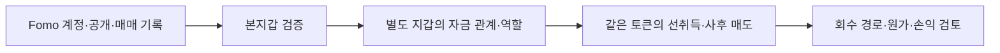

# Fomo Top Trader Research

**Fomo 트레이더와 연결된 별도 지갑이 공개 전에 토큰을 매수하고, 공개 뒤 매도하는지 조사하는 온체인 연구 프로젝트입니다.**

자료 기준: **2026년 10월 10일** · 초기 Top10 · 과거 60일 · 이벤트 당시 유통 시총 **100만 달러 이하**

[종합 연구 보고서](docs/pre-ppt-linked-wallet-research-report-ko.md) · [현재 실행 계획](docs/implementation-plan.md) · [에이전트 지침](AGENTS.md)

## 1. 무엇을 조사하나

핵심 가설은 다음과 같습니다.

> Fomo 작성자와 연결된 별도 지갑이 먼저 매수·보유하고, 작성자가 THESIS를 게시한 뒤 같은 별도 지갑에서 매도하며, 자금을 본지갑이나 거래소 입금 주소로 회수할 수 있다.

THESIS는 Fomo에 게시된 토큰 관련 투자 의견입니다. 이 연구에서는 게시 시각을 실제 온체인 매수·매도 시각과 대조합니다.

| 조사 질문 | 확인할 근거 |
|---|---|
| Fomo 계정이 사용하는 지갑은 무엇인가? | Fomo 이벤트와 성공한 온체인 거래의 대응 |
| 별도 지갑과 실제 자금 관계가 있는가? | 일반 자금 송금, 토큰 공급·반환, 개별 브리지 주문 |
| 별도 지갑이 공개 전에 매수·보유했는가? | 실제 지출, 토큰 순증가, 서명자, 게시 시점 재고 |
| 공개 뒤 같은 지갑에서 팔았는가? | 같은 토큰의 매도와 실제 수령 자산 |
| 자금은 어디로 회수됐는가? | 후속 전송과 정확한 체인·CEX 입금 주소의 겹침 |
| 이익은 얼마인가? | 취득 원가, 추가 매수, 수수료, 잔여 재고, 매도 수령액 |

**연결된 주소라고 해서 작성자의 뒷지갑으로 확정하지 않습니다.** 에어드롭·추천 보상·LP·공용 브리지·거래소 집금 주소도 비슷한 연결을 만들 수 있어 역할을 함께 확인합니다.

### 조사 범위

- **계정:** 처음 고정한 Top10 명단. Top100 확대는 보류했습니다. [명단과 우선순위](docs/top10-investigation-priorities.md)
- **기간:** `2026-08-08T04:43:41Z ≤ t < 2026-10-07T04:43:41Z`. 이후 활동은 별도 기록합니다.
- **토큰:** THESIS/CALL 또는 실제 매수 당시 유통 시총이 100만 달러 이하인 사건을 선별합니다. 현재 시총·FDV는 이를 대신하지 않습니다.
- **THESIS가 없는 매수:** 카피 트레이딩 가능성을 고려해 실제 Fomo 매수보다 앞선 연결 지갑의 취득도 조사합니다.

## 2. 어떻게 검증하나



| 도구 | 용도 |
|---|---|
| **Fomo REST API** | 리더보드, BUY·SELL·THESIS 시각과 과거 기록 수집 |
| **Solana·EVM RPC / Nodit 인덱스** | 거래 원문, 토큰·결제 자산 증감, 실제 전송 확인 |
| **Arkham·Etherscan 계열 탐색기** | 거래·주소 역할 확인. 거래소 라벨은 제공자의 주장으로 보관 |
| **Bridge API / Relay 주문** | 브리지 출발 거래와 실제 목적지 대응 |
| **BigQuery API·CLI** | 범위를 제한한 과거 이력 조회. 새 대량 조회는 시총 선별 후 비용 추정·상한 적용 |
| **SQLite·Python** | 원문, 정확 수량·UTC, 지갑 연결, 재고, 미확보 구간 저장·분석 |

Fomo의 신규 수집은 REST 방식입니다. WebSocket 수집과 Dune은 현재 운영에서 제외했습니다. 분석은 `gpt-6-luna` / 추론 `max` 작업자 최대 5개에 배정하고, 본체가 근거와 최종 판단을 검토합니다.

## 3. 현재 진행도

**연결 지갑의 선취득·사후 매도 패턴은 확보했습니다. 동일 소유·저시총 적격·실현 수익까지 입증한 완결 사례는 아직 0건입니다.**

| 단계 | 상태 | 지금까지 확인한 내용 |
|---|---|---|
| Fomo 기록·저장 환경 | 구축, 수집 진행 중 | SQLite와 REST 수집 경로 확보. 60일 전체 이력은 미완료 |
| Fomo 본지갑 검증 | 일부 완료 | 이벤트·실제 거래 대응으로 지갑 검증 |
| 별도 지갑 연결 | 사례 확보 | 실제 공급·송금·반환과 브리지 관계 |
| 선취득 → 공개 → 같은 지갑 매도 | 핵심 사례 확보 | Werey/PURR, Solstice/DOGINU |
| 이벤트 당시 유통 시총 ≤ $1M | 핵심 두 사례 보류 | 역사 가격·공급 대용치는 있으나 적격 근거가 부족 |
| 같은 개인 CEX 입금 주소 | 미확정 | 거래소 라벨 경로는 확인. 공용 집금·핫월렛과 구분 필요 |
| 원가·실현 수익·작성자 소유 | 미확정 | 매도 수령액은 확인했으나 비용·취득 대가·소유 귀속이 남음 |

### 핵심 관측 사례

| 사례 | 확인한 거래 구조 | 남은 공백 |
|---|---|---|
| **Werey / PURR** | 본지갑→F1bNo 8,000 USDC, 역방향 일반 송금 200 USDC. 별도 지갑의 게시 전 재고가 추가 취득분과 함께 게시 후 전량 매도됨. 사후 매도 수령 **15,196.643524 USDC** | 같은 소유자, 역사 시총, 특정 매도대금의 CEX 귀속 |
| **Solstice / DOGINU** | 공통 공급자가 본지갑·5NS 양쪽에 토큰 공급. 5NS 자체 매수 4건 후 보유, THESIS **110초 뒤**부터 6매도·**12.041207311 SOL** 수령 | 공급 물량의 원가, 5NS 소유, 출금 이후 개인 CEX 목적지 |

위 금액은 **매도 수령액**이며 확정 이익이 아닙니다. 정확한 주소·시간축·거래 링크와 STONKCATS 보상, CALI LP, 공용 집금 등 비교 사례는 [종합 보고서](docs/pre-ppt-linked-wallet-research-report-ko.md)에 있습니다.

로컬 DB에는 Fomo 이벤트 **1,338개**, 온체인 거래 **4,569개**, 이벤트·거래 대응 **73개**, 추적 연결 **646개**, 지갑 검증 레코드 **11개**가 저장돼 있습니다. 일부 보조 조사도 포함된 수치이며, 모든 계정·체인의 60일 수집 완료를 뜻하지 않습니다.

**최근 보강:** [두 사례 후속 보고서](docs/two-case-supplier-role-and-cap-followup-ko.md)에서 DOGINU 공급자의 시장 매수·두 주소 분배와 Werey의 일반 자금 송금을 독립 RPC로 확인했습니다. 두 토큰의 수수료 보상 설정도 점검했으며, 역사 시총·동일 소유·개인 CEX 목적지 판정은 보류입니다.

## 4. 연구·테스트 환경 구성

### 필요한 환경

| 항목 | 필요 조건 |
|---|---|
| Python | 3.9 이상. 현재 코드는 표준 라이브러리를 사용하며 필수 외부 패키지는 없음 |
| SQLite | Python 내장 `sqlite3` 사용 |
| Fomo API 키 | 외부 Fomo 기록 수집 시 필요 |
| 체인 RPC | 해당 체인 거래 검증 시 필요. Solana의 확장 이력 메서드는 제공자·플랜 지원 확인 필요 |
| Google Cloud CLI `bq` | BigQuery 조회를 실행할 때만 필요. 로컬 인증·조회 프로젝트 사용 |
| Bridge API | 브리지 분석 시 별도 서버 필요. 기존 로컬 주소는 `http://127.0.0.1:8080` |

### ① 새 checkout 준비

```sh
git clone https://github.com/nogie-dev/fomo-top-trader-research.git
cd fomo-top-trader-research
cp .env.example .env
```

기본 CLI는 `FOMO_API_KEY`와 `SOLANA_RPC_URL`을 프로세스 환경변수 또는 `.env`에서 읽습니다. EVM 검증·BigQuery·Bridge는 도구별 설정을 사용하므로 [데이터 공급원](docs/data-sources.md)을 참고합니다. `.env.example`의 `DUNE_API_KEY`는 현재 작업에 필요하지 않습니다.

**Git에는 코드·정책·보고서만 포함됩니다. 기존 SQLite와 수집 원문은 로컬 파일이므로 새 checkout에 자동으로 제공되지 않습니다.**

### ② 외부 요청 없이 준비 확인

```sh
PYTHONPATH=src python3 -m fomo_research --help
PYTHONPATH=src python3 -m fomo_research init-db --database data/research/setup-check.sqlite3
PYTHONPATH=src python3 -m fomo_research status --database data/research/setup-check.sqlite3
```

준비 확인용 DB에서 명령과 스키마를 확인하는 절차입니다. 실제 API 수집·RPC 검증·연구 결과 재현까지 검증하는 절차는 아닙니다. 기본 연구 DB 경로는 `data/research/fomo.sqlite3`입니다.

### ③ 외부 수집 명령

```sh
PYTHONPATH=src python3 -m fomo_research snapshot --period 30d --limit 50
PYTHONPATH=src python3 -m fomo_research sync-alerts --user-id "FOMO_USER_ID" --since 2026-08-08T04:43:41Z --max-pages 1
```

`FOMO_USER_ID`는 [고정 조사 명단](docs/top10-investigation-focus.json)의 실제 ID로 바꿉니다. 신규 snapshot이 있어도 조사 대상을 현재 순위로 바꾸지 않습니다. 후속 `sync-alerts`는 같은 사용자 checkpoint를 재사용하므로 `--since`를 생략할 수 있습니다.

외부 수집은 API 크레딧을 사용합니다. 한 페이지 수집으로 60일 회수가 완료되지는 않으며, 페이지·예산·누락 구간은 [에이전트 지침](AGENTS.md)에 따라 관리합니다. 과거 THESIS 수집 어댑터와 저장 원문 정규화는 [데이터 공급원](docs/data-sources.md), [실행 계획](docs/implementation-plan.md)을 참고합니다.

## 5. 저장소 구조

```text
README.md                  연구 개요·환경 구성·진행도
AGENTS.md                  에이전트 지침·최신 근거·재개 규칙
agents/                    작업자·검토자 지침과 작업 명세 양식
src/fomo_research/         수집·정규화·지갑 추적·분석 코드
docs/                      연구 계획·한글 사례 보고서·정책
.env.example               인증정보가 없는 설정 양식
data/research/fomo.sqlite3  기준 연구 DB          ┐
data/raw/                  수집 원문             ├ 로컬 전용 / Git 제외
.env                       실제 인증정보         ┘
```

SQLite를 기준 데이터로 사용하고 CSV는 필요할 때 내보냅니다. 원문 출처, 정확한 수량·시각, 조회 범위와 미완료 상태를 보존합니다. 저장된 완전한 캡처는 재사용합니다.

## 6. 다음 조사와 문서 안내

다음은 **Werey/PURR의 사적 자금 관계·원가 보강**, **DOGINU 매도 지갑의 개별 회수 목적지**, **최초 공개 이력·역사 유통 시총** 확인입니다. 공급·보상·서비스 주소의 연결을 구분하고, 새로운 대량 수집보다 기존 핵심 사례의 증거를 보완합니다.

| 읽을 목적 | 문서 |
|---|---|
| 현재 결과·지갑 구조·발표 준비 | [PPT 사전 종합 보고서](docs/pre-ppt-linked-wallet-research-report-ko.md) |
| Werey/PURR 자세한 근거 | [재고·매도·CEX 검토](docs/werey-funded-wallet-inventory-and-cex-review.md) |
| Solstice/DOGINU 자세한 근거 | [사례 상태와 출금 경로](docs/doginu-case-evidence-status.md) |
| 조사 재개·작업 배정 | [AGENTS.md](AGENTS.md), [실행 계획](docs/implementation-plan.md), [병렬 조사 계획](docs/parallel-investigation.md) |
| 데이터 공급원·스키마 | [공급원](docs/data-sources.md), [스키마](docs/schema.md) |
| 연구 질문의 원문 | [연구 브리프](docs/research-brief.md) |
| 이전 Top100·RZD·Yeon 결과 | [Top100](docs/top100-first-batch-review.md), [RZD](docs/rank9-cex-prebuy.md), [Yeon](docs/two-month-review.md) |

과거 문서의 수치·범위·라벨은 당시 기록입니다. 현재 판정은 종합 보고서와 최신 에이전트 지침을 우선합니다. 공개 데이터만으로 작성자의 실제 지갑 소유나 게시로 발생한 수익을 단정하지 않습니다.
