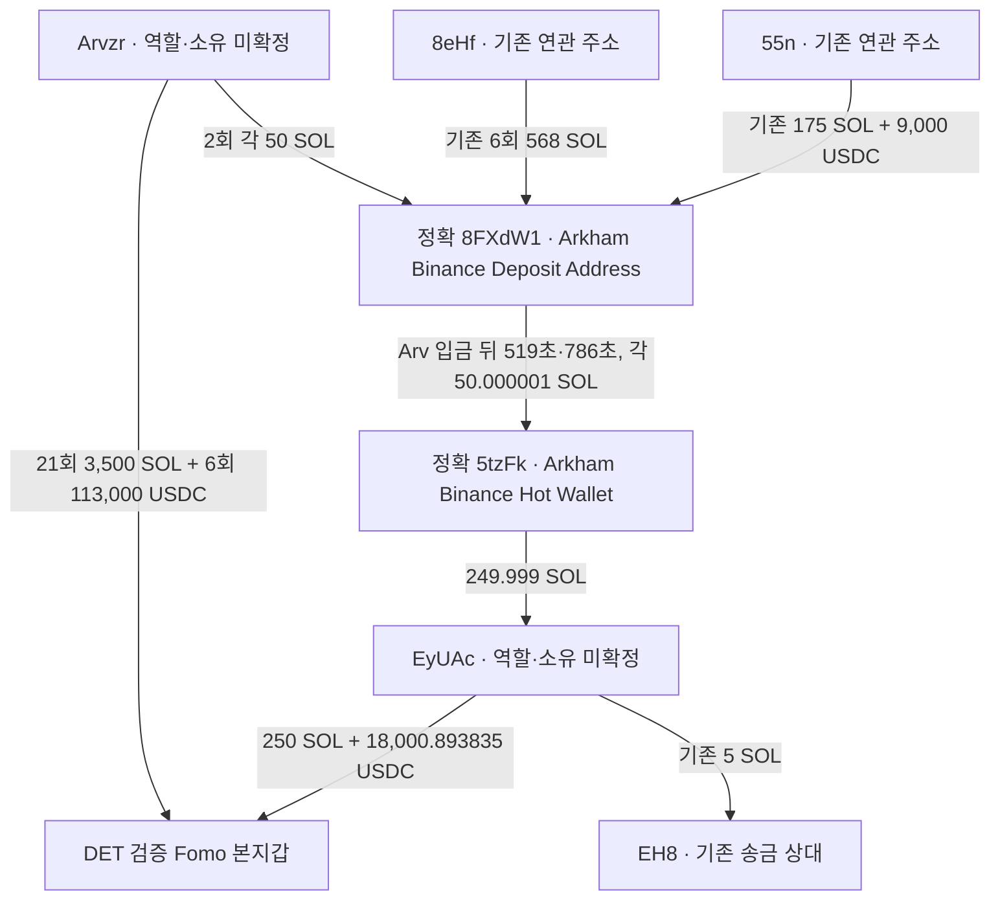

# DET: 반복 공급 주소와 정확한 거래소 입금 경로

## 결론

**Arvzr가 DET 본지갑에 반복적으로 자금을 공급하고, 기존 DET 연관 주소들과 같은 정확한 Binance 라벨 입금 주소를 사용한 연결을 확인했다.** Arvzr→DET는 고정60일에 SOL21건/3,500 SOL, USDC6건/113,000 USDC이다. 별도 EyUAc도 DET에18,000.893835 USDC와250 SOL을 보냈고 기존EH8에5 SOL을 보냈다.

이 자료는 **주소 사이의 자금 관계와 회수 경로 사례**로 사용할 수 있다. 그러나 Arv/Ey가 DET의 뒷지갑인지, 같은 거래소 고객인지, 저시총 토큰을 선행매수하고 THESIS 후 팔았는지는 확인되지 않았다. 이 두 주소의 지정 조회에서는 DET가 THESIS를 쓴 Solana 토큰6종의 mint가 전혀 나타나지 않았다. 엄격한 저시총 완결 사례는0이고 연구는 계속한다.

검증 DET 본지갑 `EC2f5DnHzuNRit1ExqghSifDbp1wgrzktsRRZCtU92MJ`, FomoUID`72460ae6-1ddc-5a56-b155-f8e187a4f388`. 원래Top10/raw141·고정2026-08-08T04:43:41Z 이상–2026-10-07T04:43:41Z 미만, 아래UTC. USDC d6의 raw정수, SOL d9의 lamports로 계산했다.

## 구조도

**DET 본지갑→8FX 직접 입금 화살표는 없다.** 보존된 지정 native/USDC 조회에서 직접 전송이 관측되지 않았으며 모든자산·계좌·평생 기록의 부재는 아니다. Arv의 두입금과8eHf/55n 기존입금을 서로의 lot으로 합치지 않는다. 같은 핫월렛의 pooled자금으로 같은고객을 추론하지 않는다.

정확주소:

- Arvzr: `ArvzrZqe4tE2KcA6bcJpiSxVEje4YAy6D7VZtTmTxNr9`
- EyUAc: `EyUAc3R6MKJXoqBetMFNK9Ca5xfxbX3pWSxBRD9RsTd4`
- 공통 입금 라벨 주소: `8FXdW1ZcR3ebEqsNNDBbZ5m39Zdif3WSYuicKrXibxwJ`
- 핫월렛 라벨 주소: `5tzFkiKscXHK5ZXCGbXZxdw7gTjjD1mBwuoFbhUvuAi9`

## 이번에 검증한 대표 거래

|UTC|경로 약칭|정확 수량|탐색기·원문|
|---|---|---:|---|
|2026-08-11T06:44:11Z|Arvzr→8FXdW|50 SOL|[거래](https://explorer.solana.com/tx/4EJ1U6G9oHficM9Bt48Yvz5hbyhEjzP8DGvhhvtEuxUJK4iKoqM7ktyEXxUThUvc3Az7pHitqb6c9uSkoEuFtFo7)·raw3583 data9|
|2026-08-11T06:52:50Z|8FXdW→5tzFk|50.000001 SOL|[거래](https://explorer.solana.com/tx/4ATvfaFTJ4hwUjQ2YSTKztTNwJTB5AYJ54L613QiGHKBMXoB7cjZJ47K5ZtcyU5toppdmjsLU6Xg4cwkfD47dmqR)·raw2551 data2|
|2026-08-30T02:39:36Z|Arvzr→8FXdW|50 SOL|[거래](https://explorer.solana.com/tx/h2CakXAPzk4gt28FM8LtcMbQUCY464Qy1e3UgH6MpErvy6akVL3AdZ3YUN8u9FxH2F5Jnd7NftJyhjL85r4A2Ai)·raw3583 data83|
|2026-08-30T02:52:42Z|8FXdW→5tzFk|50.000001 SOL|[거래](https://explorer.solana.com/tx/39oP78ruwsDfjqmxFJGS9GTzYLNR6pgcF3QT1oynbokA3LF6RSi5QkuiVQuUtyaqMHcZPQ3G2kfcyegw555Jo3TV)·raw2551 data10|
|2026-09-29T07:27:53Z|5tzFk→EyUAc|249.999 SOL|[거래](https://explorer.solana.com/tx/KNoSiRXr5vB6wnRtqwpUPWnmbEZ84jEyGNEEPjbwEkTPLB7aXbwSQwByM3kzUfZU6RrSdWAHtRdCuciG8A3ZG9M)·raw3585 data57|
|2026-09-29T07:37:57Z|EyUAc→EC2f5|250 SOL|[거래](https://explorer.solana.com/tx/NuaWy2ruMVxhn2Emy9vMQWmS4iQryjsak5WKBHvz6X1WUY7SaDS3JWKsHMZwe3GCJKJiRyAcuQUpCqUbKHcbXNK)·raw3585 data61|
|2026-09-30T02:56:36Z|Arvzr→EC2f5|8000 USDC|[거래](https://explorer.solana.com/tx/5Bkbj8cogyos7xkEMbznAgQ4Wn7GsacgQQnZQfqtFJhksH6PWB6davtTSkz2Fjc3zKoXmPfubJSYVgdMwV6SHHt9)·raw3583 data277|
|2026-10-01T07:01:06Z|EyUAc→EC2f5|9000.893835 USDC|[거래](https://explorer.solana.com/tx/2ujZYA4UDYsiv7aJi7kFpq6hdRVoQt95fJGb4RSgkPefnBSM8pUAYZuU2oRbBCeKgy28atXqrZTEZnq8xiYEUXxn)·raw3574 data286|

Arv의50SOL 두입금 뒤 같은8FX가5tz로각50.000001SOL을 보냈다. 첫쌍519초/둘째786초다. 보존원문2551data2/10이며data7/20의100/36SOL sweep은8eHf 입금분이라 이번Arv경로에 연결하지 않았다. 스윕에는 기존잔액과 별도유사주소dust가 있어 Arv물량만의 배타적귀속은 판정하지 않았다. 그dust주소는 Arv와 정확히달라 동일인/자금공급자로 승격하지 않았다.

이4건은 public finalizedRPC3589–3592가indexed transaction·meta·slot·UTC전체와일치한다. 동일exactchain/address는 실제전송으로 검증했고, `Binance Deposit Address`/`Hot Wallet` 명칭은 기존Chrome Arkhamraw2532의 provider assertion이다. 고객전용·동일고객·개인소유는unknown이다. 다른8eHf/55n 경로는 [기존 보고서](top10-repeated-exit-endpoint-review.md)를 재사용했다.

Ey는9/29 07:27:53Z에5tz로부터249.999SOL을 받고604초뒤 DET에250SOL을 보냈다. 기존Ey잔액도필요하며 CEX수령분만으로250SOL전체를 만들었다고계산하지 않았다. hotwallet배치의다른수령자 자금도Ey/DET에게귀속하지 않았다. 두전송은독립RPC3593/3594,Chrome3599로 확인했다. USDC는기존9,000(raw3560data368/public3571)과새9,000.893835(raw3574data286/public3597) 두건이다.

Arv신규8,000USDC는9/30 02:56:36Z/public3596, 기존105,000에더해총113,000이다. 직전350SOL은같은Arv가34초전DET로 보냈다. 전체21SOL전송의source서명·성공System명령·source 감소=수량+fee·DET증가=수량을각각검산했고 첫50SOL은별도public3595로대조했다. 반복성은자금관계증거이며 역할이나선행매수의도는미확정이다.

## 같은 토큰 선행매수 대조

DET 보존raw2147의 SolanaTHESIS는 STONKCATS(9/16), CODEC(9/20), HOOKED(10/1), STONK(10/3), OTC(10/4), Agency(10/5) 여섯정확mint다. Arv285행과Ey83행의메시지·역사token잔액·지시를대조해6mint 일치0을확인했다. 이조회범위에서실제같은token유상매수·게시시점재고·게시후매도는찾지못했다.

두source는고정60일·성공·`tokenAccounts=none` 지정주소query+empty/nullfooter로닫혔다(raw3583/84,3585/86). **모든ATA·수탁/위임주소·실패거래·평생활동 부재를 증명하지 않는다.** 자금만있다는이유로token시장전체를확장하지않았다. 기존EH8 STONKCATS매수는THESIS뒤이며즉시토큰반환,8eHf의paidSTONK재고는THESIS전0이라는반대근거도유지한다.

SI의세실제BUY시각 이전정확CoinGecko자료를추가조회했다(raw3587/88). HTTP200이나prices/market_caps/volume모두빈배열이다. 0가격으로해석하거나보류를해제하지않았다. DOGINU는실제별도지갑paidBUY→게시재고→게시후SELL가있지만 조건부가격×공급상한만확보해pendingcap, PURR도pending이다. ARTHUR30actualBUY적격과저자사적자금연결미확정은 별도로유지한다.

## 범위와 저장

DET exactUSDC계좌`CtfTosdDNgsTZGh3bTQW3DdmShpANuHwPhoFgpQRpxYx`는기존prefix+새8,532개고유거래를합쳐**42,032개고유성공거래**,마지막10/7 04:41:16Z,raw3582 empty/nullfooter까지닫혔다. 42,031 인접잔액대조공백0/모든행SPL지시합과USDCdelta불일치0. 지정60일단일ATA조회완료이며전체지갑/모든자산완료는아니다. 새두source query도지정범위만닫았다.

RPC25/30(기존Ey독립2+tail10+source4+추가독립9),시장2/3,Chrome2/2,나머지0;남은예약해제. independent전체meta11대조성공. 근거3606/검토3607/보고서원문은같은내용으로저장,시총3605,state`initial_top10_DET_closed_USDC_and_repeat_funder_common_CEX_review_v1`. actualTRANSFER29추가→536edges,trade4569변경0,state73→74,기존73states11wallet보존. 본체가검산/단일적재,5Luna/max는DB읽기전용·network0.

다음은 **DET 본지갑 native 주소의 남은고정60일cursor를먼저확인해이어받는것**이다. 실제회수주소와공급자를대조하고다른토큰·공개·매도연결을찾는다. 이미닫힌USDC42,032/Arv285/Ey83/8FX query를재수집하지않는다. 미확정시총·공개기록gap은유지하며RZD/Top100확대는보류한다.

미확인: 개인소유·서비스역할·CEX고객계정·동일token선행매수·의도·실현USD손익. 이자료로악용수익을단정하면안된다.
