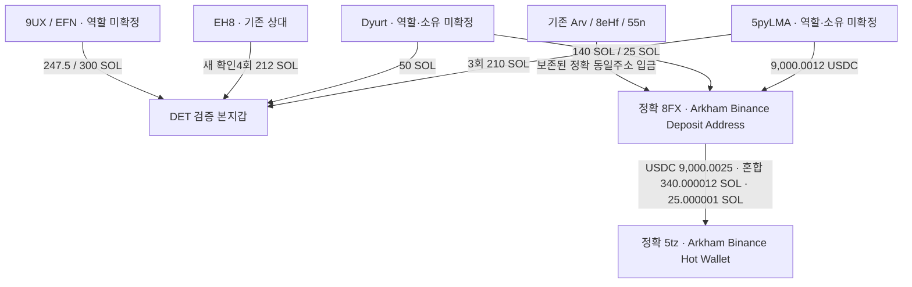

# DET: 분할 조회로 찾은 새 공급 지갑과 THESIS 직전 거래

## 이번 결론

**DET 본지갑에 자금을 보낸 새 주소들이 기존 연관 주소들과 같은 정확한 거래소 입금 주소를 사용한 연결을 더 찾았다.** 5pyLMA는 DET에3회210SOL을보냈고, 정확같은주소가8FX에9,000.0012USDC를입금했다. Dyurt는 DET에50SOL을보내고8FX에140SOL·25SOL을입금했다. 기존Arv·8eHf·55n과공통8FX를사용한다.

이는 **실제 자금망과 정확한 입금주소 재사용 관계**다. 아직 이주소들이동일인/동일고객/뒷지갑이라는결론은없고,같은저시총토큰을미리사서THESIS후팔았다는완결연결도없다. 새공급주소의같은token취득·재고·exit를다음순서로조사한다. 엄격저시총별도지갑완결사례0/연구진행중을유지한다.

DET검증Fomo본지갑`EC2f5DnHzuNRit1ExqghSifDbp1wgrzktsRRZCtU92MJ`, UID`72460ae6-1ddc-5a56-b155-f8e187a4f388`. 원래Top10/raw141,고정구간2026-08-08T04:43:41Z 이상–2026-10-07T04:43:41Z 미만. 아래시각UTC,수량은raw정수/Decimal로계산했다.

## 확인한 구조

본지갑→8FX직접화살표는없다. 이번부분주소쿼리에서직접전송이관측되지않았으며미조회구간·모든ATA/자산의부재가아니다. 거래소명칭은raw2532 Arkham assertion,실제전송은역사owner·성공명령·서명·잔액으로검증했다. 고객전용/동일고객/실소유는unknown이다.

- 5py: `5pyLMAgApHKGiSamQqeW1dzD9Lh9KSxCdVrTMTa7qgL`
- Dyurt: `DyurtTjiucekd6xgdKYhFDnhVcModxxnMduNJVyemsjj`
- 9UX: `9UXDr5sZwcE2duBKXkzqTbwKknfuycWqpRrV5QZmDWXg`
- EFN: `EFNxcRU6eidLMaVj7ZL5ikA6BqaXWYpEhaGa2hQvFAV3`
- 정확입금주소: `8FXdW1ZcR3ebEqsNNDBbZ5m39Zdif3WSYuicKrXibxwJ`
- 정확핫월렛주소: `5tzFkiKscXHK5ZXCGbXZxdw7gTjjD1mBwuoFbhUvuAi9`

## 새로 저장한 실제 전송

|UTC|주소 약칭|정확 수량|거래·원문|
|---|---|---:|---|
|2026-08-10T00:34:48Z|5pyLMAg→EC2f5Dn|70 SOL|[거래](https://explorer.solana.com/tx/4jF1A3ipZDHbwKxuwHypXUBsxdbftA2QPHM7eiDHwmLYaamYo7JXdAC6BRwqeBnxsqwV9Nj5cmpjc6xh9KrdmVpy)·raw3613 data14|
|2026-08-12T05:45:46Z|5pyLMAg→EC2f5Dn|100 SOL|[거래](https://explorer.solana.com/tx/5JcHHdP1mx7GFLyC1LzJkPGCrMhiEorpcrSChDwWUbxKtCYhSqVXu6uJfQwH5kGf8J48HUisz1pf3ycA9AZp6A4c)·raw3613 data100|
|2026-08-21T14:26:34Z|5pyLMAg→EC2f5Dn|40 SOL|[거래](https://explorer.solana.com/tx/3MgD72EQM9CqoL7xvxJVGDYbrbEE9jt2pBBfjQ8JecMZ2E5wJvoATwqAzvvRiowJV23E4aMPo9W84j58sAe2u7jc)·raw3615 data99|
|2026-08-22T07:11:31Z|EH8pNWx→EC2f5Dn|45 SOL|[거래](https://explorer.solana.com/tx/rf5jD8YRtxQC756S2vshLjtAraoHNqTZ7xfGc3iZjWcEwKMqSeVsYUcB6wq7PwFu33NZBkHwEuYoWv5n1LReXmr)·raw3615 data112|
|2026-08-30T06:19:33Z|EH8pNWx→EC2f5Dn|100 SOL|[거래](https://explorer.solana.com/tx/26E8yg3RwowLMMSMC4souH6Az1wzvQpLoE5TXoZYHJssZYMy19TurQYisKgRBHG6mPejdnNoffdPYmJ5Yb7L4ABX)·raw3623 data2|
|2026-09-05T03:58:45Z|EH8pNWx→EC2f5Dn|9 SOL|[거래](https://explorer.solana.com/tx/4C51TyPo5EDw9CR6K9RYQpQxDuudDNhnX8y7GidPvCebBKg1w57zYEbQvUF1eekJC16t1tHdMWP1vPLubsC4nvJg)·raw3627 data9|
|2026-09-10T05:39:29Z|9UXDr5s→EC2f5Dn|247.5 SOL|[거래](https://explorer.solana.com/tx/2ggaLeBNzcdDUYyuP33Ni5c7iUxhWXFcnw7qzVEkg78EmxezF43SKfvaEwuh5dccwZFAqT8qTHrQ4o6pf8zzU1Sx)·raw3632 data59|
|2026-09-12T06:15:52Z|EFNxcRU→EC2f5Dn|300 SOL|[거래](https://explorer.solana.com/tx/24e6m3TUEqhkb6E2qjMGT3u3mAhSh2gediK2zAjeQ3Wu5ohYcfy3dasv3g5qSwxuzHYPr7ijcpj1XJhhjEvThwvu)·raw3633 data77|
|2026-09-12T07:50:10Z|EH8pNWx→EC2f5Dn|58 SOL|[거래](https://explorer.solana.com/tx/45QkQ6R817imYKwJe5xdTktbs7sEnNFezhu6eXx98oxW29H7BtSsQDFEE7wQSJHqZ4LBbo7w75vLo8qv5CtkqcwH)·raw3633 data87|
|2026-09-18T06:36:39Z|DyurtTj→EC2f5Dn|50 SOL|[거래](https://explorer.solana.com/tx/2AxsGdy5Adzgy5amuveuUzU67YLZUDtbm7WzzLhAync4w6KorJyBQ7uKGgEYeT8WtNAoCvgzWDGTZdzTPa8r8Aup)·raw3638 data6|
|2026-10-01T06:57:13Z|5pyLMAg→8FXdW1Z|9000.0012 USDC|[거래](https://explorer.solana.com/tx/44cn971qGtB1wkhatuL2Rpsz38TpXHGXxHqM2qQebMxw2JurGw5x2C15iKxktYV2Yt797aKg8qcFxaciyyVPVMTM)·raw2553 data14|
|2026-10-01T07:02:58Z|8FXdW1Z→5tzFkiK|9000.0025 USDC|[거래](https://explorer.solana.com/tx/24AwHVCdWckjrf6Ujr3VeDKWqYm3hAZ8QP1QEs3AGYPcGgnUoV2e3reHruP3fxHMc3FLuzN51uhBNjCaGiJf97AX)·raw2553 data18|
|2026-09-16T14:59:07Z|DyurtTj→8FXdW1Z|140 SOL|[거래](https://explorer.solana.com/tx/4hiaqFnyNHcgeb1ZQDTToHiZRTb6eEwE7LnPw2cw7Uvz3r5QTbXR8Juuoe7LMUAPK1VpJLaVc5JE6UPu3YQjTBX5)·raw2538 data16|
|2026-09-30T02:42:01Z|DyurtTj→8FXdW1Z|25 SOL|[거래](https://explorer.solana.com/tx/RDQVoTi4afXyx7dnaCERqyu1PmWZ2js9XwwMjay2zZrmGQ1E7rFTmpTQThxMUuGJkMo4zcGUqZPsYfRa9YpKhN3)·raw2538 data30|
|2026-09-30T02:52:45Z|8FXdW1Z→5tzFkiK|25.000001 SOL|[거래](https://explorer.solana.com/tx/2GKdDeuH8pN8Ey8Fcr6FNmi6NmVBR8fCA28NRgpFa7muYMaFFbQEW25z2Gq8wRmxrcgYxK5VXBJ2She7UuxRmzu4)·raw2538 data32|

새native10건은단독top-level System전송·source서명·송신감소=수량+fee·DET증가=수량을검산했다. 합계1,019.5SOL: 새4주소807.5SOL와기존EH8의새4signature212SOL이다. 기존Arv20건/3,150SOL은20/20canonical중복으로재적재하지않았다. **Arv전체60일21건/3,500SOL과모순되지않는다.** 이번mainpartial끝9/19밖인9/30의350SOL은기존sourcequery3583에있다.

이번요약은1SOL이상단독직접native전송을우선했다. 소액·dust·서비스/AMM/임대료경로도원문과worker정규화로보존했지만개인funding으로승격하지않았다. 1SOL미만활동의부재를뜻하지않는다. 단순시간인접/Agm공유서명도같은개인근거가아니다. 이번신규전송은indexed검산이며**추가publicRPC대조는아직미완**이다. Chrome3639/3640에서5py70SOL송금과USDC입금거래를열어상태를확인했다.

5py의9,000.0012USDC입금345초뒤8FX가5tz로9,000.0025USDC를보냈다. raw2553의역사ATAowner와양쪽정확delta를확인했다. 차이는기존0.0001USDC와별도5pyLMS/5pyLjav주소소액이섞인잔액이며,이주소들을정확5pyLMA와동일인으로취급하지않았다. 스윕을5py단일lot이라고단정하지않는다.

Dyurt140SOL입금19초전8eHf200SOL이있었고후속340.000012SOL은혼합스윕이다. 이기존스윕은canonical`native:SOL`로이미있어새`SOL`edge로중복생성하지않았다. Dyurt25SOL뒤644초25.000001SOL스윕도기존잔액/dust와구분했다. closed8FX64native/19USDC계좌자료를재사용했으며풀링된핫월렛전체흐름을확장하지않았다.

## STONKCATS: THESIS 직전 본지갑 재고 교체

정확mint`9h5AzEQzYu9CV5K6uLtFRMD1KcbxZSFNxZEgBTNfw5Na`,d6. 보존THESIS raw2147은9/16 **06:20:35Z**다.

|UTC|실제 본지갑 흐름|증거|
|---|---|---|
|9/15 03:12:12|BTR배분: gross15,000,000 / main net14,850,000 STONKCATS|[전송](https://explorer.solana.com/tx/4ffjPFaSxzk5fSq3e17k4YY3oGGkFoSVaChsqo7UBhjV2K55vvnakkWvS84pV5SYDYiovpua9AMR5g8G5uUYVxTu)·raw3636data79/기존874|
|9/16 06:18:19|14,850,000전량매도→4,808.851634USDC 수령|[매도](https://explorer.solana.com/tx/22JKCQAhSeswzqQpvMNSy2YvAAciQ8guC1QnGtKHbRxyjpwap44ZwNhT1r3v3dQxRAS2A3b4t4JKeFPWn6a2NCHW)·raw3637data19|
|9/16 06:19:04|5,000USDC지급→net12,905,635.706584STONKCATS재매수|[매수](https://explorer.solana.com/tx/4q7baDCcS3kt5PRbv2Vo2qLr6EQDUbwaVikcWk9SxXDLoHZf2V8Gev5zxm9zQyz1gMWGHRXbWQq3UKHPvfRM5b2h)·raw3637data20|
|9/16 06:20:35|THESIS 게시|raw2147 theses15|

매도는THESIS136초전,재매수는**91초전**이다. 처음배분후재고→매도후0→재매수양수와USDC반대delta,main서명·swap로그를검산했다. **이것은본지갑의거래로,뒷지갑이토큰을보관하다게시뒤판사례가아니다.** 기존배분의대가/원가는미확정이므로4,808.851634USDC를실현이익으로표시하지않는다. 재매수비용이전매도수령분보다191.148366USDC크다는사실도전체손익이아니다.

CODEC는6개source→4X→main20,060,836.508432토큰전달을새main조회에서도확인했다(raw3638data80/기존2451). 전달은확인했지만source들의유상취득·잔여재고·공개후매도·소유는미확정이다. STONK/CODEC/HOOKED등저자의같은-token첫공개는보존관측과절대최초를구분한다. 이번대조에서THESIS6mint관련409고유signature를관측했지만main수익/사적연관매수로일괄분류하지않았다.

## 실제 조회 범위와 재개

이전문서cursor`444844361:1237`은**본지갑native가아닌Ctf USDC ATA(raw2724)**였다. 해당계좌42,032고유거래는041에서footer3582로이미닫혔다. 이커서를main주소에보내지않았다.

새main60일요청1000/500은raw3609/3610의2500ms제공자timeout504로실패했다. 활동0/완료로판정하지않았다. 첫하루성공후주단위half-open구간으로나눴다. 그중주단위500실패3617은같은구간100으로한번재시도해347행+footer로닫혔다.

- **8/8 04:43:41–9/13 04:43:41Z: 연속36일 1,781행**, 첫하루+5주간query/footer종료.
- **9/13–9/20: 300행partial**,마지막9/19 21:30:24Z,raw3638cursor`448529455:775`.
- **9/20–10/7: 미조회**. 전체60일/모든ATA/자산완료아니다.

합계2,081고유서명/경계중복0. 성공쿼리이므로실패거래/수수료전체coverage는아니다. 다음동일week범위`gte1789274621/lt1789879421`,asc/limit100/none/succeeded로raw3638cursor부터재개하고이후인접주간을고정종료까지이어간다.

근거3647/검토3648/시총3646,state`initial_top10_DET_main_segments_new_funders_and_STONKCATS_inventory_review_v1`. 신규TRANSFER15=native10+5pyUSDC2+Dyurt입금2/25SOL후속1,edges536→551;기존혼합340SOL스윕중복1과Arv20중복제외. trade4569변경0/state74→75/기존74states11wallet보존.5Luna/max는읽기전용·network0,본체단일검산/적재했다. RPC30/30·Chrome2/2·나머지0;추가주문근거없어Bridge0/시장/BQ/Fomo0,남은예약해제.

다음은①정확main남은cursor종료②5py/Dyurt의실제같은token유상매수·공개시재고·이후매도③새관계대표의독립RPC다. 시총gate와DOGINU/PURR/SI보류/ARTHURevent별30적격은유지한다. 원래Top10/F5등남은frontier보존,단독RZD/Top100재개없음.

미확인: 동일소유·CEX고객·서비스역할·유상별도선행매수·의도·USD실현손익. 이번자료는자금망사례이며악용수익입증은아니다.
