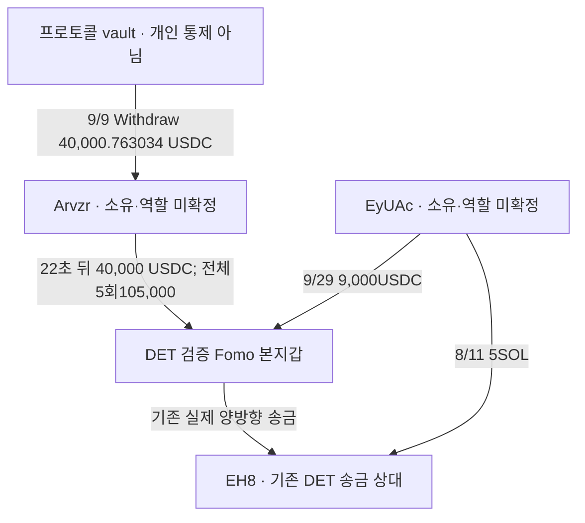

# DET: 새 공급 주소와 두 지갑의 공통 자금 출처

## 확인한 내용

**새로운 실제 송금 관계 두 종류를 찾았다.** Arvzr는 DET 본지갑에5회 합계105,000USDC를 보냈다. 별도EyUAc는 DET에9,000USDC를 보냈고, 앞서 DET와 이미 송금 관계가 확인된EH8에도5SOL을 보냈다. 두 경우 모두 실제 송신 주소의 서명·성공 지시문·양쪽 잔액변화를 검산했다.

이는 자금 연결이다. **공급 주소의 개인 소유·서비스 역할·같은 CEX 고객·특정 토큰 매수 목적은 아직 미확정**이다. 신규 공급자 두 주소에서 같은 저자의 저시총 토큰을 먼저 매수하고 THESIS 후 팔았다는 자료는 아직 없다. 엄격 저시총 별도지갑 사례0/연구 진행 중을 유지한다.

기존 Solstice DOGINU 후보의 실제 별도 지갑 유상매수→THESIS재고→게시후매도는 [별도 보고서](solstice-doginu-funding-recovery-and-cost-review.md)로 보존했다. 해당 후보의 당시 유통시총·소유·의도·수익 미확정도 유지한다.

원래Top10/raw141,고정구간2026-08-08T04:43:41Z 이상–2026-10-07T04:43:41Z 미만. 아래시각UTC. DET Fomo UID`72460ae6-1ddc-5a56-b155-f8e187a4f388`, 검증 본지갑 `EC2f5DnHzuNRit1ExqghSifDbp1wgrzktsRRZCtU92MJ`. USDC exactmint`EPjFWdd5AufqSSqeM2qN1xzybapC8G4wEGGkZwyTDt1v`/d6.

## 구조

Arvzr `ArvzrZqe4tE2KcA6bcJpiSxVEje4YAy6D7VZtTmTxNr9`, EyUAc `EyUAc3R6MKJXoqBetMFNK9Ca5xfxbX3pWSxBRD9RsTd4`, EH8 `EH8pNWx5K5vCnnrNrraB4wR3ntJa3EUAV5rTH1Eq1KX`. vault는`jup3Ye…`프로그램의 관측된출금 맥락이며 서비스 이름은 검증하지 못했다. 이 vault를 새로운 개인 공급자로 승격하지 않았다. 일반송금의 정확 sender인Arvzr와 vault의 역할은 다르다.

## 실제 송금 거래

|UTC|정확 경로|수량|탐색기·원문|
|---|---|---:|---|
|2026-09-09T04:11:44Z|Arvzr→DET|40000 USDC|[거래](https://explorer.solana.com/tx/55TqzKVDbu4FsrEP8airU24bXmms2xKxYbnFshKhcnFsXg7oBjb3Bwrav57ekLc3QELG4yVWmNvF3d6Mgfps6MgW)·raw3532 data645|
|2026-09-10T07:57:17Z|Arvzr→DET|20000 USDC|[거래](https://explorer.solana.com/tx/2P8J5sgRTX1F1N8tr8nnwmbYFX8X7EBMVWVEXS989sKoYWr8ZXRNhbP5udQFoS4jGK238nzChtFd8XJVqfQXskQw)·raw3535 data192|
|2026-09-14T08:00:13Z|Arvzr→DET|15000 USDC|[거래](https://explorer.solana.com/tx/upUSXBTxqBkgbPceJY1zMH7zLVmW9GT8CH6G6HgkTJmQSmc8A1CFf26598Fk4UxxBkTosyHno3eUt4Prgf2z1qn)·raw3540 data54|
|2026-09-17T05:06:25Z|Arvzr→DET|25000 USDC|[거래](https://explorer.solana.com/tx/5t5aKFoEEmmiG5KRUfRf83WPAD7KzKVVMMyyb5PqBeCLjVZQo9dLRodxNMTnBYbQP2dp3YgcVX62XWo5yzCazg7Q)·raw3542 data172|
|2026-09-21T06:22:03Z|Arvzr→DET|5000 USDC|[거래](https://explorer.solana.com/tx/mCKiLpz8ZuQm53oCASL1vtYEDFNaUBuCydoTWPrKkGEogecfytewsZxne33qmga9yWSDaa5PbFDEqkzWSTzxGyH)·raw3545 data405|
|2026-09-29T07:36:40Z|EyUAc→DET|9000 USDC|[거래](https://explorer.solana.com/tx/3yEmTCgb2QJGqvyYEEUAqhZhSQHApUQT7icjjrAebeH4hw8sqR9nVhCc98eBud4BpnaF3zbdjAmxnthpZxgj13mG)·raw3560 data368|
|2026-08-11T07:20:09Z|EyUAc→EH8|5 SOL|[거래](https://explorer.solana.com/tx/ttkbYnrKRoBUUBZj4oZwxgU6kbarzL6teoCaVBc4pBgomj4yW8mSGtQyExrSMVgDdFC9x3vZzoPnb5GfKRWZh5o)·raw2459 data29|

Arvzr5건은 모두본인서명·top-level SPL`transferChecked`,source역사owner=authority=Arvzr,수령exactATAowner=DET였다. source감소와DET증가는 각각지시raw수량과일치한다. 브리지·swap 프로그램이 없는 직접전송이다. 최초40k raw3532data645와마지막5k raw3545data405는 별도publicfinalizedRPC3553/3554의transaction·meta·slot·UTC와 완전히 일치한다. 다른3건은indexed원문검산이며별도provider검증완료로표시하지않았다.

EyUAc→DET9k raw3560data368도sourceowner/authority/signer와 양쪽USDCdelta가 정확히 일치한다. source잔액9,000.899224→0.899224,DET33.026228→9,033.026228. 기존canonicaledge에없었다. **EyUAc→EH8 5SOL은 새네트워크조회가 아니라 이미 보존된raw2459data29를 연결한 결과**다. sender서명·outerSystemTransfer/수령+5SOL/source−5.000005004SOL/fee0.000005004SOL을 확인했다. 두Ey거래의 독립RPC대조는 다음신규예약작업이다.

새source이기때문에무조건개인지갑으로분류하지않는다. 같은공급주소가두지갑에보낸사실과그두지갑의동일인·공모·같은고객계정이라는결론은다르다. 최신CEX라벨검색3558은빈결과라identityunknown이며CEX부재를증명하지않는다.

## 첫40k의 직전 자금

[관측된출금](https://explorer.solana.com/tx/UKE4otLDCJK9KpnRDft8ekShCpt2tRV6SomHG2U4j7uRAvWEq1yA8sskKeh6UDUzsCrNKW1dHNPDLsF1yGxkNVr)은9/9 04:11:22Z,`jup3YeL8QhtSx1e253b2FDvsMNC87fDrgQZivbrndc9`의`Withdraw`로그가있다. Arvzr가서명하여vaultUSDC **40,000.763034**를 받았다. independentRPC3559는raw3556data0와transaction/meta/slot/UTC전체일치한다.

Arvzr USDC는3.651748→40,004.414782,22초뒤40,000을DET로보내4.414782가남았다. 같은exactsourceATA의연속잔액이다. 특정토큰매도대금·예금수익·CEX출금으로분류하지않았다. 프로그램이름공식검색3561도빈결과라‘Jupiter Earn’같은명칭을확정하지않는다. 나머지65,000USDC의직전취득출처도아직미확인이다.

Arvzr firstfunding10분query3556/57은5행+empty/nullfooter로닫았다.60일source이력완료가아니다. 이후소액전송에나온`EC2f…`유사주소들은검증DET와정확주소·서명이달라본지갑의반환으로계산하지않았다. token/가스dust나임대료를사적송금·매수원가로승격하지않았다.

## 선행매수 가설 대조

현재 새공급2주소는funding근거만확보했다. 기존EH8/2Tf/8eHf proof를재사용해별도매수·THESIS재고·게시후exit를다시구분했다.

- EH8의보존STONKCATS매수는DET9/16THESIS이후이며,매수뒤16–32초에토큰이DET로돌아갔다. 사전별도지갑보유→THESIS→그별도지갑매도케이스가아니다.
- 8eHf의paidSTONK재고는10/3THESIS전에0이됐고,THESIS때재고는후속이전분이다. 기존paidlot의게시후매도로연결하지않았다.
- F7공유정산유입과99vQ`DepositToken`→7uTT역사owner의vault전송은실제전송이어도같은개인·CEX고객근거가아니다. 닫힌EH8ATA에있는기존송금을또edge로적재하지않았다.

Werey ARTHUR의선정62별도owner에는실제BUY1,912건/30event별cap적격이있지만저자의사적자금연결은미확정이다. ‘본지갑BUY뿐’이라는이전감사문장은정정했다. Werey exactUSDC47,612query는이미footer로닫혔으며전체wallet/allATA완료는아니다. DOGINU/PURR/SI cap보류를유지하고새전체token군집/BQ수집0.

## 범위·보존·다음 작업

DET exactUSDC는raw3380cursor`444885063:1439`부터새 **24,000개고유성공서명**을이어받았다. 모든행의exactATA USDC잔액과SPL지시합이일치하고페이지사이잔액공백0. 9/6 20:38:32Z–9/29 22:36:31Z만신규확보했으며,끝cursor`451777844:152`가남아 **partial**이다. 이전prefix와새구간을고정60일전체완료로표시하지않았다.

직접RPC30/30=USDC25요청(24성공페이지+503한번/같은cursor1회retry성공)+Arvzr10분2요청+독립RPC3. Chrome1/3(raw3555최초40kSuccess/Finalized),primary검색2/4,나머지0. Bridge새주문근거가없어조회0. 남은예약해제.

근거raw3568/검토3569/시총3567,state`initial_top10_DET_USDC_continuation_and_Arvzr_EyUAc_funding_review_v1`. 새TRANSFER7=새fundingUSDC6건+보존native공통source1건→507edges,trade4569변경0,old72states11wallet보존/newstate1→73.5Luna/max는읽기전용network0,본체가검산·단일적재했다.

다음은①DET남은cursor→고정종료②Ey두거래독립RPC와실제source역할③Arvzr/Ey의지원토큰취득·같은author보존공개·재고·후속exit교차다. 새시장수집은event별역사시총승인후에만한다. 처음105ksource10분닫힌구간·기존EH8ATA·서비스pooledflow를재조회하지않는다. RZD/Top100확대는보류한다. 소유·CEX고객·의도·USD수익은미확정이다.
