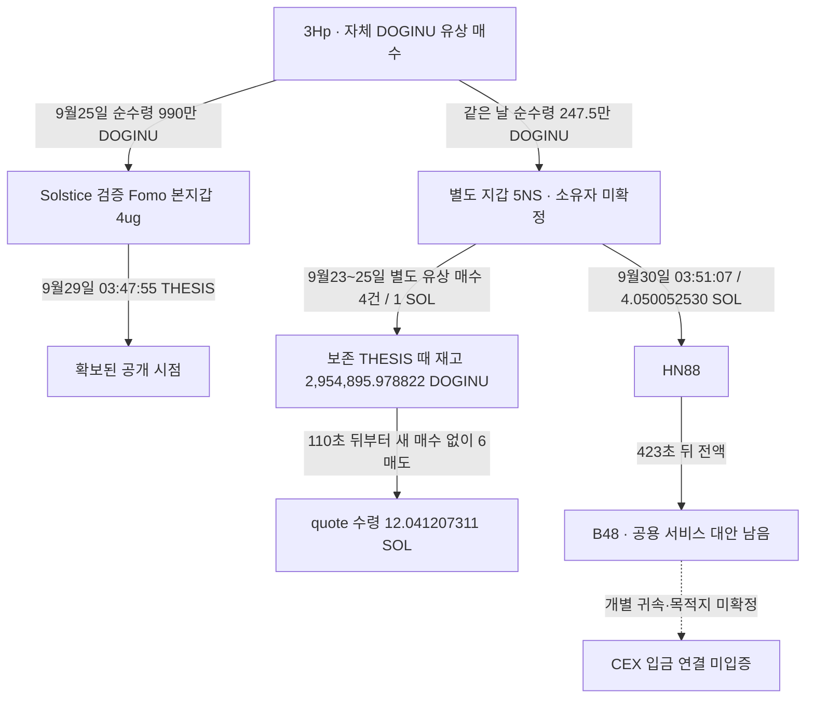

# DOGINU 연결 지갑 사례 — 관측 사실과 미입증 항목

## 결론

**별도 지갑 5NS가 유상 매수한 DOGINU를 보유한 채 Solstice의 보존 THESIS를 맞고, 게시 110초 뒤부터 같은 지갑에서 매도한 거래 구조를 확인했다.** 공통 공급자 3Hp가 Fomo 본지갑과 5NS 양쪽에 토큰을 보낸 실제 접점도 있다. 거래 패턴을 기록하는 사례 보고서는 작성할 수 있다.

다만 5NS가 작성자의 뒷지갑이라는 소유·통제 증거, 절대 최초 공개 이전 매수 여부, 이벤트 당시 유통 시총 100만 달러 이하, 토큰 원가와 실현 수익은 미확정이다. **현재 엄격한 완결 사례는 0건이며 전체 연구는 진행 중이다.**

범위는 원래 Top10/raw141, 고정 60일 `2026-08-08T04:43:41Z <= t < 2026-10-07T04:43:41Z`다. 아래 시각은 UTC이며 현재 순위나 다른 계정으로 바꾸지 않았다.

## 실제 연결 구조

공통 공급·실제 전송은 확인된 사실이며 동일 소유의 증명은 아니다. 토큰 유입을 유상 매수로 바꾸지 않았고, 서비스 주소 전체의 자금을 개인에게 귀속하지 않았다.

## 거래와 재고 검산

|관측|확인값|
|---|---:|
|5NS 보존 THESIS 이전 유상 매수|4건, gross input 1 SOL|
|그 매수에서 취득한 DOGINU|779,895.978822|
|3Hp에서 별도로 받은 DOGINU|2,475,000|
|보존 THESIS 이전 매도|300,000 DOGINU|
|THESIS 시점 재고|2,954,895.978822 DOGINU|
|110초 뒤부터 첫 6매도의 DOGINU 소비|2,366,447.994004|
|그 6매도의 quote 수령|12.041207311 SOL|
|첫 6매도 후 재고|588,447.984818 DOGINU|

`779,895.978822 + 2,475,000 - 300,000 = 2,954,895.978822`이며, 그 재고에서 첫 6매도 소비량을 빼면 잔량과 일치한다. 해당 6매도 사이에 추가 매수가 없었다. 유상 취득량 전부를 매도에 우선 배정하더라도 공급 물량을 소비한 하한은 `2,366,447.994004 - 779,895.978822 = 1,586,552.015182 DOGINU`다. 이는 대체 가능한 재고의 수량 하한이며 특정 토큰 단위나 수익의 추적이 아니다.

quote 12.041207311 SOL은 실제 수령량이다. 공급된 247.5만 DOGINU의 대가·원가가 없으므로 `12.041207311 - 1`을 이익이라고 쓸 수 없다. 이후 다른 토큰 거래와 자금이 섞여 4.050052530 SOL 출금 전액을 DOGINU 매도대금으로 지정할 수도 없다.

기존 거래 근거는 [별도 지갑 매수·게시 후 매도](solstice-doginu-linked-recipient-prebuy-review.md), [원금·실패 비용·회수](solstice-doginu-funding-recovery-and-cost-review.md), [최신 개별 거래 정산](top10-linked-wallet-case-and-cashout-report.md)을 따른다.

## 이번 후속 조회 — 실제 출금 2건

|확인한 정확 source 거래|기존 실제 송금 근거|새 공개 Relay 조회|
|---|---|---|
|[5NS → HN88](https://explorer.solana.com/tx/2Ht6ckrgCJVbCrngTduVR4CS4sQ62NvixiYqHWWcW5qZQjVJxV8jmbFDm4W7mpsUjYdgeYcYSeuaCfGC3AKdgBX1)|독립 RPC raw3492|raw3983, HTTP200 / requests 0|
|[HN88 → B48](https://explorer.solana.com/tx/5fFXM92i9NDJA7TADSteGxV16a3R13xFB4wSUMWxe1MFkYrzUShVC1PwGGZa2PsFmkkMzsvYmAWgX4U13Gxzg91b)|독립 RPC raw3496|raw3984, HTTP200 / requests 0|

기존 로컬 bridge aggregator raw3491은 해결되지 않은 응답이었다. 이번 두 signature는 공개 Relay의 hash 조회와 처음 대조했으나 주문이 반환되지 않았다. **이 특정 조회에서 주문을 확보하지 못했다**는 결과다. 다른 bridge·CEX의 부재나 해당 주소의 역할을 확정한 것은 아니다. B48의 닫힌 20분 자료는 재수집하지 않았고, 혼합 자금의 전체 후속 주소를 확장하지 않았다.

## CEX 연결에서 실제로 확인된 부분

공급자 3Hp의 **Relay → Ethereum 213d → 3081 → 정확 Binance 라벨 입금 주소 487** 전송을 확인했다. 마지막 수령은 [2026-09-15T23:48:23Z / 0.054858215192477777 ETH](https://etherscan.io/tx/0xc6957749b4263f8b6c52c0af62af7a8860b80a288ac39fc99591ef4ed097b7e2)다. 라벨은 현재 Arkham/Etherscan의 표시다.

이 거래는 5NS 최초 DOGINU 유상 매수보다 681,855초 앞이다. DOGINU 게시 후 회수나 작성자와 같은 CEX 고객의 증거로 쓰지 않는다. [공급자 경로 보고서](doginu-supplier-crosschain-wallet-review.md)에 source/order/destination과 정수 금액을 보존했다.

Fomo 본지갑에 실제 bridge로 연결된 Hypercore d1c는 별도 대조했다. **확보된 ledger 출금 10건 / 150,165.576050 USDC는 모두 본지갑 4ug로 반환됐다.** 이 10건 목적지는 확인 완료지만, 공급자와 같은 정확 487 입금 주소 사용은 확인되지 않았다. [본지갑 반환 대조](solstice-main-hypercore-and-binance-endpoint-review.md), 최신 raw3980~3982를 따른다.

## 완결 판정에 남은 근거

|항목|현재 상태|추가로 필요한 근거|
|---|---|---|
|작성자와 별도 지갑 연결|실제 공통 토큰 공급 있음|작성자 통제·사적 경제 관계의 독립 증거|
|게시 전 매수|보존 THESIS보다 앞선 4건 확인|최초 공개라고 주장하려면 과거 공개 이력 확인|
|게시 후 매도|같은 5NS에서 실제 매도·quote 확인|행동 사실로는 기록 가능|
|100만 달러 이하|단일 풀 가격 × 역사 공급 상한의 대용치|정책에 맞는 이벤트 당시 유통 시총 또는 엄밀한 상한|
|실현 수익|원가 일부·매도 수령량 확인|공급 물량의 대가·전체 원가 및 일관된 lot 회계|
|같은 정확 CEX deposit|공급자쪽 입금만 확인|작성자 / 5NS의 실제 동일 chain/address 입금 근거|

현재 Chrome에서 정확 Fomo 프로필을 열면 로그인 전 랜딩으로 이동한다. 화면 raw3985에 보존했고 기존 사용자 계정 로그인을 요청했다. 과거 REST raw3245의 `source=memory, available=false, alerts=[]`는 자료 미가용 응답이지 활동 0이나 60일 완료의 증거가 아니다. 접근 조건이 바뀌기 전 같은 로그인 전 조회를 반복하지 않는다.

역사 시총은 `pending_cap_proxy`로 유지하며 신규 전체 토큰 군집·BigQuery 수집을 실행하지 않았다. 당시 가격을 현재 MCAP/FDV로 대체하거나 공급자 출금을 매도 이익으로 연결하지 않았다.

## 보존과 다음 조사

근거 raw3987, 검토 raw3988, cap raw3986. 실제 Bridge 2회, Chrome 신규 프로필 관측 1회, RPC·Fomo REST·시장·BigQuery 0회. 신규 경제 행은 없다. 기존 88개 state, resolution 11개, 거래 4,569개, edge 644개 값을 보존하고 검토 state 1개만 추가했다. 모든 사용하지 않은 예약을 해제했다.

다음은 과거 공개 이력 접근 회복, 독립 역사 시총, 실제 추가 경제 연결이다. 이미 닫힌 10개 Hypercore 반환과 두 Relay hash 조회를 그대로 반복하지 않는다. 소유권·악용 의도·CEX 고객·실현 수익을 미확정으로 유지한다.

## 배치057 후속 원천 감사

[완결·원천 감사](top10-completion-and-source-gap-audit.md): 정확 DOGINU contract 역사 시총 첫조회 raw3993이 HTTP404 coinnotfound였고 cap은 보류다. 원래10명의 일부 query는 닫혔지만 전체 범위 소진은 입증되지 않았다. 다음은 실제 공급자 송금의3Nyy 수령주소 첫역할 확인이다.

## 배치058 후속 확인 — 동일 주소의 새 라벨·공급자 경로

[공통 Binance 라벨 주소 보고서](doginu-supplier-solana-binance-deposit-review.md): 현재 Arkham raw4005가 exact Solana8zHc를 Binance Deposit으로 표시한다. DOGINU 공급자3Hp→3Nyy→같은8zHc1.269190999SOL 경로를 독립RPC4006/4007로 확인했다. 서로 다른 중간주소가 같은 수령주소로 모인 사실이며, 같은 개인·CEX고객·DOGINU 게시후 수익의 증명이 아니다. 이전 당시 라벨 미확보 기록은 유지한다.
