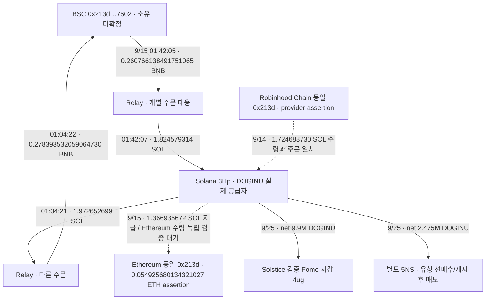
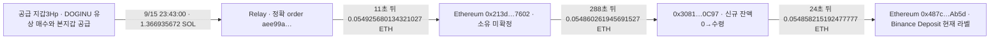

# DOGINU 공급 지갑의 크로스체인 원래 주소 추적

## 확인한 연결

**공급 지갑 3Hp와 EVM 주소 `0x213d6a69d9effe5a37ea0cfd21ec7cda99407602` 사이의 BSC 왕복 브리지를 실제 source·order·destination 거래로 확인했다.** 공용 Relay 송금자를 원래 자금 소유자로 표시하지 않고, 개별 주문에 대응하는 실제 원래 주소를 복원했다. 이 주소와 Solstice Fomo 본지갑의 소유 관계는 아직 미확정이다.

원래 Top10/raw141, 고정 60일 **2026-08-08T04:43:41Z 이상–2026-10-07T04:43:41Z 미만**을 유지한다. 아래 시각은 UTC다. 이번에 확인한 브리지는 모두 DOGINU 매수보다 앞선 9월14–15일 거래다. DOGINU 매도 수익의 회수나 수익으로 계산하지 않는다.

## 구조

Robinhood Chain은 네트워크 이름이며 Robinhood 거래소 고객 출금 증거가 아니다. 같은 EVM 문자열이 다른 체인에 나타난 것과 **같은 정확한 chain/address의 CEX 고객 입금**은 별도다.

## 독립 검증된 왕복

|출발 UTC|출발|도착 UTC|도착|원문|
|---|---|---|---|---|
|9/15 01:04:21|3Hp 1.972652699 SOL|01:04:22|BSC 213d 0.278393532059064730 BNB|[BSC 수령](https://bscscan.com/tx/0x94e608aa956a830ad907bda6eb47249f34e50b9dd24e86a30989717cc64c9b57) · raw3913/3916–3919/3929|
|9/15 01:42:05|BSC 213d 0.260766138491751065 BNB|01:42:07|3Hp 1.824579314 SOL|[BSC 출발](https://bscscan.com/tx/0xb887b3cabc74dd333c060dfa3a7c76d7c54347615401df1dd1b7b63213c0d110) · raw3920/3923–3926/3929|

Solana owner 성공 원문3439와 독립 공개 RPC의 전체 transaction/meta/blockTime이 4개 모두 일치했다(3916/3922/3923/3927). BSC 두 거래는 독립 RPC의 chainId56, sender/recipient, native value, 성공 receipt, block/header 시각과 calldata/orderID를 확인했다. source DepositNative의 amount와 32바이트 ID를 [Relay 공식 명세](https://docs.relay.link/references/protocol/contracts/solana-depository)에 맞춰 확인했다.

BSC 수령의 수수료 2,673,600,000,000 wei는 solver가 부담했다. BSC 출발의 6,131,528,000,000 wei는 213d가 부담했다. 각 Solana source 지급에는 15,000 lamports의 네트워크 수수료가 별도로 있다. 금액이 달라 같은 원금 전량 반환 또는 차액 수익으로 판정하지 않는다. 다른 기존 잔액·거래도 확인해야 한다.

## provider assertion과 미확보 부분

- 9/14 Relay order `0xd22824ab7369cef12eec3629785fb65308e10bf629ad992352706c3db6064e0c`: Robinhood Chain4663 213d가 0.070753318273378982 ETH를 지급했다고 표시한다. 실제 Solana 3Hp 수령 1.724688730 SOL과 주문·두 메모는 일치했다. Robinhood 원거래 RPC 독립 증명은 기존403 접근 문제로 미확보다.
- 9/15 Relay order `0xaee99a989790d3b42ec42b331f125ff75a4e40ce4e70720076c3c16ced34e771`: 실제 3Hp source1.366935672 SOL은 독립 확인했다. 목적지는 **Ethereum chain1**이며 provider는 같은213d의 0.054925680134321027 ETH 수령을 표시한다. [예정 수령 거래](https://etherscan.io/tx/0x6094977a5f80d4c438d3b5b9aed61a114a397a4f9c12e3c51f7c012098ecae0d)는 Nodit401로 독립 RPC 미확보다. BSC로 잘못 저장하지 않았다.
- 9/18 3Hp 수령0.960483554 SOL의 정확 order `0x18e7ae90e9c1b960be678886da65a403615c8e3aff9ec8bc250799a57a84c320`는 이번 Bridge 한도에서 아직 조회하지 않았다. 못 찾았다는 결론이 아니다.

F7와7uTT의 pooled 전체 flow를 개인에게 귀속하지 않는다. 새213d와 검증 Fomo wallet resolutions의 동일 주소는 없으며, 소유/사용자 resolution은 변경하지 않았다. 이 주소의 실제 CEX 역할·입금/출금과 Fomo 본지갑의 추가 접점이 다음 핵심 확인 대상이다.

## 연구 판정과 저장

5NS의 유상 선매수·게시 후 매도 및 공통 공급자3Hp는 기존 보고서의 실제 거래 사실이다. 이번에는 그 공급자의 **반복되는 크로스체인 상대**를 찾았다. 그러나 Fomo 작성자의 별도 지갑 소유, 최초 공개 시각, 당시 유통 시총≤$1M, 의도와 실현 손익은 확정하지 못했다. `pending_cap_proxy`, 엄격한 완결 사례0을 유지한다.

근거 raw3931, 검토 raw3932, cap raw3930. RPC12/15, Bridge5/5(429와 한 번의 재시도 포함), 공식 문서1. 4개의 실제 Solana 전송과 2개의 독립 검증된 bridge를 추가해 edges626→632, state84→85이며 trades4,569와 wallet resolutions11 및 모든 기존 경제행·state를 보존했다. 실패한 로컬 호출3915는 network dispatch0으로 구분했다. 신규 전체 토큰/BQ/Fomo 수집은0이다. 연구 목표는 진행 중이다.

## 배치053: 실제 Binance 고객 입금 주소까지의 경로

**공급자3Hp에서 Relay를 거쳐 Ethereum213d로 수령한 돈이, 0x3081 중간 주소를 거쳐 Binance 입금 라벨의 정확 주소487로 이동했다.** 세 Ethereum 거래는 Etherscan에서 성공·sender/recipient·정수 금액·UTC·전후 잔액을 확인했다. 기존 Ethereum Nodit401은 해소된 것이 아니며, 이번 독립 증거는 **explorer indexed UI**다. 라벨은 Arkham과 Etherscan의 현재 assertion이며 실제 Binance 고객 이름·소유 또는 당시 라벨 유효성을 공개 전송만으로 확정하지 않는다.

### 경로

정확 입금 주소: **`eip155:1 / 0x487cab40f6d11a278fa7c442c6741eabe44eab5d`**. 중간 주소: `0x30810f41da4c88c75f98c013a6f3826909920c97`.

|UTC|실제 전송|금액 ETH|검증 거래|
|---|---|---:|---|
|2026-09-15 23:43:11|Relay solver331→213d|0.054925680134321027|[수령](https://etherscan.io/tx/0x6094977a5f80d4c438d3b5b9aed61a114a397a4f9c12e3c51f7c012098ecae0d) · raw3934/3941|
|2026-09-15 23:47:59|213d→3081|0.054860261945691527|[중간 전송](https://etherscan.io/tx/0x87c9cb48f6e6544d2f9dc2a0944120e2534614fe6a9b70b3878ce42ab7671b2c) · raw3939|
|2026-09-15 23:48:23|3081→487 Binance 라벨|0.054858215192477777|[입금 거래](https://etherscan.io/tx/0xc6957749b4263f8b6c52c0af62af7a8860b80a288ac39fc99591ef4ed097b7e2) · raw3940|

### 잔액 대사

Etherscan state raw3941은 213d의 수령 전 native잔액0→0.054925680134321027 ETH를 보여준다. 다음 송금 직전 잔액도 정확히 같은 값이다(raw3939). 3081 역시 수령 전0이고, 입금 거래 직전 잔액은 직전 수령액과 정확히 같다(raw3940). source outflow와 CEX 입금은 둘 다 sender nonce0, input0x로 표시된다. state 화면의 nonce 열은 Overview와 표기가 달라 잔액 검산에만 사용한다.

- 213d: 54,925,680,134,321,027−54,860,261,945,691,527−42,973,836,402,000 = **22,444,352,227,500 wei** 잔여. 화면의0.0000224443522275 ETH와 일치.
- 3081: 54,860,261,945,691,527−54,858,215,192,477,777−975,664,641,000 = **1,071,088,572,750 wei** 잔여. 화면의0.00000107108857275 ETH와 일치.
- 정확487잔액: 63,897,739,765,259,882→118,755,954,957,737,659 wei, 증가 **54,858,215,192,477,777 wei**가 실제 입금과 일치.

이는 서로 비슷한 USD 금액만 이어 붙인 경로가 아니다. 실제 native 잔액·수수료·recipient가 연속적으로 맞는다. 다만 특정 고객의 계정에 실제 credit됐는지와 고객 신원은 공개 체인으로 확인할 수 없다.

### 남은 공급 주문과 거래소 출금

미조회였던 9/18 F7→3Hp **0.960483554 SOL**도 정확 order18e7ae9, requestID와 메모 두 개, 실제 수령 signature가 모두 맞았다(raw3935/독립Solana3936). 원래 depositor는 다시 **같은213d**, chain5042이고 실제 protocol deposit은 token0x3600000000000000000000000000000000000000의107,463,704raw/d6이다. metadata의 gas currency18decimals 표시107.463703439113061222를 실제 token수량으로 바꾸지 않는다. origin체인 receipt·route 독립 확인은 남았다. 3Hp 관련5주문은 전부 같은213d를 origin 또는 recipient로 표시한다. 그중 BSC2주문과 Ethereum출금 주문은 독립 체인/explorer 근거가 있고, Robinhood·5042 origin은 provider-only다.

213d Arkham raw3937의 요청한4개 USD≥$1 페이지에는 Robinhoodchain4663에서 **KuCoin hotwallet88D→213d** 거래 `0x40ca44adb379fc849396812896e9066e38f94d82d040a6d202c2b632b4962e62`가 보인다. 이는 거래소 출금 방향의 현재 assertion이다. 개별 exact금액·UTC/RPC는 미확보이며 CEX 입금으로 뒤집지 않는다. 요약의9/10–10/8 범위와 USD필터는 고정60일 전체가 아니다. 표시 USD로 원가·수익을 계산하지 않았다.

### 아직 완결 사례가 아닌 이유와 다음 확인

**이 경로는 DOGINU 매수 전9/15 현금화다. THESIS 악용 수익의 회수 증거가 아니다.** 또한3Hp/213d/3081이 Solstice 본인의 별도 지갑인지는 미확정이다. 본지갑4ug와 그 관련 canonical25개 경로를 대조했지만 **같은 정확 eip155:1/487입금 주소**는 현재 저장 범위에서 없었다. 본지갑의 기존 Hypercore d1c 연결이나 아직 미완료된 bridge가 같은 지점으로 귀결하는지 다음에 확인한다. 동일 Binance 이름만으로 합치지 않는다.

5NS의 유상 선매수→보존THESIS110초 후 매도는 별도로 확인된 사실이며, 그 매도 대금이 새487로 회수됐다는 근거는 아직 없다. 원래Fomo 공개 기록은 로그인 대기, 당시유통cap는pending_cap_proxy로 유지한다. 엄격한 완결 사례0이며 조사 가능한 범위를 소진했다고 선언하지 않는다.

근거 raw3943, 검토 raw3944, cap raw3942. Chrome5/5, Bridge1/2, RPC1/12, BQ/Fomo/시장0. 신규4edges로632→636/state85→86. 기존85states/11wallet resolutions와4,569trades/632edges 전체 값을 보존했다. 지갑 소유 resolution 변경0.

## 배치054 후속 대조

[본지갑Hypercore후속](solstice-main-hypercore-and-binance-endpoint-review.md)에서미해결4건123,001.449316USDC가모두4ug로반환됐음을독립확인했다. 합계6반환134,960.576050/남은4개15,205USDC미조회. 같은exact487공통입금은아직미확정이다. 5042source의routeoutput과protocolorigin은d6 1raw-unit 차이로독립수량미확정을유지한다.

## 배치055 후속 대조

[본지갑 반환 대조](solstice-main-hypercore-and-binance-endpoint-review.md)에서 확보된 d1c 출금10건150,165.576050USDC 모두 본지갑4ug 반환을 확인했다. 이10건은 정확487의 공통입금 근거가 아니다. 이후 핵심은 5NS 게시후 출금의 개별 주문 확인이다.
