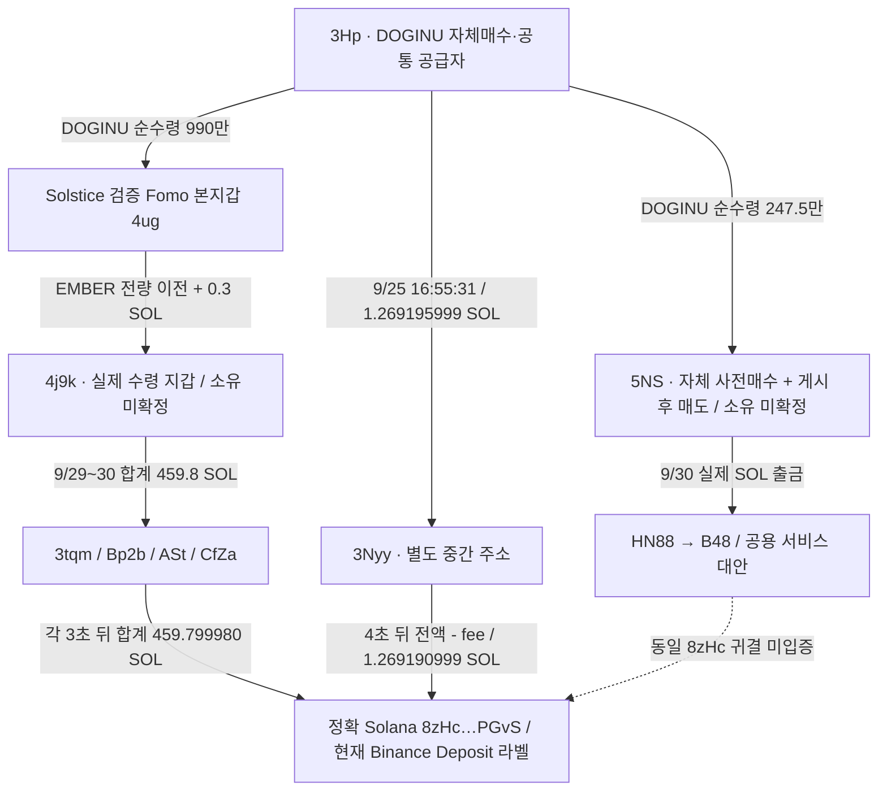

# DOGINU 공급 지갑과 EMBER 수령 지갑의 공통 Binance 라벨 주소

> 배치059 후속: 현재 exact8zHc 상세화면 raw4014에서625페이지, 최근7일Binance그룹2177건·여러유입·HotWallet출금이 표시돼 공용집금 대안이 강화됐다. 실제 공통 전송 경로는 유지하지만 **개인의 동일 CEX 고객 deposit 증거로 쓰지 않는다.** [최신 역할·econoar 후보](top10-exchange-hub-and-econoar-candidate-review.md)를 따른다.

## 새로 확인한 사실

**DOGINU 공급자 3Hp의 SOL이 3Nyy를 거쳐 4초 만에 `8zHc…PGvS`로 이동했다. 이 정확한 Solana 주소는 이전 EMBER 수령 지갑 4j9k의 출금 네 건이 귀결된 주소와 같다.** 현재 Arkham 화면은 이 주소를 **Binance Deposit**으로 표시한다. 이전 EMBER 조사 당시에는 보안 확인 화면 때문에 라벨을 확보하지 못했으나 이번 화면 raw4005에서 확보했다.

이는 실제 **공통 수령 주소와 현재 거래소 라벨**을 추가한 결과다. 서로 다른 중간 주소들이 같은 주소로 스윕되는 구조이므로, 개인의 고유 deposit인지 거래소·서비스가 여러 고객의 자금을 모으는 주소인지는 미확정이다. 동일 고객·동일 소유·THESIS 악용 수익은 확정하지 않는다. 엄격한 저시총 완결 사례는 여전히 0건이다.

원래 Top10/raw141, 고정60일 `2026-08-08T04:43:41Z <= t < 2026-10-07T04:43:41Z`을 유지한다. 모든 시각은 UTC다.

## 구조

실선은 확보된 실제 전송이며 점선은 미입증 항목이다. 같은 수령 주소를 통해 같은 개인이나 같은 Binance 계정이라는 결론으로 넘어가지 않는다.

## 새 두 거래의 독립 검증

|UTC|전송|정확 금액|거래|
|---|---|---:|---|
|2026-09-25 16:55:31Z|3Hp → 3Nyy|1.269195999 SOL|[원송금](https://explorer.solana.com/tx/3aG5na6oM87Tb4dHNBWE5uRmip6gzMiNAU1rjxTw9CWgswkSQhviosgE6gjZiLKB1EEfYjBPz6bY1J43CcXJEhnU)|
|2026-09-25 16:55:35Z|3Nyy → 8zHc|1.269190999 SOL|[Binance 라벨 주소 수령](https://explorer.solana.com/tx/CDv8EdnWo2ToTpqTBQUvSNYXALSPD5T4SHRZx2EoNEpFdLad1XozWHGzLWm5mMfW6aRTQo86DH6zGjhdo9WBH9P)|

원송금 slot450412501 / epoch1790355331, 후속 slot450412515 / epoch1790355335다. QuickNode raw4003의 전체 transaction/meta와 독립 public Solana RPC raw4006/4007이 일치했다. 성공 상태, source own signer, System transfer, 정수 lamports, fee, 전후 잔고를 확인했다.

3Nyy는 입금 직전0 → 1,269,195,999 lamports → 출금 후0이다. `1,269,195,999 - 1,269,190,999 = 5,000`은 후속 거래 fee와 정확히 같다. 8zHc의 수령 직전 잔고194,243,431,272 → 수령 후195,512,622,271 lamports의 증가도 송금액과 일치한다. 원송금 source3Hp의 fee79,934 lamports와 잔여890,880 lamports는 별도이며 두 거래 fee를 섞지 않았다.

3Nyy 지정 query는 성공 / owner tokenAccounts=none / 고정60일 / asc 조건에서2행(raw4003)과 빈/null footer(raw4004)로 닫혔다. 모든 ATA·실패 거래·평생 이력의 완성을 뜻하지 않는다. 현재 Arkham의 System Account/on-curve 표시는 서명 가능한 계정 형식이며 개인 신원·고객 통제 증명이 아니다.

## 이전 EMBER 경로와 정확 주소 비교

앞서 확인한4j9k→네 중간 주소→8zHc는 [EMBER 회수 보고서](solstice-ember-recovery-review.md)의 실제 전송이다. 네 집금은9/29 20:08:00,20:18:25,20:21:12 및9/30 07:17:14Z다. 합계459.799980 SOL이고 신규1.269190999 SOL과 합산하면 이 다섯 수령에서461.069170999 SOL이다. 이 합계는 **선택된 전송량의 합**이며 특정 토큰 수익이나 계좌 전체 현금화 금액이 아니다.

정확 chain/address가 동일함은 확인했다. 기존 Ethereum `0x487cab40f6d11a278fa7c442c6741eabe44eab5d`, Solana `8FX…`, `6vy…`와는 다른 endpoint다. 같은 Binance 이름을 이유로 동일 주소나 동일 고객으로 합치지 않았다.

기존 canonical644개 edge에는 본지갑4ug 또는5NS가 3Nyy/8zHc로 직접 보낸 edge가 없었다. 이는 **기존 canonical edge의 지정 비교**이며 모든 raw·모든 기간에 직접 송금이 없다는 결론이 아니다. 4ug→4j9k→중간주소→8zHc의 간접 경로와 3Hp→3Nyy→8zHc의 간접 경로를 그대로 보존했다.

## 시간과 토큰을 분리한 판정

- EMBER의4j9k는 본지갑에서 물량을 받았고, 확인된48매도는 모두9/12 보존 THESIS 전이다. 별도 주소 자체 사전 유상 매수·게시 후 EMBER 매도는 확인되지 않았다.
- DOGINU의3Hp 신규 SOL 출금은9/25다. DOGINU 보존 THESIS9/29 03:47:55Z보다 앞이므로 게시 후 DOGINU 수익 회수로 쓰지 않는다.
- DOGINU의5NS는 별도 유상 사전매수4건과 게시 시 재고, 게시110초 뒤부터 같은 지갑의 매도·quote 수령이 있다. 그러나 그 게시 후 출금 HN88→B48에서 이번8zHc까지 이어지는 개별 증거는 없다.
- 앞선3Hp 거래에는 다른 mint의 거래도 있다. 이번1.269195999 SOL을 DOGINU 특정 lot의 매도대금으로 지정하지 않는다.

공통 공급자·공통 수령 주소는 연구할 접점이다. 자금 섞임, 고객별 deposit와 집금의 차이, 제공자 라벨의 적용 시점 때문에 작성자의 통제 지갑이라고 확정하려면 별도 근거가 필요하다.

## 아직 미확정인 항목

DOGINU/EMBER의 당시 유통 시총은 `pending_cap_proxy`다. 이전 DOGINU 독립 contract history raw3993은 HTTP404 coinnotfound였고, 이를 시총0이나 활동 부재로 쓰지 않는다. 승인된 개별 BUY raw2286/2893/2933의 존재와 strict 완결0도 구분한다. Fomo 과거 공개 이력은 기존 로그인 요청이 pending이며 같은 로그인 전 조회를 반복하지 않았다.

공통8zHc의 거래 전체나 Binance pooled 후속 흐름은 수집하지 않았다. 라벨은 현재 Arkham assertion, 실제 전송은 독립 RPC proof, 고객 귀속·owner·역사 유통 시총·실현 수익은 미확정으로 분리해 저장했다.

## 저장과 다음 조사

worker raw[4008, 4009], cap raw4010, 근거 raw4011, 검토 raw4012. 네트워크는 RPC4회(주소 페이지2+독립 거래2), Chrome 신규 주소 관측1회다. Bridge/Fomo/시장/BigQuery0회. 사용하지 않은 예약은 해제했다.

원송금3Hp→3Nyy는 기존 edge를 보존하고 중복 삽입하지 않았다. 새3Nyy→8zHc TRANSFER1개만 추가해 edge645개, 실제 trade4,569개, resolution11개를 유지했다. 기존 state90개와 모든 경제 행의 값을 보존하고 검토 state1개를 추가했다. 소유권 resolution 변경은 없다.

다음은8zHc의 정확 라벨·deposit/집금 역할의 범위를 확인하고, 원래10명의 실제 연결 지갑에서 사적 접점과 적격 시총·공개 이력 공백을 이어간다. 이미 닫힌3Nyy/10Hypercore/두Relay hash query는 반복하지 않는다. 조사 전체는 계속 active다.
