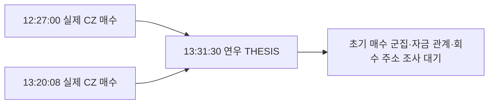

# 과거 THESIS 확보와 저시총 토큰 선별

## 현재 범위 변경 — 2026-10-07 KST

사용자가 조사 토큰을 **게시 당시 유통 시총100만 달러 이하**로 한정했다. [현재 병렬 조사 계획](parallel-investigation.md)을 따른다. 아래 raw2067/2068과 $10M 선별 결과는 이전 파일럿 기록이며 이번 문서화에서 DB를 변경하지 않았다.

현 기준에서 CZ는 FDV 대용치만 있어 `pending_cap_proxy`로 보류한다. baton은100만 달러도 초과해 제외, 나머지7개는cap/source 미확인으로 보류다. 새 기준의 적격 토큰을 확정한 결과가 아니다. 기존 CZ 거래 검증은 재사용할 수 있지만 신규 매수 군집 심층 수집은 유통 시총 gate를 충족한 뒤 배정한다. 아래의 '다음 조사'는 당시 frontier이며 현 지침에 맞춰 재배정한다.

갱신: 2026-10-07 UTC. 현재 review raw2067, 검증 raw2068. 기준 저장소는 SQLite이며 아래 결과의 원문·정확한 수량·출처는 ignored `data/research/lowcap-thesis-review-2026-10-07.json`과 `data/raw/lowcap-thesis/2026-10-07/`에 있다.

## 현재 결과

연우 `yeon__`의 과거 THESIS **9건·9토큰**을 새로 확보했다. 작성 시점은 **2026-09-25 13:19:35–2026-10-06 13:31:30 UTC**다. 이전 `/v2/alerts` 조회에서는 연우 THESIS가 0건이었다. 이번에는 별도의 [사용자 THESIS REST 경로](https://fomoapi.io/docs)를 사용했다. 두 달 목표 구간인 **8월 7일–10월 7일의 전체 글을 확보했다는 뜻은 아니다.** 9월 25일 이전, 수정·삭제된 글, 절대 최초 공개 시점은 여전히 미확인이다.

기존 고정 Top 10의 THESIS 20건과 이번 연우 9건을 합쳐 원문 관측 **29건**을 정규화했다. 연우 글 9건은 `fomo_events`에도 추가했다. 같은 글을 다시 읽어도 이벤트를 중복하지 않도록 `derived_thesis_document` 식별자를 사용하며, 원본 알림 ID로 주장하지 않는다. DB 전체 Fomo 이벤트는 999건, 그중 THESIS는 151건이다. 기존 알림 checkpoint, 지갑 해상도, RZD·연우 추적 frontier는 보존했다.

우선 선별 결과는 **CZ 예비 대상 1개, baton 제외 1개, 보류 7개**다. 정확한 유통 시총으로 1,000만 달러 이하가 확인된 대상은 아직 0개다. CZ는 역사적 가격과 총발행량으로 계산한 낮은 평가액 때문에 예비 조사만 진행한다. 미확인 토큰의 초기 매수 지갑 추적은 시작하지 않았다.

## 선별 기준

- 기준 시점: 확보한 각 THESIS의 작성 시각. 현재 시총으로 과거 대상을 고르지 않는다.
- 우선 기준: 당시 시총 **1,000만 달러 이하**. `<3만 / 3만–20만 / 20만–100만 / 100만–1,000만 달러`로 나눈다. 3만 달러 미만도 별도 보존한다.
- 유통 시총과 총발행량 평가액을 분리한다. FDV 대용치만 확인되면 `provisional_low_fdv`이며 확정 시총으로 표시하지 않는다.
- 가격은 글 작성 전에 끝난 분봉만 사용하고, 종가 시각과 글 시각의 차이가 5분 이내여야 한다. CALL이 포함된 미완료 분봉은 제외한다. 실제 시각·가격의 정밀도와 공급자 assertion을 함께 기록한다.
- 현재 풀 유동성은 후보 풀 선택에만 사용했다. 같은 시점의 유동성으로 대체하지 않는다. 첫 페이지·현재 활발한 풀 위주인 만큼 사라진 풀과 과거 전체 풀 coverage는 unknown이다.
- 작은 시총만으로 조종, 같은 소유자, 선행매수 의도 또는 수익을 판정하지 않는다.

## 연우 글별 선별 결과

| 토큰 | 체인 | THESIS 작성 시각 | 작성 시점 주변 평가액 | 처리 |
|---|---|---|---|---|
| CZ | bsc | 2026-10-06 13:31:30 UTC | FDV 대용치 $844,583.53 | 저시총 예비 대상 — 유통 시총 미확인 |
| pill | solana | 2026-10-04 22:00:50 UTC | 미확인 | 당시 발행량·시총 확인 대기 |
| baton | solana | 2026-10-04 22:00:45 UTC | $14,082,929.32 | 1,000만 달러 초과 — 제외 |
| SXSI | solana | 2026-10-04 15:12:40 UTC | 미확인 | 과거 가격 조회 제한 — 보류 |
| 🙈 | bsc | 2026-10-03 19:33:30 UTC | 미확인 | 과거 가격 조회 제한 — 보류 |
| 김치 | bsc | 2026-10-03 08:22:20 UTC | 미확인 | 과거 가격 조회 제한 — 보류 |
| MOON | bsc | 2026-10-03 06:52:20 UTC | 미확인 | 과거 가격 조회 제한 — 보류 |
| AI | bsc | 2026-10-02 13:30:25 UTC | 미확인 | 과거 가격 조회 제한 — 보류 |
| MOMO | bsc | 2026-09-25 13:19:35 UTC | 미확인 | 과거 가격 조회 제한 — 보류 |

`pill`은 당시 가격 분봉을 확보했지만 역사적 발행량·유통 시총이 없다. SXSI·🙈·김치·MOON·AI의 풀 조회는 HTTP429와 1회 재시도 후 429였고, MOMO는 풀을 찾았으나 과거 가격 조회가 재시도 후에도 429였다. 실패를 시총 0이나 거래 부재로 바꾸지 않았다.

## CZ: 지금 확인할 수 있는 범위

토큰: BSC `0xb1b798c76a9f7bc6f5002dd72c23cf0d64b76666`.

연우 THESIS: **2026-10-06T13:31:30.000Z**. 이는 FomoAPI의 원문·작성 시각 assertion이며 공식 화면이나 X의 절대 최초 게시 시점으로 독립 검증한 값은 아니다.

GeckoTerminal의 글 직전 완료 분봉은 **13:30:00–13:31:00 UTC**, 종가는 **$0.000844583532464795**였다. 글 시각보다 30초 앞선다. 조회 기준과 분봉 구조는 [공급자 OHLCV 문서](https://docs.coingecko.com/reference/pool-ohlcv-contract-address)에 근거한다.

Nodit의 독립 BSC RPC로 다음을 확인했다.

- 작성 초까지의 마지막 블록: **126,068,495**, 시각 **13:31:30 UTC**. 다음 블록은 **126,068,496 / 13:31:31 UTC**다. 같은 초의 블록 내 거래 순서와 THESIS 작성의 순서를 추가로 확정하지 않았다.
- 해당 블록의 `totalSupply` raw: `1000000000000000000000000000`, decimals **18**, 총발행량 **1,000,000,000 CZ**.
- 직전 분봉 종가 × 당시 총발행량: **$844,583.53**. 총발행량 기준 FDV 대용치이고, 별도 유통 시총·정확한 게시 순간의 달러 가격은 미확인이다.
- 실제 풀 `0x6f0aa2c067ce5f6e5253d7f6487548fa01601b3b`은 CZ/WBNB, fee **1%**다. 풀의 `factory()`와 공식 factory의 `getPool(CZ,WBNB,10000)`이 맞는다. 공식 [PancakeSwap v3 주소](https://developer.pancakeswap.finance/contracts/v3/addresses)와 대조했다.

기존 두 성공 receipt를 다시 수집하지 않고, [PancakeSwap의 Swap ABI](https://github.com/pancakeswap/pancake-v3-contracts/blob/main/projects/v3-core/contracts/interfaces/pool/IPancakeV3PoolEvents.sol)에 맞춰 해석했다. 각 풀의 CZ 감소·WBNB 증가와 최종 수령 CZ raw amount가 정확히 일치한다. 단순 전송을 매수로 간주한 결과가 아니다. 중간 routing 주소를 최종 매수 지갑으로 취급하지 않는다.

| BSC 실제 매수 시각 | 풀에 투입된 WBNB | 최종 수령 CZ | 확보 THESIS보다 앞선 시간 | 원문 |
|---|---:|---:|---:|---|
| 2026-10-06T12:27:00Z | 3.808439845006467012 | 4989029.010615887268807409 | 3870초 | [거래](https://bscscan.com/tx/0x421bfb7e8c6bca8664109168ae93d2e113c8111ba5a199824d7b3feea216c9f1) |
| 2026-10-06T13:20:08Z | 6.349987289210441103 | 5966324.93528740418051768 | 682초 | [거래](https://bscscan.com/tx/0xf325a54acd747d11ec1333b39a025d0eb3e4b0cc07c32830f640de2ed8d2ecf8) |

최종 수령주소는 두 건 모두 `0x172695ac783cc308fc3699e0a5d161494eb5ad58`이다. 주소의 소유권은 unknown을 유지한다. Solana quote 감소와 BSC 목적지의 기존 대응은 provider UI correlation이고, 실제 개별 Bridge operation으로 확정한 것과 구분한다. WBNB 풀 leg는 전체 cross-chain 원가, 수수료 합계 또는 실현 수익과 같지 않다.

이 두 매수는 알려진 Fomo 거래와 대응하는 실행이다. 뒷지갑의 선행매수를 발견했다는 뜻은 아니다. 첫 retained Fomo BUY도 12:27:00 UTC에 있어 THESIS 이전에 이미 공개 BUY가 있었다. 절대 최초 공개 시점은 unknown이다.

이전 14,668개 전송/3,711개 수령주소 검사는 **첫 retained BUY 이전**까지만 대상으로 했다. 이번에 확보한 THESIS 이전 전체 구간을 조사한 결과로 소급해서 쓰지 않는다. 전송 수령주소 목록을 실제 DEX 매수 지갑 목록으로 바꾸지도 않는다.

## baton을 제외한 이유

CoinGecko `baton-3`의 계약 주소가 정확히 Solana `Hg5Ja55T5wESq4vyFoiVCMeHXtGyVA69X2UHq8hgpump`와 일치했다. [역사적 시장 차트](https://docs.coingecko.com/reference/coins-id-market-chart-range)는 10월 4일 **22:00:00 UTC**에 **$14,082,929.317754881** 시총을 반환했다. THESIS는 **22:00:45 UTC**로, 해당 관측보다 45초 뒤다. 공급자의 유통 시총 assertion을 근거로 현재 파일럿에서 제외했다.

같은 응답의 **21:00** 시총은 약 **$9,419,240.98**였다. 한 시간 이전 값을 가져오면 잘못 포함될 수 있어 게시 시각 주변의 마지막 적합한 표본을 선택했다. GeckoTerminal이 돌려준 CALL 포함 미완료 22:00 분봉은 채택하지 않았다.

## 수집·저장과 공백

Fomo는 사용자 THESIS 2페이지를 시도했다. 연우는 raw2016, 기존 Top1 `pointfarmcap`은 raw2017이다. Top1은 HTTP200이지만 `available:false / upstream-unavailable`이었다. 조사하지 못했다는 응답이므로 글 0건으로 해석하지 않으며 다음 bounded 실행의 재시도 대상으로 남겼다. 사용자 route의 반환에는 `hasMore`·cursor가 없어 과거 두 달의 페이지 완료를 선언할 수 없다.

이번 실행은 Fomo **1,250 credits**, 관측 잔액 **243,875**; 직접 RPC **24회**(일시 429의 1회 재시도 포함); GeckoTerminal **20회**; CoinGecko **2회**다. Bridge와 BigQuery의 새 요청은 없다. 기존 완전한 캡처는 재수집하지 않았다. Fomo raw2016/2017의 `captured_at_utc`는 최초 실행 스크립트의 요청 시작 시각이었다. 공급자 `capturedAt`와 수신 후 파일 메타데이터도 보존했고, 논문 시점에는 게시 시각 `ts`만 쓴다.

정규화는 `fomo_thesis_observations`에 원문·작성 시각·stable user ID·정확한 chain/token·원본 ID를, `lowcap_thesis_screens`에 각 판단과 source refs를 저장했다. 새 9개의 정규화 이벤트는 원본 raw2016을 직접 참조하고 `amount_usd`는 NULL이다. API `tradeUsd`·PnL·현재 USD를 비용으로 쓰지 않는다.

로컬 적재의 외래키 오류는 **0**, 역사적 발행량은 TEXT, 선택 분봉은 모두 글 작성 전에 종료됐다. RZD·연우 기존 trace/state 및 wallet resolution의 fingerprint는 동일했다. 최신 상태와 다음 작업은 `collector_state.lowcap_thesis_research_v1`에 있다.

## 다음 bounded 조사

1. **CZ의 실제 초기 매수 지갑.** 검증된 V3 풀에 대해 10월 6일 **11:31:30–14:31:30 UTC**를 우선 후보 창으로 삼는다. 실제 Swap을 해석해 token output의 최종 수령 지갑까지 대응하고, 첫 Fomo BUY 12:27과 THESIS 13:31:30을 각각 비교한다. BigQuery를 쓰면 해당 pool/token/time만 dry run·cap을 적용한다. 이미 보존한 이전 창과 추가 창을 구분한다.
2. **동시 매수 군집과 공통 자금 관계.** 10·30·60초 창을 비교하고, 같은 거래 강도·유동성·토큰 나이의 대조 기간을 둔다. 단순히 60초에 3개 주소가 샀다는 조건은 탐색용이다. 공통 비서비스 공급자, 토큰 반환, 반복 회수, 기존 Fomo 연결 주소와의 실제 접점을 요구한다. Shared router·Relay pooled 계정은 동일 소유권 신호로 올리지 않는다.
3. **정확한 CEX 고객 입금 지점.** 같은 chain/address인지 비교하고 직접 전송 근거를 붙인다. 같은 거래소 이름이나 Binance51 같은 shared hotwallet은 공통 고객 증거가 아니다.
4. **보류 토큰과 더 오래된 글.** 제한이 풀린 뒤 저장 frontier의 실패 항목을 bounded 재개한다. 과거 시총·발행량이 검증되지 않은 토큰은 계속 보류한다. RZD tracing은 이전 사용자 요청대로 보존 상태이며 이번에는 기존 THESIS를 재사용했다.
5. **매도·원가·수익.** 선행 시점의 실제 취득, CALL, 실제 exit와 quote/fee, 이전 재고·전송 원가가 있을 때만 계산한다. 현재 뒷지갑·조종 의도·실현 수익 판정은 없다.
