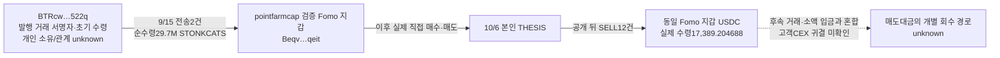

# pointfarmcap / STONKCATS 추적 — 초기 물량 수령과 THESIS 이후 매도

검토 UTC: 2026-10-07T17:13:55.755Z. 배치 `top10-60d-20261008-v1-batch003`. raw141의 초기10명 중 pointfarmcap에 집중했다. 고정60일 구간은 2026-08-08T04:43:41Z 이상~2026-10-07T04:43:41Z 미만이다. 아래 표의 시간은 UTC이며 한국시간은9시간을 더한다.

## 확인한 사실

**앞서 설명한10/6 2,000USDC 매수는 확인된 Fomo 지갑의 직접 추가 매수다. 이번에 기존 재고의 출처를 추가로 찾았다.** 토큰 최초 발행 거래의 서명자이자 초기 수령 주소 BTRcw가 같은 Fomo 지갑에 두 차례 전송했고, 순수령 합계는29,700,000 STONKCATS다. 이 주소의 개인 신원, pointfarmcap과의 관계·동일 소유, 대가 지급 여부는unknown이다.

**본인 THESIS 이후 실제 매도12건도 확인했다.** 소유 지갑의 성공 거래·서명·swap로그·최종 토큰/USDC 잔액 변화가 맞는다. STONKCATS18,745,333.605173개가 감소하고 USDC17,389.204688이 실제 입금됐다. 같은 구간 추가 매수11건의 USDC지출569.104574를 빼면 관측 순현금흐름은16,820.100114USDC다. 이전 재고의 취득 대가가unknown이고 여러 거래 대금이 섞여 **실현 수익으로 판정하지 않는다.**

## 정확한 대상

| 항목 | 값 |
|---|---|
| Fomo user ID | `6d8c0bf3-5d42-506c-a0ea-9e1e75ff38af` |
| 검증된 Fomo Solana 지갑 | `Beqv6dzTcjV2eodo8RRXCiCcnSYrS1vkQKhfqwHXqeit` |
| STONKCATS mint | `9h5AzEQzYu9CV5K6uLtFRMD1KcbxZSFNxZEgBTNfw5Na` |
| 추적한 토큰 계정 | `HpTZurBv2LqNM9qfEnH7tr1q5A2gzGaDAqd7KfGGYg1V` |
| 초기 물량 전송자 | `BTRcwVTSoBwXg9XXEXcK4UYYCTmhd6iv81TZggFG522q` |
| USDC 수령 계정 | `Fbck4smimeuWmxAUU4PKwJGYYVoxzXFhrwDgmTk8eQH3` |

## 시간순 근거

| UTC | 사실 | 원문 / 거래 |
|---|---|
| 9/15 01:49:24 | 최초 발행 거래에서10억개 mintTo, mintTokens 권한 폐기. BTR이 tx서명자·초기 수령자 | raw2210 / [발행](https://explorer.solana.com/tx/5R9DhgY69VCxv3yHXbaHys8CDxedqmb2AwqKxsaqQ1TicfJk3SiyAKqzeMo8o6RZ6WiGRs5CxFJcnjdpFFShu8nN?cluster=mainnet-beta) |
| 9/15 03:11:51 | BTR→point gross15,000,000 / net14,850,000. quote 지출0 | raw2212 data0, 기존804 / [입금1](https://explorer.solana.com/tx/2H4VAzZVyk6wtH6hm4acGmR4NHoJBwSG1tuWRZELQda5au7uZ2ixQX2yQhm7ytDTXRTVTvs6D6QumENHZtyMwk7v?cluster=mainnet-beta) |
| 9/15 05:19:07 | 같은 BTR→같은 point ATA gross15,000,000 / net14,850,000. quote 지출0 | raw2212 data2 / [입금2](https://explorer.solana.com/tx/3pZjrURev6amSiueQ2ZbodDWBVBkJUXC8FLk6EYHjNRV6UHGJAxWzJeeZAAnA22Xv5xyBpRA5iQV8qsTcwxGeHMa?cluster=mainnet-beta) |
| 9/15 21:22:13 | 저장된 첫 직접 매수:50USDC 지출,635,255.649864개 증가. 직전 이미29.7M 보유 | raw2212·기존801 |
| 9/16 06:20:35 | detweiler의 확보된 최초 STONKCATS THESIS | 기존 Fomo 원문, 작업자3 chronology. 절대 최초 공개unknown |
| 10/4 18:15:25 | Solstice THESIS | 기존 Fomo 원문 |
| 10/6 01:08:07 | point 추가 매수:2,000USDC 지출/3,387,070.295886개 증가 | raw686 및2213 / [추가 매수](https://explorer.solana.com/tx/2LN6M61Lw8XMiRAvgtjTPg1FQhoSV2o78cWx2A5pN8imbtkj9moYPYq1mXJusSwjjF1c4p3KtxGFZpyYP7FTLywR?cluster=mainnet-beta) |
| 10/6 05:14:35 | point 본인 THESIS. 그전 추가 매수11,533.293569개도 확인 | 기존 Fomo 원문 / raw2213 |
| 10/6 17:23:44 | 본인 글 뒤 첫 실제 SELL:1,094,237.500310개 감소/954.137441USDC 증가 | raw2213 / [첫 매도](https://explorer.solana.com/tx/pwP7xN6ysfthNfD75baXvWdo9ecMQ7BEjPFhxk5PmKLg1BHhf4C4uTcDBQwy3cVzknCUJKp3atCuEMxXHQVk8Yq?cluster=mainnet-beta) |
| 10/7 03:06:45 | 관측 마지막 SELL 뒤8,761,371.230654개 보유 | raw2213 / [마지막 매도](https://explorer.solana.com/tx/2MAVSrMqCj8PquKGw5CKcbVYEg5of68ufZ3bWVssQJus3NynFbXSQzAGQEhCbVx4KjhuCxzESWJ6Z4YEJkmu2mMZ?cluster=mainnet-beta) |

두 초기 전송은 확보된 detweiler THESIS보다 이르다. 이는 retained Fomo 시점과의 관계이며 외부 X·다른 공개 글까지 포함한 절대 최초 공개를 증명하지 않는다. 최초 직접 매수도 detweiler 글보다8시간58분22초 앞서지만 이미 외부 수령 물량을 보유했다. 전송을 선행 **매수**로 바꾸지 않는다.

이 그림의 THESIS는 공개 시점이며 토큰 이동 주소가 아니다. 외부 지갑에서 **받은 사실**은 확인했지만 BTR의 해당 전송 물량의 원가·선행 매수 여부나 뒷지갑 동일 소유는 미판정이다.

## 재고 복원

29,700,000 외부 순수령 +12,788,021.096786 기존 매수 −18,918,846.172049 기존 매도 = **23,569,174.924737**. 10/6 01:08:07 실제 추가 매수 직전 잔액과 잔차0으로 일치한다.

이후 +3,387,070.295886 추가 매수 +11,533.293569 THESIS 전 추가 매수 +538,926.321635 THESIS 후 매수 −18,745,333.605173 THESIS 후 매도 = **8,761,371.230654**. 전량 청산은 아니다.

## THESIS 이후 실제 매도12건

| UTC | STONKCATS 지갑 감소 | USDC 실제 수령 | 거래 |
|---|---:|---:|---|
| 2026-10-06T17:23:44Z | 1094237.50031 | 954.137441 | [확인](https://explorer.solana.com/tx/pwP7xN6ysfthNfD75baXvWdo9ecMQ7BEjPFhxk5PmKLg1BHhf4C4uTcDBQwy3cVzknCUJKp3atCuEMxXHQVk8Yq?cluster=mainnet-beta) |
| 2026-10-06T19:00:08Z | 1355603.860194 | 1431.599282 | [확인](https://explorer.solana.com/tx/2w6JqMzNUSQNRjUDzzGXfyAB93VyuEw1DDLS4RnwZMXKbXAKKGp4dyrkoWdbbhegV41NdheGammwQtetPYyC3ciB?cluster=mainnet-beta) |
| 2026-10-06T19:07:10Z | 2046930.169581 | 1860.430975 | [확인](https://explorer.solana.com/tx/5jsD87nEoio1fL7YVngb2WuGeHs5SVkJPARn6aBWWvndmbD7ZeMhAmXFroriBcF2jXFXvogGyKcBwmeAVnFuQFn7?cluster=mainnet-beta) |
| 2026-10-06T19:21:24Z | 1848999.056994 | 1856.07185 | [확인](https://explorer.solana.com/tx/kqB6Cm8q3CBzGsqpp9brbMCTn3vNaUd35BCSWhbCxtJaM8qpiJiT4pwFNDjUjShiuJehnF1mpJTpNLWWK8gpbYR?cluster=mainnet-beta) |
| 2026-10-06T21:31:14Z | 1879724.300708 | 1861.920767 | [확인](https://explorer.solana.com/tx/Yo16MLN6MTAGqVWvihuxXv2vkJ7VaeVMCRUHtVSvnNyxKBFrGqcCUMxF3w8TGADffZWtJRmysmHEjNfAvYDEQg7?cluster=mainnet-beta) |
| 2026-10-06T22:06:55Z | 1800428.402629 | 1876.335214 | [확인](https://explorer.solana.com/tx/3Ya1GtfdtnCy1fKtdTwXooVFhhoJdTtEZHnoxTAM36KMrShYjxnvPjQn5EA26TrsieCZwd5vjh6Mbft2RNKpvKbT?cluster=mainnet-beta) |
| 2026-10-06T23:07:45Z | 940426.692378 | 952.316575 | [확인](https://explorer.solana.com/tx/1utBj8N8PmQJhce2swVUyCEjoZX5vDzgVtHQK1NB7u2CEw7EyoBTiG84UAkJUKDATbxjkY2mwhjtsZXFs5zccmR?cluster=mainnet-beta) |
| 2026-10-06T23:15:36Z | 969934.729004 | 950.251274 | [확인](https://explorer.solana.com/tx/3A3PYrBiiY42kZDcaqqy3BFr48n4DtkjA6vFzNYr5Sc46LeffozaxFr5XxBjgh3vcaK5ahfhoHf28oPss8DSfaMc?cluster=mainnet-beta) |
| 2026-10-07T01:05:36Z | 924851.768149 | 941.241301 | [확인](https://explorer.solana.com/tx/5AhwsnVcWujrr96PYKUNeJ9wJwXBKeqNUEKYCUUqkmffavLA4dfwLXTH1gFA4h4akCBZtvJpiRDH1hthWpjSXxj6?cluster=mainnet-beta) |
| 2026-10-07T01:17:09Z | 982164.895716 | 951.042486 | [확인](https://explorer.solana.com/tx/5KSW3bhQ4YbGkWbJiM3AqnFabVDeejri2zLuKHDCoiadBpVVsZhDC5mC2TYXJ7Q5Wr1bFDNqdQts81nBW5EUDHCN?cluster=mainnet-beta) |
| 2026-10-07T02:00:15Z | 2106276.187183 | 1883.704467 | [확인](https://explorer.solana.com/tx/xnUY9BhnwC1xtuFSow4nCYkaJ5s6B4SDd7k65Pv895tmtCnzwhM3HFUXaQnPTQyCbg3upXdfbgJPiFZNYKaP4aX?cluster=mainnet-beta) |
| 2026-10-07T03:06:45Z | 2795756.042327 | 1870.153056 | [확인](https://explorer.solana.com/tx/2MAVSrMqCj8PquKGw5CKcbVYEg5of68ufZ3bWVssQJus3NynFbXSQzAGQEhCbVx4KjhuCxzESWJ6Z4YEJkmu2mMZ?cluster=mainnet-beta) |

## 후속 USDC와 CEX

첫 공개 후 매도 시각부터 고정 종료까지 정확 USDC 계정을 참조한 성공 거래2,186건과 빈 후속 페이지를 확보했다(raw2217–2220). 이 중2,185건은 소유자의 USDC 잔액 근거가 있으며 관측 잔액의 불연속은0이다. 1건은 미사용 account key에 주소를 넣은 거래로 토큰 잔액·토큰 명령이 없고 해당 계정의 SOL 잔액도 변하지 않았다. 이1건을 입금·자금 연결로 처리하지 않았다. 잔액은 해당 구간 시작 전0.280104에서 마지막 관측0.291549USDC로 조정된다. STONKCATS 외의 swap·소액 수수료성 입금이 섞여 있다. 상호작용 자체를 개인 자금 공급으로 승격하지 않는다.

기존 분류기가 UNKNOWN으로 둔69USDC 지출(raw2218)은 Jupiter route 호출과 다른 토큰 순증이 있어 단순 CEX 입금으로 분류하지 않았다. quote 계정 원문을 회수한 것과 모든 funding/fee 경로의 의미를 검증한 것은 별개다. **새 고객별 CEX 입금 주소·공통 귀결은 확인되지 않았다.**

Chrome에서 Arkham·Solscan은 보안 확인 화면이 표시됐고, 공식 Solana Explorer에서 두 번째 입금과 첫 매도 화면을 확인했다. UI 접근 gap을 보존했고 새 provider CEX 라벨은 만들지 않았다.

## 시총 조건

과거 발행 거래 raw2210으로 총 공급량 상한10억개와 발행 권한 폐기를 독립 확인했다. BUY 직전 완결 분봉 고가×상한은 실제 사용된 두 풀에서 약$524,037와$546,255다. 현재 발행량이나 현재 FDV를 과거로 소급하지 않았다.

이 수치는 역사적 유통 시총의 확정값이 아니다. THESIS 시각 두 번째 풀의 마지막 분봉은575초 전으로 운영 가정300초 밖이며 전체 시장 가격·유통량의 확정 근거는 남아 있다. canonical **pending_cap**을 유지하고 신규 전체 토큰 군집/BQ 수집은 실행하지 않았다.

## 수집 범위와 저장

- 정확 HpTZ ATA의 생성부터 고정 종료까지 성공 거래246건, 실제 잔고 변화146건, 서명 중복0·잔고 불연속0·후속 빈 페이지(raw2214)를 확인했다. 이 계정 범위의 회수 완료다.
- 현재 계정 조회raw2221에는 같은 mint/owner의 HpTZ 한 개가 반환됐다. 현재 잔액7,358,174.740537은 고정 종료 뒤 상태로 따로 보존했으며 과거 잔액으로 쓰지 않았다. 폐쇄된 다른 역사 계정·전체 지갑60일·Fomo 모든 게시글 completeness는unknown/일부다.
- Nodit raw2208의9/28 하한은 지갑 생성일이 아니다. QuickNode가 같은 ATA의9/15 기록을 반환해 provider history gap임을 대조했다.
- SQLite 추가: 정규화 활동25건/토큰delta49건/실제 매매143건/외부 전송edge2건. 기존 실제 매수1건과 Fomo 매칭·지갑resolution·collector state를 보존했다. 새 Fomo 매칭/PnL은 만들지 않았다.
- 이번 사용: 직접RPC12회, 시장자료2회, Chrome직접탐색4회. Fomo/indexed/Bridge/BQ0회. 기존5개 Luna/max 작업자는 저장 근거만 분석했다.
- 본체 review raw2229, evidence raw2228, Chrome raw2227. 재개 state `initial_top10_point_stonkcats_trace_v1`.

## 다음 조사

1. 역사적 유통 시총·가격 범위를 마무리해 적격 사건을 정한다. 현재 가격/FDV를 대신 쓰지 않는다.
2. 적격 사건에서 BTR의 취득과 다른 관련 지갑 분배·동시 매수·실제 exit를 대조한다. BTR을 point의 뒷지갑으로 확정하지 않는다.
3. 고정 종료 뒤 quote 출금은 별도 incremental 범위로 수집한다. 실제 고객 CEX 전송이 나오면 정확 chain/address를 연관 지갑과 비교한다.
