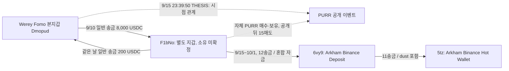
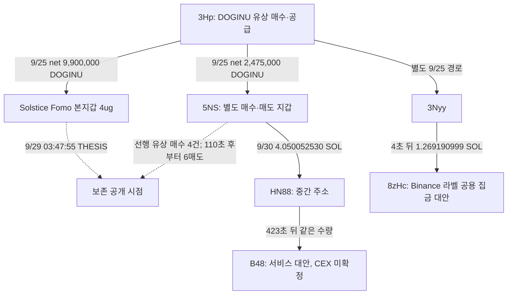

# Fomo Top Trader 연결 지갑과 THESIS 전후 매매

## PPT 작성 전 근거 보고서

**작성일:** 2026년 10월 10일

**근거 마감:** 배치062, 2026-10-10T02:27:45.156Z까지 저장된 자료

**성격:** 탐색적 사례 연구. 동일 소유·시세조종·THESIS 악용 수익을 입증한 보고서는 아니다.

**시각 기준:** 별도 표시가 없으면 UTC. 한국 시각은 9시간을 더한다.

---

## 1. 요약: 지금 무엇을 말할 수 있는가

**Fomo 작성자와 실제 자금 관계가 있는 별도 지갑이, 작성자의 보존 THESIS 전에 해당 토큰을 매수·보유하고 게시 뒤 같은 지갑에서 매도한 사례를 찾았다.** 가장 구체적인 사례는 Werey/PURR와 Solstice/DOGINU다. 두 사례 모두 단순 토큰 전송을 매수로 오인하지 않도록 실제 지출·토큰 증감·서명·성공 여부를 대조했다.

**Werey/PURR는 지갑 간 자금 관계와 재고 처분이 강한 사례다.** 검증된 Fomo 본지갑에서 별도 지갑 F1bNo로 8,000 USDC가 송금됐고, 역방향 200 USDC 일반 송금도 있었다. F1bNo는 THESIS 때 PURR 1,233,646.646503316개를 보유했으며, 그중 최소 1,233,631.919863633개는 유상 매수에서 온 재고였다. 이후 추가 취득분까지 합한 재고가 15번의 매도로 모두 처분됐다. 게시 후 PURR 매도 수령액은 15,196.643524 USDC다.

**Solstice/DOGINU는 게시 직후 매도 시점이 뚜렷한 사례다.** 별도 지갑 5NS는 자체 유상 매수 4건과 공통 공급자에게 받은 물량을 보유했고, Solstice의 보존 THESIS 110초 뒤부터 추가 매수 없이 6번 매도해 12.041207311 SOL을 수령했다. 공통 공급자 3Hp는 Fomo 본지갑과 5NS 양쪽에 DOGINU를 보냈다. 다만 Werey 사례처럼 본지갑과 5NS 사이의 직접 일반 자금 송금까지 확인한 것은 아니다.

**Binance 등 외부 서비스로 이어지는 실제 전송 경로도 확보했다.** 그러나 본지갑과 해당 매도 지갑이 같은 개인의 정확한 CEX 입금 주소를 사용했다는 증거는 아직 없다. 공용 집금·핫월렛에서 만난다는 사실은 동일 거래소 고객이나 동일 소유를 뜻하지 않는다.

현재의 발표 주제는 **“THESIS 전후 연관 지갑의 거래와 회수 경로: 관측 사례와 식별의 한계”**가 적절하다. “뒷지갑으로 선행매수해 THESIS로 이익을 얻었다”는 결론은 자료가 뒷받침하는 범위를 넘는다. 이벤트 당시 유통 시총 100만 달러 이하, 소유·통제, 최초 공개, 원가·손익을 함께 충족한 **엄격한 완결 사례는 0건**이다. 이는 개별 유상 매수나 게시 후 매도 사례가 없다는 뜻은 아니다.

## 2. 범위와 판정 기준

### 2.1 조사 대상과 자료 범위

주 분석 대상은 최초 고정한 Top10 스냅샷(raw141)이다. 현재 리더보드 순위로 교체하지 않았다. 고정 창은 **2026-08-08T04:43:41Z 이상, 2026-10-07T04:43:41Z 미만**의 60일이다. Yeon과 이전 RZD 추적은 보조 사례로 구분하며, 그 자료를 주 표본과 합산하지 않는다.

SQLite에는 전체 Fomo 이벤트 1,338개, 온체인 거래 4,569개, 이벤트·거래 대응 73개, 추적 연결 646개, 지갑 검증 레코드 11개가 저장돼 있다. 최초 Top10의 보존 Fomo 이벤트는 404개(THESIS 171·BUY 123·SELL 110)다. 이 수는 **60일의 모든 활동을 완전히 수집했다는 보증이 아니며**, 온체인 거래 4,569개가 모두 선행매수 의심 거래라는 뜻도 아니다.

일부 정확 주소·토큰 계좌 조회는 빈 후속 페이지까지 확인했다. 지갑의 모든 토큰 계좌, 모든 체인, 실패 거래, 수명 전체까지 조회 완료한 것으로 확대하지 않는다. 접근 실패·미완료 페이지·아직 조회하지 않은 구간은 “거래가 없음”과 구분한다.

### 2.2 보고서에서 사용하는 표현

| 표현 | 이 보고서의 의미 |
|---|---|
| 검증 Fomo 본지갑 | 저장된 Fomo 계정·거래 대응으로 연결된 주소. 법적 실명 확인은 아니다. |
| 연결 지갑 | 실제 일반 자금 전송, 같은 토큰 공급 또는 개별 브리지 주문으로 접점이 있는 주소 |
| 뒷지갑 후보 | 작성자가 통제할 가능성을 추가 검토할 주소. 연결만으로 동일 소유를 확정하지 않는다. |
| 게시 전 매수 | 확보된 가장 이른 THESIS보다 먼저 발생한 실제 유상 매수. 절대 최초 대외 공개 이전이라는 뜻은 아니다. |
| 매도 수령액 | 실제 매도에서 지갑이 받은 USDC·SOL 등 quote 자산 수량 |
| 순현금흐름 | 지정 거래 묶음의 수령액에서 지출액을 뺀 값. 취득 원가·비용·잔여 재고를 모두 반영한 실현 수익과 다르다. |
| CEX 입금 경로 | 실제 송금이 거래소 라벨 주소에 도달한 경로. 거래소 고객 신원·내부 계정 입금 완료까지 증명하지 않는다. |

핵심 가설은 **별도 지갑의 선행 취득 → Fomo 계정의 공개 → 같은 별도 지갑의 매도 → 회수 접점**이다. 각 단계에 실제 거래가 있어야 한다. 선행 취득·사후 매도와 게시 시각이 맞아도, 게시가 가격이나 이익을 유발했다는 인과관계는 별도 문제다.

## 3. 사례별 확인 수준

| 계정·토큰 | 본지갑과 별도 지갑의 접점 | 별도 지갑의 게시 전 매수·재고 | 같은 별도 지갑의 게시 후 매도 | 외부 회수 경로 | 발표에서의 역할 |
|---|---|---|---|---|---|
| **Werey / PURR** | 본지갑→F1bNo 8,000 USDC, 역방향 일반 송금 200 USDC | 실제 유상 매수, 게시 때 123.36만 개; 대부분 유상 기원 | 15매도, 추가 취득분 포함 최종 0 | F1bNo→6vy9→Binance 핫월렛 | **핵심 사례. 직접 자금 관계와 전량 처분** |
| **Solstice / DOGINU** | 3Hp가 본지갑·5NS 양쪽에 공급 | 5NS 유상 매수 4건/1 SOL + 대가 미확인 공급 | 게시 110초 뒤부터 6매도/12.041207311 SOL | 5NS→HN88→B48. 이후 CEX 미확정 | **핵심 사례. 공개 직후 매도와 공통 공급** |
| Werey / SI | 위와 같은 F1bNo | 게시 때 1,002,757.978826 SI | 게시 후 26매도, 최종 0 | F1bNo의 CEX 경로는 있으나 마지막 SI 매도보다 앞섬 | 같은 상대의 반복 거래 비교. 저시총 적격 미확정 |
| pointfarmcap / STONKCATS | 발행자 초기 분배와 플랫폼 보상 | 본지갑에 공급 + 본지갑 자체 유상 매수 | **본지갑** 게시 후 매도 | 정확한 CEX 회수 미입증 | 에어드롭·보상 오탐을 설명하는 비교 사례 |
| theveeman / CALI | Ek의 실제 자금 공급·후속 반환 | Ek 유상 매수 + 혼합 취득·LP | LP 회수. 일부 수령 지갑의 토큰 매도는 THESIS 이전 | Ek→중간 주소→Roobet 라벨 주소 | 연결은 실제지만 요청한 현물 매수·사후 매도 구조와 구분 |
| econoar / ORBIO·WORM | Ethereum 0.005 ETH 관계, 별도 주소→본지갑 토큰 전달 | ORBIO 취득 UI·전달 시점, WORM 전달 시점 확보 | 같은 별도 주소의 사후 매도·quote 미확보 | 정확한 공통 개인 입금 주소 미확정 | 취득 후 본지갑 전달 유형의 후속 후보 |
| detweiler / 공급 지갑들 | 반복 SOL·USDC 공급, 공급자끼리 정확 8FX 입금 경로 | 조회한 THESIS 토큰에서 유효한 같은 지갑 선행 재고 미확인 | 동일 토큰 선행매수→사후 매도 묶음 미확인 | 일부 공급자→8FX→Binance 핫월렛 | 자금 관계·거래소 사용과 선행매수 입증을 분리 |

위 표의 핵심 사례도 역사적 유통 시총≤100만 달러와 동일 소유를 확정한 적격 사례는 아니다. SI는 특히 늦은 약 3,036만 달러 시총 표본이 있어 저시총 사례로 소개하면 안 된다.

## 4. 핵심 사례 A — Werey / PURR

### 4.1 연결 구조

Werey의 검증 Fomo 본지갑은 `Dmopud…LKs28`, 별도 자금 상대는 `F1bNo…qbM4B`다. 정확 주소와 mint는 부록 A에 기재했다.

실선은 실제 자금 전송이다. 점선은 매매·공개 시점의 비교이며 송금이나 지갑 소유권을 나타내지 않는다. CEX 경로는 이 기간의 별도 전송 묶음으로, 모든 금액이 PURR 매도에서 나왔다는 뜻은 아니다.

### 4.2 주요 시점

| 시각 UTC | 관측 사실 | 해석 |
|---|---|---|
| 9/10 23:44:51 | Werey 본지갑→F1bNo 8,000 USDC | 실제 일반 자금 공급. 대여·투자·결제 등 목적은 미확정 |
| 9/10 23:52:05 | F1bNo→본지갑 200 USDC | 434초 뒤 역방향 일반 송금. 공동 소유를 증명하지는 않음 |
| 9/15 23:39:50 | 가장 이른 보존 PURR THESIS | 과거 공개 이력이 더 없었다는 증명은 아님 |
| 같은 THESIS 직전 | F1bNo PURR 1,233,646.646503316개 | 최소 1,233,631.919863633개가 유상 매수 기원 |
| THESIS 이후 | 3BUY + 소액 분배 7건 + 15SELL | 게시 후 새 매수도 포함. 전부 선행 매집분이라고 하지 않음 |
| 9/22 07:16:24 | 마지막 PURR 매도, 해당 계좌 잔액 0 | 게시 시점 재고가 이후 모두 처분된 수량 흐름 확인 |

8,000 USDC 송금 전에도 F1bNo의 PURR 취득이 존재한다. 따라서 해당 송금 하나를 모든 초기 매집의 원금으로 지정하지 않는다.

### 4.3 재고가 실제로 전부 팔렸는가

정확 PURR 계좌의 82행과 빈 후속 페이지를 대조했다. 전체 유상 매수 31건·매도 21건과 별도 입금 8건을 구분했다. 게시 후 재고식은 다음과 같다.

**게시 시 재고 1,233,646.646503316 + 게시 후 유상 취득 157,946.904401926 + 대가 미확인 순수령 35.852957446 = 게시 후 매도 1,391,629.403862688 PURR.**

마지막 잔액은 0이다. 이 계좌의 재고가 모두 처분된 사실은 확인된다. 대체 가능한 토큰이므로 특정 매도 한 건이 어느 취득 물량을 팔았는지는 식별하지 않았다. 게시 전 대가 미확인 입금 최대 14.726639683개를 제외해도 당시 재고 대부분이 실제 유상 매수에서 왔다는 하한은 유지된다.

### 4.4 얼마를 받았고, 얼마가 수익인가

| PURR 거래 구간 | 유상 매수 USDC 지출 | 매도 USDC 수령 | 관측 순현금흐름 |
|---|---:|---:|---:|
| 보존 THESIS 전 | 6,428.364600 | 4,073.040106 | −2,355.324494 |
| 보존 THESIS 후 | 1,810.000000 | **15,196.643524** | **+13,386.643524** |
| 확보된 PURR 거래 전체 | 8,238.364600 | 19,269.683630 | **+11,031.319030** |

“게시 뒤 15,196.643524 USDC를 매도에서 받았다”는 확인된 사실이다. “게시 뒤 13,386.643524 USDC의 이익을 냈다”는 표현은 적절하지 않다. 게시 전 재고의 취득 비용을 게시 후 구간에서 빼지 않았기 때문이다. 전체 구간의 +11,031.319030 USDC도 별도 입금의 취득 대가, 비용 부담·지갑 소유 귀속이 남아 있어 확정 실현 수익으로 표기하지 않는다.

### 4.5 Binance 경로와 본지갑의 접점

F1bNo→6vy9는 12회·21,057.868025 USDC, 6vy9→5tz는 11회·21,057.879025 USDC다. 0.011 USDC 차이는 다른 유사 주소에서 들어온 dust로 설명된다. 유사 주소를 F1bNo와 합치지 않았다. 현재 Arkham은 6vy9를 Binance Deposit Address, 5tz를 Binance Hot Wallet로 표시한다. 초기 라벨 미확보 기록보다 후속 raw3886을 우선한다.

PURR 마지막 매도 뒤 F1bNo의 일반 USDC 출금은 9건·18,004.717677 USDC다. 그중 7건·17,879.717677 USDC가 6vy9, 10 USDC가 DXAh, 115 USDC가 3TW6로 갔다. 다른 토큰 거래·잔액이 섞이므로 이 출금을 PURR 회수액으로 확정하지 않는다.

Werey 본지갑과 F1bNo가 **같은 정확한 개인 CEX 입금 주소를 사용했다는 증거는 없다.** 지정 본지갑 USDC 조회와 6vy9 계좌 비교에서는 본지갑의 직접 입금이 관측되지 않았다. 다른 계좌·체인·기간의 부재까지 증명한 것은 아니다. CEX 전송의 indexed 자료와 getTransaction 대조는 같은 QuickNode의 다른 조회 방법이며 독립 제공자 교차 검증이라고 하지 않는다.

### 4.6 소액 연결의 대안과 반복성

F1bNo→Werey의 실제 USDC 수령은 36건·212.100249 USDC다. 200 USDC 일반 송금 1건과 소액 35건·12.100249 USDC를 나눠야 한다. 소액은 스왑 관련 로그와 함께 나타나 수수료·추천 보상 가능성이 있다. 이를 “수익 반환 35회”로 설명하지 않는다.

3TW6는 F1bNo에 6.7 USDC를 보냈고 나중에 115 USDC를 받았다. 115 USDC 수령 21초 뒤 매수한 최종 토큰은 PURR가 아닌 ARTHUR였으며, 같은 스왑의 소액 분배 0.2375 USDC가 F1bNo에 돌아갔다. DXAh의 반복 소액 수령에도 Fomo 수수료 대납·스왑 관련 분배 대안이 있다. 현재 이 두 주소를 PURR 뒷지갑으로 추가하지 않는다.

같은 F1bNo의 SI에서도 게시 전 재고→게시 후 26매도→최종 0이 확인됐다. 확보된 전체 SI 스왑 순현금흐름은 +22,343.803882 USDC다. 다만 전체 매도 수령 33,586.185119 USDC를 전부 THESIS 이후 금액으로 소개하면 안 된다. CEX 전송들도 마지막 SI 매도보다 앞선다. **반복 거래 구조의 비교 자료**이며 저시총 적격·게시 후 수익 회수의 확정 사례는 아니다.

### 4.7 발표용 결론

> Werey의 검증 Fomo 지갑과 일반 자금 송금이 오간 별도 지갑이, 보존 THESIS 이전에 대부분 유상 취득한 PURR 재고를 보유하고 게시 이후 전량 처분했다. 실제 매도 수령과 Binance 라벨 주소로의 전송도 확인되지만, 같은 소유자·같은 거래소 고객·게시 때문에 발생한 수익은 아직 입증되지 않았다.

근거: [Werey 상세 보고서](werey-funded-wallet-inventory-and-cex-review.md), raw3239·3240, 후속3886·3894·3895, 최신4056·4057·4058.

## 5. 핵심 사례 B — Solstice / DOGINU

### 5.1 연결 구조

공통 공급은 확인됐다. 5NS를 Solstice 소유로 확정할 직접 자금·통제 증거는 없다. 아래쪽 공급자의 Binance 경로는 DOGINU THESIS 이전 전송이며, 위쪽 5NS의 게시 후 매도 회수 경로와 연결 완료한 것이 아니다.

### 5.2 주요 시점과 수량

| 시각 UTC | 사실 |
|---|---|
| 9/23 21:12:38 | 5NS의 첫 실제 DOGINU 매수: 0.25 SOL, net 188,849.460332 DOGINU |
| 9/23~25 | 게시 전 자체 유상 매수 4건: gross input 1 SOL, 취득 779,895.978822 DOGINU |
| 9/25 14:57:50 | 3Hp→Fomo 본지갑 순수령 9,900,000 DOGINU |
| 9/25 15:21:27 | 3Hp→5NS 순수령 2,475,000 DOGINU. 대가·원가 미확인 |
| 9/29 03:47:55 | 가장 이른 보존 THESIS. 5NS 재고 2,954,895.978822 DOGINU |
| 9/29 03:49:45 | **110초 뒤** 첫 사후 매도: 350,000 DOGINU, quote 1.016704346 SOL |
| 첫 사후 매도부터 6매도 | 추가 매수 없이 2,366,447.994004 DOGINU 매도, 12.041207311 SOL 수령 |
| 9/30 03:51:07 | 5NS→HN88 4.050052530 SOL, 이후 423초 뒤 HN88→B48 같은 수량 |

게시 시 재고는 `779,895.978822 + 2,475,000 − 300,000 = 2,954,895.978822`다. 첫 6매도 후 588,447.984818 DOGINU가 남아 전량 청산 사례는 아니다. 총 유상 취득량을 모두 우선 배정해도 해당 6매도에서 공급 물량이 소비된 하한은 1,586,552.015182 DOGINU다. 이는 재고 수량의 하한이며 특정 매도대금의 출처 배분은 아니다.

### 5.3 수익과 회수에 대한 판정

12.041207311 SOL은 실제 매도 quote 수령이다. 공급 물량 247.5만 DOGINU의 대가가 없으므로 **12.041207311−1 SOL을 수익으로 계산하지 않는다.** 지정 성공 거래 묶음의 실제 native 순증가 +5.346205767 SOL도 알려져 있으나, 이는 첫 6매도와 다른 거래 집합이다. 두 수치를 같은 구간의 이익처럼 섞지 않는다. 추가 실패 거래 33건의 수수료 0.023864977 SOL도 전체 60일 비용이 아니다.

5NS→HN88→B48은 실제 출금이다. B48은 여러 상대의 자금과 공통 nonce·수수료 처리 구조가 관측돼 공유 서비스 대안이 있다. 현재 CEX나 특정 고객 입금 주소로 확정하지 않았다. 두 정확 거래의 공개 Relay 조회는 주문 0개를 반환했지만, 이는 해당 조회에서 주문을 얻지 못했다는 뜻이며 브리지·CEX 부재 증명은 아니다.

공급자 3Hp의 별도 크로스체인 경로는 **Relay→Ethereum 213d→3081→Binance 라벨 487**까지 확인됐다. 9/15 마지막 입금은 0.054858215192477777 ETH로, DOGINU 매수·THESIS 이전이다. 따라서 이 경로를 게시 후 수익 회수로 연결하지 않는다.

3Hp→3Nyy→Solana 8zHc 입금은 9/25, 1.269190999 SOL이다. 다른 EMBER 연관 지갑도 같은 8zHc에 도달했지만, 현재 화면에 대량·다수 거래가 보여 공용 집금 대안이 강하다. **동일 개인 CEX 고객의 접점으로 쓰지 않는다.** EMBER 관련 48매도는 그 토큰의 THESIS 이전이라 요청한 사후 매도 사례로도 넣지 않는다.

Solstice 본지갑에 실제 연결된 Hypercore 지갑의 확보된 출금 10건·150,165.576050 USDC는 모두 본지갑 4ug로 반환됐다. 이 반환 자체를 공급자와 같은 Binance 입금 주소 사용으로 해석하지 않는다.

### 5.4 발표용 결론

> Solstice의 Fomo 지갑과 별도 매도 지갑은 실제 DOGINU 공통 공급자를 가진다. 별도 지갑은 자체 유상 매수 재고를 보유한 채 보존 THESIS를 맞았고 110초 뒤부터 매도했다. 거래 순서는 확인되지만, 공급·소유 관계와 매도 원가, 이후 개인 CEX 입금의 일치는 미확정이다.

근거: [DOGINU 사례 상태](doginu-case-evidence-status.md), [공급자 크로스체인](doginu-supplier-crosschain-wallet-review.md), [공급자 Solana 입금](doginu-supplier-solana-binance-deposit-review.md). raw3437·3453·3492·3496·3894·3895·3943·3987·4011·4020 및 각 검토 raw.

## 6. 같은 구조로 오인하면 안 되는 비교 사례

### 6.1 pointfarmcap / STONKCATS — 본지갑 매매와 보상 분배

pointfarmcap 본지갑 Beqv에는 발행자 BTR에서 초기 순수령 29.7M STONKCATS가 공급됐고, 본지갑 자체 유상 매수도 있었다. 보존 THESIS는 10/6 05:14:35 UTC, 첫 사후 매도는 17:23:44로 12시간 9분 9초 뒤다. 게시 후 12매도에서 17,389.204688 USDC, 11매수 지출 569.104574 USDC로 관측 순현금흐름은 +16,820.100114 USDC다. 해당 시점 잔여 재고는 8,761,371.230654개다.

이 매도는 **Fomo 본지갑의 매도**다. 별도 숨은 지갑의 사후 매도라고 소개하지 않는다. 초기 공급 대가·원가가 없어 위 순현금흐름도 확정 수익이 아니다.

STONKCATS는 1% Token-2022 수수료를 모아 페어 토큰 STONK를 분배하는 실제 보상 구조가 확인됐다. STONKCATS와 STONK는 서로 다른 mint다. 공식 보상 24행을 실제 소유자·토큰 증감과 대응했고, 발행자 BTR와 플랫폼 수수료 권한 5KX도 구분했다. 초기 29.7M 배분의 자격·대가는 미확정이다. **공통 분배자·페어 보상 수령만으로 사적 뒷지갑 군집을 만들 수 없다.**

근거: [STONKCATS 추적](pointfarmcap-stonkcats-trace.md), [수수료·보상 역할 검토](stonkcats-fee-reward-role-review.md), raw2228·2229·2350·2351 및 대응 거래.

### 6.2 theveeman / CALI — 연결 LP 지갑의 회수

theveeman 본지갑 F5와 Ek 사이의 실제 자금 관계, Ek의 CALI 유상 매수와 LP 활동은 확인됐다. 10/5 LP 회수의 WSOL은 254.831172892 SOL 상당이며, **원금과 수수료가 함께 반환된 값**이다. 현물 매도 수익으로 바꾸면 안 된다.

Ek는 10/6 본지갑 F5에 41.540854405 SOL을 송금했고 본지갑은 약 2분 50초 뒤 이를 포함한 잔액으로 USDC 스왑을 했다. Ek의 기존 잔고·다른 유입·LP 원금이 섞이므로 CALI의 특정 매도 이익 반환으로 귀속하지 않는다. 다른 수령 지갑들의 CALI 청산은 9/19 또는 9/22로 10/3 THESIS 이전이다.

Ek→Ef9p→53yze→9cDD의 실제 경로와 현재 Arkham의 **Roobet Deposit / Roobet Hot Wallet** 라벨도 확인됐다. Roobet은 이 조사에서 도박 플랫폼으로 구분하며 CEX로 표기하지 않는다. 고객 신원·실제 도박 여부·CALI 수익 귀속은 미확정이다.

근거: [CALI 처분·회수](theveeman-cali-recipient-exit-and-native-recovery-review.md), [Roobet 역할](top10-roobet-endpoint-and-case-readiness-review.md), raw3780·3811·3856·3873·3874·3881.

### 6.3 econoar / ORBIO·WORM — 별도 주소 취득 후 본지갑 전달

Ethereum의 econoar 본지갑 1605와 별도 주소 bfd 사이에 0.005 ETH 전송이 있다. Robinhood Chain에서는 다음 원문 화면을 확보했다.

- **ORBIO:** 9/30 21:07:31, bfd의 USDG 124,948.533095 지출과 ORBIO 1,525,221.08389185277232859 취득 표시. 20초 뒤 같은 수량이 본지갑에 전달됐다. 보존 THESIS 10/6 02:34:05보다 앞선다.
- **WORM:** 9/18 21:07:08, bfd→본지갑 3,031,388.715612183155949703 WORM 전달. 보존 THESIS는 37초 뒤다. 초기 취득 상세는 미완성이다.

이는 **별도 주소 취득·전달→본지갑 공개** 유형이다. 전달 계약은 THESIS 계약과 맞지만, 취득 거래의 정확 계약·원시 로그·독립 receipt와 동일 bfd의 사후 매도는 미확보다. 일부 독립 탐색기 접근은 HTTP403이었다. 따라서 “뒷지갑이 보유하다 게시 후 팔았다” 유형으로 확정하지 않는다.

근거: [econoar 시점 보고서](econoar-private-wallet-orbio-worm-timeline.md), raw4023·4024·4025·4026·4032·4033·4034.

### 6.4 detweiler — 반복 공급과 CEX 입금 접점은 있지만 거래 패턴 미완성

Arv는 detweiler 본지갑 EC2에 21회·3,500 SOL과 6회·113,000 USDC를 일반 송금했다. Ey 역시 SOL·USDC를 공급했다. Arv 및 다른 공급자가 정확한 8FX 주소를 거쳐 Binance 핫월렛 5tz로 송금한 경로는 확인됐다.

그러나 조회한 THESIS 토큰에 대해 해당 공급자의 같은 토큰 선행 재고→게시 후 매도 구조는 확보하지 못했다. 확인된 한 후보의 매수는 THESIS 이후였고, 다른 후보의 유상 재고는 THESIS 때 이미 0이었다. 본지갑 EC2와 공급자가 같은 8FX에 입금했다는 증거도 지정 범위에서 없다. **큰 반복 송금 자체가 선행매수·공동 소유의 증명은 아니다.**

근거: [반복 공급·정확 CEX 경로](detweiler-repeat-funders-and-exact-cex-path-review.md), 후속 detweiler 보고서, raw3606·3607·3647·3687.

## 7. CEX·외부 서비스 접점 비교

| 실제 경로 | 정확한 최종·중간 식별자 | 확인 수준 | 공통 개인 입금 주소로 쓸 수 있는가 |
|---|---|---|---|
| F1bNo→6vy9→5tz | Solana 6vy9 / 5tz, 부록 A | 실제 USDC 전송, 현재 Binance Deposit/Hot Wallet 라벨 | **미확정.** Werey 본지갑의 같은 6vy9 사용 미확인 |
| DET 공급자→8FX→5tz | Solana `8FXdW1ZcR3ebEqsNNDBbZ5m39Zdif3WSYuicKrXibxwJ` | 실제 송금·독립 RPC, 현재 Binance Deposit 라벨 | **미확정.** 6vy9와 다른 주소. 핫월렛 일치로 병합 금지 |
| 3Hp→Relay→213d→3081→487 | Ethereum `0x487cab40f6d11a278fa7c442c6741eabe44eab5d` | 개별 주문, Etherscan 거래·잔액, 현재 Binance 라벨 | **미확정.** 본지갑·5NS의 같은 주소 사용 미확인; DOGINU 이전 전송 |
| 3Hp→3Nyy→8zHc 및 EMBER 연관 경로 | Solana `8zHcWujHhyJri3CRTcWUGmT5WSRdwW7xrns3WTTkPGvS` | 실제 전송·독립 RPC, 현재 Binance Deposit 라벨 | **개인 접점 증거에서 제외.** 공용 집금 대안이 강함 |
| 5NS→HN88→B48 | Solana B48, 부록 A | 실제 4.050052530 SOL 출금, 역할 unknown | CEX 고객·목적지 미확정 |
| Ek→Ef9p→53yze→9cDD | Solana 53yze / 9cDD, 부록 A | 독립 송금 증명, 현재 Roobet 라벨 | CEX로 분류하지 않음. 본지갑 직접 입금·같은 고객 미확정 |
| Yeon 연결 54d2→c67a/32f023→Binance 51 | BSC `0x8894e0a0c962cb723c1976a4421c95949be2d4e3` | 보조 사례. 실제 전달, 일부 독립 receipt | 중간 주소 재사용은 후보 근거. 동일 고객·선행매수 수익은 미확정 |

**Binance라는 같은 이름에서 만나는 것, 같은 핫월렛에서 만나는 것, 같은 고객별 입금 주소를 쓰는 것은 서로 다른 주장이다.** 체인·정확 주소·역할·시기·집금 운영을 함께 비교해야 한다. 거래소 라벨은 제공자의 현재 주장이고, RPC는 전송·성공·수량을 검증한다.

## 8. 보조 사례 — Yeon과 이전 RZD

### 8.1 Yeon: CEX 경로는 구체적, 제보 지갑의 동일 소유는 미확정

검증 Solana 본지갑 DHnr와 실제 브리지로 연결된 EVM 54d2가 있다. BSC에서 54d2→c67a→Binance 51의 동일 수량 USDC 3건은 총 588,098.805041163975619333 USDC다. 9/8 한 쌍은 양쪽 receipt의 정확 USDC 로그를 검증했고 나머지 두 쌍은 인덱스 근거다. 54d2→32f023의 12.5 BNB 공급과 이후 Binance 51 전송도 직접 RPC로 검증했다.

사용자가 제보한 `0x32f0a…1353`과 실제 송금 중간 주소 `0x32f023…1353`은 다르다. 제보 주소의 일부 BNB 이름 토큰 로그는 실제 native 송금을 흉내 낸 미검증 이벤트였다. 소유 관계에 쓰지 않는다. 다른 제보 주소 3개가 실제 32f023에 송금한 과거 비교 자료는 있으나 주 60일 범위 밖이며, 동일 고객이라는 결론은 아니다.

Yeon 자료는 거래소 경로 조사에는 의미가 있지만, 해당 제보 주소의 같은 저시총 토큰 선행매수→Yeon THESIS→제보 주소 사후 매도·원가까지 완결한 것은 아니다. 여기의 큰 USDC 전달액을 매매 수익으로 소개하지 않는다.

근거: [두 달 보조 조사](two-month-review.md), [Yeon 추적](yeon-wallet-trace.md), raw1994·1995·2014 및 이전1722–1733.

### 8.2 RZD: 첫 THESIS 이전 선행매수 사례로 사용할 수 없음

RZD 연결 주소 6a2는 STOCKER를 10/6에 4번 매수하고 총 1,114,947.519342597221320112개를 본지갑 afe3에 전달했다. 하지만 첫 보존 THESIS는 10/3, 두 번째는 10/5다. 이 4매수는 **첫·두 번째 THESIS 이후, 세 번째 이전**이다. 최초 공개 이전 선행매수라고 분류하면 시점이 틀린다.

이후 본지갑의 실제 같은 토큰 매도·quote·원가와 공통 개인 CEX 입금은 미확정이다. 공급자 e7af→Robinhood 입금 후보와 6a2→80cf→Coinbase 후보도 서로 다른 경로이며, CEX→지갑 출금을 현금화 입금으로 뒤집지 않는다. 중단된 RZD 추적을 이 보고서 작성으로 재개하지 않았다.

근거: [RZD CEX·매수 시점](rank9-cex-prebuy.md), [RZD 연결](rank9-wallet-trace.md), raw1605·1653.

## 9. 매도대금·순현금흐름·수익의 정리

| 대상·거래 집합 | 실제 관측값 | 발표 가능한 문장 | 이익으로 확정하지 못하는 이유 |
|---|---:|---|---|
| F1bNo / PURR 게시 후 | 매도 15,196.643524 USDC, 구간 순현금흐름 +13,386.643524 | 게시 뒤 실제 매도로 USDC를 수령 | 게시 전 재고 비용이 사후 구간에 미반영, 추가 매수·별도 공급 |
| F1bNo / PURR 확보 전체 | 순현금흐름 +11,031.319030 USDC | 지정 스왑의 수령액이 지출액을 초과 | 별도 공급의 원가, 비용·소유 귀속 미확정 |
| F1bNo / SI 확보 전체 | 순현금흐름 +22,343.803882 USDC | 다른 토큰에서도 양의 관측 스왑 현금흐름 | 전체 구간 값, 무료처럼 보이는 이전 대가·비용 미확정 |
| 5NS / DOGINU 첫 사후 6매도 | quote 12.041207311 SOL | THESIS 110초 뒤부터 매도로 SOL 수령 | 공급된 247.5만 개 원가 미확인, 잔여 재고 존재 |
| pointfarmcap 본지갑 / STONKCATS 사후 | 순현금흐름 +16,820.100114 USDC | 본지갑의 공개 이후 매매 현금흐름 | 초기 공급 원가 미확인, 잔여 재고 존재, 숨은 지갑 사례 아님 |
| F1bNo→6vy9 회수 경로 | 21,057.868025 USDC | 별도 지갑의 실제 CEX 라벨 경로 전송 | 여러 자금·토큰이 혼합, PURR/SI 수익과 직접 배분 불가 |
| Yeon 연결 BSC 전달 | 588,098.805041163975619333 USDC | 연결 주소의 3건 실제 거래소 서비스 전달 | 매매 손익이 아닌 송금액 |

계정 간 수치나 USDC·SOL·ETH를 합산해 “총 악용 수익”을 만들지 않는다. USDC 수량을 당시 달러 실현 수익으로 자동 치환하지 않으며, Fomo amount_usd·Arkham 현재 USD도 원가로 쓰지 않는다.

## 10. 저시총 조건과 공개 시점의 남은 공백

연구의 대상 조건은 **해당 THESIS/CALL 또는 실제 BUY 시점의 유통 시총≤100만 달러**다. 현재 FDV·현재 가격·총발행량을 과거 유통 시총으로 대체하지 않는다.

| 토큰 | 현재 역사 근거 | 상태 |
|---|---|---|
| PURR | THESIS 전 완결된 1분봉 2풀. 종가 약 $0.007696 / $0.008096; 역사 유통량 없음 | `pending_cap` |
| DOGINU | 단일 풀 완결 분봉 HIGH × 역사 총공급 상한 1B의 조건부 값: 첫 BUY $146,822.98 / THESIS $435,103.58 | `pending_cap_proxy`. 전체 시장·유통량 조건 검토 전 적격 아님 |
| SI | 늦은 10/2 06:00 유통 시총 표본 약 $30.36M. 다음 실제 BUY보다 2,419초 전 | 해당 이벤트 적격 미확정. 저시총 사례로 제시 금지 |
| STONKCATS·CALI·ORBIO·WORM | 일부 가격·공급 대용치 또는 화면 단서만 있음 | 주요 이벤트의 적격 근거 보류 |

운영 기준 **300초**는 역사적 가격·시총 표본을 이벤트와 대응할 때 허용하는 시차다. 선행 매집을 찾는 기간이 5분이라는 뜻은 아니다. 매집·공급 이력은 가능한 60일 창과 취득 시점까지 따로 추적한다. 300초를 늘리면 오래된 가격을 이벤트 가격으로 쓰는 오차가 커지며, 유통량·시장 전체 가격 공백 자체는 해결되지 않는다.

보존 THESIS를 절대 최초 공개로 확정하려면 과거 공개 이력의 접근·완결성이 필요하다. 일부 프로필은 로그인 전 화면으로 이동했고 저장 REST 응답도 자료 미가용을 반환했다. 이 상태를 공개가 없었던 것으로 해석하지 않는다. 가격 상승·체결·공개 시점이 맞는 사례도 게시의 인과적 영향을 주장하려면 유동성·시장 공통 움직임·대조 구간 등 추가 근거가 필요하다.

## 11. 최초 10명의 조사 현황과 공백

| 계정 | 발표에 쓸 현재 관측 | 남은 핵심 공백 |
|---|---|---|
| pointfarmcap | STONKCATS 본지갑 매매, 초기 분배·보상 역할 | 사적 별도 지갑의 같은 토큰 선행 취득·사후 매도 |
| The__Solstice | DOGINU 5NS 패턴, 공급자 CEX 경로, Hypercore 반환 | 5NS 통제·원가·개인 endpoint 및 역사 시총 |
| theveeman | CALI 자금 공급·LP 회수·Roobet 경로 | 현물 사후 매도와 수익의 특정 귀속 |
| RareDualJay | 지정 주소 조회 일부 종료 | 검증 Fomo 지갑 기초·같은 토큰 거래 연결 미완성 |
| detweiler | 반복 공급자·정확 8FX 경로 | 공급자 같은 토큰의 유효한 선행 재고·사후 매도 |
| pricedin | 지정 주소 조회 일부 종료 | 검증 Fomo 지갑 기초·같은 토큰 연결 미완성 |
| RunningClam | 보존 THESIS | 실제 체인 지갑·거래 해시, Robinhood RPC 접근 공백 |
| econoar | ORBIO·WORM 전달 시점 | 취득 receipt·같은 bfd 사후 매도·원가 |
| RZDxbt | 기존 연결·STOCKER 전달 | 첫 공개 전 사례 아님. 단독 추가 추적은 중단 상태 |
| motiyawerey | F1bNo의 PURR/SI 선취득·사후 매도·CEX 경로 | 소유·역사 시총·개인 공통 입금·손익 귀속 |

“10명을 조사했다”는 것은 같은 깊이로 10명 모두 완료했다는 뜻이 아니다. 숨은 지갑을 아직 찾지 못한 경우와 기초 주소·접근이 미완성인 경우가 섞여 있다. 현재 자료로 Top100 전체에 대한 발생 비율을 추정하지 않는다.

## 12. PPT에 사용할 주장과 제외할 주장

| 사용 가능한 주장 | 아직 사용할 수 없는 주장 |
|---|---|
| Werey와 실제 자금 관계가 있는 별도 주소의 PURR 선취득·사후 전량 처분을 확인했다. | F1bNo는 Werey가 소유한 비밀 지갑이다. |
| 5NS는 공통 공급자로 연결됐고 보존 THESIS 110초 뒤 매도를 시작했다. | Solstice가 게시로 가격을 조종하도록 5NS에 지시했다. |
| 특정 매도에서 실제 USDC·SOL 수령량을 확인했다. | 구간 순현금흐름 전액이 작성자의 THESIS 악용 수익이다. |
| CEX 라벨 주소까지 이어지는 실제 전송이 있다. | 같은 Binance 핫월렛에 도달했으므로 같은 개인이다. |
| STONKCATS의 수수료·페어 보상 구조를 검증해 오탐 대안을 확인했다. | 같은 발행자·분배자에게 받은 모든 주소가 작성자의 뒷지갑이다. |
| 저시총 대용치는 있으나 엄격한 적격 판단은 보류했다. | 두 핵심 사례는 확정된 100만 달러 이하 토큰이다. |

**발표 권장 제목:** 「Fomo THESIS 전후 연관 지갑의 거래와 회수 경로」

**부제:** 「별도 지갑의 선취득·사후 매도 관측 사례와 동일 소유 식별의 한계」

### 슬라이드 구성안

| 순서 | 내용 | 보여줄 자료 |
|---:|---|---|
| 1 | 연구 질문: 작성자와 연결된 별도 지갑이 먼저 사고 나중에 파는가 | 핵심 가설 4단계, 미확정 소유 표시 |
| 2 | 조사 범위·판정 기준 | 고정 Top10·60일·유통 시총≤$1M·증거 구분 |
| 3 | 사례 비교 | 3절 표를 축약. Werey·DOGINU 우선 |
| 4 | Werey 직접 자금 관계와 PURR 시간축 | 8,000/200 USDC, THESIS 재고, 최종 0 |
| 5 | Werey 매도 수령·CEX 경로 | 사후 수령 15,196.643524 USDC, 혼합 회수 주석 |
| 6 | DOGINU 공통 공급과 110초 매도 | 3Hp→두 지갑, 4BUY→THESIS→6SELL |
| 7 | 매도 지갑에서 출금·공급자 경로의 차이 | 5NS→B48 미확정 / 공급자 Binance 경로는 공개 이전 |
| 8 | 오탐 검토 | STONKCATS 페어 보상·CALI LP·공용 집금 |
| 9 | 어디까지 결론 가능한가 | 사실·미확정 주장 비교, 엄격한 완결 0건 |
| 10 | 후속 연구 | 소유 관계, 최초 공개, 역사 시총, 원가, 정확 개인 입금 |

각 핵심 사례 슬라이드에는 **“보존 THESIS 기준 / 소유 미확정 / 역사 유통 시총 보류 / 수령액≠확정 수익”**을 읽을 수 있는 크기로 표시한다. 같은 정보를 작은 각주에만 숨기지 않는다.

## 13. 후속 조사 우선순위

1. **Werey/PURR의 연결 성격과 원가 보강.** 이미 종료된 계좌를 재수집하기보다 일반 원금 송금·반환·정확 개인 입금 재사용의 새로운 근거를 찾는다. 소액 수수료성 송금은 군집에서 제외한다. 별도 공급 대가·실제 비용 부담·손익 계산 방법을 정한 뒤에 수익을 계산한다.
2. **DOGINU 5NS의 개별 회수 목적지와 소유 접점.** HN88→B48 이후 해당 송금의 개별 주문·수령자를 찾을 수 있을 때만 이어간다. 공용 서비스의 전체 자금을 팬아웃해 개인에게 배분하지 않는다. 공급자 Binance 경로를 5NS 사후 회수와 섞지 않는다.
3. **공개 이력과 역사 시총 적격 근거.** 최초 공개 확인과 당시 유통량·시장 가격을 보완한다. 기준을 만족한 경우에만 토큰 전체 매수 군집·BigQuery로 확장한다. 미완료 접속이나 빈 결과를 활동 부재로 바꾸지 않는다.
4. **econoar의 취득·전달형 사례 보완.** ORBIO/WORM의 정확 취득 receipt와 동일 bfd의 사후 exit·quote를 확인한다. 본지갑 전달 뒤 본지갑 매도라면 별도 보유·사후 매도형과 구분한다.

새 사례 수를 늘리기보다 기존 두 핵심 사례의 어느 주장까지 증명되는지 좁혀 완성하는 편이 발표의 설득력을 높인다. 자료가 추가되지 않으면 그 한계를 결론으로 유지한다.

## 부록 A. 핵심 주소·토큰 식별자

아래 별도 주소의 소유자는 미확정이다. Solana 토큰 계좌와 소유 지갑 주소를 혼동하지 않도록 주 표에는 owner를 적었다.

| 역할 | 체인·정확 주소 |
|---|---|
| Werey Fomo 본지갑 | Solana `DmopudSGaQQenK4cW5NgmHUsexMB3sEJNn6n1EfLKs28` |
| Werey 실제 자금 상대 | Solana `F1bNo6w7c56fhTrWaQtpEPjpL54zrhEf2j4uA1dqbM4B` |
| F1bNo 회수 중간 주소 | Solana `6vy9yXosShBGNPU5SbqTods2CF8YLnpELcJf5rrSEf9J` |
| Binance 핫월렛 라벨 | Solana `5tzFkiKscXHK5ZXCGbXZxdw7gTjjD1mBwuoFbhUvuAi9` |
| Solstice Fomo 본지갑 | Solana `4ugDhHJ8XDXAeABmrNmGffFaLbJb9BkPyiFGVSV9ocwo` |
| DOGINU 공통 공급자 | Solana `3HpNWdgjK9yMLMbmJdpsZcx6iiK39hPrDzTFYc65oQdr` |
| DOGINU 별도 매수·매도 지갑 | Solana `5NSXD54Ljcezm5ohSbDSiD7Yr7dL93mn5TBzMsvurZFj` |
| DOGINU 출금 중간 주소 | Solana `HN88xT9rYmWYPMShC3MN3GANUBR3ZKmLYWhBCyP7a4xg` |
| DOGINU 출금 후속 주소 | Solana `B48kNVXs4YK4amkBCH2XokQiv1SeiVQGHDR17xDeKAAn` |
| 3Hp EVM 브리지 상대 | BSC·Ethereum `0x213d6a69d9effe5a37ea0cfd21ec7cda99407602` |
| 공급자 Ethereum 중간 주소 | Ethereum `0x30810f41da4c88c75f98c013a6f3826909920c97` |
| 공급자 Binance 입금 라벨 | Ethereum `0x487cab40f6d11a278fa7c442c6741eabe44eab5d` |
| pointfarmcap Fomo 본지갑 | Solana `Beqv6dzTcjV2eodo8RRXCiCcnSYrS1vkQKhfqwHXqeit` |
| STONKCATS 발행자·초기 공급자 | Solana `BTRcwVTSoBwXg9XXEXcK4UYYCTmhd6iv81TZggFG522q` |
| theveeman Fomo 본지갑 | Solana `F5hkYsi8JxjyA2JHN5CA7MbnnhWubkXB2ZQB7Gkaxqs6` |
| theveeman 실제 자금 상대 | Solana `Ek1ZCPSKNMVTEMJCNNSTTKSKYXGWQKPCPZCDHPQMMXWu` |
| Roobet 입금 라벨 | Solana `53yzeZk6eA8Vxn1fVbK1wkUn4xaKRp1C9a3wrJc12BUE` |
| Roobet 핫월렛 라벨 | Solana `9cDDJ5g2wPqVZUZwpPuwqzxN7ouvc6QFauFwrX2TTTAX` |
| econoar Fomo 본지갑 | EVM `0x1605b59dfe3c1742c815d604aab6a2faa3a5c91f` |
| econoar 별도 전달 주소 | EVM `0xbfd26274e94cbc3826d25f3217d4a756a8c25c3b` |
| detweiler Fomo 본지갑 | Solana `EC2f5DnHzuNRit1ExqghSifDbp1wgrzktsRRZCtU92MJ` |
| detweiler 반복 공급자 Arv | Solana `ArvzrZqe4tE2KcA6bcJpiSxVEje4YAy6D7VZtTmTxNr9` |
| detweiler 공급자 Ey | Solana `EyUAc3R6MKJXoqBetMFNK9Ca5xfxbX3pWSxBRD9RsTd4` |
| Yeon Fomo 본지갑 | Solana `DHnrkgve2u4nGAmzSXdWoZSib8ksFea2xxz7N4asSrvR` |
| Yeon 실제 브리지 연결 | BSC·Ethereum `0x54d209d9d224a615e0e5f0476644886897b75e45` |
| Yeon USDC 전달 주소 | BSC `0xc67a6a9c928f26f08f191a71c038c5f6324f3b6a` |
| Yeon 실제 BNB 전달 주소 | BSC `0x32f023e5bf084ae85429926379899e85b6701353` |
| RZD Fomo 본지갑 | Ethereum `0xafe3b520b70db0f7fb50d2e1fc00e9b837abc322` |
| RZD STOCKER 매수·전달 상대 | Ethereum `0x6a2b632b8c8676fa1aa269aee66176adbf016ee1` |

| 토큰 | 체인·mint 또는 계약 | decimals |
|---|---|---:|
| PURR | Solana `8RNUw4N655VSrZKuhGdywhbSMDTrheguFPfxbpE2NZHQ` | 9 |
| SI | Solana `DEW9dSN6QpWyNthphCpMmAbZP1Q4cEKR9xQXAri98WDP` | 6 |
| DOGINU | Solana `5JgioXRQSq1Nw4VJvpRyXxnvm8jVtLSUC7vbf1zzDg3L` | 6 |
| STONKCATS | Solana `9h5AzEQzYu9CV5K6uLtFRMD1KcbxZSFNxZEgBTNfw5Na` | 6 |
| 페어 보상 STONK | Solana `6GmAFSYs4gk3FDao5FzzySQpPZaWsa4rUJHacpMpUNgx` | 9 |
| CALI | Solana `8k4sBtEeK4pf26noKqApv8NBTnuSJcbdwpKYknk5PbAA` | 6 |
| ORBIO 전달 계약 | Robinhood Chain4663 `0xaa07a0e9209e16ac99708c3ec70159c6ef3128a3` | 원시 취득 receipt 미확보 |
| WORM 전달 계약 | Robinhood Chain4663 `0x3ba500f1ababbcf0f0247d06d1c56fd7e6c4c09d` | 원시 취득 receipt 미확보 |
| STOCKER | Ethereum `0x75e2fc69ff2ac12af65ba7d321bbf4f878c535d2` | 18 |

## 부록 B. 직접 확인할 대표 거래와 원문

아래 링크는 저장된 거래를 독자가 확인하는 용도다. 이번 보고서 작성에서 외부 페이지를 새로 조회하지 않았으며 현재 라벨이 과거 시점에도 같았다고 보증하지 않는다.

| 확인할 주장 | 거래·근거 |
|---|---|
| Werey 본지갑→F1bNo 8,000 USDC | [Solscan 거래](https://solscan.io/tx/4iAYy8JVVnVFg2MceLVARCsgUmreToZ8YMEAJB8bwxU5JGN4aufWwU7yEoixeerWBdjzpmYtr6ywpgxT3QPLZBNn), raw3161/data865 |
| F1bNo→Werey 200 USDC | [Solscan 거래](https://solscan.io/tx/55Uig5k7mo5VUSB3ubR2FpFGzDRcjNHgjHELYDPgfn6PgxyM9v9eP4qFQKu4MqmjgztrUm86HdKLGvXwaGmC6522), raw3161/data875 |
| F1bNo→6vy9 7,026.531285 USDC | [Solscan 거래](https://solscan.io/tx/2Bda9kcpLT2pkpRu9RSjAw2yFU8G9bUYjKfgMNLKDKHqfeNVFaLzWH9Uu83SLyQoT3YwBWvQ429UvyZVv7G5pcEq), raw3200/data409·3224 |
| 6vy9→Binance 핫월렛 7,026.532385 USDC | [Solscan 거래](https://solscan.io/tx/SVBH6U81tRV6xgPcjQRZ79oKBvPrN9EJfG6HBmHzRAqbq4YCoZtkYRHbXfNkTk6KdsWS6zED26R9h7bCUmojfRD), raw3226/data25·3230 |
| 5NS 첫 실제 DOGINU 매수 | [Solana Explorer 거래](https://explorer.solana.com/tx/3LQFf23nsL9hD358BW8kGVp6EqfdQzY98gWxEbvbC921zdWW1ZMB3EJE5NgoknJ7eBPs3eKJTjEtkXgdxrpzcDFC), raw3437/data0 |
| 5NS→HN88 게시 후 출금 | [Solana Explorer 거래](https://explorer.solana.com/tx/2Ht6ckrgCJVbCrngTduVR4CS4sQ62NvixiYqHWWcW5qZQjVJxV8jmbFDm4W7mpsUjYdgeYcYSeuaCfGC3AKdgBX1), raw3492 |
| HN88→B48 같은 수량 후속 전송 | [Solana Explorer 거래](https://explorer.solana.com/tx/5fFXM92i9NDJA7TADSteGxV16a3R13xFB4wSUMWxe1MFkYrzUShVC1PwGGZa2PsFmkkMzsvYmAWgX4U13Gxzg91b), raw3496 |
| 공급자 경로 Ethereum Binance 입금 | [Etherscan 거래](https://etherscan.io/tx/0xc6957749b4263f8b6c52c0af62af7a8860b80a288ac39fc99591ef4ed097b7e2), raw3940 |
| 3Nyy→Solana Binance 라벨 8zHc | [Solana Explorer 거래](https://explorer.solana.com/tx/CDv8EdnWo2ToTpqTBQUvSNYXALSPD5T4SHRZx2EoNEpFdLad1XozWHGzLWm5mMfW6aRTQo86DH6zGjhdo9WBH9P), raw4007 |
| STONKCATS 본지갑 첫 사후 매도 | [Solana Explorer 거래](https://explorer.solana.com/tx/pwP7xN6ysfthNfD75baXvWdo9ecMQ7BEjPFhxk5PmKLg1BHhf4C4uTcDBQwy3cVzknCUJKp3atCuEMxXHQVk8Yq), [사례 보고서](pointfarmcap-stonkcats-trace.md) |
| econoar ORBIO 취득 화면 | [Arkham 거래](https://arkm.com/explorer/tx/0xf7eb376b02013923d7fec490e49ee9b1154d65de9fa2814095f56cdcaf1b1921), raw4023, UI 주장·독립 receipt 미확보 |
| Yeon 연결 주소의 BSC Binance 전송 | [BscScan 거래](https://bscscan.com/tx/0x6e0369548a1a99b7e60ab2a6126e943eee235fbf831c153a115a25502db8f7ce), raw1995 |

SQLite의 `raw_payloads`에는 요청 경로·수집 시각·원문 JSON·SHA-256이 보존돼 있다. raw 번호는 이 프로젝트 내부 식별자다. 가장 최신 검토의 수정사항을 과거 보고서의 초기 판정보다 우선했다: **6vy9 후속 Binance 라벨 확보, 8zHc 공용 집금 대안, 53yze/9cDD의 Roobet 역할, PURR 재고·수수료 대안 검토**를 반영했다.

## 최종 결론

**거래 패턴과 실제 연결을 보여주는 탐색적 발표 자료는 확보됐다.** Werey/PURR는 직접 자금 관계·선취득 재고·사후 전량 처분, Solstice/DOGINU는 공통 공급·별도 유상 매수·게시 직후 매도가 핵심이다. 수령 자산과 외부 서비스 경로도 일부 확인됐다.

**아직 확정된 것은 작성자의 뒷지갑 소유나 THESIS를 이용한 실현 이익이 아니다.** PPT는 확인된 경로와 시점을 중심으로 작성하고, 소유·최초 공개·저시총 적격·원가·개인 CEX 고객의 공백을 함께 제시한다. 이 보고서 작성은 기존 저장 근거의 종합이며 신규 외부 수집, 경제 데이터 수정, 추적 frontier 변경을 수행하지 않았다.
