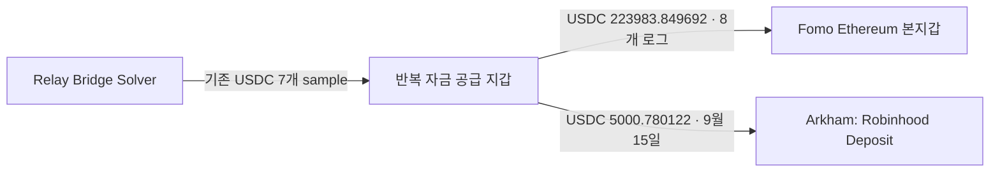

# Rank 9 Arkham CEX 연결 조사

2026-10-07 KST에 로그인된 Arkham 브라우저에서 확인했다. 원문 관측 시각은 2026-10-06 16:57 UTC부터 후속 관측 시각 2026-10-06T17:03:16.821Z까지다. 대상은 기존 rank 9 RZD의 Ethereum 본지갑과 이미 보존된 최대 2-hop 상대 주소다. 고정 연구 구간은 `2026-09-06T07:46:11Z <= timestamp < 2026-10-06T07:46:11Z`다.

## 확인 결과

| 관계 | 근거 | 해석 |
|---|---|---|
| `0xe7af3221ad9b407055e9105aba5a783443d2c3c5` → Fomo 본지갑 `0xafe3b520b70db0f7fb50d2e1fc00e9b837abc322` | 기존 성공 receipt log 8개, 합계 **223,983.849692 USDC** | 반복 자금 공급 관계. 소유권은 unknown |
| 같은 공급 지갑 → `0x056f02966a8ec618df3da0ea7cd9c7cc3f26fa16` | 성공 USDC log 217, **5,000.780122 USDC**, **2026-09-15 04:01:47 UTC** | 전송은 원장으로 확인. 목적지의 Robinhood 역할은 Arkham 라벨 |
| `0xf70da97812cb96acdf810712aa562db8dfa3dbef` → 공급 지갑 | 기존 성공 USDC sample 7개. Arkham은 상류 주소를 **Relay.link: Bridge Solver**로 표시 | 서비스 운영 주소라는 공급자 근거가 생겼다. 개인 뒷지갑으로 묶지 않는다 |

[Robinhood 입금 거래 상세](https://arkm.com/explorer/tx/0x4565d12dec31248b20e1242006a5eab2e02ba75d46a382fa519f4e7c8d2055fa)와 [Etherscan 원장 링크](https://etherscan.io/tx/0x4565d12dec31248b20e1242006a5eab2e02ba75d46a382fa519f4e7c8d2055fa)는 동일 거래다. 기존 SQLite raw payload **984**의 성공 receipt에서 Ethereum USDC contract, from/to, raw quantity `5000780122`, log index 217, block 25980340, UTC 시각을 다시 대조했고 Arkham 상세 금액·주소·시각과 일치했다. Transaction의 top-level `to`는 USDC contract이며 입금 주소는 Transfer log의 `to`다. 이 기록은 Ethereum `chain_id=1`의 Robinhood 거래소 입금 후보이며 Robinhood Chain `4663` 전송이 아니다.

## 라벨과 소유권의 한계

- [공급 지갑](https://arkm.com/explorer/address/0xe7af3221ad9b407055e9105aba5a783443d2c3c5)은 Arkham에서 `@riziderxbt?`이며 **Lower confidence prediction by an AI model**이라고 명시한다. 같은 소유자의 뒷지갑으로 확정하지 않는다.
- [본지갑](https://arkm.com/explorer/address/0xafe3b520b70db0f7fb50d2e1fc00e9b837abc322)은 Arkham에서 `@riziderxbt: "riziderxbt" on Fomo`로 표시된다. 기존 Fomo snapshot의 `@RZDxbt`와 별칭이 다르므로 stable user ID와 기존 두 distinct event/tx 매칭을 유지하고 계정 데이터를 덮어쓰지 않았다.
- [입금 주소](https://arkm.com/explorer/address/0x056f02966a8ec618df3da0ea7cd9c7cc3f26fa16)의 **Robinhood Deposit**은 Arkham의 주소 분류다. Robinhood의 독립 확인, 고객 신원, 고객별 전용 여부는 unknown이다. 토큰 입금이 법정화폐 환전·출금을 입증하지 않는다.
- [Relay 운영 주소](https://arkm.com/explorer/address/0xf70da97812cb96acdf810712aa562db8dfa3dbef)의 다른 이용자나 거래소 거래를 RZD의 자금 흐름으로 귀속하지 않는다. 실제 source deposit/order/destination으로만 크로스체인 대응을 확인한다.
- CEX 입금은 본지갑에 대한 첫 보관 공급 거래인 **2026-09-17 16:27:47 UTC**보다 앞선다. 따라서 본지갑의 수익이 공급 지갑을 거쳐 CEX로 돌아간 경로는 아직 입증되지 않았다. 본지갑과 선행매수 지갑이 같은 입금 주소로 귀결되는지도 미확인이다.

## 보존 범위

로그인된 공급 지갑 화면의 **2/2 페이지, 표시 거래 20행**과 거래 상세·주소 라벨의 화면 텍스트 및 스크린샷을 보존했다. 브라우저의 모든 페이지를 읽었다는 사실이 전체 원장 history coverage를 뜻하지 않는다. 최신 공급 1건은 2026-10-06 15:00:11 UTC, 27,001.6471 USDC로 cutoff 이후다. 다른 출금 2건은 같은 날 02:51:47/02:53:23 UTC로 고정 구간 안에 있다. 상대 시각만으로 경계를 나누지 않고 거래 상세 UTC를 확인했다. 이 3개 새 화면 관측은 아직 독립 receipt 대조를 하지 않아 기존 normalized ledger에 추가하지 않았다. 로그인 전 노출된 `0x0000…5000` 형태의 demo 행은 거래 증거로 사용하지 않았다.

원문은 ignored `data/raw/arkham/rank9-2026-10-07/`, 검토 JSON은 ignored `data/research/rank9-arkham-cex-review.json`에 있다. 화면 텍스트 원문 11개와 검토 report 두 revision을 SQLite `raw_payloads`에 additive로 보존했다. 최신 report raw는 **1458**, raw 총수는 **1458**다. 이전 report와 원장 기록은 그대로 보존한다. 스크린샷 파일/hash와 원본 관측 시각을 함께 기록했다. 과거 Flow case·movement·wallet resolution은 수정하지 않았다. 신규 BigQuery query와 RPC 호출은 0개다.

## 추가 미확인 출금 후보

공급 지갑에서 [0x6a2b632b8c8676fa1aa269aee66176adbf016ee1](https://arkm.com/explorer/address/0x6a2b632b8c8676fa1aa269aee66176adbf016ee1)로 나간 두 거래가 새 화면에 있었다. 이 주소의 Arkham header에는 CEX/entity 라벨이 보이지 않았다. 거래 상세는 다음을 표시한다.

| UTC 시각 | USDC 정확 금액 | Arkham 거래 |
|---|---|---|
| 2026-10-06 02:51:47 | 5,000.31502 | [0x3fa67…](https://arkm.com/explorer/tx/0x3fa67c78b97def7d8d45e601cab8f4a244769c9eda6b18555ae1843ca1f1175b) |
| 2026-10-06 02:53:23 | 8,000.40002 | [0x163bb…](https://arkm.com/explorer/tx/0x163bb5e957fb431ff088de2593d552467c0583cf6dce33e3ea7d8a98f198351f) |

합계 **13,000.71504 USDC**이며 두 시각 모두 고정 구간 안이다. 현재는 Arkham provider assertion이고 새 RPC receipt 대조는 하지 않았다. CEX, 동일 소유자, BUY/SELL로 분류하지 않으며 원장 검증을 다음 작업의 첫 단계로 둔다. 이 주소는 seed–funder–recipient의 기존 최대 2-hop 안에서 발견했다.

## 다음 한정 조사

새 출금 2건의 receipt를 먼저 검증한 뒤 기존 공급 지갑의 같은-chain·같은-token Fomo BUY/THESIS 전후 거래를 먼저 확인한다. 독립적으로 찾은 선행매수 주소의 출금과 본지갑 경로가 **같은 정확한 `0x056…fa16` 주소**에 닿는지 비교한다. 같은 거래소라는 사실만으로는 묶지 않는다. 방향, 시간 순서, 실제 bridge order, 반복성, 공급·회수 관계를 추가 근거로 기록한다. 소유권과 PnL은 필요한 거래·원가·exit 근거를 확보할 때까지 unknown이다.
