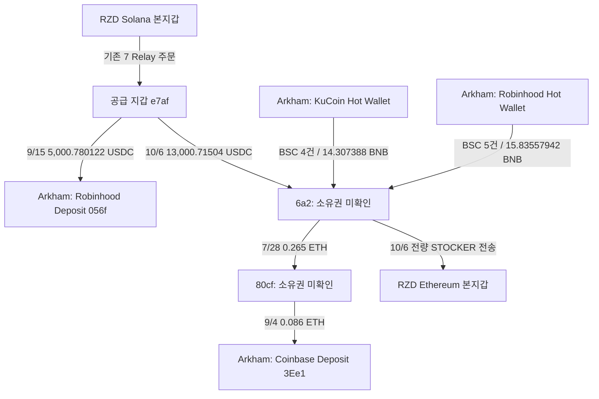

# RZD CEX 연결과 STOCKER 취득 조사

갱신: 2026-10-06T18:26:08.037Z · review raw **1605** · Fomo user `779bceab-5c5a-5cf2-b76c-193ff7beed0e`.

## 현재 결론

- 거래소 연결은 존재한다. 공급 지갑→Robinhood 입금 후보는 기존 검증 근거이며, 새 조사에서는 6a2의 BSC 거래소 출금 9건과 중간 지갑→Coinbase 입금 후보를 독립 RPC로 확인했다.
- **RZD 본지갑과 연결 매수 지갑이 같은 정확한 CEX 입금 주소로 회수했다는 근거는 아직 없다.** Ethereum의 수집 범위에서 두 알려진 입금 후보에 대한 seed·funder·6a2 전송을 비교했으며 funder→Robinhood 1건만 나왔다. 다른 체인·다른 입금 주소·더 오래된 기록은 배제하지 못한다.
- 6a2가 STOCKER를 네 번 취득한 뒤 전량을 RZD Ethereum 본지갑에 보낸 사실이 확인됐다. 첫 retained THESIS보다 늦고 세 번째 THESIS보다 앞선다. 최초 공개 전 선행매수의 근거가 되지 않는다.
- 지갑 소유권, 같은 CEX 고객 계정, 매수 의도, 실현 수익은 unknown이다. CEX 분류는 Arkham의 주소 라벨이며 RPC는 체인·방향·금액·성공·시각을 검증한다.

## 조사 주소

| 역할 | 체인·정확한 주소 | 상태 |
|---|---|---|
| RZD 본지갑 | Ethereum `0xafe3b520b70db0f7fb50d2e1fc00e9b837abc322` | Fomo 연결 verified |
| RZD 본지갑 | Solana `5MfuqNSawthUL1qdJJTN8DauQvJYSUkuuZuySXuVc6Tz` | Fomo 연결 verified |
| 공급 지갑 | Ethereum `0xe7af3221ad9b407055e9105aba5a783443d2c3c5` | ownership unknown |
| STOCKER 매수·반환 지갑 | Ethereum `0x6a2b632b8c8676fa1aa269aee66176adbf016ee1` | ownership unknown |
| 과거 ETH 수령 중간 지갑 | Ethereum `0x80cf28cb5df6fba5347f714147c055190ccee665` | ownership unknown |

## 확인한 CEX 방향

각 화살표의 날짜·자산을 구분한다. 7월→9월 Coinbase 경로를 10월 STOCKER 매수 수익으로 연결하거나, 중간 지갑의 전체 잔고를 6a2의 자금으로 귀속하지 않는다.

### BSC 거래소 → 6a2: 원장 검증 9건

| Arkham 라벨 | UTC | BNB | 거래 |
|---|---|---:|---|
| Robinhood | 2026-07-07T21:03:09Z | 1.70498788 | [0x6203b73e…](https://bscscan.com/tx/0x6203b73e08a143734a781960e5d2b7f858acac555872010d81c959f75da0a67e) |
| KuCoin | 2026-07-07T21:39:39Z | 1.723447 | [0x064a000b…](https://bscscan.com/tx/0x064a000b819e00236ae3af2e58cb6603d57edd832b7e8b6afec2bb13cf157200) |
| Robinhood | 2026-07-08T02:11:25Z | 2.08435788 | [0xaf08967c…](https://bscscan.com/tx/0xaf08967caeef1e3bd4bbe71a79230bf506a4295ac6de04509765b88bcaaece3d) |
| Robinhood | 2026-07-09T15:29:38Z | 4.3299379 | [0x00d9bbbe…](https://bscscan.com/tx/0x00d9bbbee660b8405f0ad59fa48de37e2ab41e5da9192f5f06fd0dde80ee1159) |
| KuCoin | 2026-07-09T15:34:39Z | 2.620647 | [0xe9dceefa…](https://bscscan.com/tx/0xe9dceefade677ada924a3c310e5fb78b6fa0eaaa4d24bc833eabe6433971a114) |
| Robinhood | 2026-07-10T21:09:30Z | 4.30451788 | [0x53b6b516…](https://bscscan.com/tx/0x53b6b5169ddcef93a385cf735e1dff832a5a432d7efa3b681c39df570e8e6919) |
| Robinhood | 2026-07-11T19:02:17Z | 3.41177788 | [0xf497bb62…](https://bscscan.com/tx/0xf497bb621f6e2c356bab9eb9fd5ab9d557448fe92a2b2d8e0608b2fff5629369) |
| KuCoin | 2026-07-11T22:32:39Z | 2.991747 | [0x68663b38…](https://bscscan.com/tx/0x68663b38df403749ca6ffbee93f029fd354d49b27cb7ea36dd78046379095247) |
| KuCoin | 2026-07-27T01:36:13Z | 6.971547 | [0x003961e0…](https://bscscan.com/tx/0x003961e00cc1f3482315eea829aa5d5958c491e9e603f5af1ec70ed0435fead2) |

KuCoin 송신자는 `0x635308e731a878741bfec299e67f5fd28c7553d9`, Robinhood 송신자는 `0x1887fa9edadeab7562b01cc3f4fa246ace2c3cdd`다. 두 라벨은 Arkham 필터 화면 원문을 보존했다. Nodit BSC chain ID 56, top-level sender/receiver/value, 성공 receipt와 block timestamp를 대조했다.

BNB Chain 공식 public RPC에서는 해당 과거 해시의 transaction/receipt가 null이었다. 이를 거래 부재로 판정하지 않고 Nodit에서 정상 반환한 원문을 보존했다. [공식 BNB RPC 안내](https://docs.bnbchain.org/bnb-smart-chain/developers/json_rpc/json-rpc-endpoint/), [Nodit BNB Node API](https://developer.nodit.io/en/api/bnb/node-api/eth_blocknumber/).

### Robinhood Chain 출금: Arkham만 확인

| UTC | ETH | 거래 | 상태 |
|---|---:|---|---|
| 2026-08-03T22:16:25Z | 0.53727 | [0x60102575…](https://arkm.com/explorer/tx/0x601025753a13bd09f9efda5ea5b129cb467faf32d5551a2b3492ff0d61ba74e8) | RPC HTTP 403 |
| 2026-08-03T22:06:25Z | 0.532205 | [0x12b278a3…](https://arkm.com/explorer/tx/0x12b278a397691961e70ffe6fb837f800329afb546e8d59e0676db9d3e4179997) | RPC HTTP 403 |

체인은 4663이며 Ethereum chain 1의 Robinhood Deposit과 구분한다. Arkham의 성공/시각/주소/금액은 보존했으나 독립 RPC 검증은 미완료다. [공식 Robinhood 연결 문서](https://docs.robinhood.com/chain/connecting/).

Arkham 90일 withdrawal 요약의 Robinhood $15.06K·KuCoin $8.21K를 이번 개별 조회 합계와 완전히 재조정하지 못했다. 위 목록을 전체 CEX 거래 이력으로 해석하지 않는다.

### 6a2 → 중간 지갑 → Coinbase 입금 후보

| UTC | Ethereum 전송 | 금액 | 거래 |
|---|---|---:|---|
| 2026-07-28T23:17:59Z | 6a2 → `0x80cf28cb5df6fba5347f714147c055190ccee665` | 0.265 ETH | [0x7fb811…](https://etherscan.io/tx/0x7fb811b2405f95000ffbf4df2feed250b78001a5a6f161b37fa12bc557990b06) |
| 2026-09-04T20:34:11Z | 80cf → `0x3ee1cf26e829386f0128842ce871a1e0ba5714b3` | 0.086 ETH | [0xa9071c…](https://etherscan.io/tx/0xa9071cf879fec54e24bc728f6f34067a01db29c43d78f2e3009c51bd57d6d867) |

두 전송은 성공 receipt/top-level tx/header로 확인했다. Coinbase Deposit 분류는 [Arkham 거래 화면](https://arkm.com/explorer/tx/0xa9071cf879fec54e24bc728f6f34067a01db29c43d78f2e3009c51bd57d6d867)의 라벨이다. 약 38일의 간격과 중간 지갑의 다른 활동이 있어 동일 자금의 단위 추적은 unknown이다. 두 거래 모두 고정 30일 window 이전인 `prior_history_extension`으로 저장한다. 80cf의 Yeet.com·Stake.com Deposit 화면 관측도 보존했으나 이번 CEX 검증 대상에 합산하지 않았다.

## STOCKER 매수 → RZD 본지갑

Ethereum contract `0x75e2fc69ff2ac12af65ba7d321bbf4f878c535d2`, decimals 18. 각 거래에서 6a2가 GMGN SwapX Proxy로 ETH를 보내고, WETH quote leg와 같은 거래의 STOCKER 순수령을 확인했다. BigQuery event index·amount·block time은 receipt와 일치한다. 소유권 미확인 지갑의 취득이며 verified RZD action 테이블에 넣지 않는다.

| UTC | 공급 ETH | 취득 STOCKER | 거래 |
|---|---:|---:|---|
| 2026-10-06T02:55:23Z | 0.5 | 317392.650131590498014105 | [0x1c1e9675…](https://etherscan.io/tx/0x1c1e967582237d436052c60d6362df03be192a3604d8af3e0dd77122dee33f7c) |
| 2026-10-06T02:55:35Z | 0.5 | 311207.79756303969673373 | [0xff492d97…](https://etherscan.io/tx/0xff492d97eae284dd926a12c5d70a28643519528095fc2d8aae5bda553d56619a) |
| 2026-10-06T02:55:47Z | 0.5 | 305201.981730251308593199 | [0xe77d0b0b…](https://etherscan.io/tx/0xe77d0b0b4f63b5bb79a8d762eda9f5333fdcddb1cf62314e12e9c65d85403538) |
| 2026-10-06T02:55:59Z | 0.3 | 181145.089917715717979078 | [0xdefa6c77…](https://etherscan.io/tx/0xdefa6c7725c9c1abee5c8154cecab73426925c3d14abd0b704fe827821be7948) |

- 공급 ETH 합계 **1.8 ETH**, network gas 합계 **0.000646099977211829 ETH**. 둘의 합계는 **1.800646099977211829 ETH**다.
- 실제 wrapped WETH quote leg 합계는 **1.782 WETH**다. 0.018 ETH 차이의 정확한 router fee 구성은 이번 slice에서 분해하지 않았다.
- 취득 합계 **1,114,947.519342597221320112 STOCKER**는 15:39:23 UTC RZD 본지갑으로 보낸 raw amount와 정확히 같다. [반환 거래](https://etherscan.io/tx/0x3bd0ffdec22411e9267462c56aa667dc2faf39244c55ce78cced18d3d5a0eb52).
- historical balanceOf: block 26113548(첫 THESIS 직전), 26130482(6a2 첫 매수 직전), 26134283(반환 후)에서 모두 0. 조회 원문과 header를 저장했다.
- 첫 RZD 본지갑 STOCKER 수령은 2026-10-03T18:12:35Z의 성공 receipt log 325다. 최초 retained Fomo BUY는 10초 뒤 18:12:45Z다. 이 수령 거래는 다른 사용자도 포함한 실행이므로 aggregate transaction의 전체 quote/금액을 RZD에게 귀속하지 않는다.

### THESIS 기준 시각 비교

| 기준 | UTC | 6a2 첫 매수와 관계 | 해석 |
|---|---|---|---|
| 최초 retained BUY | 10/3 18:12:45 | 2일 8시간 42분 38초 뒤 | 이미 공개 BUY가 존재 |
| 첫 retained THESIS | 10/3 18:17:20 | 2일 8시간 38분 3초 뒤 | 최초 공개 전 매수 근거 없음 |
| 두 번째 THESIS | 10/5 19:36:00 | 7시간 19분 23초 뒤 | 이 THESIS보다도 늦음 |
| 세 번째 THESIS | 10/6 14:37:30 | 11시간 42분 7초 앞 | 추가 THESIS 전 취득 후보 |

개별 취득 네 건 각각에 대해 Fomo event ID·timestamp·raw 683/1459와 초 단위 차이를 SQLite acquisition evidence에 기록했다. 최초 retained event는 lifetime 최초 공개를 뜻하지 않는다. X/더 오래된 Fomo 공개 내용은 아직 수집되지 않았다.

**실현 PnL은 미확인**이다. 관측한 STOCKER 출금은 RZD로의 토큰 전송이며 매도가 아니다. 본지갑에서의 실제 매도·quote 수령·가스·수수료·후속 bridge/CEX exit와 lot 배분 근거가 생긴 뒤 계산한다. Fomo amount_usd나 Arkham 현재 USD 표시를 매수 원가/실현 수익으로 쓰지 않는다.

## 같은 정확한 CEX 입금 주소 비교

Ethereum known deposit 후보: Robinhood `0x056f02966a8ec618df3da0ea7cd9c7cc3f26fa16`, Coinbase `0x3ee1cf26e829386f0128842ce871a1e0ba5714b3`. Seed·funder·6a2의 아래 수집 구간에서 양수 canonical USDC와 ETH top-level/internal 이동을 대조했다. 알려진 후보로의 일치 행은 funder→Robinhood 1건이다.

Seed와 6a2의 공통 서비스 주소는 RelayDepository지만 CEX 입금 주소가 아니다. Router/pool/bridge나 거래소 hot wallet의 일치를 동일 소유자 근거로 승격하지 않는다. 현금화에는 CEX 입금 외 경로도 가능하며 모든 거래자가 같은 입금 주소를 재사용하는 것은 아니다. 이 가설은 탐색 기준이고 필수 조건이 아니다.

## 추가 공급·bridge 처리

기존 pending 27,001.6471 USDC를 처리했다: 10/6 15:00:11 공급 지갑→RZD Ethereum, 15:02:11 Ethereum→Relay, 15:02:37 Solana RZD owner USDC 증가 27,001.6471. 출발 Deposit ID `0x48295b652d5265b0de31fbaa7a09359fcc424c9c89165f7d6a2ccc7b9dd8137e`와 operation ID `0x17912989207ba099bf4e4bc3bb801ed3a765d93398eb8ab638dfaa7ab3479ada`가 destination memo에 모두 있어 `order_correlated`다. 출발 tx `0x4c27db4010bf2baf0e4c93b02115d95faab47edcb480b4eddb774297b4aea65f`, Solana signature `7HyXYEVVcJxrFeYpx44rpmSDiavCTShH4Ms7rfCgregFPMsCi8emeHR3V84Jzc95t19rbgnhVhDyox6FDMvfg92`.

## 수집 범위·저장·비용

| BigQuery 조회 | UTC 구간 | 회수 행 | billed bytes |
|---|---|---:|---:|
| Ethereum tokens / seed·funder·6a2 | 2026-09-06T07:46:11Z ≤ time < 2026-10-06T18:12:00Z | 365 | 35435577344 |
| Ethereum native / seed·funder·6a2 | 2026-07-07T00:00:00Z ≤ time < 2026-10-06T18:12:00Z | 62 | 232448327680 |
| Ethereum traces / seed·funder·6a2 | 2026-07-07T00:00:00Z ≤ time < 2026-10-06T18:12:00Z | 27 | 423919353856 |

세 query는 dry run 및 maximumBytesBilled 상한 뒤 실행했고 결과 454행을 모두 회수했다. 합계 billed bytes **691,803,258,880**. 실제 통화 청구·무료량·크레딧 적용 금액은 job bytes만으로 확정하지 않는다. Query 결과 회수 완료는 provider watermark/체인 lifetime coverage 완료를 뜻하지 않는다.

정규화 신규: tracing edge 18건, unknown-owner STOCKER acquisition 4건, discovery collection 3건/row 454건. 전체 wallet_trace_edges는 31건, raw_payloads는 1,605건이다. Source RPC·API·브라우저 capture 80개와 BigQuery CLI capture 15개, review 두 단계가 저장됐다.

- Canonical DB: `data/research/fomo.sqlite3`.
- Review export: ignored `data/research/rank9-cex-prebuy.json`.
- 원문·SQL·job metadata: ignored `data/raw/cex-prebuy/rank9-2026-10-07/`.
- Offline importer: `src/fomo_research/cex_prebuy.py`. 수집된 proof를 정규화하며 이 importer 자체가 chain truth를 판정하지 않는다.

ERC-20 발견 행에는 다른 contract가 실제 지갑 주소를 from으로 표시한 기록, 0-value 로그와 유사 주소가 있다. 미검증 contract/zero/dust 행을 후보 발견용으로만 보존하고 실제 자금 연결 graph에 자동 승격하지 않았다. Code test는 요청되지 않아 추가/실행하지 않았으며 위 검증은 실제 연구 데이터의 RPC/receipt 대조다.

## 다음 추적 순서

1. RZD 본지갑으로 반환된 STOCKER의 실제 매도·quote 수령과 이후 exit를 추적한다. 매도 없이 profit를 확정하지 않는다.
2. RZD Solana→공급 지갑 회수와 6a2/80cf의 실제 출금에 대해 **같은 정확한 chain/address의 CEX deposit**이 반복되는지 비교한다. 현재 확인된 Robinhood/KuCoin hot-wallet 출금은 보조 근거다.
3. BSC의 bounded outflow와 Robinhood withdrawal 요약의 미조정 부분, Coinbase 입금 후보의 역할을 추가 검증한다. 서비스 pool 전체의 흐름을 개인에게 귀속하지 않는다.
4. 추가 8.027063514 SOL의 독립 source와 기존 unresolved deposit은 frontier에서 유지한다. YDfd의 KNOTS와 중간 mint STONK를 구분한다.
5. 다른 token의 매수는 최초 retained BUY·THESIS 이전 기간과 이전 inventory까지 검증한다. 보관된 capture는 재활용하고 6시간 heartbeat는 변화가 있을 때만 알린다.

## Incremental heartbeat — 2026-10-07 09시 KST 전후

검토 UTC `2026-10-07T00:10:14.879Z`. 이전 review raw1605 이후 조회이며 과거 fixed window와 별도다. 최신 review raw **1653**, ignored export `data/research/rank9-heartbeat-2026-10-07-235605.json`, captures `data/raw/wallet-trace/rank9-heartbeat-2026-10-07-235605/`.

### 반환 이후 실제 활동

- Ethereum `18:12:00 ≤ time < 23:56:06 UTC`의 seed/funder/6a2 조회: ERC-20 14행, native0행, positive native call trace0행. 검증된 positive target rows는 STOCKER 수령 2건이다. 이 조회 결과에 seed의 STOCKER 매도나 두 known CEX 입금 주소로의 양수 canonical USDC/ETH 전송은 없다. 결과 회수 complete와 chain watermark/전체 history complete를 구분한다.
- RZD Solana→Relay→RZD Ethereum의 **USDC→STOCKER 주문 2개**를 대응했다. 19:03:38 UTC 4,933 USDC 차감→19:03:59 UTC 1,428,506.247441745654347642 STOCKER 수령; 22:55:34 UTC 4,975 USDC 차감→22:55:47 UTC 1,650,289.762742996896689739 STOCKER 수령. 실제 signer/historical owner·input authority·raw delta와 destination 성공 receipt/log/header를 각각 확인했다. 주문 대응은 Relay provider assertion이므로 `provider_order_matched_legs_verified`로 유지한다. Relay executor/service의 전체 pooled flow는 RZD에게 귀속하지 않는다.
- RZD는 **22:55:27 UTC 23,245.105430971 STONK를 매도해 net 4,964.861691 USDC를 받았다**. Fomo SELL은 22:55:25 UTC다. 같은 historical USDC ATA 잔액은 10.816446→4,975.678137이고, 7초 뒤 그 계정에서 4,975 USDC를 bridge로 보낸 뒤 0.678137가 남았다. 이 주문은 위 두 번째 STOCKER 취득으로 대응된다. 기존 USDC 잔액과 매도 대금이 섞였으며 개별 자금 단위 또는 실현 수익을 단정하지 않는다. STONK 원가·lot 배분은 미완료다.
- 반환된 KNOTS의 후속 **15:38:29 UTC 거래는 매도가 아니라 추가 매수**다: net USDC 감소 677.999999, KNOTS 증가 157,038.792022; 반환 직후 pre잔액 2,295,131.356185→2,452,170.148207. Token-2022의 fee harvest 2건은 RZD가 signer가 아니고 spendable owner delta0이어서 매도/회수로 분류하지 않았다.
- STOCKER는 기존 본지갑 lot·6a2 반환 lot·새 취득 lot이 혼재한다. 반환 lot의 실제 매도와 CEX 회수, 공통 deposit chain/address, realized PnL은 여전히 미확인이다.

### 새 pending 및 소음 처리

19:02:12 UTC RZD Solana USDC ATA가 `F7p3dFrjRTbtRp8FRF6qHLomXbKRBzpvBLjtQcfcgmNe`의 token account에서 **4,921.592069 USDC**를 받았다. 성공 RPC·양쪽 historical owner·Transfer와 destination memo를 확인했다. Deposit ID `0x6fb1a5ee1a20840df9534befe8f96ce7270b60756df8d44c50681fe7630714d8`, operation ID `0x179131333061941b9b716558dbeeca56ed049347d24b2430dabf88c0f498cee0`. Bridge API는 `unresolved`/`relay_origin_chain_is_not_mapped`; upstream chain/주소를 임의로 지정하지 않았다. 기존 8.027063514 SOL도 동일 diagnostic의 unresolved 상태다. 기존 10,000.55003 USDC deposit 재조회는 다른 사용자 batch order만 반환해 계속 제외했다.

USDC ATA의 2페이지/50개 서명 중 42개가 상세 미조회이며 frontier에 저장했다. 최신 4개를 샘플 확인한 결과 각0.38 USDC의 제3자 수령으로, RZD는 signer가 아니다. Source identity/funding graph에 자동 승격하지 않는다. EOA signature 조회에는 이런 ATA-only 수령이 빠질 수 있다. 향후 bounded token-account frontier 또는 balanceChanged full owner capture를 사용한다.

Ethereum discovery 나머지12행도 zero canonical USDC 또는 미검증 contract의 from 표시/유사 주소였다. 미검증 token/from 표시를 실제 공급·소유권으로 승격하지 않았다.

### 수집·저장

- Fomo 사용자 checkpoint에서 1페이지/새5events, hasMore=false,125credits; capture raw1606. STOCKER BUY2/THESIS1, STONK SELL1/THESIS1. amount_usd는 원가/매도대금으로 쓰지 않았다.
- 직접 RPC **26/30**, Bridge **5/5**. Solana version0 요청4건의 -32015를 원문 보존한 뒤, 응답이 명시한 maxSupportedTransactionVersion1로 각1회 재시도해 모두 회수했다. Version1 원문과 실패 원문을 함께 보존했다.
- BigQuery 3job: dry run 및 maximumBytesBilled 적용, 총billed **2,343,567,360 bytes**. 실제 통화 청구/크레딧 적용액은 별도다.
- SQLite additive: graph edge3, discovery collection3/rows14, verified Solana action11/delta11. 기존 V3 classifier는 SWAP2/UNKNOWN9이며 보수적 UNKNOWN을 실제 transfer/sale로 임의 승격하지 않았다. 독립 transfer proof는 graph/review에서 보존한다. 기존 fixed-window timeline·wallet resolution은 그대로 유지한다.

다음은 반환 STOCKER의 실제 exit를 우선 확인하고, 이번 두 신규 매수로 재고가 섞인 점을 원가 계산에 반영한다. Exact CEX endpoint 비교 및 BSC outflow, 4,921.592069 USDC/8.027063514 SOL upstream·기존 unresolved deposit을 frontier에서 이어 간다. Ethereum 다음 구간은 최소1시간 overlap으로 late indexing을 대비하며 complete chain checkpoint는 올리지 않았다.
