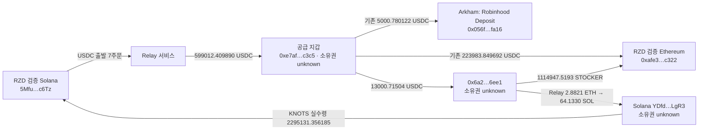

# RZD Relay·공급 지갑 후속 추적

2026-10-07 KST 조사. 마지막 검토 시각은 `2026-10-06T17:50:19.331602Z`다. 사용자가 Relay의 실제 출발·도착과 공급 지갑을 계속 추적하도록 요청해 기존 분기를 확장했다. 최초 고정 구간은 `2026-09-06T07:46:11Z <= timestamp < 2026-10-06T07:46:11Z`이며 그 뒤 활동은 `incremental_after_cutoff`로 별도 보존한다.

## 핵심 결과

1. 기존 **Relay Solver → 공급 지갑 7개 표본 모두** 실제 출발 owner가 RZD의 검증된 Solana 지갑인 주문으로 대응된다. Solana USDC 차감 합계 **599,060.667266**, Ethereum 수령 합계 **599,012.409890 USDC**다. 차액 48.257376 USDC의 정확한 수수료·quote 구성은 unknown이다.
2. 공급 지갑 → `0x6a2…6ee1`의 두 출금 **13,000.71504 USDC**를 성공 receipt로 검증했다. 같은 주소가 RZD Ethereum 지갑에 **1,114,947.519342597221320112 STOCKER**를 보냈다.
3. `0x6a2…6ee1`에서 Relay에 넣은 **2.8821 ETH**가 Solana `YDfd…LgR3`에 **64.133031727 SOL**로 도착했다. 성공 원장 양쪽과 deposit ID·operation ID의 destination memo까지 일치한다.
4. 새 Solana 주소는 수령 이후 13개 반환 서명의 거래를 모두 읽었다. 11개 SOL→KNOTS 취득 후보의 net 증가 **2,366,114.800191 KNOTS**가 이후 RZD Solana 지갑으로 보낸 gross 수량과 정확히 같다. RZD 지갑 실제 수령은 **2,295,131.356185 KNOTS**다.

이 결과는 실제 자금·토큰 연결 근거다. 세 미검증 주소의 동일 소유자 여부와 선행매수 의도는 unknown이다. 서로 다른 날짜·자산의 화살표를 하나의 원가 또는 동일 자금의 보존식으로 합산하지 않는다.

## 연결도

CEX 역할은 Arkham 공급자 라벨이다. 기존 Fomo Ethereum→Solana 7/8 bridge 결과는 별도 ledger로 유지한다. 여기의 upstream 7개 주문과 서로 다른 주문 집합이다.

## 추적 주소

| 역할 | 체인 | 정확한 주소 | identity 상태 |
|---|---|---|---|
| RZD Fomo seed | Ethereum | `0xafe3b520b70db0f7fb50d2e1fc00e9b837abc322` | 기존 두 distinct Fomo event/tx로 verified |
| RZD Fomo seed | Solana | `5MfuqNSawthUL1qdJJTN8DauQvJYSUkuuZuySXuVc6Tz` | 기존 두 distinct Fomo event/signature로 verified |
| 공급 지갑 | Ethereum | `0xe7af3221ad9b407055e9105aba5a783443d2c3c5` | ownership unknown; Arkham AI low confidence |
| 공급 지갑 출금 상대 | Ethereum | `0x6a2b632b8c8676fa1aa269aee66176adbf016ee1` | ownership unknown |
| 실제 bridge 수령 상대 | Solana | `YDfdSBii9PyxRXBzX8eg8MPBqoYLpddLtrCGzYiLgR3` | ownership unknown |

## 상류 7개 주문: 출발 원장과 수령 원장을 각각 검증

| 실제 Solana 출발 UTC | 출발 USDC | Ethereum 수령 USDC | 원장 링크 |
|---|---:|---:|---|
| 2026-09-15T03:58:21Z | 50,000 | 49,995.956367 | [Solana](https://solscan.io/tx/5AzmXXiCmt5a2nNTGYMm4bcnWSQEmkZ397YLwGLHKzX1H5CcGPkJffMeZzg6adj2rqZu6UYynFipXobZrzkmGh49) / [Ethereum](https://etherscan.io/tx/0xc139cb46a47c42842884ecb883af5dd867c046ee341c4393ed07c1d3a9fdecc5) |
| 2026-09-15T03:59:23Z | 50,000 | 49,995.969786 | [Solana](https://solscan.io/tx/4hQWhgyubdw5neCcpbRr61jrMCuPRapiaPHQW9FguSF1n3vrzXUvDMjg7czPeZmVQFsCj1vsC1A1qWGAVM4ytNy5) / [Ethereum](https://etherscan.io/tx/0xc8edba972eb43118927d922c5fe44c4fb4e2e50fa65cb8000e4bc44f0d5b6d13) |
| 2026-09-15T04:02:58Z | 119,885.995542 | 119,876.373848 | [Solana](https://solscan.io/tx/eUnuHbYLjmQAkjCDUk2wmrq22mF4FPJwrmbDpNqRUXieWDuRCfzZb8zoP22PA6v74EGPEdy5BANs5kTyBfKk9NH) / [Ethereum](https://etherscan.io/tx/0xa5ee3e9c57292526336afa4f0586aa56a07fea0032b943babe3b4751a1393be1) |
| 2026-09-15T04:03:46Z | 179,828.993314 | 179,814.575359 | [Solana](https://solscan.io/tx/24w7YNgEaE7NQPeFtG81qoa3iK2M6hC9TkJ2BkLtdmoKjZRTS9XYNt7gmKbDu2MxgVG8PqWFfaPKBfktdLUdF4Vp) / [Ethereum](https://etherscan.io/tx/0xa6a4cb93d421710b4b6a610a46606ae11426ed99e3c4994d48af36f6394cca54) |
| 2026-09-15T04:04:14Z | 100,000 | 99,991.969165 | [Solana](https://solscan.io/tx/4LjxaWDKUNBtMmbD1YRP8m1VhwdnGopAkLJndgGhYcYaXg7PspeJN5xfzp2MEnfjHuTRvxQ2WVtnSrBcuyxpCJCS) / [Ethereum](https://etherscan.io/tx/0x30b7400a0fc30a2c5d84be70698ad10804ccb98df1c27c12a46b00cc4c3cfeb8) |
| 2026-09-17T16:41:41Z | 50,063.092225 | 50,058.973708 | [Solana](https://solscan.io/tx/37QqVHPdsQppBeyvH2LFJF8HweAAd81Rt5ViT3pNqZN1EcPvyamCX3LxsDG12pLTrbTHNBUKBPCENseDe87nBPMD) / [Ethereum](https://etherscan.io/tx/0xf2b202a28e112a8604b51c7a70c6d9eb07e6489c7bfe8af7eeaaac797d6029e8) |
| 2026-09-17T20:12:24Z | 49,282.586185 | 49,278.591657 | [Solana](https://solscan.io/tx/446fPtBBZdCASGn8v5DC2MibRKmwwhrc8Qum7BnCWSXeqxyYd2bCPj1gvTiag5mr4J5bfHyjNLWeqz5JtjAMoZGS) / [Ethereum](https://etherscan.io/tx/0x482f5212c6a34aa139cd78afcf699d0e5629d24a39950a8d51324b832b8afb76) |

모든 source transaction은 기존 QuickNode full response raw **885**에 있었다. 성공·slot·서명 signer와 historical USDC owner, SPL TransferChecked의 source/mint/authority/raw amount/decimals를 확인했다. Owner USDC delta가 input amount의 정확한 음수다. Bridge API의 source SPL locator/token accounts/slot과 일치한다. 목적지의 기존 Etherscan 성공 receipt raw **982, 983, 985, 986, 987, 992, 1002**에서 solver→funder Transfer log를 각각 대조했다.

양쪽 원장은 독립적으로 확인했지만 **두 체인 사이의 주문 대응은 Relay 공급자 assertion**이다. 따라서 `provider_order_matched_legs_verified`로 보존한다. Source transaction의 fee payer `AgmL…N51`을 RZD owner로 혼동하지 않는다. Relay API의 `observedAt` 대신 실제 RPC blockTime을 타임라인에 사용했다. 7/7은 보존된 표본의 대응률이며 공급 지갑 전체 이력의 완전성을 뜻하지 않는다.

9월 15일 첫 두 Solana 출발→공급 지갑 수령은 기존 04:01:47 UTC의 Robinhood Deposit 전송보다 앞선다. RZD Solana 출발 주문을 받은 주소가 이 CEX 후보에도 송금한 시간 관계가 생겼다. 정확히 그 자금 단위가 CEX로 간 것인지, 그 입금이 거래 수익인지 또는 fiat cashout인지까지는 확인되지 않았다.

## 공급 지갑 분기: receipt 검증

| UTC | 관계 | 금액 | 원장 |
|---|---|---:|---|
| 2026-10-06T02:51:47Z | 공급 지갑→6a2 | 5,000.31502 USDC | [tx](https://etherscan.io/tx/0x3fa67c78b97def7d8d45e601cab8f4a244769c9eda6b18555ae1843ca1f1175b), log 491 |
| 2026-10-06T02:53:23Z | 공급 지갑→6a2 | 8,000.40002 USDC | [tx](https://etherscan.io/tx/0x163bb5e957fb431ff088de2593d552467c0583cf6dce33e3ea7d8a98f198351f), log 553 |
| 2026-10-06T02:54:59Z | 6a2→USDC pool | 5,000 USDC | [tx](https://etherscan.io/tx/0xb9b3fcbe4c57dc6416efdb5b80872d35f54402b102cc5baf4e2ef7a0119a5ed6), log 60 |
| 2026-10-06T15:39:23Z | 6a2→RZD Ethereum | 1,114,947.519342597221320112 STOCKER | [tx](https://etherscan.io/tx/0x3bd0ffdec22411e9267462c56aa667dc2faf39244c55ce78cced18d3d5a0eb52), log 271 |

Configured Ethereum RPC 성공 receipt와 block hash/number/timestamp를 대조했다. STOCKER contract는 `0x75e2fc69ff2ac12af65ba7d321bbf4f878c535d2`; historical block의 decimals() 결과는 18이다. Pool 전송 거래에는 swap·WETH withdrawal 로그가 있으나 수령 native ETH·protocol fee 전체 귀속은 아직 완료하지 않았다. 이 개별 Transfer log를 target-token BUY로 바꾸지 않았다.

## 6a2→Relay→새 Solana 지갑→RZD 반환

Source [Ethereum tx](https://etherscan.io/tx/0x46bdfe578512355fa0e4993dccc387793ac27e4e6c2648b9bccaed86e2cbda9b)는 **2026-10-06T14:58:35Z**에 성공했다. 실제 transaction.value는 **2.8821 ETH**이며 RelayDepository의 native deposit event log 320도 from/amount/deposit ID와 일치한다.

Destination [Solana tx](https://solscan.io/tx/kvqCbqosdwCHHpBCviPjYGwTjTQVNwBzfA7QiB73n4EnryjvWs1yD4fxLz4mw5fbs5xqWrYExY5MyvSqntKat7T)는 **2026-10-06T14:59:00Z**, slot **453935376**이다. 성공 System transfer instruction 2가 `YDfd…LgR3`에 **64.133031727 SOL**을 보냈고 native owner 잔액 증가도 정확히 같다.

- Deposit ID: `0x0dc97bfe8fd16f248446ee7155eb3a3b708781e1da8f18ed528b9a9a73293291`
- Relay operation ID: `0x17912987062583e794b10d2332851406b2facef117df4ce17a24ec834f969b52`
- 두 ID 모두 실제 Solana memo instruction과 일치한다. 이 route는 `order_correlated`다.

Recipient의 25개 signature page 안에 known receipt와 그보다 오래된 서명도 있어 그 수령 이후 **반환된 13개 거래를 모두 읽었다**. 이 중 11건은 owner가 signer이고, swap 로그·본인 authority WSOL input·KNOTS owner 잔액 증가가 일치하는 `SWAP_BUY_CANDIDATE`다. WSOL principal 합계는 **71.6 SOL**이며 gas/rent/protocol fee를 포함한 원가가 아니다. 첫 취득 후보의 해당 mint owner pre-balance는 0, 후보 net 증가 합계는 **2,366,114.800191 KNOTS**다. 신규 recipient의 활동은 identity unknown으로 별도 report에 저장해 기존 verified-trader action table에 귀속하지 않았다.

Recipient는 15:06:32 UTC에 또 **8.027063514 SOL**을 받았다. 실제 수령 원장은 저장했고 destination 기준 Bridge lookup은 HTTP 200 `unresolved`였다. 이 추가 입금의 독립 출발지·주문은 unknown이다. 71.6 SOL 전체를 앞의 64.133 SOL 하나로 조달했다고 주장하지 않는다.

[반환 거래](https://solscan.io/tx/4R13yJJyATApbCRdMtHXFtot56TNSu9txoaxCPNdQcAUdFoFEZGBbmVDgjbhEHQyfm51FU4nX1TmxU76NEgwcBau)는 **2026-10-06T15:07:45Z**에 성공했다. Source owner `YDfd…LgR3`가 signer이며 source token account 잔액은 **2,366,114.800191→0 KNOTS**다. 새 destination token account의 historical owner는 **RZD의 verified Solana 주소**다.

| 항목 | 정확 수량 |
|---|---:|
| TransferChecked gross / source 감소 | 2,366,114.800191 KNOTS |
| RZD destination owner 실제 증가 | 2,295,131.356185 KNOTS |
| 관측 gross−net 차이 | 70,983.444006 KNOTS |

Mint는 `8RVBk8vxLiUHueLUW1f4izFVqN3nWippLhkohKg6EGkS`, decimals 6, Token-2022 program이다. 차이는 약 3%이나 historical fee config 자체는 조회하지 않았다. Symbol KNOTS는 기존 다른 trader의 Fomo event metadata를 이용한 표기다. 주소·mint·raw amount가 판정 기준이다.

## Fomo 시각 대조와 해석 한계

RZD REST checkpoint를 재개해 새 알림 3개를 저장했다: STOCKER THESIS **14:37:30 UTC**, STONK BUY **15:02:50/15:02:55 UTC**다. 1페이지 `hasMore=false`; 125 credits 사용, 최신 관측 잔액 246,125 credits다. 이 응답에 더 페이지가 없다는 사실이 전체 Fomo history 완전성을 뜻하지 않는다.

- STOCKER 반환 15:39:23은 새 THESIS보다 **1시간 1분 53초 뒤**다. 6a2의 STOCKER 최초 취득 시각은 아직 조사하지 않았다. 반환만으로 선행매수를 판정할 수 없다.
- 새 Solana 주소의 KNOTS mint는 RZD STONK BUY mint `6GmAFSYs4gk3FDao5FzzySQpPZaWsa4rUJHacpMpUNgx`와 다르다. STONK는 일부 route의 intermediate mint이며 최종 owner 증가 mint는 KNOTS다. 이 swap을 RZD STONK 선행매수로 합산하지 않는다.
- 보존된 RZD event에서 KNOTS THESIS/BUY는 발견하지 못했다. 같은 token의 다른 trader event를 RZD CALL로 간주하지 않는다.
- 반복 자금 공급 + 같은 seed로의 토큰 반환은 연관 지갑 후보의 근거를 강화한다. 서비스·대행·거래 상대 관계 등도 가능해 wallet resolution은 바꾸지 않았다. 공통 CEX deposit 주소·고객·PnL은 미확인이다.

## SQLite·원문과 다음 추적 지점

- Canonical DB: `data/research/fomo.sqlite3`.
- 새 `wallet_trace_edges` **13행**: 상류 BRIDGE 7, 신규 native BRIDGE 1, 개별 TRANSFER 5. Source/destination chain·address·tx·locator·UTC·asset·raw amount·decimals·raw ref와 provider assertion ref를 분리한다.
- Raw capture **48개**와 review 1개를 additive로 저장했다. Review raw **1508**, 전체 raw **1508**, Fomo events **976**이다. Browser snapshot 2개와 screenshot hash도 포함한다. HTTP 503/429/422, plan-range error와 transport failure를 성공 결과로 숨기지 않았다.
- 기존 Flow 42개 movement, forward bridge routes, wallet resolutions와 owner heuristic labels는 보존했다.
- `collector_state.rzd_wallet_trace_v1`에 관측 frontier·gap·report pointer를 저장했다. Raw는 `data/raw/wallet-trace/rank9-2026-10-07/`, JSON export는 `data/research/rank9-wallet-trace.json`; 둘 다 ignored다. 원문 파싱 및 offline proof builder도 raw 폴더에 보존한다.
- `python3 -m fomo_research.wallet_trace --report <review-json> --captures <capture-directory>`는 네트워크 없는 적재 도구다. 검토된 evidence를 보존하며 blockchain verification 자체를 대신하지 않는다. Software tests는 추가·실행하지 않았다.

현재 gaps:

1. Ethereum funder/6a2 USDC `eth_getLogs`의 1,000-block range가 현재 Nodit plan 한도로 실패했다. 두 scan은 **미완료**이며 observed head 26134844로 complete checkpoint를 올리지 않았다. 허용 range를 공식 문서·응답으로 확인하거나 bounded indexed query로 복구한다.
2. Arkham에서 보인 **Robinhood Chain 4663**의 Relay native deposit `0x34938…7bd7`는 API HTTP 422 `source_unsupported_chain`이다. 이는 기존 **Ethereum chain 1의 Robinhood Deposit CEX 주소**와 별개다. 출발 체인 원장과 추가 SOL 수령 주문의 대응은 미확인이다.
3. 기존 seed의 10,000.55003 USDC order 1개와 새 공급 27,001.6471 USDC의 receipt는 다음 확인 대상이다.
4. 6a2 STOCKER 취득 거래를 정확한 chain/token/THESIS 전후로 좁혀 확인한다. YDfd의 다음 출금·회수·CEX 후보도 실제 instruction/bridge order가 발견될 때 이어 간다.

6시간 간격의 현재 thread 후속 추적을 활성화했다. Automation ID는 `rzd-relay`, 상태는 `ACTIVE`다. Known wallets의 신규 활동과 pending frontier부터 확인하며 동일 조회를 전체 history scan으로 반복하지 않는다. BigQuery는 dry run/cap을 적용하고 큰 예상 비용을 실행 전에 알린다. 이번 조사 신규 BigQuery query는 **0개**다. 연관 주소가 새 CEX endpoint나 기존 입금 주소에 닿는지 비교하고 전체 history·소유권·의도·수익이 입증됐다는 표현은 피한다.

## Incremental heartbeat — 2026-10-07 09시 KST 전후

검토 UTC `2026-10-07T00:10:14.879Z`. 이전 review raw1605 이후 조회이며 과거 fixed window와 별도다. 최신 review raw **1653**, ignored export `data/research/rank9-heartbeat-2026-10-07-235605.json`, captures `data/raw/wallet-trace/rank9-heartbeat-2026-10-07-235605/`.

### 반환 이후 실제 활동

- Ethereum `18:12:00 ≤ time < 23:56:06 UTC`의 seed/funder/6a2 조회: ERC-20 14행, native0행, positive native call trace0행. 검증된 positive target rows는 STOCKER 수령 2건이다. 이 조회 결과에 seed의 STOCKER 매도나 두 known CEX 입금 주소로의 양수 canonical USDC/ETH 전송은 없다. 결과 회수 complete와 chain watermark/전체 history complete를 구분한다.
- RZD Solana→Relay→RZD Ethereum의 **USDC→STOCKER 주문 2개**를 대응했다. 19:03:38 UTC 4,933 USDC 차감→19:03:59 UTC 1,428,506.247441745654347642 STOCKER 수령; 22:55:34 UTC 4,975 USDC 차감→22:55:47 UTC 1,650,289.762742996896689739 STOCKER 수령. 실제 signer/historical owner·input authority·raw delta와 destination 성공 receipt/log/header를 각각 확인했다. 주문 대응은 Relay provider assertion이므로 `provider_order_matched_legs_verified`로 유지한다. Relay executor/service의 전체 pooled flow는 RZD에게 귀속하지 않는다.
- RZD는 **22:55:27 UTC 23,245.105430971 STONK를 매도해 net 4,964.861691 USDC를 받았다**. Fomo SELL은 22:55:25 UTC다. 같은 historical USDC ATA 잔액은 10.816446→4,975.678137이고, 7초 뒤 그 계정에서 4,975 USDC를 bridge로 보낸 뒤 0.678137가 남았다. 이 주문은 위 두 번째 STOCKER 취득으로 대응된다. 기존 USDC 잔액과 매도 대금이 섞였으며 개별 자금 단위 또는 실현 수익을 단정하지 않는다. STONK 원가·lot 배분은 미완료다.
- 반환된 KNOTS의 후속 **15:38:29 UTC 거래는 매도가 아니라 추가 매수**다: net USDC 감소 677.999999, KNOTS 증가 157,038.792022; 반환 직후 pre잔액 2,295,131.356185→2,452,170.148207. Token-2022의 fee harvest 2건은 RZD가 signer가 아니고 spendable owner delta0이어서 매도/회수로 분류하지 않았다.
- STOCKER는 기존 본지갑 lot·6a2 반환 lot·새 취득 lot이 혼재한다. 반환 lot의 실제 매도와 CEX 회수, 공통 deposit chain/address, realized PnL은 여전히 미확인이다.

### 새 pending 및 소음 처리

19:02:12 UTC RZD Solana USDC ATA가 `F7p3dFrjRTbtRp8FRF6qHLomXbKRBzpvBLjtQcfcgmNe`의 token account에서 **4,921.592069 USDC**를 받았다. 성공 RPC·양쪽 historical owner·Transfer와 destination memo를 확인했다. Deposit ID `0x6fb1a5ee1a20840df9534befe8f96ce7270b60756df8d44c50681fe7630714d8`, operation ID `0x179131333061941b9b716558dbeeca56ed049347d24b2430dabf88c0f498cee0`. Bridge API는 `unresolved`/`relay_origin_chain_is_not_mapped`; upstream chain/주소를 임의로 지정하지 않았다. 기존 8.027063514 SOL도 동일 diagnostic의 unresolved 상태다. 기존 10,000.55003 USDC deposit 재조회는 다른 사용자 batch order만 반환해 계속 제외했다.

USDC ATA의 2페이지/50개 서명 중 42개가 상세 미조회이며 frontier에 저장했다. 최신 4개를 샘플 확인한 결과 각0.38 USDC의 제3자 수령으로, RZD는 signer가 아니다. Source identity/funding graph에 자동 승격하지 않는다. EOA signature 조회에는 이런 ATA-only 수령이 빠질 수 있다. 향후 bounded token-account frontier 또는 balanceChanged full owner capture를 사용한다.

Ethereum discovery 나머지12행도 zero canonical USDC 또는 미검증 contract의 from 표시/유사 주소였다. 미검증 token/from 표시를 실제 공급·소유권으로 승격하지 않았다.

### 수집·저장

- Fomo 사용자 checkpoint에서 1페이지/새5events, hasMore=false,125credits; capture raw1606. STOCKER BUY2/THESIS1, STONK SELL1/THESIS1. amount_usd는 원가/매도대금으로 쓰지 않았다.
- 직접 RPC **26/30**, Bridge **5/5**. Solana version0 요청4건의 -32015를 원문 보존한 뒤, 응답이 명시한 maxSupportedTransactionVersion1로 각1회 재시도해 모두 회수했다. Version1 원문과 실패 원문을 함께 보존했다.
- BigQuery 3job: dry run 및 maximumBytesBilled 적용, 총billed **2,343,567,360 bytes**. 실제 통화 청구/크레딧 적용액은 별도다.
- SQLite additive: graph edge3, discovery collection3/rows14, verified Solana action11/delta11. 기존 V3 classifier는 SWAP2/UNKNOWN9이며 보수적 UNKNOWN을 실제 transfer/sale로 임의 승격하지 않았다. 독립 transfer proof는 graph/review에서 보존한다. 기존 fixed-window timeline·wallet resolution은 그대로 유지한다.

다음은 반환 STOCKER의 실제 exit를 우선 확인하고, 이번 두 신규 매수로 재고가 섞인 점을 원가 계산에 반영한다. Exact CEX endpoint 비교 및 BSC outflow, 4,921.592069 USDC/8.027063514 SOL upstream·기존 unresolved deposit을 frontier에서 이어 간다. Ethereum 다음 구간은 최소1시간 overlap으로 late indexing을 대비하며 complete chain checkpoint는 올리지 않았다.
