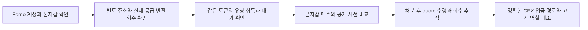
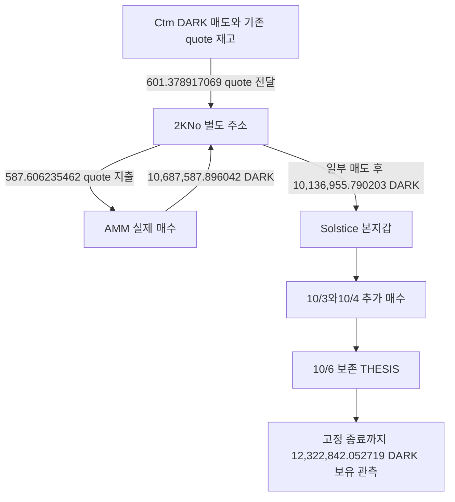
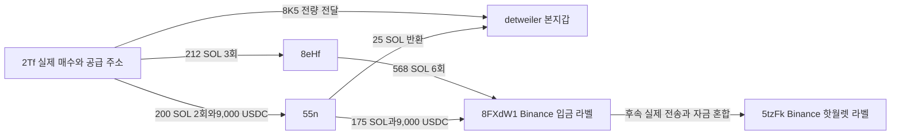

# Fomo Top Trader 연관 지갑과 선행 취득 연구 현황 보고서

작성일 2026년 10월 8일

## 1 종합 판단

**Fomo 계정과 연결된 별도 지갑의 실제 매수와 토큰 전달, 반복 자금 공급과 반환, 거래소 라벨 주소로의 전송을 확인했다. 다만 같은 사람이 별도 지갑을 관리하며 공개 전에 매집하고 공개 뒤 회수했다는 최종 가설은 아직 입증하지 못했다.**

현재 가장 우선할 사례는 **Solstice의 DARK**다. 별도 주소 2KNo가 대가를 지급해 토큰을 취득한 뒤 본지갑에 1,013만 DARK를 전달했고, 전달 시점은 보존된 THESIS보다 4일 21시간 앞선다. 이 물량이 어느 개인의 투자 재고인지, 매매 대행이나 지갑 이전인지, 당시 유통 시총이 100만 달러 이하였는지는 미확인이다.

**detweiler의 연결 지갑망**에서는 반복 공급과 매수 후 본지갑 전달, 두 별도 주소의 동일한 Binance 라벨 입금 주소 사용까지 확인했다. 연결 자체는 조사 가치가 높다. 그러나 확인한 8K5 매수들은 본지갑 첫 보존 매수 이후였고, 본지갑도 동일 고객 입금 주소를 사용했다는 증거는 없다.

**STONKCATS의 공통 공급**은 발행자 배분과 홀더 보상으로 설명할 수 있는 경로가 확인됐다. 이 사례는 공통 송신자만으로 뒷지갑을 묶으면 오탐이 생긴다는 점을 보여 준다. **ARTHUR**는 저시총 조건을 충족한 매수 한 건을 중심으로 풀을 조사했지만, 직전 매수 군집이나 Fomo 연관 뒷지갑을 뒷받침하는 결과는 나오지 않았다.

| 연구 질문 | 현재 답 |
|---|---|
| Fomo 본지갑과 실제로 연결된 별도 주소가 있는가 | 있다. 자금 공급과 반환, 토큰 전달이 확인된 주소들이 있다 |
| 별도 주소가 같은 토큰을 대가를 지급해 취득했는가 | DARK와 8K5 등에서 확인했다 |
| 별도 주소의 취득이 보존 THESIS보다 앞선 사례가 있는가 | DARK에서 확인했다. 절대 최초 공개 여부는 별도다 |
| 같은 개인의 뒷지갑인가 | 미확인. 실행 대행과 서비스 관계를 구분하는 근거가 필요하다 |
| 연결된 별도 주소들이 같은 거래소 라벨 주소를 쓰는가 | 8eHf와 55n의 동일 Solana 입금 주소 사용을 확인했다 |
| 본지갑과 별도 주소의 동일 고객 CEX 계정이 확인됐는가 | 확인되지 않았다 |
| 공개 후 처분과 실현 수익까지 입증됐는가 | 일부 매도와 수령액은 확인했지만 핵심 후보의 전체 원가와 회수는 미완료다 |

## 2 연구 목표와 판정 기준

최종 목표는 다음 순서를 실제 거래와 공개 시각으로 연결하는 것이다.

본지갑이 매수한 뒤 THESIS를 쓰는 것은 관측 가능한 일반 행동이다. 핵심 질문은 **연결된 별도 주소가 어떤 역할로 토큰을 취득하고, 누가 비용을 부담하며, 이후 자산이 어디로 회수되는가**다.

보고서에서 사용하는 표현은 다음과 같다.

- **본지갑 연결 검증:** Fomo의 서로 다른 매매 기록과 실제 거래의 서명 또는 최종 수령 주소, 정확 토큰과 수량을 대조했다는 뜻이다. 실명이나 최종 수익자를 확인했다는 뜻은 아니다.
- **연관 주소:** 실제 공급·반환·전달 관계가 있는 별도 주소다. 같은 사람 소유로 확정한 주소가 아니다.
- **공개 전 취득:** 확보한 THESIS 또는 BUY 노출 시각보다 취득이 앞선 경우다. 삭제된 글이나 다른 플랫폼 게시물을 포함한 절대 최초 공개와 구분한다.
- **거래소 연결:** 실제 전송과 Arkham·탐색기의 거래소 라벨이 함께 있는 경우다. 라벨은 제공자 주장이고, RPC는 전송을 검증한다.
- **수령액과 수익:** 매도 또는 출금에서 받은 자산은 수령액이다. 원가·수수료·재고 배분이 확인돼야 실현 수익으로 계산할 수 있다.

같은 고객 입금 주소를 사용하는 것은 중요한 연결 단서다. 그러나 거래소 핫월렛, 공동 출납 주소, 브리지 정산 주소가 겹치는 것만으로 같은 고객이라고 판정하지 않는다. 반대로 입금 주소가 겹치지 않아도 지갑 간 직접 반환, 매매 실행과 재고 전달, 개별 브리지 주문 같은 다른 근거로 연결을 조사할 수 있다.

## 3 현재 범위와 계정별 진행도

### 조사 구간과 저시총 조건

현재 집중 대상은 처음 지정한 30일 리더보드 스냅샷의 **원래 Top10**이다. 현재 순위가 바뀌어도 사용자 ID는 유지한다. Top100 확대와 RZD 단독 반복 추적은 중단한 상태다. 연우 조사는 이전 개별 조사로 별도 보존한다.

고정 60일 구간은 **2026-08-08 04:43:41 UTC 이상, 2026-10-07 04:43:41 UTC 미만**이다. 한국 시각으로는 8월 8일 13:43:41부터 10월 7일 13:43:41까지다. 이 구간을 설정한 것과 10명의 모든 거래·게시물을 60일치 확보한 것은 다르다.

새 전체 토큰 매수자 검색과 군집 분석은 사건 당시 **유통 시총 100만 달러 이하**를 확인한 사건에 한정한다. 이미 연결된 지갑의 정확 거래·토큰 계좌·역할 검증은 시총 보류 상태에서도 기초 근거로 보존하되, 이를 저시총 적격 사례로 발표하지 않는다.

현재 시총, 총발행량에 가격을 곱한 완전희석가치인 FDV, 한 풀의 가격을 과거 유통 시총으로 대체하지 않는다. 시총 표본의 사전 300초 조건은 가격 자료의 시간 근접성을 위한 운영 기준이다. 선행 매집 탐색 기간은 고정 60일이며, 300초로 줄어드는 것이 아니다.

### 초기 10명 현황

아래 BUY·SELL·THESIS 수는 고정 구간 안의 **보존된 Fomo 이벤트**다. 실제 온체인 거래 수와 다르고 전체 게시 기록의 완전성도 보장하지 않는다.

| 원래 순위 | 계정 | BUY | SELL | THESIS | 본지갑 연결과 주요 조사 |
|---:|---|---:|---:|---:|---|
| 1 | pointfarmcap | 5 | 0 | 5 | 검증 · STONKCATS 발행자 배분과 보상 역할 검토 |
| 2 | The__Solstice | 1 | 5 | 22 | 검증 · DARK 공급 후보와 STONKCATS·브리지 |
| 3 | theveeman | 3 | 2 | 28 | 검증 · GOMO·OCTO 실행 확인, 일부 매칭 모호 |
| 4 | RareDualJay | 2 | 0 | 22 | 후보 · Ash 매수 표본, 본지갑 후보 |
| 5 | 0xdetweiler | 60 | 65 | 16 | 검증 · EH8·2Tf·8eHf·55n과 HOOKED |
| 6 | pricedin | 0 | 1 | 5 | 후보 · JEANPHIL·PERPSPAD 표본, 본지갑 후보 |
| 7 | RunningClam | 0 | 0 | 14 | 미확보 · Robinhood 실행 자료와 조회 경로 공백 |
| 8 | econoar | 12 | 8 | 27 | 검증 · Ethereum IMD·Base/Solana 주문 경로 |
| 9 | RZDxbt | 20 | 12 | 21 | 검증 · STOCKER·CEX·브리지 기존 결과, 단독 추적 중단 |
| 10 | motiyawerey | 20 | 17 | 11 | 검증 · SI·MONEROCHAN·ARTHUR와 NEAR 브리지 |

10명 중 **7명에서 8개의 체인별 본지갑 연결**을 검증했다. RareDualJay와 pricedin은 후보 상태이고 RunningClam은 지갑과 실행 자료가 미확보다. 이 비율은 지갑 연결 진행도이며 연구 전체의 완료율은 아니다.

## 4 확보한 데이터와 사용 구조

### SQLite 집계

보고서 작성 전 SQLite 스냅샷 기준이다. 전체 DB에는 초기 조사와 개별 계정 조사, 현재 Top10 결과가 함께 들어 있다.

| 자료 | 행 수 | 의미 |
|---|---:|---|
| 원문 보존 기록 | 2,592 | API 응답, RPC, 브라우저 관측, 검토 결과 등이 포함된다. 고유 거래 수가 아니다 |
| Fomo 이벤트 전체 | 1,338 | 전체 저장 범위의 BUY·SELL·THESIS |
| 원래 Top10 고정 구간 이벤트 | 404 | BUY 123, SELL 110, THESIS 171 |
| 온체인 매매와 취득 기록 | 806 | Solana 798, Ethereum 8. 원가 미확인 취득도 포함된다 |
| Fomo 이벤트와 거래 대응 링크 | 73 | 단일 대응과 모호한 대응을 포함한다 |
| Solana 정규화 활동 | 44,604 | swap 외 이체와 프로그램 활동도 포함한다 |
| 토큰 잔액 변화 | 63,178 | 활동의 자산별 원시 잔액 변화 |
| 자금과 브리지 연결 기록 | 349 | 전송·주문·역할 근거. 전부 개인 funding이나 동일 소유 관계가 아니다 |
| 지갑 연결 판정 | 11 | 전체 DB 기준 검증 9, 후보 2. 연우 등 개별 조사도 포함한다 |
| 수집과 검토 재개 상태 | 46 | 완료 범위, 다음 커서와 미해결 항목을 보존한다 |

SQLite가 기준 저장소다. CSV나 JSON은 분석과 검토를 돕는 산출물이며 기준 DB를 대신하지 않는다. 토큰 수량은 원시 정수와 소수 자릿수를 보존하고, 거래·게시·수집 시각을 각각 UTC로 저장한다.

### 데이터 도구의 역할

| 도구 | 현재 역할 | 제한 |
|---|---|---|
| Fomo 관련 REST API | 사용자와 리더보드, BUY·SELL·THESIS 보존 | 제3자 색인 자료이며 과거 게시·삭제·수정과 60일 전체 노출은 불완전하다 |
| RPC와 주소 인덱스 API | 실제 전송, signer, 최종 수령자, 대가와 잔액 변화 검증 | 단일 주소 조회는 ATA만 건드린 거래를 놓칠 수 있다. 마지막 Nodit 확인은 401 인증 실패였다 |
| Chrome의 Arkham과 체인 탐색기 | 거래소와 서비스 라벨, 개별 거래 화면 대조 | 라벨은 제공자 주장이다. 접근 실패는 거래 부재가 아니다 |
| Relay와 deBridge 등 주문 조회 | 출발 거래·주문·목적지 거래 대응 | 공유 정산 지갑 전체 흐름을 한 사용자에게 귀속하지 않는다 |
| BigQuery API와 CLI | 특정 지갑·토큰·시간창의 과거 탐색과 데이터 공백 보완 | dry run과 최대 처리량 상한을 먼저 적용한다. 현재 전체 토큰 확대는 적격 조건 전까지 보류다 |
| Dune | 현재 실행 경로에서 제외 | 이전 조회·권한 점검 결과만 보존한다 |
| SQLite와 분석 작업자 | 보존 자료 분석, 연결·역할·시각 검토와 결과 저장 | 기존 작업자 5개는 gpt-6-luna, 추론 max. 본체가 외부 요청과 최종 판정을 담당한다 |

새 WebSocket 수집은 사용하지 않는다. 이번 종합 보고서는 저장 자료만 대조했고 외부 API·유료 BigQuery를 새로 실행하지 않았다. 과거 RZD 조사에서는 BigQuery를 실제 사용했다. 예를 들어 CEX·STOCKER 검토의 세 작업은 약 691.8GB의 billed bytes를 기록했으며, 이는 현재 크레딧 잔액이나 실제 원화 청구액이 아니다.

## 5 가장 중요한 후보 Solstice와 DARK

### 유상 취득과 전달의 시간표

- 본지갑: Solana `4ugDhHJ8XDXAeABmrNmGffFaLbJb9BkPyiFGVSV9ocwo`
- 직접 공급 주소: `2KNoBqc81eP9Narp8p77fgMYTncLGJRMt7xBGMZU52iF`
- 직전 quote 공급 주소: `Ctm86tHoUygaxDRbt9ELRacLt8zYt8UsZHbq1HLddMGp`
- DARK mint: `7KEPApdbBMByrmqihz3bht2uMhFQcatjfSFQCKq66kH3`

| UTC 시점 | 실제 사실 | 해석 |
|---|---|---|
| 10/2 00:28:17 | Ctm이 DARK를 매도하고 임시 계좌들을 거쳐 601.378917069 NEAR/wNEAR quote를 2KNo에 전달 | 실제 연결은 확인. 같은 slot의 연속 실행이라 공동 실행·지갑 이전 대안도 있다 |
| 같은 slot의 다음 tx index | 2KNo가 587.606235462 quote를 지급해 10,687,587.896042 DARK 취득 | 별도 주소의 유상 취득 확인 |
| 10/2 01:40:43 | 두 차례 일부 매도 뒤 10,136,955.790203 DARK를 본지갑에 전달 | 전달 후 2KNo 해당 계좌의 잔고 0 |
| 10/3 23:40:48 | 본지갑이 273.968614 USDC로 234,073.819331 DARK 추가 매수 | **현재 저장된 본지갑의 가장 이른 실제 유상 매수** |
| 10/4 22:16:17 | 본지갑이 3,123.595706 USDC로 1,951,812.443185 DARK 추가 매수 | 보존 Fomo BUY 알림과 대응한 거래 |
| 10/6 22:59:05 | 보존된 DARK THESIS | 절대 최초 공개를 뜻하지 않음 |

**정정 사항:** 직전 답변과 이전 최신 보고서는 10/4 거래를 본지갑의 첫 보존 실제 매수로 표현했다. 저장 원문과 SQLite를 종합 대조한 결과 10/3 거래가 더 이르다. 따라서 1,013만 DARK 전달은 본지갑의 첫 보존 실제 유상 매수보다 **1일 22시간 5초**, 보존 THESIS보다 **4일 21시간 18분 22초** 앞선 것으로 정정한다. 10/4는 Fomo 알림과 대응한 추가 매수다.

[2KNo 유상 매수](https://solscan.io/tx/3TDM6urbdPpJ3AacpTnnzYcfVkAx4oqurUJzGWnyX3XmeoKUpGSE5ZVGXXqtRNiUDN3XJzqCmULcD5mpcW9nmq4r), [본지갑 전달](https://solscan.io/tx/1iZ877Z12puJ72nBG9KWHSjjy9Wc36oc4njgZpQzisWQN6B9uouUTZGwSoXuinhmwUYxSHeHTbEowwqW6EM5QJk), [10/3 본지갑 실제 매수](https://solscan.io/tx/2v47MSDcSUzd6R249ZK7xsrnc9qA2DfpC7jabUfvwNhjPiqURfW3zMbbbznqK4LHYaDxdBv53PCMTpqPtt4VHykG)에서 거래를 확인할 수 있다.

### 이 사례가 중요한 이유와 남은 조건

이 사례에서는 별도 주소의 유상 취득, 본지갑 전달, 이후 본지갑 매수와 THESIS가 같은 정확 토큰으로 연결된다. 단순 공통 거래소 사용보다 직접적인 관계다. **본지갑에 들어온 물량이 공개 전에 별도 주소에서 취득된 재고였다는 사실**은 후보 사례로 남길 수 있다.

그러나 같은 slot에서 Ctm의 매도와 2KNo의 재매수가 이어지고 여러 임시 계좌와 공동 서명이 등장한다. 개인 투자 지갑, 실행 대행, 관리 서비스와 지갑 이전을 구분해야 한다. 현재 지갑 주소의 연결을 동일 개인의 뒷지갑으로 확정하지 않았다.

DARK의 역사 유통 시총 조회는 빈 응답을 반환했다. 현재 유통량 0 표기나 풀 분봉 가격만으로 과거 시총이 100만 달러 이하였다고 판정할 수 없다. 고정 종료 시점까지 본지갑 정확 토큰 계좌의 처분도 관측되지 않아, 게시 뒤 회수·CEX 입금·실현 수익까지 완성된 사례는 아니다.

### 공통 홀더 보상과 결제 토큰 이름 정정

공식 지급 목록에는 Ctm·2KNo·Solstice가 보상 수령자로 등장한다. 첫 지급 각 한 건을 RPC로 확인했으며, 실제 공통 source owner와 signer는 `3qNjuHy3uxB5fq7H5PgXc3CLBeorpjD3LejLT6RS1x5C`다. 이를 개인 자금 공급자나 동일인 군집 근거에서 제외했다. 2KNo의 첫 확인 보상은 해당 DARK 매수와 전달 이후다.

공식 목록의 수령 행 16개 중 고정 구간 안은 14개다. 그 안에서 RPC로 확인한 것은 3개이며 나머지 11개는 제공자 주장이다. 1,013만 DARK 전달 거래가 이번 반환 목록에 없다는 사실은 전체 과거 에어드롭 부재를 증명하지 않는다.

이전 DARK 거래에서 STONK라고 표기한 quote mint `3ZLekZYq2qkZiSpnSvabjit34tUkjSwD1JFuW9as9wBG`는 탐색기상 NEAR, 공식 문서상 wNEAR다. STONK mint `6Gm…`와 다르다. 정확 주소와 수량을 보존한 채 이름을 정정했고, 두 자산의 가격이나 시총을 서로 대입하지 않는다.

근거: [연관 지갑 핵심 검토](top10-linked-wallet-core-review.md), [매수 시점과 보상 역할 검토](top10-linked-wallet-prebuy-chronology.md). 시각 정정의 직접 근거는 raw2281 두 번째 거래와 해당 SQLite 매수 행이다.

## 6 detweiler의 반복 실행과 공통 거래소 경로

### 본지갑과 EH8의 반복 공급과 반환

검증된 본지갑 `EC2f5DnHzuNRit1ExqghSifDbp1wgrzktsRRZCtU92MJ`와 EH8 사이에서 다음 실제 전송을 확인했다.

| 방향 | 전송 수 | 수량 |
|---|---:|---:|
| 본지갑 → EH8 | 90 | 1,439,792 USDC |
| EH8 → 본지갑 | 35 | 570,846.948548 USDC |

STONKCATS의 세 실행에서는 본지갑이 USDC를 보낸 뒤 16~32초 안에 EH8가 실제 매수했고, 이후 토큰을 본지갑에 전달했다. 세 매수 모두 보존 THESIS 이후였다. 이 구조는 본지갑 자금에 의한 매매 실행과 전달을 보여 주며, 독립 자금으로 먼저 매집한 뒷지갑이라는 판단을 지지하지 않는다. 공급·반환 차이는 수익이나 채무가 아니다.

### 8K5의 취득과 전달

| 9/1 UTC | 거래 |
|---|---|
| 08:33:11 | 본지갑 최초 보존 실제 BUY |
| 08:40:48 | 2Tf가 21 SOL로 1,871,224.456686468개 취득 |
| 08:41:43 | EH8가 7.5 SOL로 655,618.272880162개 취득 |
| 08:43:57 | EH8가 취득분 전량 본지갑 전달 |
| 08:45:47 | 2Tf가 취득분 전량 본지갑 전달 |
| 08:48:24 | 8eHf가 10 SOL로 729,024.251719156개 취득 |
| 09:10:56 | 8eHf가 최초 취득량 절반에 해당하는 수량 매도, 14.577646693 WSOL net 수령 |

별도 주소의 실제 취득·전달은 확인했지만 **위 매수 모두 본지갑 최초 보존 매수 뒤**다. 정확 8K5 mint의 Fomo 이벤트는 보존 자료에서 0건이므로 앱 최초 노출·CALL 전후 판정도 아직 불가능하다. 매수와 LP·claim·대출 지분 활동을 구분했다.

### 별도 주소들의 동일 Binance 라벨 입금 주소

두 별도 주소가 사용한 정확 입금 주소는 Solana `8FXdW1ZcR3ebEqsNNDBbZ5m39Zdif3WSYuicKrXibxwJ`다. Arkham은 Binance Deposit Address로 표시한다. 55n의 USDC 입금은 토큰 계좌를 경유하며, 당시 owner가 같은 정확 주소임을 RPC로 확인했다.

해당 입금 주소에는 다른 유의미한 송신자도 있다. 고객별 전용 주소인지 공유 출납 주소인지 확인되지 않았다. 본지갑의 직접 입금은 고정 60일 native 및 단일 USDC 계좌 비교에서 관측되지 않았으며, 다른 자산·다른 계좌의 가능성은 남아 있다. 568 SOL을 2Tf에서 받은 212 SOL의 회수액으로 귀속하지 않는다. 일부 입금은 그 공급보다 먼저 발생했고 후속 sweep에는 다른 자금도 섞였다.

다른 분기인 EH8 → FE5X → KuCoin 라벨 주소에서도 전송을 확인했지만, 혼합 자금과 중간 주소의 역할 때문에 같은 고객 입금이나 특정 토큰 수익으로 연결하지 않았다. 거래소 라벨 주소로부터 2Tf의 개별 deBridge 원출발 경로가 이어지는 사례는 **거래소 출금 방향**이며 현금화 입금과 구분한다.

근거: [핵심 연결 검토](top10-linked-wallet-core-review.md), [처분과 브리지 검토](top10-linked-wallet-exit-review.md), [공통 거래소 입금 경로](top10-repeated-exit-endpoint-review.md).

## 7 공통 공급과 본지갑 매매 사례의 재평가

### STONKCATS 초기 배분과 홀더 보상

pointfarmcap과 Solstice는 같은 BTR 발행자 주소에서 각각 **29,700,000 STONKCATS를 순수령**했다. 수령은 보존 THESIS보다 앞섰지만, 직접 토큰 전달이므로 수령자의 유상 장내 매수로 세지 않는다.

이후 정확 수수료 회수 권한의 토큰 수수료 회수, STONKCATS 매도와 페어 토큰 수령, 홀더 보상 지급이 확인됐다. 공통 송신자에는 실제 발행자 배분과 서비스 보상이라는 설명이 있다. 따라서 공통 공급만으로 세 주소를 같은 개인의 뒷지갑이나 공조 그룹으로 묶지 않는다. 초기 NFT 보유·허용목록·프로모션 자격과 대가는 여전히 미확인이다.

Solstice의 관측 계좌는 공급과 추가 매수 뒤 총 9회 매도로 잔고가 0이 됐고, USDC **39,597.727526**을 수령했다. 이는 매도 수령액이다. 처음 지급된 물량의 대가가 미확인이므로 수익으로 확정하지 않았다. 역사 유통 시총도 보류다.

이와 별개인 **STONK 6Gm**의 8eHf 매수 당시 8/21 시간별 시총은 약 560만~719만 달러였다. 이 토큰의 신규 100만 달러 이하 시장 확대 우선순위는 낮췄다. STONKCATS, STONK, DARK의 NEAR/wNEAR quote는 서로 다른 정확 mint다.

근거: [수수료와 보상 역할 검토](stonkcats-fee-reward-role-review.md), [pointfarmcap 재고 추적](pointfarmcap-stonkcats-trace.md), [공급과 매도 검토](top10-arthur-and-common-supply-review.md).

### HOOKED와 Werey의 본지갑 공개 전 매수

| 사례 | 확인된 시점과 행동 | 연구상 의미 |
|---|---|---|
| detweiler HOOKED | 보존 THESIS 14초 전 본지갑 매수, 이후 46개 실제 매매와 정확 계좌 잔고 0→0 | 본지갑 매매 시간표 사례. 별도 지갑 선행매수 증거는 아니다 |
| Werey SI | 보존 THESIS 전 24 BUY, 뒤 27 SELL | 본지갑의 며칠 전 매수와 게시 뒤 매도 확인. 시총과 연관 별도 주소는 별도다 |
| Werey MONEROCHAN | 보존 THESIS 전 22 BUY, 뒤 1 SELL | 같은 구분을 적용한다 |

HOOKED에서 본지갑 USDC 순지출은 39,799.999998, 순수령은 181,356.519484이며 차이는 **+141,556.519486 USDC**다. 이는 검토한 거래들의 순현금흐름이다. 전체 원가 배분과 서비스 비용, 다른 경로를 포함한 최종 USD 수익으로 확정하지 않았다. 시총 시간 표본은 매수 전 약 70만 달러에서 매수 뒤 약 128만 달러로 100만 경계를 가로질러, 사건 순간의 저시총 적격성도 보류했다.

이 사례들은 게시 전 재고와 게시 후 매도를 연구할 수 있음을 보여 준다. 별도 주소의 소유권과 거래·회수가 연결돼야 뒷지갑 가설을 검증하는 사례로 발전한다.

### ARTHUR 저시총 군집 조사

Werey의 **10/2 08:00:37 실제 추가 매수**는 37초 전 역사 유통 시총 약 **595,242달러** 표본으로 조사 적격으로 승인했다. 이 승인은 해당 매수 한 건에 대한 것으로 다른 날짜의 매수나 THESIS를 자동 승인하지 않는다.

해당 풀의 3시간 성공 거래 613건을 보존했고, 엄격히 같은 owner의 ARTHUR·USDC 반대 방향 변화를 확인한 거래는 BUY 115·SELL 69, 매수 주소 63개였다. 추가 매수 직전 60초 BUY는 0건, 5분은 3건, 15분은 9건이었다. 5분·15분의 빈도는 대조 구간 중앙값 3·8과 비슷했다.

후속 후보 F73의 반복 매매 546건도 확인했지만 검토 범위에서 Top10 지갑 접점은 찾지 못했다. 일반 자동매매나 마켓메이킹 가능성이 있어 뒷지갑으로 승격하지 않았다. 현재 이 사건은 **저시총 탐색은 실행됐으나 유의미한 선행매수 연결은 확인되지 않은 사례**다.

근거: [ARTHUR 적격과 군집 검토](top10-arthur-and-common-supply-review.md), [후속 후보 검토](top10-prepublic-buy-and-crosschain-review.md).

## 8 이전 RZD와 연우 조사에서 남은 근거

아래는 현재 Top10 집중 조사와 구간·대상이 다른 기존 개별 조사다. 현재 새 추적이 계속 진행되고 있다는 뜻은 아니다.

| 대상 | 보존된 주요 사실 | 현재 판단 |
|---|---|---|
| RZD와 6a2 | 6a2가 STOCKER를 4회 유상 취득한 뒤 1,114,947.519342597221320112개를 RZD 본지갑에 전량 전달 | 매수는 최초 보존 THESIS 뒤, 세 번째 THESIS 앞. 최초 공개 전 선행매수 증거가 아니다 |
| RZD의 거래소 접점 | 공급 주소의 Robinhood 입금 후보, 6a2의 BSC 거래소 출금 9건, 중간 주소를 거친 Coinbase 입금 후보 | 본지갑과 별도 매수 주소의 동일 고객 CEX 입금은 미확인. 과거 전송을 STOCKER 수익으로 귀속하지 않는다 |
| 연우의 BSC 전달 경로 | 54d2→c67a→Binance 51 USDC 3건, 합588,098.805041163975619333 | 9/8 한 쌍은 양쪽 RPC, 두 쌍은 인덱스 자료. 고객 입금 주소의 운영 주체는 미확인 |
| 연우의 BNB 전달 경로 | 54d2→32f023→Binance 51, 12.5 BNB 공급과 후속 전송 | 실제 전송 확인. 제보 주소32f0a와는 다른 정확 주소 |
| 연우 CZ | 알려진 Fomo 실행에 대응한 유상 취득 2건, 보존 THESIS보다 먼저 발생 | 본계정 실행 사례다. 조사한 이전 CZ 수령 주소와 연관 주소 교차에서는 겹침0 |

연우 조사에서 `32f0a…`를 유력 뒷지갑으로 제보받았지만, 주요 기록은 실제 BNB 전송을 흉내 낸 미검증 토큰 이벤트와 유사 주소 패턴이었다. 실제 native 전달 주소 `32f023…`와 분리했고, 제보를 사실로 승격하지 않았다.

연우의 최초 조사에서는 THESIS가 0건이었으나 후속 REST 경로로 9건을 추가 확보했다. 따라서 과거 보고서의 “THESIS 없음”은 최신 상태가 아니다. CZ의 FDV 예비값을 유통 시총으로 바꾸거나, Binance 서비스 주소로 끝나는 두 경로를 동일 고객으로 판정하지 않았다.

RZD의 초기 30일과 과거 비교 범위, 연우의 약61일 개별 구간은 현재 고정60일 Top10 구간과 합산하지 않는다. 상세 주소와 직접 거래 링크는 [RZD CEX와 STOCKER](rank9-cex-prebuy.md), [연우 추적](yeon-wallet-trace.md), [연우 두 달 조사](two-month-review.md), [과거 THESIS 검토](lowcap-thesis-review.md)에 있다.

## 9 진행 단계와 주요 공백

| 단계 | 상태 | 다음 판정에 필요한 내용 |
|---|---|---|
| 기준 저장소와 원문·UTC·수량 보존 | 구축됨 | SQLite와 원문을 기준으로 재개 가능 |
| 초기10명 Fomo 게시와 알림 기초 수집 | 일부 확보 | 더 오래된 게시, 삭제·수정, 앱 BUY 노출의 과거 완전성 |
| 본지갑 연결 | 7명 검증, 2명 후보, 1명 미확보 | 미확보 계정의 별도 실행 근거 |
| 비서비스 연관 주소와 역할 | 일부 확인 | 매매 대행·발행자 배분·보상·브리지 정산·개인 관리 구분 |
| 저시총 적격과 선행매수 군집 | ARTHUR 한 실제 매수 중심 실행 | 사건 시각에 가까운 유통 시총, 후보의 실제 본지갑 접점 |
| 공개 전 별도 취득과 본지갑 공급 | DARK 후보 시간표 확인 | 동일 관리와 실행 역할, 역사 시총, 절대 최초 공개 |
| 처분과 quote 회수 | 일부 계좌에서 확인 | 핵심 후보의 원가와 lot별 회수·브리지 대응 |
| 공통 고객 CEX와 실현 수익 | 미완료 | 고객별 입금 역할, 본지갑과의 동일 endpoint, 비용·재고 배분 |

가장 큰 병목은 과거 Fomo 노출 시점과 사건 당시 유통 시총이다. RPC가 실제 매수와 전송을 보여 줘도 이 두 자료가 비어 있으면 공개 전 저시총 선행매수 판정을 완성할 수 없다.

자료 회수의 완료 범위도 구분한다. 빈 후속 페이지와 null cursor는 해당 주소·계좌·기간·필터의 결과를 회수했다는 뜻이다. 모든 자산·실패 거래·폐쇄된 과거 계좌·평생 이력의 완전성을 뜻하지 않는다. 예를 들어 8eHf의 고정60일 native 성공 조회 1,740행은 종료됐지만, 이것이 모든 토큰 계좌 이동의 완전한 이력은 아니다.

현재 남아 있는 실무 공백은 detweiler의 USDC 미완료 커서, 개별 2Tf 브리지 주문의 원출발 주소, Robinhood Chain 목적지의 독립 원장 검증, 일부 API 인증과 브라우저 접근 실패다. 이를 무활동이나 관계 부재로 해석하지 않는다.

## 10 다음 조사 우선순위

### 우선순위 1 DARK 후보의 역할과 적격 조건

이미 확인한 유상 취득·전달을 재사용하고, Ctm·2KNo의 실행 권한과 서비스 역할을 구분할 독립 근거를 찾는다. 사건 당시 유통 시총과 더 이전 공개 기록을 보완한다. 핵심 산출물은 개인 관리 또는 서비스 대안의 근거, 게시 기준 시각, 사건별 저시총 적격 판정이다.

기초 근거로 저장한 사례와 저시총 심층 대상은 구분한다. 시총 근거를 확보하지 못하면 보류 상태로 남기고 다음 적격 후보로 이동한다. 시총 자료 없이 DARK 전체 시장이나 관련 없는 지갑군을 대량 수집하지 않는다.

### 우선순위 2 초기10명의 적격 사건에서 실제 별도 주소 찾기

100만 달러 이하가 확인된 사건을 중심으로 본지갑 매수 이전 또는 보존 공개 이전 실제 취득자를 찾는다. 단기 동시 매수뿐 아니라 고정60일 안의 장기 매집도 검토한다. 그중 본지갑과 비서비스 공급·반환·토큰 전달·정확 입금 경로가 겹치는 후보부터 좁힌다.

매수 빈도는 주변 대조 구간과 비교하고 같은 라우터·fee payer·브리지 서비스 사용을 통제한다. 후보가 일반 봇이나 유동성 운영으로 설명되고 Top10 접점이 없다면 우선순위를 낮춘다. ARTHUR의 약한 후보를 계속 확장하는 것보다 실제 연결이 있는 다른 적격 사건으로 옮기는 편이 현재 목적에 맞다.

### 우선순위 3 처분과 회수 그리고 정확한 고객 입금

실제 매도와 quote 수령이 확인된 후보만 후속 전송과 개별 브리지 주문으로 잇는다. `(체인, 정확 주소)`와 필요할 때 memo/tag를 비교하며, 고객 입금 주소의 역할을 별도로 검증한다. 이미 종료한 Binance 주소 SOL·USDC 조회와 공유 핫월렛 전체 흐름을 반복 수집하지 않는다.

고정 종료 뒤 DARK 매도와 신규 회수를 볼 필요가 생기면 별도의 증분 구간을 명시해야 한다. 이번 보고서가 고정60일 구간을 자동으로 늘린 것은 아니다. 원가·수수료·계좌 생성 비용·재고 이동과 lot 배분이 확인된 뒤 자산별 현금흐름과 실현 수익을 구분해 계산한다.

## 11 현재 사례집에 넣을 수 있는 내용

| 사례집 항목 | 지금 쓸 수 있는 주장 | 확정해서 쓰면 안 되는 주장 |
|---|---|---|
| Solstice DARK | 별도 주소의 유상 취득 물량이 보존 THESIS 전에 본지갑으로 전달됨 | 동일인 뒷지갑, 조작 목적, 당시100만 달러 이하, 게시 뒤 수익 회수 확정 |
| detweiler 연결망 | 반복 자금 공급·반환, 매수 후 본지갑 전달, 별도 주소들의 공통 Binance 라벨 입금 | 본지갑 매수 전 8K5 선행매수, 동일 CEX 고객과 소유권 확정 |
| STONKCATS | 발행자 초기 배분, 수수료 회수와 홀더 보상, 이후 실제 매도 | 공통 공급자만으로 동일인 또는 공조 그룹 판정 |
| HOOKED와 Werey 본지갑 | 보존 THESIS 전 실제 매수와 이후 매도 시간표 | 관련 뒷지갑의 존재와 조작 의도 확정 |
| ARTHUR | 사건별 저시총 적격·풀 매수자 대조를 실제 실행했고 뚜렷한 직전 군집은 미관측 | 조사 결과를 토큰 전체·모든 뒷지갑의 부재 증명으로 확대 |
| RZD와 연우 | 개별 실제 취득·전송·거래소 라벨 경로와 제보 주소의 오탐 교정 | 과거 전송을 해당 토큰 수익으로 귀속하거나 제보 주소의 개인 소유 확정 |

현재 성과는 **후보 연결을 찾고 서비스·보상·일반 실행과 구분하는 근거가 쌓였다는 것**이다. 최종 사례를 완성하려면 실제 유상 취득의 비용 부담, 공개 시각, 별도 주소의 관리 관계, 게시 뒤 처분과 회수라는 고리를 연결해야 한다.

## 부록 재개 자료와 정정 기록

주요 상세 보고서는 다음과 같다.

1. [매수 시점과 보상 역할](top10-linked-wallet-prebuy-chronology.md)
2. [공통 거래소 입금 경로](top10-repeated-exit-endpoint-review.md)
3. [별도 지갑 실제 매수와 공급](top10-linked-wallet-core-review.md)
4. [처분과 브리지](top10-linked-wallet-exit-review.md)
5. [본지갑 공개 전 매수와 크로스체인](top10-prepublic-buy-and-crosschain-review.md)
6. [수수료와 홀더 보상](stonkcats-fee-reward-role-review.md)
7. [ARTHUR 적격과 군집](top10-arthur-and-common-supply-review.md)
8. [나머지 계정 기초 검토](top10-remaining-accounts-review.md)

계정 ID와 운영 범위는 `docs/top10-investigation-focus.json`, 판단 규칙과 재개 지시는 `AGENTS.md`와 `docs/agent-research-policy.json`을 따른다. latest 조사 검토는 raw2591, 근거는 raw2590이다. 다만 DARK 본지갑 첫 보존 실제 매수 시각은 이 보고서의 정정과 raw2281을 우선한다.

보고서 작성용 집계와 시각 정정 근거는 ignored `data/research/reports/fomo-research-overview-2026-10-08.json`에 보존한다. 이전 원문, 지갑 연결 판정, 거래 행과 수집 재개 상태는 덮어쓰지 않는다. 이 보고서 작성은 신규 거래 수집이나 범위 확대가 아니다.

종합 집계·정정 근거 원문: raw2593(이번 보고서 대조). 위 DB 행 수는 이 보고서 원문 2건을 추가하기 전 스냅샷이다.
