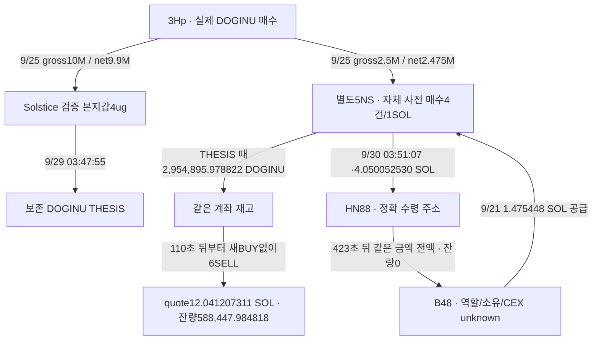

# Solstice DOGINU: 공급·게시 후 매도·자금 회수와 실패 비용 검토

## 현재 판단

**서로 연결된 별도 지갑의 실제 유상 매수 → Solstice의 보존 THESIS 시점 재고 → 같은 별도 지갑의 게시 후 매도 → 후속 SOL 회수 경로를 찾았다.** 기존 공통 공급자3Hp가 본지갑4ug와 별도5NS 양쪽에 DOGINU를 보냈고,5NS는 THESIS 전에 자체 매수4건도 실행했다. THESIS110초 뒤부터 시작한 첫6매도는 추가 매수 없이 기존 재고만 소비했다.

이번에는 **5NS의 실제 SOL 공급자B48와 게시 다음 날 회수 종착점B48가 겹친다**는 점을 확인했다. 5NS→HN88→B48 구간은 독립 RPC로도 검증했다. B48/HN88의 서비스·거래소·고객·개인 소유 역할은 미확정이다. 거래소 회수나 Solstice의 뒷지갑이라고 확정하지 않는다.

당시 유통 시총, 절대 최초 대외 노출, 이전받은 재고의 대가·원가, USD 실현 수익은 여전히 미확정이다. **거래·시점·자금 구조를 담은 사례 후보 보고서는 작성할 수 있지만, ‘저시총 뒷지갑을 이용한 THESIS 악용 수익’의 완결 입증은 아니다.** `pending_cap`/엄격 적격 사례0/전체 연구 목표 진행 중을 유지한다.

원래 Top10/raw141, 고정 구간2026-08-08T04:43:41Z 이상–2026-10-07T04:43:41Z 미만. 아래 시각은 UTC. Fomo 사용자ID `888d8a2c-a25d-5543-86b2-1dbd03cf4479`, exact DOGINU mint `5JgioXRQSq1Nw4VJvpRyXxnvm8jVtLSUC7vbf1zzDg3L`, decimals6.

## 연결도

5NS `5NSXD54Ljcezm5ohSbDSiD7Yr7dL93mn5TBzMsvurZFj`, B48 `B48kNVXs4YK4amkBCH2XokQiv1SeiVQGHDR17xDeKAAn`, HN88 `HN88xT9rYmWYPMShC3MN3GANUBR3ZKmLYWhBCyP7a4xg`. 직접 본지갑↔5NS 일반 SOL 송금이 확인된 것은 아니다. 연결 근거는 별도 정확 토큰 계좌에서 확인한 **main←3Hp→5NS 실제 전송 두 경로**다. 같은 pool·수수료 수령 주소·F7 서비스 접점만으로 만든 연결이 아니다. 공통 공급도 사적 동일 소유의 증명은 아니다.

## 새 공급·회수 거래

|UTC|실제 경로·금액|근거|
|---|---|---|
|9/21 20:19:34|B48→5NS **1.475448000 SOL**|[공급 거래](https://explorer.solana.com/tx/3WVyaaseh7uanWdSXJBY1FNVenopr2FUKoNbCMUQYq7mndRcMY5uSR4tmTfpf6Pha9jfyJYeJBxTR7ARrZCDFuLT) · raw3488 data117/outer1 · B48/DSc signer|
|9/30 03:51:07|5NS→HN88 **4.050052530 SOL**|[회수 출금](https://explorer.solana.com/tx/2Ht6ckrgCJVbCrngTduVR4CS4sQ62NvixiYqHWWcW5qZQjVJxV8jmbFDm4W7mpsUjYdgeYcYSeuaCfGC3AKdgBX1) · raw3488 data224/3493 data0 · 독립 RPC3492 · Chrome3495|
|9/30 03:58:10|HN88→B48 **4.050052530 SOL 전액**, HN88 잔고0|[423초 뒤 스윕](https://explorer.solana.com/tx/5fFXM92i9NDJA7TADSteGxV16a3R13xFB4wSUMWxe1MFkYrzUShVC1PwGGZa2PsFmkkMzsvYmAWgX4U13Gxzg91b) · raw3493 data1/outer1 · 독립 RPC3496|

첫 공급은 최초5NS DOGINU 유상 매수보다48시간53분04초 앞이다. 그 뒤 다른 거래와 잔액이 섞였으므로 그1.475448SOL을 특정 DOGINU 매수의 유일 원금으로 지정하지 않았다.

5NS의4.050052530SOL 출금에는 ADu 주소로 별도0.0001SOL 지급과 네트워크0.000105SOL이 있다. 최종5NS SOL 감소는 **4.050257530SOL**, HN88 실제 입금은4.050052530SOL이다. 후속 전액 스윕의0.00025SOL 네트워크 비용은 별도DSc fee payer가 부담하므로 HN88가 보낸 금액을 줄이지 않는다. 직접 메타와 independent RPC의 transaction·meta·slot·UTC가 일치한다.

수령→전액 스윕 구조는 관측 사실이다. 이를 개인 지갑·고객 deposit·CEX hot wallet 중 하나로 단정할 라벨/고객 증거는 없다. **B48가 보내고 B48로 회수된다는 주소 일치만으로 5NS=Solstice 또는 B48=본인 계정이 되지는 않는다.** resolver3491은 HTTP200이지만 `unresolved`, observations0이며 Relay order나 cross-chain destination은 확인되지 않았다.

## 같은 지갑 매수·매도와 quote

앞선 [사전 매수·게시 후 매도 보고서](solstice-doginu-linked-recipient-prebuy-review.md)의 exact ATA41행/재고 검산을 재사용했다. 최초5NS BUY9/23 21:12:38→THESIS9/29 03:47:55의 간격은5일6시간35분17초다. 총4paidBUY의 SOL충전1, 순취득779,895.978822DOGINU. 별도3Hp 순이전2,475,000DOGINU는 paidBUY가 아니다.

THESIS 재고2,954,895.978822,110초 뒤 첫SELL350,000. 새BUY 없이 첫6SELL2,366,447.994004, 실제 최종 quote12.041207311SOL/잔량588,447.984818. 최소1,586,552.015182DOGINU는 앞서 받은 이전분에서 소비되어야 한다는 보수적 재고 하한을 유지한다. 개별 토큰 단위나 특정 quote의 소유·원가 추적은 아니다.

THESIS 후 처음1시간은3451/52를 재사용하고, 이후23시간3478/79를 새로 확인했다. 21행 안의 DOGINU4SELL/3BUY는 모두3437의 기존 거래와 같아 다시 적재하지 않았다. 네SELL의 최종 wSOL **10.470952001SOL**은5NS 소유 임시계정CUQY와sUAvx로 들어와 **close destination5NS**로 정산된다. 이 임시 계좌들을 외부 회수·router 소유 계좌로 오인하지 않는다. 같은 네거래의 최종 native 증가 합은 수수료·지급을 반영한 **10.359075944SOL**이다.

이어 다른 토큰 매수·fee 분배 수령과 DOGINU 추가 매수가 섞인다. 게시 다음 날4.050052530SOL 전송을 확인했지만 전액을 DOGINU 매도 대금으로 지정할 개별 원금 증거는 없다. 수령액·잔액 증가·현금 회수·USD 수익을 구분한다.

마지막10/7 00:47:09의2,360,962.998039DOGINU 매도는 최종 알려진 exact ATA를0으로 만들었다. 같은 거래는 기존3437 data40이므로 중복0. 6초 후 다른 토큰0.25SOL 매수와 추가4다른swap이 있었고, 이후14개 SOL 소액 분배 credit은5NS 비서명/다른payer였다. 해당 짧은 창에는 직접 CEX 회수 근거가 없다.

## 실패 거래 비용을 포함한 검산

성공 거래만 조회하면 실패 수수료가 빠진다. 정확 DOGINU ATA의 **all-status3482/83는68행=기존 성공41+실패27**이며 빈/null footer로 닫혔다. 실패27건은 모두5NS fee payer, DOGINU 잔액변동0, native 감소가 정확히 network fee였다. 실패를 BUY/SELL로 적재하지 않았다.

|실패 비용 범위|건수|5NS 부담 SOL|
|---|---:|---:|
|DOGINU THESIS 이전|6|0.003629994|
|DOGINU THESIS 이후|21|0.015604983|
|정확 DOGINU ATA 실패 합계|27|**0.019234977**|

최종 매도→고정 종료의 owner all-status3480/81은42행(성공20/실패22), 잔액 사이 단절0으로 검산했다. 성공20행 delta 합−0.005324887SOL에 **5NS 부담 실패8건0.006740000SOL**을 더하면 전체−0.012064887SOL과 일치한다. 다른14실패의 Hck payer 수수료0.000126SOL은5NS 비용이 아니다. DOGINU ATA 실패와 owner 실패의 중복 signature를 또 더하지 않는다.

이 비용 보완으로 모든 재고의 취득 대가가 생기는 것은 아니다. 이전된2.475M의 대가·원가, 다른 token 혼합, 당시SOL/USD와 모든 관련 asset coverage가 남으므로 USD PnL은 미확정이다.

## 역사 공급량과1M 시총 조건

[최초 발행 거래](https://explorer.solana.com/tx/5RhjiY8opAuoqNaxQp6Dyn6uwxfJqLiMnKeWfjmDq2GLfaWVokEhGkNtFuo1XayUcArRgSKvtMZt4NE88JjrghFS) raw3470 data0를 독립 finalized public RPC3475와 대조했다.9/19 21:26:44에 exact mint 새계좌 생성→decimals6 initializeMint2→**1,000,000,000DOGINU mintTo**→**mintTokens authority null**이 한 성공 transaction에서 순서대로 발생했다. [Solana 공식 문서](https://solana.com/docs/tokens/basics/set-authority)는None 권한 설정이 해당 역할의 영구 제거임을 설명한다(raw3476). 따라서 발행 이후 **총공급량의 역사 상한10억 개**를 확보했다. 현재 값에서 과거 공급량을 추정한 것이 아니다. 유통량의 정확값·authority의 개인 소유는 여전히unknown이다.

이번에는 OHLCV 요청의token 파라미터를 **정확 DOGINU mint**로 지정해3484/85를 확보했다.10개 분봉 각각이 기존3455/56과 완전히 일치해 base/quote 이름의 혼동을 제거했다. 아직 끝나지 않은 이벤트분봉의 close는 제외했다.

|기준|이미 끝난 분봉/close 이후 경과|USD 표본가격|검증 총공급 상한×표본가격|
|---|---|---:|---:|
|첫5NS paidBUY|9/23 21:10:00/98초|0.0001463665039591363|약146,366.50달러|
|보존THESIS|9/29 03:46:00/55초|0.0004055740394138896|약405,574.04달러|

위 값은 **그 표본가격을 기준으로 한 시총 상한 계산**이다. 정확한 이벤트시각의 전체 시장 가격·당시 유통량 확정치가 아니다. 첫·THESIS 표본은 운영 freshness300초 안이지만, 이를 모든 시장의 가격 상한 또는 정확 유통 시총으로 승격하지 않았다. 나머지3개 사전BUY 가격도 별도 미확인이다. `pending_cap`, 엄격 적격0을 유지하며 신규전체토큰 군집/BQ수집0. Gecko문서 직접 fetch3486의404를 내용 검증 성공으로 쓰지 않는다.

## 수집 범위와 남은 공백

5NS owner-address 고정60일 성공 query는 기존3446–48의300행과 새3487/88/89의594행,3490 빈/null footer를 합쳐 **894개 고유 signature로 종료**됐다. 저장 cursor를 실제로 이어 받았고 서로 중복이 없다. `tokenAccounts=none` 조건이므로 모든 SPL ATA·실패·archive 전체가 완성된 것은 아니다. owner가 메시지에 나오지 않는 수령 ATA 이전은 이 쿼리에서 빠질 수 있어 기존3Hp token전송 근거를 유지한다.

Fomo 저장 자료에서 exact DOGINU 공개 기록은2167의THESIS1건이다. 공개BUY/CALL/SELL 및 절대 최초 대외 노출의 완전한 과거 목록은 미확인이다. ‘보존 THESIS 이전 매수’와 ‘절대 최초 공개 이전 매수’를 구분한다. 처음BUY 직전3시간3473/74는 다른mint을 매수한1건뿐이며 외부native 유입은 없었다. 이는3시간창의 부정 근거이고 전체 기간의 자금 부재가 아니다. 최종 owner DeVUr 증가572,043.139811은 해당 swap 맥락이며 중간 Xs3를 최종취득 토큰으로 쓰지 않았다.

공급3Hp와 본지갑/5NS token 전송은 실제 signed transfer다. 5NS의 자체paidBUY도 실제swap이다. 그러나 공급된 토큰은 매수가 아닌 배분이며 정상 개인 이전·OTC·프로젝트 배분 등의 대안을 배제하지 않는다. token fee/holder 분배·dust·같은pool 접점을 사적 자금 또는유상매수로 승격하지 않았다.

Solscan3477은보안화면, Explorer3495는실제회수tx의Success/Finalized 화면을 확인했다. 기존 Arkhamchallenge·Nodit401은 반복하지 않았다. 거래소라벨·고객귀속·동일통제·악용의도는추가독립근거가필요하다.

## 저장·다음 추적

근거raw3505/검토3506/시총3504,state`initial_top10_Solstice_DOGINU_historical_supply_cost_and_recovery_review_v1`. 새canonical 실제TRANSFER3건, 기존trade 재적재0→trades4569/edges500/states71. 기존70states·11wallet·497edges/Fomo1338·고정404/match73를 그대로 보존했다. 실패27건은 원문/검토 evidence로 저장했고 실제trade로 세지 않았다. 작업자5개Luna/max는DBRO/network0이며 본체가 검산했다.

실제 RPC20/20,Bridge1/3,시장2/2,Chrome2/3,공식문서4/4(직접HTTP2+웹검색2),기타0. 웹문서2건의 개별usage 기록 누락을 마감전에정정했다;사전전체예약4회안의조회였고추가네트워크호출은없다. 남은예약은해제했다.

다음은 **B48/HN88의 서비스·거래소 역할과 본지갑의 같은 정확 고객입금 주소 여부**, 이후공개이력/역사시총의남은조건이다.이미완료한exactDOGINU ATA/source/main/5NSowner894·HN88 hour는재조회하지않는다. B48 pooled flow 전체를 Solstice에게 귀속하지않는다. 원래10명·고정60일·1M조건을유지하고 전체연구는계속한다.
