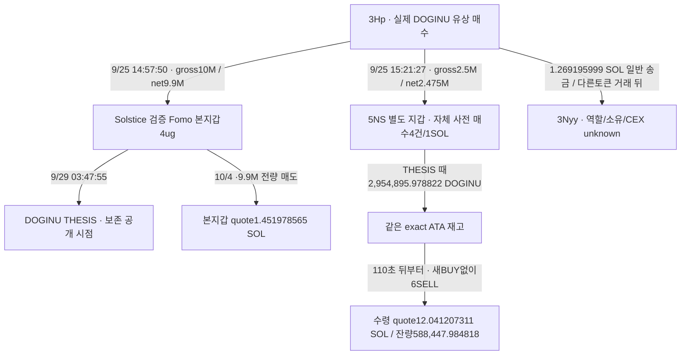

# Solstice DOGINU: 공통 공급자와 연결된 별도 지갑의 사전 매수·게시 후 매도

## 이번에 확인한 흐름

**Fomo 본지갑에 토큰을 보낸 동일 공급자3Hp가 별도5NS에도 DOGINU를 보냈다. 5NS는 자체 SOL 유상 매수와 THESIS 당시 보유 재고가 있었고, Solstice THESIS 110초 뒤부터 같은 계좌에서 매도했다.** 첫 매도는 독립 공개 RPC로도 대조했다.

실제 송금 경로·주소별 서명·역사 token account owner·매매 시각을 확인했다. 5NS가 Solstice 본인 또는 공모 지갑이라는 소유권·의도 증거는 없다. 정상적인 개인 간 전송·OTC·배분 등 대안도 남는다. 당시 유통 시총은 아직 확정되지 않았다. **조작·선행매수 악용 또는 USD 수익을 입증한 사례로 발표하지 않는다.**

범위는 원래 Top10/raw141, 고정2026-08-08T04:43:41Z 이상–2026-10-07T04:43:41Z 미만. 아래는 UTC.

## 연결 구조

정확 DOGINU mint `5JgioXRQSq1Nw4VJvpRyXxnvm8jVtLSUC7vbf1zzDg3L`, decimals6. 본지갑 `4ugDhHJ8XDXAeABmrNmGffFaLbJb9BkPyiFGVSV9ocwo`, 공급자 `3HpNWdgjK9yMLMbmJdpsZcx6iiK39hPrDzTFYc65oQdr`, 별도 지갑 `5NSXD54Ljcezm5ohSbDSiD7Yr7dL93mn5TBzMsvurZFj`. CEX 라벨·같은 고객 입금 주소는 확인되지 않았다.

## 5NS 실제 매매와 공개 시점 재고

|시각|실제 거래·재고|근거|
|---|---|---|
|9/23 21:12:38|0.25 SOL 유상 매수 · DOGINU188,849.460332 순수령|[첫 매수](https://solscan.io/tx/3LQFf23nsL9hD358BW8kGVp6EqfdQzY98gWxEbvbC921zdWW1ZMB3EJE5NgoknJ7eBPs3eKJTjEtkXgdxrpzcDFC) · raw3437 data0|
|9/24 07:47:32 /18:25:51|각0.25 SOL 추가 매수 · 220,383.714310 /210,455.863025|raw3437 data2/4|
|9/25 15:21:27|3Hp→5NS gross2.5M/net2.475M 전송, 매수와 분리|raw3437 data6=3424 data5=3439 data55|
|9/25 16:54:45|0.25 SOL 추가 매수 ·160,206.941155|raw3437 data8|
|9/29 01:16:07|300,000 매도 · THESIS 이전|raw3437 data10|
|9/29 03:47:55|THESIS 시점 exact ATA 재고 **2,954,895.978822**|raw2167 보존 THESIS +3437 연속 ledger|
|9/29 03:49:45|**110초 뒤350,000 매도**, quote1.016704346 SOL|[첫 게시 후 매도](https://solscan.io/tx/34e5wf2jQJ3zT2rZxphKX3NQX6rANLhGq753GNT3pDrNEiKtb1R9v8kQYyRQanxUVedYAYEeea2L3yPhvpZcHuNC) · raw3437 data11/3451 data0/독립3453|
|9/29 03:50:41|166초 뒤200,000 매도, quote0.553550964 SOL|raw3437 data12|
|9/29 17:51:28까지|새 DOGINU BUY 없이6SELL 총2,366,447.994004 · 잔량588,447.984818|raw3437 data11–16|
|10/3 14:45:50|이후 재매수와 섞인4,174,567.134899 전량 매도 · target0|raw3437 data37|
|10/4 21:04:22 →10/7 00:47:09|새2,360,962.998039 취득→같은 수량 전량 매도, 이전 cycle과 분리|raw3437 data38/40|

4번 자체 매수는 **779,895.978822 DOGINU/임시 WSOL 투입1SOL**이다. 3Hp 이전분2.475M은 paid BUY로 분류하지 않았다. 전체 fixed exact ATA는15BUY/9SELL/1TRANSFER·16개 무변화 명령,41행+3438 빈/null footer, 잔량0→0·각 pre/post연속 검산이다. 게시 전1SELL/게시 후8SELL·추가11BUY. 전체 게시 후 실제 quote12.583482105 SOL은 수익이 아니다.

첫6SELL은 게시 시점 재고만 소비했다. 자체 유상 매수 전량779,895.978822를 보수적으로 비이전분의 최대량으로 두어도 **2,366,447.994004−779,895.978822=최소1,586,552.015182 DOGINU**가 3Hp 순이전분에서 소비되어야 한다. 이는 fungible 재고의 수학적 하한이며 개별 토큰 단위·특정 매도 대금의 출처 추적 또는 소유권 증명은 아니다. 이후 혼합 재매수의 원가를 임의 배분하지 않았다.

## 매도 대금 검증과 회수 공백

첫2SELL quote 합계1.570255310 SOL, 네트워크·별도 native 지급 반영 후 signer잔액 증가1.550078493 SOL. USDC는 경로 중간 교환이며 최종 지갑 USDC 수령으로 세지 않는다. 원문은 임시 WSOL 실제 입금→close→같은 signer SOL 반환을 보여 준다. 공개 Solana RPC3453은 첫SELL의 signature·slot451525292·blockTime·transaction·선택 meta와 QuickNode 원문이 일치한다. 추가 매도로 중복 세지 않았다.

첫 게시 후1시간3451/52는2DOGINU SELL 뒤 **03:51:35 다른토큰 취득**을 보여 준다. 첫 target0 매도 뒤1시간3457/58도 SELL 뒤 다른토큰 취득3건이다. 두 좁은 구간에 exact CEX endpoint는 확립되지 않았다. 전체5NS owner60일은3446–48의300행/9/7–9/11/cursor446230245:688로 여전히 부분이다. exact DOGINU ATA 완성과 모든자산 owner 이력 완성을 구분한다.

각 BUY의 임시 WSOL 충전과 pool 입력·수수료·환급은 분리했다. 마지막 재매수0.29SOL 충전 중0.2871은 실제 route 입력,0.0029는 미사용 WSOL로 돌아와 같은 거래에서 별도 provider 지급된다. 이를 quote와 fee에 두 번 더하지 않는다. network·tip·일시 준비금 전체를 포함한 최종 USD PnL은 미확정이다.

본지갑 exact ATA3435/36는3행: 3Hp 순9.9M 전송→무변화 fee harvest→10/4 본지갑 서명 전량 매도. THESIS 당시 재고9.9M을 검증했다. quote1.451978565 SOL/native 순증1.451809979는 앞선 보고서를 재사용한다. source3Hp 자체 SELL은 모두 THESIS 이전이며 자체 target0이다.

3Hp→`3Nyyv4d5G4SxkgefYsjKEfV4FxSLmGqCFycy3aSpsnru` 일반 SOL1.269195999를 새 edge로 추가했다. 성공 instruction·수취자 잔액을 대조했지만, 직전 다른토큰 거래 뒤 송금이라 DOGINU 매도 대금 또는 CEX로 귀속하지 않았다. BNr의 기존13회28,619.698191 USDC 송금은 별도다. BNr2000행8/25–26 prefix에서1955개 수령자·많은 지급을 보았으므로 서비스 대안이 크다. 역할 라벨은 미확정, pooled fanout과 전체 이력 확장은 보류했다.

## 1M 이하 시총 조건의 현재 상태

GeckoTerminal이 반환한 정확 pool·DOGINU quote-token USD 분봉을 확보했다. 아직 끝나지 않은 event당시 분봉을 제외하고 **이미 종료된 분봉**만 골랐다.

|기준|완료 분봉 시작/표본 경과|USD 가격|현재 provider 명목10억 개를 조건부로 곱한 값|
|---|---|---|---|
|첫5NS BUY|9/23 21:10:00 /158초(분봉 끝 이후98초)|0.0001463665039591363|약146,366.50달러|
|THESIS|9/29 03:46:00 /115초(분봉 끝 이후55초)|0.0004055740394138896|약405,574.04달러|

두 분봉은 freshness300초 운영 가정 안이다. 첫BUY21:12분봉/THESIS03:47분봉의 close에는 event이후 시간이 포함되어 제외했다. **위 값은 확정 역사 유통 시총이 아니다.** single pool 가격과 현재 provider 명목 공급량10억에 대한 조건부 FDV 대용치다. 현재 RPC supply999,993,721.516102·mintAuthority null·현재 Token-2022 fee1%를 확인했으나 당시 초기 공급량·authority변경·burn·유통량은 아직 검증하지 않았다. provider market_cap_usd도 null이다. `pending_cap_proxy` 유지, 신규전체토큰/BQ수집0·엄격 적격 완결 사례0.

## 공백과 저장

Arkham3443/44는 보안 확인 화면, Nodit3449/50는401다. 같은401 두 번째 시도도 예산에 포함하고 반복하지 않는다. 이후 공개 RPC로 대표 SELL을 검증했다. 실패를 거래0·역할 부재로 해석하지 않는다. Fomo 절대 최초 공개/대외 BUY 노출·사적 소유·공동통제·의도·원가·USD수익은 미확정이다.

근거raw3467/검토3468/시총3466, state`initial_top10_Solstice_DOGINU_common_supplier_prepublic_and_postpublic_sell_review_v1`. 실제5NS swap24/일반SOL edge1 추가→trades4569/edges497/states70, 기존69states·11wallet·4545trades·496edges/Fomo1338·고정404/matches73 보존. RPC20/20·시장4/4·Chrome2/3·나머지0. Luna5개/max는 network0/DBRO. 닫힌 exact ATA/source owner/first-hour query는 재수집하지 않는다.

다음 핵심은 **역사 mint 초기 공급·authority와 공개 이력 공백, 5NS의 실제 추가 회수·CEX endpoint**다. 이미 관측된 그래프와 경제적 행동을 저장했으며, 확정되지 않은 악용 결론을 채우기 위해 거래를 반복 조회하지 않는다. 원래Top10·60일·1M 범위 유지, 목표 진행 중.
