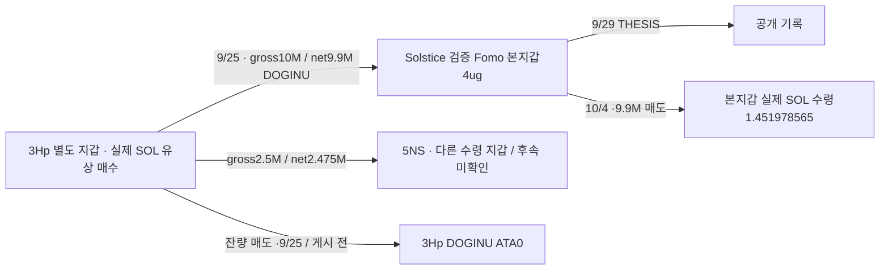

# Solstice: 별도 지갑 매수·토큰 전달·THESIS 이후 본지갑 매도

## 결론

별도 주소 **3Hp**가 DOGINU를 SOL로 매수하고, Fomo 검증 본지갑 **4ug**에 토큰을 보내고, 이후 Solstice가 THESIS를 게시하고 본지갑에서 전달 수량과 같은 990만 개를 매도한 거래를 확인했다. 단순 airdrop 수령을 유상 매수로 바꿔 해석한 사례가 아니다. 그러나 **공급자 자체 매도는 모두 THESIS 이전**이다. 찾으려는 ‘같은 뒷지갑이 게시 전 매수하고 게시 후 매도’와 구분한다. 소유권·공동통제·의도·당시 유통 시총·실현 USD 수익은 미확정이다.

원래 Top10/raw141·고정60일: 2026-08-08T04:43:41Z 이상–2026-10-07T04:43:41Z 미만. 모든 시각 UTC.

## 거래 순서

|시각|실제 관측|근거|
|---|---|---|
|9/19 22:14:36|3Hp 0.8 SOL 유상 매수, 순 DOGINU23,129,995.886128|raw3424 data0|
|9/19 22:18:29|첫 물량 전량 매도, 수령 quote0.932295928 SOL|raw3424 data1|
|9/20 01:37:59|3Hp 두 번째0.8 SOL 매수, 순 DOGINU13,398,210.259337|raw3424 data2|
|9/25 14:57:50|3Hp→본지갑10,000,000 전송, 실제 순수령9,900,000|[전송 거래](https://solscan.io/tx/5CE2myzw3pM7dRWpE2Ee5UfTtHpUgYk7ZFwEWfp7n9VJQ99DePDmHitKkvAvFfjqGWagEw1iN5mFWcerr9ohFVEu) · raw3424 data4/3410 data96|
|9/25 15:21:27|3Hp→별도5NS 2,500,000 전송, 실제 순수령2,475,000|raw3424 data5|
|9/25 16:49:18|3Hp 잔여898,210.259337 매도, quote1.399682536 SOL, target잔량0|raw3424 data6|
|9/29 03:47:55|Solstice DOGINU THESIS 게시|보존 Fomo raw2167; 절대 최초 공개 미확정|
|10/4 22:26:39|본지갑9,900,000 매도, 실제 전달 quote1.451978565 SOL|[매도 거래](https://solscan.io/tx/2RNcq2MV4CSZqBK3XgvFfP4xAwETxvsM2hhsnoMv4mFqeiZfbeuxzstb2qZtWKpH529NCew1wLpf4niT52V7tPSg) · raw3422 data26|

정확 mint `5JgioXRQSq1Nw4VJvpRyXxnvm8jVtLSUC7vbf1zzDg3L`, decimals6, Token-2022. 두 전송에서 각각 gross/net100,000 및25,000 차이가 관측된다. 역사 수수료 설정 전체를 검증했다고 주장하지 않는다. signer/authority와 역사 token-account owner가 일치한다. 다른 제3자의 fee harvest 한 건은 target변화0이며 매수·매도로 분류하지 않았다.

## quote와 원가의 구분

본지갑 매도는 WSOL 임시 계좌의 실제 토큰 입금→같은 거래의 close→본지갑 SOL 반환을 확인했다. USDC177.460541은 중간 경로이며 본지갑 최종 USDC 수령이 아니다. **1,451,978,565 − 네트워크158,586 − tip10,000 = 실제 native 잔액 증가1,451,809,979 lamports**. 표의 quote는 route 수수료 이후, 네트워크 수수료 이전 전달 금액이다. 임시 계좌의 끝 WSOL잔액0으로 매도를 누락하지 않는다.

공급자의 첫 매도는 WSOL입금933,229,157에서 route수수료933,229를 보내 quote932,295,928, 네트워크9144 차감 후 native932,286,784다. 첫4분 거래와 두 번째 매수·배분 물량을 섞지 않는다. 0.8 SOL 전체를 본지갑 원가로 귀속하거나 USD 이익으로 계산하지 않는다. source와 본지갑이 같은 liquidity pool을 사용한 접점은 공유 서비스이며 private 관계 근거로 추가하지 않는다.

## 반복 USDC 공급 주소

`BNrYNyQZhdGRs8Rvi98WGTjhxab2wFTdGtVjW72RGyh4`가 source ATA`4iWr1Pc2cjnPxTUwbfSUZRGX9ffMAZwqpWyorfca2faN`에서 본지갑 ATA`GhE45gSNXPpGuYBCVYdHnDK6SY3VNiBe7ekz9nyPo6fU`로 **13회/28,619.698191 USDC**를 보냈다. authority signer·정확 mint·양쪽 historical owner·잔액을 root에서 대조했다. 초기 worker10건 요약은13건으로 정정했다. DOGINU 매입 대가·CEX 고객·동일 사람·공동통제로 지정하지 않는다. shared Relay vault 출금과 분리한다.

## 종료한 조회와 남은 공백

본지갑 지정 owner query는 기존2100+이번원구간2287+마지막별도구간127=**4514 unique tx**, raw3421·3423 빈/null footer로 고정60일 필터 범위를 닫았다. 이는 tokenAccounts=none 지정 주소 query이며 모든 ATA/자산·평생·archive완전성을 뜻하지 않는다. raw3411은3410의100행 중복으로 신규coverage0; 요청1회와 원문은 보존한다. raw3396 timeout 후100행으로 bounded재시도1회.

3Hp exact DOGINU ATA는7행+3425 footer, 잔량0→0·연속 ledger 검산. 닫힌 이력 재수집 금지. 본지갑9.9M 수령과 매도 전9.9M은 일치하지만 **ATA-only 중간 변동을 포함한 연속 재고는 아직 미확인**이다. 다음은 exact 본지갑 ATA와 실제 다른 수령5NS를 확인한다.

DOGINU 당시 유통 시총은 pending_cap. 현재 시총·FDV를 대신 쓰지 않았고 신규 전체토큰/BQ수집0. 엄격한1M 이하 완결 사례0이며 목표 진행 중.

## 저장

근거raw3432/검토3433/시총3431, state`initial_top10_Solstice_DOGINU_supplier_and_main_exit_review_v1`. canonical 실제swap5/TRANSFER15 추가, trades4545/edges496/states69. 기존68states·11wallet resolutions·4540trades·481edges와 Fomo1338/고정404/matches73 보존. Luna5개/max는 network0/DB읽기전용. RPC30/30(실패와 중복 포함), 다른source0. 나머지 예약 해제. 전체 원문·cursor·owner·정수량·수수료 검산·frontier를 보존했다.
