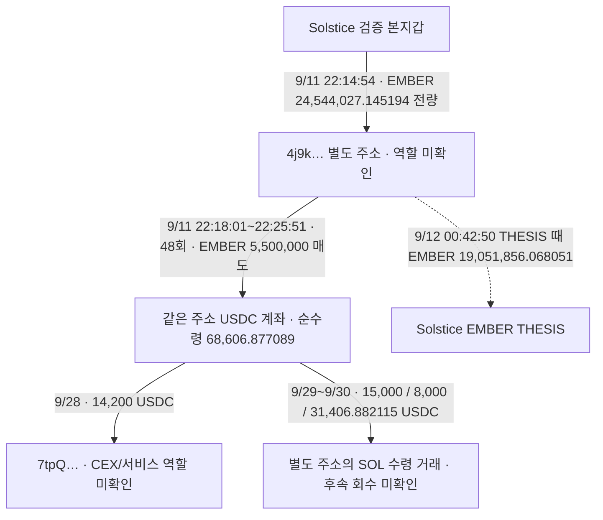

# Solstice EMBER 별도 지갑 추적 보고서

새로 확인한 흐름은 **Solstice 본지갑에서 별도 주소로 EMBER 전량을 옮긴 뒤, 별도 주소가 THESIS 전에 일부를 매도**한 사례다. 본지갑의 게시 전 매수만을 설명한 사례보다 자금 연결이 구체적이다. 다만 별도 주소의 유상 취득과 게시 후 매도가 없어, 요청한 완성 사례로 판정하지 않는다. 개인 소유권·서비스 역할·당시 유통 시총·수익은 미확정이다.

## 확인 범위

초기 raw141 Top10을 유지했다. 고정 구간은 2026-08-08 04:43:41 UTC부터 2026-10-07 04:43:41 UTC 미만이다. 이번에는 이미 연결된 지갑의 거래와 정확 토큰 계좌를 확인했다. **EMBER가 당시 유통 시총 100만 달러 이하였다는 근거는 아직 없으며 `pending_cap`이다.** 새 전체 토큰 시장 조회나 BigQuery 군집 수집은 하지 않았다. 보존 THESIS 시각은 절대 최초 공개 시각을 뜻하지 않는다.

## 주소와 구조

| 역할 | 정확한 Solana 주소 |
|---|---|
| 검증된 Solstice 본지갑 | `4ugDhHJ8XDXAeABmrNmGffFaLbJb9BkPyiFGVSV9ocwo` |
| 새 EMBER 수신·매도 주소 | `4j9kCRiUzPJ954qh8MQV4idnJB2HQ4daaNn4R6SrTBpL` |
| EMBER mint | `5dvXTZ5qwgafnHtwu3Ls3QrWx1U4LQsFeCuJgkk4QEC6` |
| 수신 EMBER 계좌 | `4NYNHSCsMB76hYjscNyPpFpGwzNJVb8Xgj1nhNZgZfHg` |
| 매도 USDC 수령 계좌 | `6NgnNLAsUz1MeVN3QZscsvHXt3EDH5FJ4XudPjCyfT73` |
| 후속 14,200 USDC 수신 주소 | `7tpQy8SiHiM9PSqrRnCjzZFxPNVJkGvu4kDD74vcQaJQ` |

이 그래프의 화살표는 실제 전송·매도·대가 수령이며 동일 개인 소유를 뜻하지 않는다. 매도와 THESIS는 별도 시계다.

## 전량 이전과 게시 전 매도

모든 시각은 UTC다.

| 시각 | 확인된 사실 | 검토 근거 |
|---|---|---|
| 9/11 22:14:54 | Solstice가 수신 토큰 계좌를 생성하고 자기 EMBER 잔고 전부 **24,544,027.145194**를 보냄. 본지갑 잔고 0, 수신 주소가 역사 owner | raw2658 data38 및 독립 RPC raw2662, [전량 전송 거래](https://solscan.io/tx/3YxWuWPGq5gnonh9cDQZcdwZ5VTVSvZfwqDyrQrLM2QmnEwgJ4EW5AKVe2puQv3HccRN4xfSZCprScvrFPD8eFHw) |
| 9/11 22:18:01 | 수신 주소가 서명해 EMBER **100,000** 매도, 자기 USDC 잔고 **1,342.620350** 순증 | raw2663 data2/독립 raw2671, [첫 매도 거래](https://solscan.io/tx/2V3NJiURAzCkYTJBMn8Qt2xGhec4PP7LPrdzdAmLXGhZK9ZDFJT7FKPx99HxUEFG7ftoehWuaMKR8hKMPoVrK8d7) |
| 9/11 22:25:51 | 마지막 매도 EMBER **200,000**, USDC **2,220.609136** 순증 | raw2663 data49/독립 raw2668, [마지막 매도 거래](https://solscan.io/tx/3v8mUAzZgarrerwGNHej5qPgb3uYGojiHWGXjCcshpyWNV5GZoYPbw2cyAURFTUrKeV1zY5GrHkhcZDanAb2wZJm) |
| 9/12 00:42:50 | Solstice EMBER THESIS. 직전 변화의 잔고와 이후 첫 변화를 이어 exact 계좌 잔고 **19,051,856.068051** 복원 | raw2167 `theses:14`, raw2663/2664 연속 계좌 원장 |
| 9/13 13:34:05 | 해당 계좌 마지막 반환 활동 뒤 EMBER **19,068,137.887338** | raw2664 마지막 행, raw2666 빈/null footer |

전량 이전은 THESIS보다 **2시간 27분 56초** 앞선다. 매도 48건은 첫 거래부터 마지막까지 **7분 50초**에 발생했고, 모두 게시 전이다. 정확 계좌의 171개 거래에서 성공 상태·역사 owner·서명·토큰 감소·USDC 순증을 확인했다. 합계 **5,500,000 EMBER 매도 / 68,606.877089 USDC 순수령**이다. 48건의 다른 최종 소유 토큰 delta는 없었고, 첫·마지막 매도는 독립 직접 RPC와도 일치한다.

매도 USDC 순수령은 수익이 아니다. 별도 주소의 취득 원가는 없고, 본지갑의 매수 원가·토큰 이전 조건·수수료·이전 재고를 모두 연결하지 않았으므로 손익을 확정하지 않는다.

## 반복 지급과 반대 근거

첫 전량 이전 외에 EMBER 양수 변화 **122건 / 24,110.742144개**가 추가됐다. 실제 source ATA는 `GfAcdY4XBuL19q8bHup8wcT98rcgPEEfXfvZesaRx69A`, instruction authority는 `GZjYfGyUNQfDChcQ66Gc3ZMcQqPEisyRYe1nPyQhP9bp`다. 계좌와 권한 주소를 혼동하지 않는다. 지급 목적은 아직 미확정이며 수수료 보상·리베이트·분배 대안을 확인해야 한다. 이 반복 지급을 사적 자금 공급이나 유상 BUY로 승격하지 않았다.

THESIS 뒤 양수 변화는 **113건 / 16,281.819287 EMBER**이며, **그 정확 계좌에서 THESIS 후 매도·음수 변화는 관측되지 않았다.** raw2666의 빈/null 응답으로 요청한 고정 구간 조회가 끝났다. 이는 모든 자산·다른 계좌·전 생애나 이후 활동의 부재를 뜻하지 않는다. 확인된 새 유형은 **본지갑 재고 이전 → 별도 주소 게시 전 매도 → 게시 시점 큰 잔량 유지**다.

## USDC 대금의 다음 이동

USDC 계좌 67행의 첫 잔고는 0이다. 48개 EMBER 매도 크레딧 **68,606.877089**에 기타 소액 크레딧 **0.006126**이 더해졌다. 출금 4건은 합계 **68,606.882115**, 마지막 잔고는 **0.001100 USDC**다. 원장 연속성 잔차는 0이며 raw2670 빈/null footer로 해당 계좌 조회가 닫혔다.

| UTC 날짜 | 계좌 유출 | 같은 거래에서 확인한 상대/대가 |
|---|---|---|
| 9/28 22:40:10 | **14,200 USDC** | 역사 owner `7tpQ…QaJQ`로 직접 전송, 독립 raw2672. [14,200 USDC 전송](https://solscan.io/tx/5qEd4deSAJyMRpdmcE9aDtEn4zgvaAiX5p5xdaSmkkGUw9Vo4ib4kCKHpkEynEmuqabAQPZBoknRXDYTjBdG2cXw) |
| 9/29 | **15,000 USDC** | Jupiter 경로와 별도 주소의 SOL 수령. 역할·경제적 목적 미확정 |
| 9/29 | **8,000 USDC** | Jupiter 경로와 별도 주소의 SOL 수령. 역할·경제적 목적 미확정 |
| 9/30 | **31,406.882115 USDC** | 같은 성공 거래에서 `FkaLn…` → 별도 주소 **266.229811009 SOL** 전송·동일량 native 잔고 순증. [USDC와 SOL 동시 이동](https://solscan.io/tx/3zqyrjKKyFqHkeDewm1Rtn8A5Lvq5wThs3YdHJU5RRfoKNH95p5BxorupLPYsRto8PPs6Fmm5oTDeBGANM3gfhQG) |

이 USDC 계좌 범위에서 Solstice 본지갑으로의 직접 반환은 찾지 못했다. SOL로 바꾼 뒤의 반환·CEX 회수는 다음 확인 대상이다. 14,200 전송과 마지막 Fill의 resolver raw2673/2674는 `not_bridge`, 관측값 빈 배열, 역할 unknown이다. 도구 지원 범위의 결과이며 모든 브리지 부재를 증명하지 않는다. 아직 공통 고객 CEX 입금 주소는 확인되지 않았다.

## 7kHo 경로의 우선순위 변경

7kHo 주소 자체 이력 **420건**을 끝까지 이어받았고, 소유 토큰 계좌의 잔액 변화까지 포함하는 조회 **907건**을 확보했다. 기존 420개 서명은 모두 포함되며 **487개 거래가 추가**됐다. 보존된 Solstice Solana THESIS **20건 / 정확 mint 16개**와 비교했지만 해당 토큰의 역사 owner 잔액 변화가 없었다. 여기서 ‘잔고 0’이나 ‘뒷지갑 없음’을 추론하지 않는다. 시작 전 재고·무활동 보유·제공자 누락은 별도다.

[QuickNode 공식 문서](https://www.quicknode.com/docs/solana/getTransactionsForAddress)의 `balanceChanged` 옵션을 사용했다. raw2644는 문서 원문이고 raw2645–2649는 907행, raw2650은 빈/null footer다. 이 주소를 같은 토큰 선행매수 후보로 계속 우선 추적할 근거는 약해졌으며, 새로운 실제 연결이 생기기 전에는 닫힌 조회를 반복하지 않는다.

## 초기 10명과 다음 순서

| 초기 순위 | 이번까지의 초점과 남은 공백 |
|---|---|
| 1 pointfarmcap | 본지갑 STONKCATS 재고·매도와 issuer/홀더 보상 역할 근거 보존. 개인 별도 매수 지갑·시총 미확정 |
| 2 Solstice | 이번 EMBER 전량 이전·별도 주소 게시 전 SELL 새로 확인. DARK2KNo 실제 취득·게시 재고는 있으나 게시 후 SELL 미관측. 7kHo 낮춤 |
| 3 theveeman | 검증 F5hk 기존 owner cursor와 동일 query upper bound에서 재개 필요 |
| 4 Rare | AXN4 후보 수준. 지갑 소유·별도 매수 연결 미확정 |
| 5 detweiler | EH8/2Tf 실제 실행·자금 공급, 8e/55n 동일 정확 Binance 라벨 endpoint 보존. 고객 귀속·같은 토큰 게시 전후 조건 미확정 |
| 6 pricedin | 기존 후보 유지. 공개 전 별도 지갑 유상 취득 근거 미확정 |
| 7 RunningClam | Robinhood 경로 인증/coverage 공백. 미확보를 부재로 처리하지 않음 |
| 8 econoar | 기존 EVM 지갑·bridge 실거래 근거 보존. 별도 선행매수·공통 고객 CEX 미확정 |
| 9 RZD | 단독 추적 중단 유지. 기존 자료 재사용만 가능 |
| 10 Werey | 적격 ARTHUR 슬라이스 63 BUY 지갑과 기존 그래프의 교집합은 본지갑 1개뿐. 별도 연결 후보 없음 |

**다음 우선순위는 4j9k의 SOL 후속 회수·역할과 7tp의 실제 수령 역할이다.** 이후 Solstice의 미완료 owner cursor `447417753:325`에서 재개한다. 이번에 새 700행을 더해 기존 prefix 1,200행이며 9/16까지 일부 확보했다. 원래 query 종료 1791137640을 유지했고 고정 60일 완료로 올리지 않았다. F5hk·DET의 기존 커서도 보존했다. 새 시장 군집/BQ는 당시 유통 시총 적격 승인 뒤에만 진행한다.

8eHf STONK 이전 설명도 보완한다. 게시 때 관측 재고 74.840342370 뒤 574.038845574가 더 유입돼 648.879187944 전량 SELL이 발생했다. 마지막 매도 전량을 게시 때 재고 lot로 특정할 수 없다. 작성자 직접 연결과 $1M 적격은 여전히 미확정이다.

## 저장과 접근 상태

작업자 5개는 기존 **gpt-6-luna / max**, 네트워크 0회로 원문을 검토했다. 본체가 순차 조회와 최종 판단·적재를 맡았다. 외부 사용량은 **직접 RPC30회 / Bridge2회 / Chrome2회 / 문서2회**다. 실패 504 두 건과 408 한 건은 각각 1회만 재시도했고 모두 예산에 포함했다. Fomo·시장자료·indexed API·BigQuery는 0회다. 문서 조회 중 웹 도구 1회는 직후 장부에 추가 계상한 예외를 명시했다.

Chrome raw2656 Arkham과 raw2665 Solscan은 보안 확인 화면이라 새로운 CEX/서비스 라벨 증거가 아니다. CAPTCHA를 우회하거나 화면 공백을 라벨 부재로 해석하지 않았다.

신규 canonical 실제 SELL **48건**, 실제 TRANSFER edge **2건**을 추가했다. 총 trade **854건 / edge368건**이다. 기존 collector state47개·wallet resolution11개·실제 trade806개·edge366개는 변형 없이 보존했다. 새 state는 `initial_top10_ember_linked_wallet_review_v1`다. Fomo1,338건/초기10명 고정구간404건, match73건, normalized action44,604건/token delta63,178건은 유지했다. 신규 actual SELL은 별도 주소의 거래로만 적재했고 본지갑 Fomo fill·wallet 소유권으로 연결하지 않았다.

근거 raw2680, 본체 검토 raw2681. 정확 수량·UTC·원문 위치·작업자 산출물·요청 장부는 ignored `data/research/parallel/top10-60d-20261008-v1-batch015/`와 SQLite에 보존했다. 조회 종료는 해당 계좌·필터·구간의 결과 회수 종료이며 전체 지갑·생애·모든 공개 게시물 확보 완료가 아니다.
