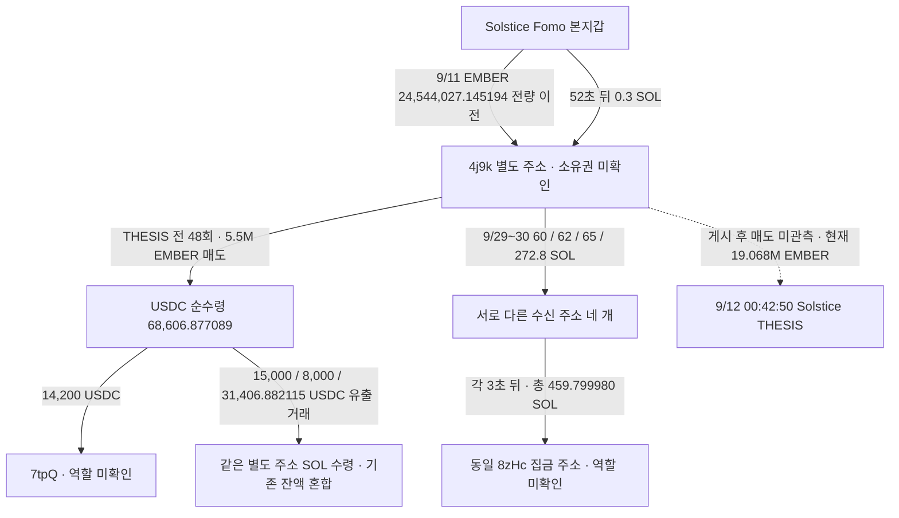

# Solstice EMBER: 별도 지갑 자금 회수와 반복성 검토

> 배치059 후속: 현재 exact8zHc 상세화면 raw4014에서625페이지, 최근7일Binance그룹2177건·여러유입·HotWallet출금이 표시돼 공용집금 대안이 강화됐다. 실제 공통 전송 경로는 유지하지만 **개인의 동일 CEX 고객 deposit 증거로 쓰지 않는다.** [최신 역할·econoar 후보](top10-exchange-hub-and-econoar-candidate-review.md)를 따른다.

**새 사실은 본지갑의 0.3 SOL 추가 송금과 별도 지갑 출금 네 건의 공통 집금 주소다.** 별도 지갑은 네 주소에 합계 459.8 SOL을 보냈고, 각 수신 주소가 3초 뒤 수수료만 제외하고 동일한 `8zHc…PGvS`로 보냈다. 자동 집금 구조라는 해석은 가능하지만 CEX·브리지·스왑 서비스·고객 귀속은 미확정이다.

**‘뒷지갑에서 선행 매수 → Fomo THESIS → 같은 뒷지갑에서 매도’ 완성 사례는 이 조사 범위에서 확인되지 않았다.** 4j9k는 EMBER를 본지갑에서 이전받았고 48회 매도는 모두 THESIS 전이다. 남은 19,068,137.887338 EMBER는 현재 확인 계좌에 있다. 이는 실제 자금 연결 사례이며 THESIS 악용 수익 증명은 아니다.

## 범위와 기준

원래 raw141 초기 Top10과 고정 60일 구간 **2026-08-08 04:43:41 UTC 이상, 2026-10-07 04:43:41 UTC 미만**을 유지했다. 이후 exact EMBER 계좌는 별도 증분 구간 **10/7 04:43:41 이상, 10/8 17:44:17 UTC 미만**을 조회했다. 현재 잔고 원문은 10/8 17:46:35.366 UTC, slot454615632의 점 시점 자료다. 증분 종료와 스냅샷 사이 138.366초는 거래 이력으로 확보하지 않았다.

EMBER 당시 유통 시총은 여전히 `pending_cap`이다. 이미 연결된 owner와 exact 계좌의 기초 거래를 검증했으며, **100만 달러 이하 적격 승인 없이 새 전체 토큰 군집·시장 수집이나 BigQuery를 실행하지 않았다.** 보존 THESIS는 확보한 게시 기록이며 절대 최초 공개를 증명하지 않는다.

## 주소와 구조

| 역할 | 정확한 Solana 주소 |
|---|---|
| 검증된 Solstice 본지갑 | `4ugDhHJ8XDXAeABmrNmGffFaLbJb9BkPyiFGVSV9ocwo` |
| 토큰 수신·매도·SOL 출금 주소 | `4j9kCRiUzPJ954qh8MQV4idnJB2HQ4daaNn4R6SrTBpL` |
| EMBER mint | `5dvXTZ5qwgafnHtwu3Ls3QrWx1U4LQsFeCuJgkk4QEC6` |
| 본지갑 EMBER 계좌 | `3ECFQTG27uCFrj6buuxSkSpZ1DFS8HTtFV2U7oAmXeLm` |
| 별도 지갑 EMBER 계좌 | `4NYNHSCsMB76hYjscNyPpFpGwzNJVb8Xgj1nhNZgZfHg` |
| 이번 공통 집금 주소 | `8zHcWujHhyJri3CRTcWUGmT5WSRdwW7xrns3WTTkPGvS` |

화살표는 실제 거래다. 같은 사람 소유, 공통 CEX 고객 계정 또는 특정 매도 물량의 수익 귀속을 뜻하지 않는다. USDC→SOL 거래와 SOL 출금 사이에는 가스·기존 잔액·수수료도 있다.

## 1. 본지갑 취득 원장과 추가 연결

본지갑 exact EMBER 계좌 **75개 거래 + 빈/null 종료 페이지(raw2691/2692)**를 대조했다. 첫 관측 거래는 9/9 23:32:15 UTC에 계좌를 생성·초기화하고 USDC를 지급한 실제 BUY다. [첫 유상 매수](https://solscan.io/tx/LJhCFDqxpoaGp5ymhiU8UbKhxqJc74kPS3ybvqJts8EFMdMDwYv92BiDPXhNTD7iv2daSRFi5dv6tjZF7aszyqZ)를 독립 직접 RPC raw2705로도 확인했다.

| 항목 | 정확한 합계와 판정 |
|---|---|
| 실제 유상 BUY | **9건**, 9/9 23:32:15~9/11 09:12:23 UTC |
| BUY에서 본지갑 EMBER 순증 | **24,531,579.568362 EMBER** |
| BUY에서 본지갑 USDC 순지출 | **70,320.700485 USDC**; 거래별 owner 잔고 차이며 수수료 보정 체결 원가와 구분 |
| 전량 이전 전 직접 지급 | **59건 / 12,447.576832 EMBER**, 본지갑 USDC 지출 0 |
| 합산 재고와 별도 주소 전량 이전 | **24,544,027.145194 EMBER**, 원장 잔차 0 |
| 본지갑 추가 native 송금 | **0.3 SOL**, 전량 이전 52초 뒤·별도 주소 첫 매도 135초 전 |

추가 SOL 송금은 **9/11 22:15:46 UTC**다. [본지갑 → 4j9k 0.3 SOL](https://solscan.io/tx/Xa3jRkWVmBqdzL39Y8bz1D1WAhMQwcxmQHVrh1HpTnwoLS4s4ccycY299zBbjFAMFKPmPCxSJQ75jzGofTxb2Qn)의 서명·System transfer·잔고를 직접 RPC raw2693으로 확인했다. 매도 전 실행 자금 공급과 부합하지만 송금 목적·개인 소유권까지 증명하지 않는다.

59개 지급의 source ATA는 `GfAcdY4XBuL19q8bHup8wcT98rcgPEEfXfvZesaRx69A`, authority/sole signer는 `GZjYfGyUNQfDChcQ66Gc3ZMcQqPEisyRYe1nPyQhP9bp`다. 수수료 보상·리베이트·분배 가능성을 유지하며 사적 공급자·유상 BUY로 분류하지 않았다.

전량 이전 뒤 본지갑에 게시 전 **0.942365 EMBER**, 게시 후 **149.375838 EMBER**가 지급돼 최종 exact 계좌 잔고는 **150.318203 EMBER**다. 게시 직후 두 DFlow 거래는 다른 토큰을 팔면서 EMBER를 중간 경로로 통과시킨 거래로, EMBER owner 순변화는 0이다. 이 두 건을 EMBER 매도로 추가하지 않았다.

## 2. 별도 지갑 출금 네 건의 공통 귀결

아래 모든 시각은 UTC다. 각 상대 주소는 해당 입금 직전 SOL 잔고 0이고, 3초 뒤 **받은 금액에서 5,000 lamports 수수료를 뺀 전량**을 동일한 `8zHcWujHhyJri3CRTcWUGmT5WSRdwW7xrns3WTTkPGvS`로 보냈다. 송금 후 잔고는 0이다. 확인 범위는 각 입금 전 60초부터 이후 60분까지의 61분 창이며 평생 한 번만 쓴 주소라는 뜻은 아니다.

| 4j9k 출금 UTC | 수신 주소 | SOL 입금 | 공통 주소 전송 UTC | SOL 집금 | 거래 링크 |
|---|---|---:|---|---:|---|
| 09-29 20:07:57Z | `3tqmQBaovCYJMUxwKTZKJsCgVC7Bzv926NbxcnJ835tp` | 60 | 09-29 20:08:00Z | 59.999995 | [입금](https://solscan.io/tx/3sibdLUQDjAj67Pcfh3ENxfVisT7o1jkUwwwDzA7XvXeeukN6pchGmZVQV2Zb3SxgXEVmoZeFC2YTbreVShi2eSz) · [집금](https://solscan.io/tx/5SxNfwqNfwhxi9HnXtVF1wLrQMXzd1fMKM6kBWLtfzLAxRQid7tAeXPZWJeqL9Ai8nBpKoLP1oG1WuidASwq7jHL) |
| 09-29 20:18:22Z | `Bp2bBYj1bfUZYAUScq2t4Rgy6U2MgC5wa8uSaEqwYRXt` | 62 | 09-29 20:18:25Z | 61.999995 | [입금](https://solscan.io/tx/5ZRmCvuMUp64ctWfQSRNoMqfjF2Y15cdnYHpMfwpwz5m8GyxS92uzo12c5FEYrm4L8p5bwBS3MeE6wAJSAjk3nb2) · [집금](https://solscan.io/tx/44iNr6nzC7MJoHZRSjSfW3BULSHec4vyuQvPh5iXvxEDMZ7bcvjrAo8pKR3sEqx2955pKHehmsqjP34iyM8mFJZJ) |
| 09-29 20:21:09Z | `AStMPzNiJJ3eTQRkzQejBwvHUaoXvcUnMSE5eiDFHn74` | 65 | 09-29 20:21:12Z | 64.999995 | [입금](https://solscan.io/tx/2ibkG6hynFSEKQkBxiqnpKAhQayUtbbavG1mKMXqzrNaCUqWvXpyQz2kFJzcD4HqZeMvobyr2ex3JdfnAnaScNWK) · [집금](https://solscan.io/tx/4NhJwiEUg58F4kbXN9pEnrvDBhLXfuxpmpDprscTEVWbp2Ps1zqxL9uAop8vMGA5e2YjiCakfAf8SfGQt8Gts7Gj) |
| 09-30 07:17:11Z | `CfZaX1eXZ5jwWeADTo8o1SUZoTfYzDjic1wz3w2H9ee1` | 272.8 | 09-30 07:17:14Z | 272.799995 | [입금](https://solscan.io/tx/VpNcjWrbnGsvhkd7EQ8zvsCmFsMqDjJ2nYgU2KCwjDrakr45qHJeFpjeXn1P1pNSiwYPaZ1WWhJUUxuv5QHK5tv) · [집금](https://solscan.io/tx/62wMmq8bPKYUST3nUKViPdWdZYUn4ezKw9orcafNCnAi68Tjmw5EyuJHJDkQgE978PNp9JpQ67Zk2zbfgGtAGxhs) |

합계는 **459.800000000 SOL 입금 → 459.799980000 SOL 집금**, 차이 **0.000020000 SOL = 네 수수료 합계**다. raw2694–2701의 각 성공 거래·서명·명령·native 잔고 및 종료 페이지를 대조했다. 마지막 272.8 SOL 출금과 집금, 첫 60 SOL 집금은 직접 RPC raw2706/2707/2708과도 일치한다. 272.8 출금은 앞선 266.229811009 SOL 수령보다 **175초 뒤**이며, 출금액 전체를 마지막 수령 거래 하나에 귀속하지 않는다.

`8zHc…`는 이 네 수취 전부터 서로 다른 기존 SOL 잔고가 있었다. 따라서 **같은 정확한 집금 주소**는 확인됐으나 **같은 고객의 CEX deposit**은 확인되지 않았다. 자동 집금·서비스 운용 구조라는 해석은 가능하다. 공유 핫월렛·브리지·즉시 교환 서비스·다른 관리 구조도 가능하며 전체 pooled 흐름은 확장하지 않았다.

Bridge resolver는 60 SOL과 272.8 SOL 출금에 raw2702/2703에서 `not_bridge`, role `unknown`, 주문 관측값 빈 배열을 반환했다. 도구가 주문 연결을 찾지 못한 결과이며 모든 브리지의 부재 증명은 아니다. Chrome raw2690(4j9k)/raw2704(8zHc)는 Arkham 보안 확인 화면이다. 새 라벨을 확보하지 못했고 이를 CEX 라벨 부재로 처리하지 않았다.

## 3. 잔여 재고와 다른 토큰 반복성

별도 owner 주소 이력 75행(raw2685/2686), owner `balanceChanged` 204행(raw2687–2689)을 회수 완료했다. 75개 서명은 모두 204개에 포함됐고, EMBER 변화 171개는 이전 exact ATA171개와 서명 집합이 동일하다. 조회된 변화는 같은 EMBER 계좌에서만 발생했다.

초기 Top10의 고정 구간 Solana Fomo 기록 **237행 / 정확 mint62개**와 실제 owner delta를 비교했다. 교집합은 **EMBER 하나**, 나머지 61 mint의 잔고 변화는 이 조회 범위에서 관측되지 않았다. Solstice만의 Solana THESIS는 **20행 / 16 mint**다. 전체 체인 게시물 개수와 혼동하지 않았다. 이는 반복 패턴 근거가 추가되지 않았다는 뜻이며 무활동 보유·종료 계좌·제공자 누락·전체 기간의 부재 증명이 아니다.

EMBER 별도 주소의 매도는 이전 보고서에서 검증한 **48건 / 5,500,000 EMBER / 68,606.877089 USDC 순수령**이며 모두 **9/11 22:18:01~22:25:51 UTC**, 9/12 00:42:50 THESIS 전이다. 게시 때 **19,051,856.068051 EMBER**가 남았고 이후 지급만 더해졌다. 게시 후 SELL·토큰 음수 변화는 고정 exact 계좌 및 별도 증분 조회에서 관측되지 않았다. 현재 raw2683에서는 동일 계좌에 **19,068,137.887338 EMBER**가 있다.

## 4. 연구 목표에 대한 판정

| 필요한 조건 | 이번 결과 |
|---|---|
| Fomo 작성자와 별도 주소의 실제 연결 | **확인**: 본지갑 재고 전량 이전 + 0.3 SOL 추가 송금 |
| 별도 주소의 공개 전 유상 BUY | **미관측**: 토큰 이전받음; 본지갑 BUY를 별도 주소 BUY로 바꾸지 않음 |
| THESIS 때 별도 주소 재고 | **확인**: 약 19.052M EMBER |
| 같은 별도 주소 THESIS 후 SELL | **미관측**: 확인된 48개 SELL은 모두 게시 전 |
| 실제 대가 및 후속 전송 | **확인**: USDC 수령·출금, 네 native 경로 공통 집금 |
| 본지갑과 별도 주소의 공통 고객 CEX deposit | **미확인**: 8zHc 역할·고객 귀속 unknown; retained 자료에 본지갑 동일 endpoint 근거 없음 |
| 당시 유통 시총 100만 달러 이하 | **미확인 / pending_cap** |
| 동일 개인·의도·THESIS 악용 실현 수익 | **미확정** |

매도 USDC를 본지갑 전체 USDC 지출과 단순 차감하지 않는다. 부분 매도이고 대량 재고가 남아 있으며, 무상 크레딧·이전 조건·원가 lot·수수료·소유권이 확정되지 않았다. SOL 집금도 USD 현금화 완료나 거래소 계좌 입금 완료를 뜻하지 않는다.

## 5. 다음 순서와 저장

4j9k의 닫힌 고정 계좌 조회는 반복하지 않는다. 새로운 실제 게시 후 처분이 나타나거나 정확 서비스 역할 근거가 생길 때 별도 증분으로 이어간다. 우선은 **나머지 초기10명의 미확보 기초 구간과 실제 별도 유상 매수 지갑**을 비교한다. F5hk cursor `439912001:1347`/query end1791315990, DET USDC `444718695:228`, Solstice owner `447417753:325`/query end1791137640을 보존했다. 시총 적격 이벤트의 군집 조회에만 BQ를 선택하며 dry run과 cap을 적용한다. 단독 RZD 예약·Top100 확대는 중단 유지다.

작업자는 기존 5개 **gpt-6-luna / max**를 재사용했고 네트워크·기준 DB 쓰기 0회다. 본체 요청은 **직접 RPC22 / Bridge2 / Chrome2**, Fomo·시장·indexed·BQ·문서 외부 조회 0회다. 22개의 직접 RPC에는 bounded 주소 이력 메서드와 독립 getTransaction 조회가 모두 포함된다. 이번 요청 실패·재시도 0회이며 브라우저 접근 제한은 별도 gap이다.

본체가 실제 BUY **9건**과 실제 native TRANSFER edge **9건**을 SQLite에 추가했다. 총 actual trades **863건**, edges **377건**이며 새 Fomo fill·지갑 소유권 판정은 만들지 않았다. 기존 state48개·wallet resolution11개·trade854개·edge368개를 보존했다. Fomo1,338건/초기10명 고정404건, match73건, normalized action44,604건/token delta63,178건은 유지했다.

근거 raw2714, 본체 검토 raw2715, 새 state `initial_top10_ember_recovery_and_repetition_review_v1`. 요청·coverage·정확 수량·UTC·raw pointer·5개 작업자 결과·본체 정정은 ignored `data/research/parallel/top10-60d-20261009-v1-batch016/`와 SQLite에 저장했다. [이전 EMBER 보고서](solstice-ember-linked-wallet-trace.md)의 원래 전량 이전과 매도 근거를 재사용했으며 이전 frontier·결론은 당시 기록으로 보존했다.

## 배치058 후속 확인 — 동일 주소의 새 라벨·공급자 경로

[공통 Binance 라벨 주소 보고서](doginu-supplier-solana-binance-deposit-review.md): 현재 Arkham raw4005가 exact Solana8zHc를 Binance Deposit으로 표시한다. DOGINU 공급자3Hp→3Nyy→같은8zHc1.269190999SOL 경로를 독립RPC4006/4007로 확인했다. 서로 다른 중간주소가 같은 수령주소로 모인 사실이며, 같은 개인·CEX고객·DOGINU 게시후 수익의 증명이 아니다. 이전 당시 라벨 미확보 기록은 유지한다.
