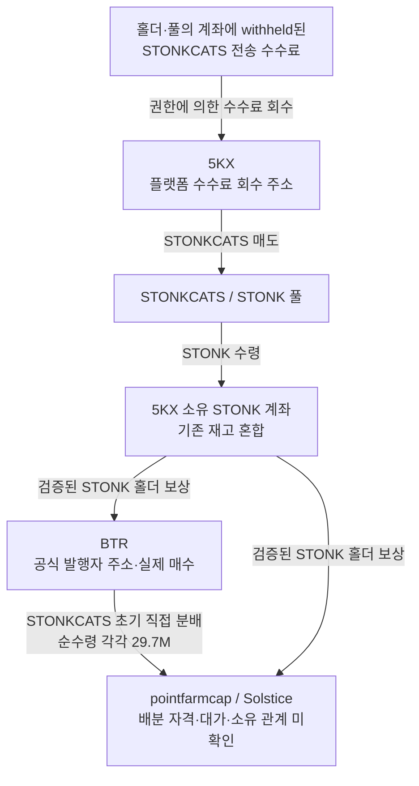

# STONKCATS 수수료 보상 구조와 공통 공급자의 역할 재검토

작성: 2026-10-08T02:23:11.820Z. 거래 시각은 **UTC**. 초기 raw141 Top10과 고정 60일 구간은 유지했다. 기존 5개 `gpt-6-luna`·추론 `max` 작업자가 보존 원문을 분석하고 본체가 수량·서명·historical token-account owner를 대조했다. 새 토큰 전체 시장 수집과 예약 RZD 작업은 실행하지 않았다.

## 결론

**사용자가 제시한 수수료 회수 → 매도 → 페어 토큰 보상 구조가 이번 STONKCATS에 실제로 존재한다.** 역사적 mint의 1% 전송 수수료, 플랫폼 회수 권한, 회수 토큰의 매도와 pointfarmcap·Solstice의 STONK 보상 수령을 확인했다.

**앞서 공통 공급자로 조사한 BTR은 공식 API의 발행자 주소이며, 수수료 회수 주소 5KX와 다르다.** BTR의 실제 매수·STONKCATS 전달은 유효한 거래 근거다. 다만 발행자의 초기 배분·NFT 홀더 에어드롭·홍보 배분이라는 대안을 먼저 검토해야 하며, 이 거래만으로 Fomo 계정의 뒷지갑이나 동일 소유를 주장할 수 없다. 수령자 자격과 지급 대가는 아직 미확인이다.

사례 분류는 **“발행자 주소의 초기 취득·토큰 분배와 플랫폼 홀더 보상”**으로 수정한다. 선행매수 의도·조종·동일 개인·실현 수익은 확정하지 않는다.

## 1. 서로 구분해야 하는 주소와 자산

| 구분 | 정확한 주소·mint | 확인 범위 |
|---|---|---|
| BTR 발행·배포 주소 | `BTRcwVTSoBwXg9XXEXcK4UYYCTmhd6iv81TZggFG522q` | 공식 `launch.creator`, 발행 거래 참여, 프로젝트 메타데이터/NFT 화면. 실제 사람 소유자는 미확인 |
| 플랫폼 수수료 회수 권한 | `5KXDF6QnqhBj72hDtJNkkpFaQVUfbFXNybMsp3DiK6tD` | 역사적 mint 권한·실제 수수료 출금 signer·공식 플랫폼 설정 일치 |
| 회수 STONKCATS 계좌 | `Bu5oxoWb9VPSNQH7u5SwCsj71ARVVNGd1MtrDzzEn5L` | Token-account owner 5KX |
| 매도대금·보상 STONK 계좌 | `6mVV637NpwmQLE7bzsfZYB1v3RjCmWCeRk3rVxyHAuQ1` | Token-account owner 5KX. 기존 재고가 혼합된 계좌 |
| 조사 토큰 STONKCATS | `9h5AzEQzYu9CV5K6uLtFRMD1KcbxZSFNxZEgBTNfw5Na` | decimals **6** |
| 페어·보상 토큰 STONK | `6GmAFSYs4gk3FDao5FzzySQpPZaWsa4rUJHacpMpUNgx` | decimals **9**. STONKCATS와 별개 자산 |

공식 [보상 설명](https://www.stonkfun.xyz/rewards)과 [개발 문서](https://www.stonkfun.xyz/developers)는 전송세를 회수해 홀더에게 보상하는 구조를 설명한다. 일부 토큰은 자체 토큰으로 보상할 수도 있으므로 **보상이라는 명칭 대신 정확한 asset mint·거래 서명·회수 권한**으로 구분했다. 이번 exact-token API는 `mode=reward`, `bps=100`, 페어 STONK를 표시한다(raw2350·2351).

## 2. 실제 회수·매도·보상 지급

| 온체인 시각 UTC | 실제 명령·잔액 변화 | 근거 |
|---|---|---|
| 2026-09-15 03:13:58 | 25개 계좌의 withheld 수수료 회수. 5KX 계좌에 **9,512,005.594505 STONKCATS** 증가 | raw2308·2355; [회수 거래](https://solscan.io/tx/967gcgfbpxhg4w3EZZS9FqegJkyK6ccM9yAVf1KKHxC2TvGojzKooW31WaRtJC8hmvVTYsQ2Fgyb3PHj7zz3cEg) |
| 03:14:00 | mint에 모인 withheld 수수료 추가 회수 **687,518.858149 STONKCATS** | raw2355; [거래](https://solscan.io/tx/447Spf6PMWs8V7E3KHv2BNcJaztezQeybm3nXLTcPNLg3iHdoQuzNmXa6cc6iBFrGUs24xrsw9JParr8GWy18nkQ) |
| 03:14:02 | 실제 `SellExactIn`. 회수 계좌에서 **5,099,762.226327 STONKCATS** 차감, 같은 권한의 페어 계좌에 **291.397532510 STONK** 수령 | raw2355; [매도 거래](https://solscan.io/tx/54on6rihdHVaJQCFmgbaDyBPBnZciiYyexhhcuuk2Qfcw7odGHCuw5naGp7tvJf8QJZuUn48f5Gu7CTDsmLnSSXY) |
| 03:15:52 | 위 STONK 계좌에서 pointfarmcap **7.237294139 STONK**, BTR **95.997686499 STONK** 수령 | raw2359; [첫 보상 거래](https://solscan.io/tx/4fZ2cBnfBuPRtbrEzGogwCuMBRpXcZxb7HgtY2XPRaYSoR1JJfBZAWdXCiLryWgrQ5dRfsEKvFXz9KdBRhF9eHpK) |
| 03:15:52 | 같은 STONK 계좌에서 Solstice **7.237294139 STONK** 수령 | raw2360; [다음 보상 거래](https://solscan.io/tx/2U9gdF76yF1rsKeqBrXrg4KKNPdHcH79mbMU7DqByVgDCv7KzFgTzWzkVfrkMQfMYtYhURyoNJ49SJ8rfhrccPfA) |

두 지급 거래에서 공식 API의 **24개 지급 행**을 실제 명령·수령 계좌 owner·잔액 증가와 대조했다. 첫 초기분배 수령자 9개도 동일한 7.237294139 STONK 보상을 받았다. 이는 같은 크기의 초기 토큰 보유와 홀더 보상으로 설명할 수 있어 공통 서비스 접점을 개인 소유 연결로 쓰지 않는다.

API `createdAt`은 약 03:15:54이고 RPC `blockTime`은 03:15:52다. **게시·처리 시각과 체인 시각을 별도로 저장했다.** 수수료 계좌에서 매도한 총액과 풀에 들어간 net 수량도 구분했다. 풀은 1%가 차감된 5,048,764.604063 STONKCATS를 받았고, 별도 quote fee 2.950861088 STONK가 있었다.

STONK 계좌에는 매도 전부터 **51,117.153783198 STONK**가 있었다. 첫 지급 직전 잔액은 45,256.048761618이다. 중간 입출금과 기존 재고가 섞였으므로 특정 매도의 291.397532510 STONK를 특정 홀더 지급분에 일대일로 귀속하지 않는다. **같은 서비스·같은 계좌의 회수/매도/지급 구조를 확인한 결과**다.

## 3. 초기 분배와 정기 보상의 구조

**위의 STONKCATS 초기 분배와 아래의 STONK 홀더 보상은 별도 자산·별도 거래다.** 공통 수령·공통 회수 주소의 의미를 판정할 때 두 경로를 섞지 않는다.

## 4. BTR에 대한 기존 해석을 수정한 이유

1. 공식 exact-token API가 BTR을 **발행자**로 표시한다(raw2350). 발행 거래의 signer/첫 매수는 raw2210·2308에 있고, 발행 시 메타데이터가 BTR 주소를 포함한 [Stonk Cats NFT 컬렉션](https://www.launchmynft.io/collections/BTRcwVTSoBwXg9XXEXcK4UYYCTmhd6iv81TZggFG522q/jKl0TdryB5I2mvzjSA48)을 가리킨다(raw2347). Chrome NFT 화면도 `by BTRc…2q`를 표시한다(raw2366). 사이트의 creator 표시는 provider assertion이며 실제 개인 신원·수령자와 동일 소유를 증명하지 않는다.
2. 보존한 정확한 BTR 토큰 계좌 이력에서는 **실제 매수 19건**(초기 3건·후속 풀 매수 16건), 순취득 **380,813,434.457177 STONKCATS**를 검토했다. 목표 풀에 전달된 quote 총량은 **60,445.541299882 STONK**다. 라우터 소유 중간 quote 계좌를 BTR 소유로 바꾸지 않았고, BTR의 상위 SOL 지출과 최종 STONK 결제 단계를 원가로 중복 합산하지 않았다. 발행자가 실제로 샀다는 사실과 제삼자의 뒷지갑이 선행매수했다는 판단은 별개다.
3. 초기 gross 15M 송금 **13건·10개 token account**, 전체 net **193.05M STONKCATS**, point/Solstice 각 **29.7M**은 기존 거래 근거를 유지한다(raw2339). 이번 검증 STONK 보상과는 자산·서명이 다르다. **수동 에어드롭/프로모션/발행자 배분 가능성이 있으며 구체적 자격·대가는 미확인**이다.
4. 공식 `airdrop:null`(raw2354)은 플랫폼의 frozen launch-airdrop 설정이 없다는 응답이다. **발행자의 수동 분배가 없었다는 뜻이 아니다.** `base:null`(raw2352)도 자체 토큰 보상에 대한 현재 API 응답으로, 모든 과거 수동 지급의 부재를 증명하지 않는다.

따라서 이 사례를 **“뒷지갑 선행매수 확인”으로 올리지 않는다.** 현재 확인된 사실은 발행자 주소가 토큰을 취득·분배했고, 알려진 Fomo 계정들이 보유 토큰에 대한 플랫폼 보상도 받았다는 것이다.

## 5. 향후 공통 공급·회수 분석에 적용할 규칙

- 먼저 token fee configuration·collector authority·보상 asset·launch creator·pool/router 역할을 확인한다.
- 수수료 회수와 홀더 보상은 개인 funding·동일인·공통 고객 CEX 접점의 근거에서 제외한다. 보상 자체도 보유량·배포 정책 분석에는 보존한다.
- 초기 같은-token 분배는 발행자 할당·NFT 홀더 지급·프로모션·대가 있는 지급·개인 지갑 이전을 구분한다. 원문 자격과 반대 근거가 없으면 목적은 unknown이다.
- 실제 자산·서명·시각을 맞춘 뒤, **독립적인 비서비스 자금 공급/반환/회수와 정확한 고객 CEX endpoint**가 있을 때 숨은 계정 가설을 다시 평가한다.

정책 JSON과 AGENTS에 운영 규칙을 추가했다. 이번 결과는 SQLite의 별도 근거/역할 검토로 저장했으며 자동 그래프 분류기를 구현한 것은 아니다. 신규 보상 행을 역할 없는 개인 funding edge로 적재하지 않았다.

기존 USDC 계좌의 소액 지급과 STONK 보상은 자산과 지급 권한이 다르다. 보존 자료에는 소액 USDC와 같은 거래의 수수료성 전송도 있어 공통 상대방·서명만으로 개인 funding으로 분류하지 않았다(Luna2 검토 raw 참조). 이를 STONKCATS 보상으로 임의 귀속하지도 않는다.

## 6. 저장·범위·미확인 항목

- 본체 검토 **raw2373**, 독립 근거 **raw2372**, 새 state **`initial_top10_fee_reward_role_review_v1`**. 작업자 5개 결과/정규화 JSONL/한글 보고서는 해당 batch와 SQLite raw에 보존했다.
- 원래 **39개 state·11개 wallet resolution**과 초기10명 Fomo **404건(BUY123/SELL110/THESIS171)**을 그대로 보존했다. 기존 거래/edge를 삭제·덮어쓰지 않았다. 새 개인 funding edge·canonical trade·소유권·시총 적격 승격은 0이다.
- 외부 요청: **RPC 6회(실패·fallback·cursor 포함), 문서/API/검색 16단위, Chrome 직접 탐색 3회**. Fomo·시장가격·Bridge·Nodit indexed·BigQuery는 0이다. 최초 검색 3개 질의가 manifest 생성 전 실행돼 사후 계상된 예산 기록 예외를 남겼다. 이후 요청은 manifest 예약 경로를 사용했다.
- 수수료 recipient ATA의 **03:13–03:16:30 짧은 구간**은 raw2355·2358로 cursor 종료를 확인했다. 이것은 플랫폼 전체·토큰 전체·60일 수수료 보상 history 완료가 아니다.
- 보상 API는 첫 **100행/다음 cursor 있음**이다. 그중 첫 2개 거래의 24개 지급 행만 RPC로 대조했다. raw2352 lifetime 수치는 고정 cutoff 후 snapshot이며 `generatedAt`보다 `lastPayoutAt`이 뒤라 전체 시각·완전성 근거로 쓰지 않는다.
- Nodit의 두 과거 지급 조회는 `result:null`(raw2356·2357)이었고 QuickNode의 단일 fallback(raw2359·2360)에서 성공했다. null을 거래 부재로 해석하지 않았다.
- 보이는 Chrome의 공식 토큰/프로젝트 화면을 보존했다(raw2361·2362·2366). Solscan은 challenge 화면(raw2363)이어서 거래 증명으로 사용하지 않았다. 잘못된 CLI 위치에서 나온 help raw2364·2365도 화면 근거에서 제외했다.
- 당시 유통 시총은 **`pending_cap`**, 지급 대가·beneficial ownership·선행매수 의도·실현 PnL은 **미확인**이다. 현재 가격·시총·API USD 보상 합계를 과거 원가나 수익으로 쓰지 않았다.

## 다음 조사

먼저 원본 발행 공지·NFT 홀더 snapshot·allowlist를 초기 실제 수령 주소와 대조해 **누가 어떤 자격으로 배분받았는지** 확인한다. 이후 실제 비서비스 반환·대가·회수 거래가 있을 때 Fomo 계정 및 정확한 고객 CEX deposit과 비교한다. 기존 HyperCore/Relay frontier는 보존하되 이번 수수료 역할 검토가 자동으로 그 추적을 재개하지 않는다.

## 구체적인 후속 조회 명세 — 2026-10-08

사용자의 “조회를 구체화해” 지시에 따른 **실행 준비 명세**다. 이번에는 보존된 SQLite를 읽어 수령 목록과 시각을 고정했고 신규 외부 요청은 0회다. 새 NFT 자격·CEX 연결·선행매수 결과를 발견한 보고서가 아니다. batch007의 원래 raw2374 보고서와 검토 state는 그대로 보존한다. 기계 판독 명세는 `docs/top10-investigation-focus.json`의 `next_query_plan`이다.

### 먼저 답할 질문

**“BTR이 지급한 초기 STONKCATS가 NFT 홀더/허용목록/발행자 배분으로 설명되는가, 아니면 별도의 대가·반환 관계가 있는가?”** 플랫폼 5KX의 수수료 매도·STONK 홀더 보상은 기존 검증을 재사용한다. 이 서비스 전체의 입출금을 다시 수집할 필요는 없다.

### Q1. 고정할 초기 지급 13건

raw2339 `common_supplier.early_distributions`와 거래 원문 raw2308을 재사용한다. 모두 2026-09-15 UTC, 같은 BTR source ATA에서 gross 15,000,000 / net 14,850,000 STONKCATS씩 보냈다. **13개 거래·10개 destination ATA·10개 historical owner wallet**, 총 순수령 **193,050,000개**다. token-account owner 필드와 실제 사람의 소유권은 구분한다.

| 수령자 표시 | 지급 당시 owner wallet | 수령 시각 UTC | 건수 / 순수령 STONKCATS | 보존 거래 |
|---|---|---|---:|---|
| pointfarmcap | `Beqv6dzTcjV2eodo8RRXCiCcnSYrS1vkQKhfqwHXqeit` | 03:11:51 05:19:07 | 2 / 29,700,000 | [거래 1](https://solscan.io/tx/2H4VAzZVyk6wtH6hm4acGmR4NHoJBwSG1tuWRZELQda5au7uZ2ixQX2yQhm7ytDTXRTVTvs6D6QumENHZtyMwk7v) [거래 2](https://solscan.io/tx/3pZjrURev6amSiueQ2ZbodDWBVBkJUXC8FLk6EYHjNRV6UHGJAxWzJeeZAAnA22Xv5xyBpRA5iQV8qsTcwxGeHMa) |
| The__Solstice | `4ugDhHJ8XDXAeABmrNmGffFaLbJb9BkPyiFGVSV9ocwo` | 03:12:00 05:23:32 | 2 / 29,700,000 | [거래 1](https://solscan.io/tx/34jZFyhy9PeE1LsLeRqDyj9c14SSyXECJ9Rm8MSKnw1CHhHnnLVGjkDY6NngFkioefN3859Acms7hsJti5XTyN7K) [거래 2](https://solscan.io/tx/25WDKJ3PgRQstStkyLZgMu648RQCg9exnzYzAJwgjQCYZgDEearpp3dfzq6n6cmtf4it17zjhrN8j7XS3ZqqXfTc) |
| unknown | `EC2f5DnHzuNRit1ExqghSifDbp1wgrzktsRRZCtU92MJ` | 03:12:12 | 1 / 14,850,000 | [거래 1](https://solscan.io/tx/4ffjPFaSxzk5fSq3e17k4YY3oGGkFoSVaChsqo7UBhjV2K55vvnakkWvS84pV5SYDYiovpua9AMR5g8G5uUYVxTu) |
| unknown | `FvaWqt5aA8BeDKBMhnnYSb2T6CMMWuukJCLvdoAcXB8` | 03:12:36 05:20:35 | 2 / 29,700,000 | [거래 1](https://solscan.io/tx/41Lhte6kzoBqkxmHGzyr1ZPKdP3VhNrAdm1sE886EABBUXhGh51xNdoe9dUtBZDiDSsyDDbSW72N9MarBYdnAdVa) [거래 2](https://solscan.io/tx/2VHq6qv6bxTSgVQ5Ve2m2UMHQ3h5a89EYeyiVTjV1PXm4N7TZYaW7478LUUnDSmaV9LqGNdndfneECoEm8xt4PrE) |
| unknown | `GV6UUmNxz2RpKxmNAPadYKb7uQpszwqQAu3qLJxVdC52` | 03:14:23 | 1 / 14,850,000 | [거래 1](https://solscan.io/tx/q3PC8W5SDGbzrSd4jasDuZqasCbW1VMNynUuoC5iUemcHHa9ZRVLFRSuj6f6W3w42fFL2dB8BU4wN3YpGcnD11s) |
| unknown | `AH39BneW9UeWxQysUcwogQrYFdPvJuRVZ5w4ccq9SKfL` | 03:14:38 | 1 / 14,850,000 | [거래 1](https://solscan.io/tx/37iJrP3xsEHCeU579vUvPNCrqmTWuAJqz3T91PRUeuRkSARx91s8L7KzWNp6ogmTmepy4bZ24muQK9D7gZnPCeqw) |
| unknown | `9oqcX4mTVdLP7MDs7ZTL7jueW5EMjXTx7bwqy57cEuww` | 03:14:51 | 1 / 14,850,000 | [거래 1](https://solscan.io/tx/5QNtNbPpxCVKuawEdyatJTsaCKzhizEtTptSnPmzyAP9PvBM81Bb3Gq74vRq52r5FtnFRm47zjHxmZLnndzNkEmE) |
| unknown | `J23qr98GjGJJqKq9CBEnyRhHbmkaVxtTJNNxKu597wsA` | 03:15:05 | 1 / 14,850,000 | [거래 1](https://solscan.io/tx/3b3QbDC4ti6VYciPdLYxonjTrri7rKHr5jTKHw3RkyDfQXJcq58mS9uJRfcj7E6Bc9P7D9V4xUoAYMFvVgkCAywp) |
| unknown | `86xCnPeV69n6t3DnyGvkKobf9FdN2H9oiVDdaMpo2MMY` | 03:15:17 | 1 / 14,850,000 | [거래 1](https://solscan.io/tx/AfKD2tJ6xC3p2Sm2Cqfh7dDWYfZGhhixEJB3dE277Z6ck1SxJxZ1JckscLfx8jpdHAkawbhqmo4x5sAR9gtWZBe) |
| unknown | `B4wHhJEGLDXv7oSzHvvDmYnxTmZyu9MEagYj7qDjGgz7` | 15:41:18 | 1 / 14,850,000 | [거래 1](https://solscan.io/tx/5sdt2ZwsEZoGNxQfvHJZUiF8eYVkJYHBN5xmENAAviwCWgPiANMqJmdUYntfc9vbni7yLQPnuRahUQMi1BFpFYFU) |

각 행의 정확한 ATA·13개 signature·UTC·raw ref/locator는 focus JSON에 함께 넣었다. 초기 분배를 실제 매수로 바꾸거나 10개 ATA를 같은 소유자로 묶지 않는다.

### Q2–Q5. 조회 순서·조건·산출물

| 순서 | 구체적인 조회 대상 | 기간·조건 | 답해야 할 내용 / 산출물 |
|---|---|---|---|
| Q2 원본 지급 규칙 | 메타데이터가 가리키는 LaunchMyNFT 컬렉션·`x.com/stonkcatsnft`·원본 프로젝트 공지/버전이 있는 allowlist | 공개자료 우선 검색: **9/14 00:00 ≤ t < 9/17 00:00 UTC**. 게시 시각과 수집 시각 별도 | NFT 홀더 지급인지, Team/Friends and Family 배분인지, 수량·snapshot 기준이 무엇인지. 원본 URL·UTC·규칙·목록 버전/hash |
| Q3 당시 지급 자격 | 위 **10개 recipient wallet**과 확인된 정확한 NFT collection | **공지에서 지정한 snapshot 시각/slot**의 NFT owner 또는 frozen allowlist를 복원 | wallet별 NFT/allowlist 자격과 지급 수량 일치 여부. qualified / not qualified / unknown 및 역사 owner 근거·coverage |
| Q4 대가·반환 관계 | **BTR ↔ pointfarmcap / Solstice**, 실제 확인된 비서비스 상대만 최대 2-hop | 보존 자료 우선. 초기 지급·NFT mint 전후 **9/14 19:36:08–9/16 00:00 UTC**부터 확인; 필요하면 고정60일 안의 더 이른 지급 대가/후속 반환으로 확대 | 누가 실제 SOL/USDC/STONK를 부담했는지, NFT 민팅 결제인지 토큰 대가인지, 반환이 있었는지. exact asset·amount·tx·historical owner·role |
| Q5 공개 전후 처분·공통 회수 | 두 Fomo 본지갑의 기존 STONKCATS 거래·실제 quote 유출 | 아래 retained THESIS/실제 swap 시각과 **고정 cutoff 10/7 04:43:41 UTC**까지 비교. 독립적인 비서비스 edge가 있을 때만 다음 주소 확장 | 초기 수령→보유/추가 매수→공개→실제 매도→회수. 정확한 chain/address·필요시 memo/tag·고객 deposit 역할·Bridge 주문 대응 |

**Q2의 검색 예:** `from:stonkcatsnft since:2026-09-14 until:2026-09-17`, exact mint + `airdrop`, `Stonk Cats` + `snapshot`. 검색 결과의 요약 대신 원본 게시물과 첨부 목록을 보존한다. 검색 누락이나 삭제된 글은 규칙이 없었다는 증명이 아니다.

현재 NFT 웹 경로 `jKl0TdryB5I2mvzjSA48`은 **온체인 collection mint로 확인되지 않았다.** BTR creator 주소도 collection mint로 대체하지 않는다. 정확한 collection과 verified membership부터 식별한다. raw2366의 Team/Friends and Family `Wallet WL` 표시는 허용목록 지갑 주소나 STONKCATS 지급 자격을 증명하지 않는다. 플랫폼의 `Fee Key NFT`도 Stonk Cats NFT와 별도다.

공식 snapshot 규칙을 못 찾으면 **발행 직전(9/15 01:49:24 UTC)**과 **각 전송 직전** NFT 보유를 탐색 비교할 수는 있다. 이 두 시점은 연구자의 비교 기준이며 공식 지급 자격으로 판정하지 않는다. 현재 holder 또는 현재 `getAccountInfo`를 과거 owner로 쓰지 않는다. NFT mint/asset ID·collection 관계와 실제 mint/transfer 기록의 slot/순서를 대조하며, 같은 초의 선후 관계도 별도 확인한다.

### 공개 시점과 비교할 기준

| 계정 | 보존된 STONKCATS 초기 지급 | retained Fomo BUY | retained THESIS |
|---|---|---|---|
| pointfarmcap | 9/15 03:11:51·05:19:07 UTC, net 29.7M | 10/6 01:08:10 UTC, **Fomo source 시각** raw675 | 10/6 05:14:35 UTC, raw2070 |
| The__Solstice | 9/15 03:12:00·05:23:32 UTC, net 29.7M | 같은-token BUY alert 미확보; 실제 온체인 BUY와 별도 | 10/4 18:15:25 UTC, raw2167 |

초기 **수령이 retained THESIS보다 이르다**는 사실을 조사한다. 실제 구매 대가나 절대 최초 공개 이전 매수는 이 표로 확정되지 않는다. Fomo source BUY·실제 swap·대외 노출·THESIS·수집 시각을 별도로 유지한다.

### 판정과 조사 종료 조건

- **배분 자격 확인:** 명시적 지급 규칙·snapshot/목록 버전과 당시 해당 지갑의 자격이 모두 확인돼야 한다. 보유 NFT 수와 지급량도 대조한다. NFT 보유 일치만으로 지급 원인·대가·동일 소유를 확정하지 않는다.
- **자격 미충족 확인:** 해당 규칙과 요청 시점의 전체 관련 NFT/허용목록 자료가 완결된 경우에만 판정한다. 미완료 cursor·접근 실패·공지 미확보는 `unknown`이다. 자료가 없으면 gap을 남기고 다른 적격 Top10 사례로 넘어간다.
- **연관 후보 재평가:** 서비스 보상·NFT 민팅 결제·pool/router를 제거한 실제 대가/반환/회수 근거가 있을 때 후보를 확장한다. 동일 고객 deposit은 exact chain/address·필요시 memo/tag와 **고객 입금 역할 근거**를 함께 비교하며 shared hotwallet은 제외한다. 공동 입금 자체도 동일 개인의 확정 증거는 아니다.
- **저시총 gate 유지:** STONKCATS 당시 유통 시총은 `pending_cap`이다. 이번 역할/자격 검토를 이유로 신규 토큰 전체 군집 조회를 시작하지 않는다. eligible event는 여전히 당시 유통 시총 ≤$1M 검토가 필요하다. 원가·수수료·exit lot이 없으면 PnL은 unknown이다.

### 다음 실행의 요청 한도 제안

새 배치 **전역 합계**로 문서/API/검색8단위·Chrome 직접 탐색3회·RPC10회·indexed4회·시장자료2회·Bridge1회를 제안한다. 실패·재시도 포함이며 재시도는 남은 예산 안에서 최대1회다. 이는 아직 예약되지 않은 한도이며 Q2→Q3 의존 순서로 사용한다. Fomo·유료 BigQuery·플랫폼 전체 보상 재수집은 0회로 시작한다. 알려진 완전한 거래 원문은 다시 요청하지 않는다.

본체가 실제 외부 조회 전에 새 manifest와 source별 예약을 만들고 공유 Chrome을 순차 담당한다. 작업자는 기존5개 Luna/max를 재사용하며 보존 자료 분석을 나눠 맡는다. cap·coverage gap 때문에 BigQuery가 필요해지면 정확한 schema·window·dry run·byte cap을 별도로 준비한다. 닫힌 batch007의 남은 예산은 재사용하지 않는다.
