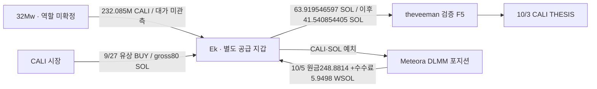

# theveeman: 별도 공급 지갑의 CALI 매수와 유동성 회수

## 확인한 내용

**검증된 Fomo 본지갑에 SOL을 반복 공급한 Ek가 같은 토큰 CALI를 THESIS 전에 유상 매수한 사실을 확인했다.** THESIS 이후 Ek의 회수는 직접 토큰 매도보다 Meteora DLMM 유동성 포지션의 원금·수수료 반환으로 나타난다. 따라서 단순한 “뒷지갑 매수 → THESIS → 뒷지갑 매도 수익” 완성 사례로 확정하지 않는다.

대상 Fomo user ID는 `fc3ea5c0-afc4-553c-a295-f838907dc581`, 검증 Solana 지갑은 `F5hkYsi8JxjyA2JHN5CA7MbnnhWubkXB2ZQB7Gkaxqs6`이다. Ek는 `Ek1ZCPSKNMVTEMJCNNSTTKSKYXGWQKPCPZCDHPQMMXWu`, CALI mint는 `8k4sBtEeK4pf26noKqApv8NBTnuSJcbdwpKYknk5PbAA`다. 두 주소의 실제 자금 연결은 확인됐지만 같은 개인 소유라는 증거는 없다.

원래 Top10/raw141과 고정 `[2026-08-08T04:43:41Z,2026-10-07T04:43:41Z)` 범위를 유지했다. 아래 시각은 UTC이며 수량은 정수 원문/Decimal 기준이다.

## CALI 시간표

|시각 UTC|주소·행동|확인 수량·근거|
|---|---|---|
|9/21 13:07:47|Ek → Fomo F5 SOL 공급|63.919546597 SOL; raw3741/data6, 기존3714/data30|
|9/21 13:11:33|F5 본지갑 CALI 유상 매수|공급 226초 뒤; SOL→USDC·특정 물량 원가 귀속은 미확정|
|9/22 07:16:20|32Mw → Ek CALI 전량 송금|232,085,414.169257 CALI; raw3768/data1/독립3770; 대가 미관측|
|9/22 07:16:30|Ek CALI 유동성 공급|약232.085M CALI가 wallet ATA에서 DLMM position으로 이동; 매수 아님|
|9/22 09:17:06|Ek pAMM 직접 매도|644,499 CALI → gross6.001592894 WSOL; THESIS 약11일 전이며 후속 매수보다 먼저|
|9/27 12:17:15|Ek CALI 실제 유상 매수|80 SOL을 WSOL 경로에 공급, 최종 +1,238,818.406196 CALI; raw3768/data76/독립3771|
|10/3 03:32:06|Ek 유동성 재예치|약22.084M CALI가 position으로 이동; 당시 전체 경제적 노출은 ATA 잔액과 다름|
|10/3 08:37:40|theveeman 보존 CALI THESIS|raw2145; 유상 매수보다 505,225초(5일20시간20분25초) 뒤|
|10/3–10/5|Ek LP 원금·수수료 수령 후 재예치|일부 19–25초 뒤 재예치; 신규 직접 Sell 로그는 해당 ATA에서 미관측|
|10/5 14:46:39|Ek 마지막 LP 회수|원금 반환248.881386686 WSOL +수수료5.949786206 WSOL; 별도 CALI claim270,617.409808; raw3768/data148/독립3772|

[Ek 유상 매수 거래](https://explorer.solana.com/tx/26fXGpTkVT4jyTP3sA9Moj8SsJYgKAiRFpkt4sktCL4psFUu4KZWwggRB8M3XNbdAoEGJwLXUkZEnBFFg8iBHgW1), [마지막 LP 회수 거래](https://explorer.solana.com/tx/3ZhzpkNvX4cHfjCWPFCkEtfF9ueYqNdiYKbniTsuK1a2SMZw2G8neEU4eb6XsdTmcyhzJ1bNNoMDiMvCouzyKw39).

80 SOL은 한 번의 다중 경로 거래에 들어간 gross WSOL 수량이다. 최종 CALI 취득과 실제 signer Ek를 검증했고 보조 signer `sigh…`도 존재한다. 이것을 정확 USD 원가나 다른 송금의 직접 자금 원가로 쓰지 않는다. 마지막 **254.831172892 WSOL** 반환도 전체 LP 원금·수수료 흐름이며, 80 SOL 매수분의 매도대금·수익으로 차감 계산하지 않는다.

THESIS 시각 정확 CALI ATA의 잔액은 **8 raw =0.000008 CALI**였다. 이는 보유 물량 대부분을 이미 LP에 예치했기 때문이다. ATA 잔량만으로 선매수 물량 전량 처분이나 경제적 노출 0을 주장할 수 없다. 포지션별 출자·거래에 따른 자산 전환·회수 대사가 다음 과제다. 232M 초기 물량도 개인 매수가 아니라 다른 지갑의 무대가 전송으로 보존했다. 발행자 배분·시장 조성·공유 실행 서비스 대안을 검토한다.

## F5의 추가 공급과 프로그램 예치

새 일반 native 전송 두 건: 10/6 11:54:57 Ek→F5 **41.540854405 SOL**, 19:41:23 5tz→F5 **41.6417522 SOL**. 170초·110초 뒤 각각 F5의 WSOL 경로 거래에서 **4,997.008290·5,018.771585 USDC** 순증을 관측했다. 기존 잔액 혼합과 다중 경로가 있어 특정 송금의 순수익으로 귀속하지 않는다. 5tz 거래는 여러 수취인에게 보내는 배치이며 모든 System 명령을 합쳐 수수료와 native 잔액 잔차0을 검산했다. 5tz의 Binance Hot Wallet 라벨은 기존 Arkham raw2532 assertion이며 같은 고객·F5 입금 주소 증명은 아니다.

F5의 `99vQ…` 프로그램 `DepositToken` 호출 **38건**, 합계 **122,372.41 USDC**를 확인했다. source authority는 F5이며 정확 수취 ATA는 `4nvJ5zWdVspxJiNZzB127U6amPH98SFFkBx2JZrAduia`, 역사 owner는 `7uTT8Xi5RWXzy7h9XL244GRgEycDYDhLjr3ZyNdXi8pZ`다. 기존 graph에서 이 수취 주소는 원래 Top10의 다른 사용자도 쓰므로 서비스·금고 가능성이 있다. 같은 서비스 사용을 뒷지갑 소유권이나 CEX 고객 접점으로 승격하지 않는다.

새 source 5건을 Bridge aggregator의 **자동 provider 선택**으로 조회했지만 모두 unresolved/observations0/Relay pending_indexing이었다(raw3762–66). 실제 주문·목적지 체인·recipient는 미확정이다. 프로그램 공식 identity는 primary 검색으로 확립하지 못했고 Solscan의 Relay Depository 라벨은 provider assertion으로만 보존했다. 서비스 전체 pooled flow는 추적하지 않았다.

## 커버리지·저장·미확정

- F5 기존1,550 +신규675 =**2,225 고유 성공 거래**. 이전 구간2,195와 인접 tail30이 각각 빈/null footer로 닫혔다. `tokenAccounts=none` 정확 주소 쿼리이며 전체 ATA·실패 거래·평생 완료는 아니다.
- Ek exact CALI ATA **149거래**와 빈 footer를 확보했다. 처음0 →마지막270,617.409820 CALI, 인접 잔액149행 대사 공백0이다. 별도 Ek owner 이력200행과 Dugs owner200행은 여전히 부분이며 저장 cursor를 유지한다. 3yw8행은 지정 주소 query가 닫혔다.
- 이전 신규 공급·USDC 전송 대표3건과 이번 Ek 대표3건은 독립 publicRPC의 slot/blockTime/transaction/meta 전체가 원문과 일치했다. Chrome3767·3773은 사용자에게 보이는 거래 확인 자료다.
- SQLite 새 TRANSFER **41건**(native2/프로그램 예치38/초기 CALI 공급1)을 추가했다. 이전77states·11wallet resolutions·4,569trades·565edges를 그대로 보존했고 새 state1/edges606이다. 실제 Ek 매매와 LP 분석은 검토 raw로 보존했으며 새로운 시총 적격 판정이나 Fomo fill match를 만들지 않았다.
- 요청은 RPC30/Bridge5/Chrome2/문서2, Fomo·시장·BQ·Nodit0. 5 Luna/max는 읽기 전용 분석만 했다. 근거3780/검토3781/시총3779, state `initial_top10_theveeman_CALI_funded_source_LP_and_program_deposit_review_v1`.

**현재 엄격 완결 사례는0이며 연구는 진행 중이다.** CALI 당시 유통 시총≤100만 달러, LP 포지션의 개별 물량 원가·전환·회수, 실제 CEX 고객 입금 접점, 동일인·공모·의도·USD 손익은 미확정이다. 다음은 초기 CALI 공급자32Mw의 실제 취득·역할과 Ek의 포지션별 회수, 미완 Dugs/Ek cursor를 조사한다. 닫힌 F5/정확CALIATA/3yw 자료는 재수집하지 않는다.
