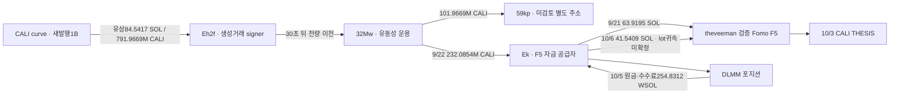

# CALI: 발행 직후 대량 매수에서 Fomo 연관 공급 지갑까지

## 핵심 발견

**CALI가 만들어진 거래 안에서 별도 지갑 Eh2f가 84.541656426 SOL을 지불하고 초기 발행량의 약79.20%를 매수했다.** 791,966,871.927537 CALI가 30초 뒤 32Mw로 전량 옮겨졌고, 이후 일부가 Ek의 유동성 운용으로 이어졌다. Ek는 theveeman의 검증 Fomo 지갑 F5에 SOL을 두 번 공급한 정확한 주소다.

따라서 이 초기 물량을 에어드롭이나 무상 발행자 배분으로 분류하면 잘못이다. **발행과 유상 초기 매수가 같은 거래에 존재한다.** 다만 다른 지갑 사이의 실제 자금·토큰 연결을 확인한 것이며 사람의 동일 소유·공모·THESIS 악용 수익을 확인한 것은 아니다. 초기 매수 당시 유통 시총과 게시 시점 LP의 실제 자산 구성도 미확정이다.

원래 Top10/raw141, 고정60일 `[2026-08-08T04:43:41Z,2026-10-07T04:43:41Z)`. 시각은 UTC. Fomo user ID `fc3ea5c0-afc4-553c-a295-f838907dc581`, 검증 지갑 `F5hkYsi8JxjyA2JHN5CA7MbnnhWubkXB2ZQB7Gkaxqs6`, CALI mint `8k4sBtEeK4pf26noKqApv8NBTnuSJcbdwpKYknk5PbAA`.

## 확인된 시간표

|UTC|행동|정확 수량·원문|
|---|---|---|
|9/17 12:12:56|Eh2f가 CreateV2 + BuyV2 실행|1B CALI 발행·mint 권한 해제와 동시에 **84.541656426 SOL →791,966,871.927537 CALI**; raw3797/data0·독립3799|
|9/17 12:13:26|Eh2f →32Mw|매수 물량 전량 이전; 30초 뒤; raw3797/data1=3783/data0·독립3800|
|9/17 12:14:19|32Mw의 DLMM 예치|689,999,999.999965 CALI; 이전 53초 뒤; raw3783/data1|
|9/17 12:14:30|32Mw →59kp 별도주소|101,966,871.927572 CALI; raw3783/data2; 소유·역할 미확정|
|9/18 09:53:52|32Mw의 추가 실제 매수|gross47.022096873 SOL →+11,758,899.798286 CALI; raw3783/data53·독립3801|
|9/19 20:00:19|32Mw의 추가 실제 매수|gross44.963785802 SOL →+6,216,448.004001 CALI; raw3783/data86·독립3802|
|9/21 13:07:47|Ek →Fomo F5|63.919546597 SOL; CALI를 Ek에 옮기기 **전**의 자금 관계|
|9/21 13:11:33|F5의 CALI 본지갑 매수|공급226초 뒤; 특정 SOL 송금의 원가 귀속은 미확정|
|9/22 07:16:08|32Mw의 CALI LP 회수|이후 이전될232.085M 물량 회수; raw3783/data94|
|9/22 07:16:20|32Mw →Ek|232,085,414.169257 CALI; 12초 뒤; raw3783/data95=기존3768/data1|
|9/27 12:17:15|Ek 추가 실제 매수|gross80 SOL →+1,238,818.406196 CALI; 기존3768/data76·독립3771|
|10/3 08:37:40|theveeman CALI THESIS|보존 공개 기록 raw2145; 절대 최초 공개라는 뜻은 아님|
|10/5 14:46:39|Ek 마지막 DLMM 회수|원금248.881386686 WSOL +수수료5.949786206 WSOL; 별도 CALI claim270,617.409808; 기존3768/data148·독립3772|
|10/6 11:54:57|Ek →Fomo F5|41.540854405 SOL; 게시·LP 회수 이후 실제 송금이나 혼합 잔액 때문에 매도대금 귀속은 미확정|

[초기 대량 매수](https://explorer.solana.com/tx/3kUH74wBkHtoDZVrTFGzcBFDSLqzxsrt4RJjXdK4gpDyXjRb1aiAZMLCAUU6eXDDWJjdEhwgvbLrti4TLNvMnxrG), [30초 뒤 전량 이전](https://explorer.solana.com/tx/3sKbCEBtth5Ei8fACyPHNauMprFJVeiVRn55NqPTDQnZ9CmSrqbxZbL4R5qKYtNfn3b4FpGhGVvRQu5ga92qpnnC), [게시 이후 LP 회수](https://explorer.solana.com/tx/3ZhzpkNvX4cHfjCWPFCkEtfF9ueYqNdiYKbniTsuK1a2SMZw2G8neEU4eb6XsdTmcyhzJ1bNNoMDiMvCouzyKw39).

## 매수·발행·LP 회수를 구분한 근거

초기 거래는 `MintTo`로 curve ATA에1B/d6를 넣고 mintTokens authority를 영구 해제한 뒤, `BuyV2`가 Eh2f의9UY6 계좌에791,966,871.927537 CALI를 보냈다. 같은 거래의 Eh2f→curve 일반 System 송금은 **84,541,656,426 lamports**다. 잔여curve208,033,128.072463와 구매 물량의 합은1B로 일치한다. 다른 SOL 수수료·임대 지출은 이 매수 원금과 분리했다. Eh2f가 token 생성거래 signer인 사실은 확인했지만 사람의 발행자 신원은 모른다.

32Mw의 추가 매수·유동성 운용·회수 이후 Ek로 옮긴 물량에는 재고가 섞여 있다. 그래서 Ek가 받은232M을 최초791M 유상 lot의 정확 잔여분이나 동일 원가로 취급하지 않는다. 대규모 유상 초기 취득과 실제 전달 경로가 존재한다는 사실을 보존한다.

Ek의 THESIS 시각 CALI ATA 잔액은8raw였지만 여러 DLMM 포지션이 열려 있었다. 지갑 입출금으로 계산한 미회수 출자량은 **실제 당시 bin 보유 수량·시가·매도 전 재고가 아니다**. AMM 거래가 진행되면 포지션의 CALI/SOL 구성이 달라지므로 과거 position/bin state 없이 같은 물량 재고를 확정하지 않는다. 게시 후 직접 `Sell`만 찾는 방식은 이런 LP를 통한 경제적 자산 전환을 놓칠 수 있다.

마지막 회수의 native 잔액 변화는 정확히 **254.872979925 SOL**이다. 이는 WSOL 반환254.831172892 +포지션 임대 반환0.041899840 −fee0.000082893 −tip0.000009914로 잔차0이다. 이 native 숫자 전체를 토큰 매도대금이나 실현 수익으로 쓰지 않는다. Ek에서 F5로 이후41.540854405 SOL이 갔지만 다른 유입·기존 잔액이 섞여 정확 회수 lot와의 연결은 아직 미확정이다.

추가 ordinary CALI 전송 두 건도 LP 예치와 구분했다. 9/22 09:09:37 Ek→8YEarb4,929,853.402962, 09:11:04 Ek→5qQsg4,936,912.533470 CALI이며 같은 거래 안에 LP 명령이 있어도 이 두 leg 자체는 별도 주소 송금이다. 상대 역할·소유는 미확정이다.

## 시총: 후기 매수·게시와 최초 매수는 별도

정확 mint의 CoinGecko mapping과 역사 `market_caps` 시계열을 확보했다(raw3792/3793). Ek 후기 매수9/27의 직전1035초 표본은 **$7,467,250.81**, 다음은$9,557,644.35다. THESIS의 직전2260초 표본은 **$1,961,264.55**, 다음은$2,108,828.75다. 둘 다 운영 가정300초 밖이다. 주요 PumpSwap의 완결 분봉은각 anchor 이전15초·100초에 끝났지만, 분 가격에 현재 공급량을 곱해 역사 유통 시총으로 바꾸지는 않았다. 검증1B 총공급 상한×고가의 조건값은약$7.710M/$2.089M이다. 상한이1M보다 크다는 사실만으로 실제 유통 시총이1M를 넘었다고 증명할 수도 없다.

이 후기 anchor는≤$1M 대상이라고 승인하기 어려워 우선순위를 낮췄고 `pending_cap`을 유지한다. 그러나 **9/17 최초 실제 매수 당시 시총은 다른 질문**이다. 아직 확보하지 않은 그 시점의 curve reserve·당시SOL/USD 또는 초기 실제 가격을 확인해야 한다. 평균 매수 단가×총공급을 당시 시장 시총으로 쓰지 않는다. CoinGecko 공식 문서도 시장 시계열의 시간 해상도와5분 간격 접근 범위를 구분한다. [공식 API 변경 기록](https://docs.coingecko.com/v3.0.1/changelog/23032023).

DOGINU 이전 조건부 수치에는 고가·종가 구분 정정을 추가했다. 검증 역사총공급1B×직전 완결분 **고가**는 첫5NS BUY **$146,822.98**, THESIS **$435,103.58**이다. 과거$146,366.50/$405,574.04는 **종가** 기준이었다. 둘 다1M 아래지만 단일 풀 표본이 전 시장 가격 상한을 입증하지 않아 자동 적격 승격은0이다. 과거 raw/state는 수정하지 않고 이번 검토에 정정 근거를 추가했다.

## 조회·저장·다음 추적

HAV8 정확CALI ATA96, 원천9UY6 ATA2, Dugs 지정 성공 주소338, Ek 지정 성공 주소1819 쿼리는 각각 빈/null footer로 닫혔다. 두 token ATA는 잔액 연속성 공백0·최종0이다. 같은 Eh2f→32Mw 전송이 두capture에 겹치는 것을 원문 전체 일치로 중복 제외했다. 전체 ATA·실패 거래·평생 완료를 선언한 것은 아니다.

새4개 TRANSFER를 SQLite에 추가했다(791M 공급,101.966M 분기,Ek 두 ordinary 전송). 기존78states·11wallet resolution·4,569trades·606edges를 보존했고 현재79states/610edges다. 초기·추가 매수와 LP 분석은 검토 raw에 정확 수량과 시각으로 저장했다. 본체RPC13/시장6/문서2/Chrome2, Fomo·Bridge·BQ·Nodit0. 남은 예약은해제했다. 5 Luna/max는 읽기 전용 분석만 했다. 근거3811/검토3812/시총3810, state `initial_top10_CALI_launch_paidbuy_source_chain_and_LP_inventory_review_v1`.

다음은 **최초 실제 매수 당시 시총**, 실제101.966M을 받은59kp의 동일 계좌 취득·게시 시점 보유·사후 처분, Ek의 최종 회수와F5송금의 혼합 잔액을 제한 추적한다. 이미 닫힌 exact query와 pooled 서비스 전체는 재수집하지 않는다. 엄격한≤$1M 별도 지갑 유상 매수→게시 재고→같은 지갑 사후 매도→원가·회수 완결 사례는0이며 연구는 계속한다.

미확인: 같은 개인 통제·공모·절대 최초 공개·CEX 고객 입금 주소·실현 USD 손익. 실제 연결점은 사례집에 포함할 수 있으나 THESIS 악용이 입증됐다고 쓰면 안 된다.
