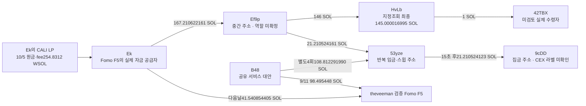

# CALI: 초기 물량 처분과 게시 이후 자금 회수 추적

## 이번에 확인한 사실

**게시 이후 Ek에서 빠져나간 실제 자금이 중간 주소를 거쳐 반복 집금 주소로 이어졌다.** Ek→Ef9p167.210622161 SOL 중21.210524161 SOL이53yze로 들어갔고,15초 뒤9cDD로21.210524123 SOL이 옮겨졌다. 주소·수량·서명은 독립RPC로 검증했다. CEX 라벨·고객 전용 입금 주소·Fomo와 같은 개인인지는 미확인이다.

동시에 앞서 후보였던 CALI 수령 계좌 세 개가 **10월3일 THESIS 이전에 잔액0**이 됐음을 확인했다. 이 경로를 게시 후 뒷지갑 매도 사례로 넣으면 오탐이다. 초기 유상 대량매수와 LP를 통한 게시 후 회수는 별도 근거로 보존한다.

대상은 원래Top10/raw141와 고정60일 `[2026-08-08T04:43:41Z,2026-10-07T04:43:41Z)`. theveeman user ID `fc3ea5c0-afc4-553c-a295-f838907dc581`, 검증Fomo 지갑 `F5hkYsi8JxjyA2JHN5CA7MbnnhWubkXB2ZQB7Gkaxqs6`. 모든 시각UTC. CALI mint `8k4sBtEeK4pf26noKqApv8NBTnuSJcbdwpKYknk5PbAA`,d6.

## 게시 이후 회수 경로

|UTC|실제 행동|수량·근거|
|---|---|---|
|10/5 14:46:39|Ek의 DLMM 원금·수수료 회수|254.831172892 WSOL; 기존3768/data148·독립3772|
|10/5 15:31:09|Ek→Ef9p|167.210622161 SOL;3837/data0=3788/data71·독립3843|
|10/5 15:36:16|Ef9p→HvLb|146 SOL;3837/data2=3839/data0·독립3844|
|10/5 16:04:40|Ef9p→53yze|21.210524161 SOL;3837/data5=3841/data269·독립3845|
|10/5 16:04:55|53yze→9cDD|21.210524123 SOL;15초 뒤;3841/data270·독립3847|
|10/5 21:29:12|HvLb→42TBX|1 SOL;3839/data3·독립3846; 이후 지정조회 최종145.000016995 SOL 잔액|
|10/6 11:54:57|Ek→Fomo F5|41.540854405 SOL;3788/data238=기존3757/data16|
|10/6 11:57:47|F5 SOL→USDC|gross41.541860132 SOL wrap/+4,997.008290 USDC; 기존잔액·추가dust도 입력에 포함|

[Ek→Ef9p](https://explorer.solana.com/tx/2js3e1RyLcDrzNRQi2mqH3Zk59KiLNPQ22rQewzZ8zmCnvdAdnZL7jWwzwbkCrC7cK7QbPrJfisDscwZ2VfrC5Qw), [Ef9p→53yze](https://explorer.solana.com/tx/5W7WjQyyPRAh8JH5c7B7EhKGmi4UFzDaqBB3u1vdksAW1MTrzMB1rWsKnPkAeyTctwHMzvRQcmNJVE7TUBnTJc44), [15초 뒤 집금](https://explorer.solana.com/tx/4uZkC92vdD2zsMGtGVi8NBUqEuu3dDhgSZvyj3BqCdVyr7D2gDLEZSMXZtuvC7Gxv3diUfkkaBKUXwKxB7PqDosU).

화살표는 실제 전송이다. **LP 회수금의 개별 lot가 각 송금에 들어갔다는 뜻은 아니다.** Ek는 LP 회수 전에도416.966855985 SOL을 보유했고 회수 이후671.839835910 SOL이었다. F5 지급 직전까지167개 거래의 순 잔액 변화는−192.370860982 SOL로, 다른 입금·매수·매도와 섞였다. 이 중125.738283295 SOL의 별도 입금도 있다. 따라서 LP→F5 송금의 특정 원가·이익을 확정하지 않는다.

Ef9p의 지정 성공 주소 조회6행은0부터 시작해0으로 끝난다. 정확한 식은167,210,622,161 input +12,000 lookalike dust −167,210,524,161 두 실제 출금 −110,000 두 수수료=0 lamports다. 유사한 prefix·suffix의 dust 주소는 관계 그래프에 넣지 않았다.53yze 집금액은 입금보다38lamports 적고 기존잔액·fee도 함께 대사했다.

## 53yze는 누구의 입금 주소인가

`53yzeZk6eA8Vxn1fVbK1wkUn4xaKRp1C9a3wrJc12BUE`의 지정60일281행에는65회 실질 입금과65회 스윕이 있고, 스윕 목적지는 모두 `9cDDJ5g2wPqVZUZwpPuwqzxN7ouvc6QFauFwrX2TTTAX`다. 실질 입금 상대는23개다. nonceAuthority `EbsUZEFAU23Z2SgAymFtU2hADLiyNLzaPLKiJfvpKnE7`의 co-sign이 관측된다. 전체 incoming에는dust48건도 있어113건이며 잔액대사는다음과 같다.

`9,989,958 +3,097,133,823,089 −3,097,133,167,067 −655,021 =9,990,959 lamports`.

B48은 이 주소로4회108.812291990 SOL을 보내고13–18초 뒤 같은 집금 주소로 스윕됐으며, 별도로 F5에98.495448 SOL을 공급한 원문도 있다(독립3738, **9/11 19:23:43Z**). 그러나 이미 B48에 서비스 대안이 있어 **공통 공급·스윕을 공통 CEX 고객으로 해석할 수 없다**. F5가53yze에 직접 입금한 거래는 이281행에 관측되지 않았다. 전체F5 ATA·평생 부재를 뜻하지 않는다. 다음은 주소 라벨과 고객 전용성 확인이다.

## 초기 CALI 수령 지갑의 오탐 제거

|정확한 계좌의 owner|지정60일 거래|검증된 행동|10/3 게시와의 관계|
|---|---:|---|---|
|59kpXqYimprD1eEs2FSutcxHRRuerVd4rJtZ11VRqTtv|2,218|32Mw 일반전송9회226,061,106.775607 CALI; 별도 반환2회113,099,922.096295; 프로그램 매도1,455회|마지막9/19 15:50:13Z, 최종0; 게시 후 매도0(지정계좌만)|
|8YEarbFiXpzqopYadUtoRbM19P7GdQ5RsEcBBNSEUCa3|19|Ek에게4,929,853.402962 CALI 수령→19초 뒤전량매도/49.163646500 WSOL|9/22 09:09:56Z 매도·최종0|
|5qQsg58WKonPym3pVh7GaVdwFeF5BYfSDCCLfstq4xzW|2|Ek에게4,936,912.533470 CALI 수령→21초 뒤전량매도/46.364284545 WSOL|9/22 09:11:25Z 매도·최종0|

59kp 자신이 transaction message signer인 거래는0이다. DuLd 프로그램 실행에서32Mw와 운영 signer가 서명했고, Token CPI의 authority59kp가 사용됐다. 두 CALI 반환도 DuLd→Token CPI이지59kp의 개인지갑 서명이 아니다.59kp의 자체 유상BUY도 이 계좌에서 확인되지 않았다. 초기Eh2f의 paidBUY와 수령계좌의 취득을 합치지 않는다.

1,455회 매도에서275,875,228.387873 CALI가 나갔고,59kp 소유 임시WSOL계좌로599.915857820 WSOL이 들어왔다. 실제native증가602.081538020 SOL에는 임대 반환2.165680200 SOL이 포함된다. 이는1,455×0.001488440 SOL과 일치한다. native전체를 매도대금이나USD수익으로 쓰지 않는다. 32Mw로 이 매도quote가 직접 돌아간 근거는 없고, 별도의CALI 반환만 구분했다.

8YEarb의 일부 반복 실행·라우팅에는 서비스 대안이 있다. 일반전송2개의 같은 거래에LP 제거명령이 있어도 **수령자의 유상매수**가 되는 것은 아니다. 각각 자기 signer의 실제매도는 맞지만 보존THESIS 약11일 전이다. 두 계좌가0인 것은 다른ATA의 보유 부재를 뜻하지 않는다. 대표4매도는독립3831–34 전체meta일치, Chrome3835/36에서성공·UTC를 대조했다.

## 발행 직후 시총 근거를 보완한 범위

CALI 초기거래3797/data0(독립3799)는CreateV2와paidBuyV2가 함께 있다. 공식Pump IDL3823의 안정적인event prefix만 해독해 실제mint/user/UTC/token/quote와대조했다. 현재IDL의 모든 필드가 당시배포버전과 같다고 주장하지 않았다. Create의virtualreserves는1,073,000,000,000,000 tokenraw/30,000,000,000 SOLraw, Buy 이후는281,033,128,072,463/114,541,656,426이다. 각차이는정확791,966,871,927,537 CALIraw/84,541,656,426 lamports와일치한다. [공식IDL](https://github.com/pump-fun/pump-public-docs/blob/main/idl/pump.json), [공식곡선 설명](https://github.com/pump-fun/pump-public-docs/blob/main/docs/PUMP_PROGRAM_README.md).

Coinbase SOL-USD 마지막완결분은9/17 12:11:00–12:12:00Z, BUY56초 전이며HIGH$100.54/CLOSE$100.50이다.12:12분은매수를포함해끝나기전이므로제외했다. CoinGecko직전표본은776초전이라주계산에쓰지않았다. [공식분봉 배열·시간 설명](https://docs.cdp.coinbase.com/api-reference/exchange-api/rest-api/products/get-product-candles).

검증된역사총공급상한1B와curveprice, 위SOL표본HIGH를곱한 **조건부 총발행량 평가액**은매수전$2,810.9972, 매수후$40,977.4400이다. 저시총launch를 뒷받침하는근거가보완됐지만 **정확역사유통시총이나모든시장가격의확정상한이아니다**. `pending_cap_proxy`를보존했고적격자동승격0/신규전체시장·BQ0이다. 후기EkBUY와THESIS의약$7.467M/$1.961M시계열은이초기거래와별도다.

DOGINU의4선행paidBUY→게시재고→6사후SELL은여전히가장직접적인별도주소사례다. 정확역사총공급1B×단일풀HIGH 조건값$146,822.98/$435,103.58와TKLS→USD시장범위공백은그대로다. 이배치에서닫힌기존capture를재요청하거나조건값을유통시총으로승격하지않았다.

## 저장·다음 조사

이번6개 지정쿼리2,218/19/2/6/6/281행은빈/nullfooter와잔액연속성공백0으로닫혔다. 전체ATA·실패거래·평생이력완료는아니다. 독립RPC11개전체meta일치와Chrome2개보조확인을보존했다. 새15개TRANSFER는32Mw↔59kp추가10개와실제native회수5개다. 기준DB625edges/80states,4,569trades와79개기존state·11walletresolution·기존전송/거래행은보존했다.

원문조회RPC26/30, 시장2/6, 공식문서6/6,Chrome2/2. Fomo·Bridge·Nodit·BQ0,남은예약해제.5 Luna/max는읽기전용·외부요청0.근거3856/검토3857/시총3855,state `initial_top10_CALI_recipient_exits_and_native_recovery_review_v1`.

다음은 **정확53yze/9cDD라벨·역할**, 실제1SOL수령42TBX의제한역할확인, Ek의과거LP자산구성과strongestDOGINU시총공백이다. 원래10명·60일·100만달러기준을유지한다.완결엄격사례0이며연구진행중이다. 동일소유·의도·절대최초공개·CEX고객입금주소·실현USD손익은아직확정하지않았다.
