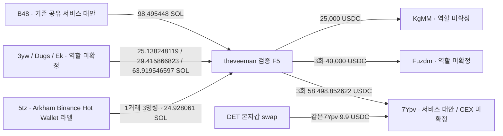

# theveeman: 자금 공급과 반복 USDC 출금 목적지

## 결론

**검증된 Fomo Solana 본지갑 F5에서 세 정확 주소로 USDC를 반복 송금한 관계를 새로 확인했다.** 7건 합계 **123,498.852622USDC**다. 이는 실제 전송 수량이며 거래소 입금·수익회수·동일인으로 확정한 금액이 아니다. 실제 새 SOL 공급도5거래/7명령 **241.897170539SOL**을 확인했다.

별도 지갑 유상 선매수→같은작성자 게시시재고→별도 지갑 게시후매도→원가·회수·당시시총100만달러 이하까지 갖춘 완결사례는0이다. 연구는 계속하며, 다음은 새 공급자의 **같은 토큰 실제 매수**와 반복 수취주소의 **역할**을 확인한다.

원래Top10/raw141, 고정구간 `[2026-08-08T04:43:41Z,2026-10-07T04:43:41Z)`. UTC/정수수량 기준. UID `fc3ea5c0-afc4-553c-a295-f838907dc581`, 검증본지갑 `F5hkYsi8JxjyA2JHN5CA7MbnnhWubkXB2ZQB7Gkaxqs6`.

## 반복 수취 주소

|역사적 수취 owner|건수|USDC|정확 ATA|
|---|---:|---:|---|
|`7YpvTvSt7QDBU3aYDV6PGgsh4JGyHFfwtwngWCjz8NLx`|3|58,498.852622|`CPncmGhzHMXZp6Coc4iCiAYRu7harsuKrbHFKvTsn9eD`|
|`FuzdmLUUngRPHrgEYt35L5n7cYmh7WLznisCp31abgB4`|3|40,000|`H3HFGymw5xqLjAR65mrfV189446Zk2f8rnDRxSS7SPW4`|
|`KgMMFzkWC6Kq1P1A4BWsGUnwSivaMpzV5LGP7Rdhhoe`|1|25,000|`FVWJdZ8xXicZQ9bRnQARcUPddrC4t5K3ThgaPnmrZETc`|

모두 F5가 signer/Token authority이며 source USDC 감소와 역사owner가확인된 recipient ATA 증가가 정확 일치한다. 바깥명령은ComputeBudget+일반Token전송이다. Agm fee payer/공유서명자는개인identity가아니다. source잔액이나월렛프로필만으로CEX고객을붙이지않는다.

7Ypv는 DET의스왑경로에서도 **9.9USDC**를수령했다(raw3677/data94). 공통 서비스·수수료주소 대안을 우선 검토한다. 큰일반전송을받았다는이유만으로개인집금주소/CEX입금주소로승격하지않았다. Fuzdm25k raw3702/data18의최초worker수취주소분류를정확owner로정정했다. Fuzdm의추가7,500두건3699/data22·3700/data0도포함했다.

5tz라벨은기존Arkham2532 assertion이고실제수신은indexed서명/잔액으로검증했다. **거래소→지갑방향**이며F5가같은거래소고객입금주소를썼다는근거가아니다. B48는Solstice DOGINU 별도주소5NS→HN88→B48 회수에서이미등장한정확주소다. 기존짧은B48자료61거래의nonce/다수counterparty가공유서비스대안을뒷받침한다. 같은B48를통해거래했다는사실로두사람/지갑을동일소유로합치지않았다.

## 실제 거래

|UTC|약칭|정확 수량|원문·확인 링크|
|---|---|---:|---|
|2026-08-26T23:24:23Z|5tzFkiK→F5hkYsi|9.778483 SOL|[거래](https://explorer.solana.com/tx/3DYLys8gEB9WCFrZnR87EjjiVPgTXVqPU1veSu17pN1WKhDkDwUvVvQz94L9aUzsFaBdvuEpJmMpqNRv22DYsfWS)·raw3695/data10|
|2026-08-26T23:24:23Z|5tzFkiK→F5hkYsi|6.517018 SOL|[거래](https://explorer.solana.com/tx/3DYLys8gEB9WCFrZnR87EjjiVPgTXVqPU1veSu17pN1WKhDkDwUvVvQz94L9aUzsFaBdvuEpJmMpqNRv22DYsfWS)·raw3695/data10|
|2026-08-26T23:24:23Z|5tzFkiK→F5hkYsi|8.63256 SOL|[거래](https://explorer.solana.com/tx/3DYLys8gEB9WCFrZnR87EjjiVPgTXVqPU1veSu17pN1WKhDkDwUvVvQz94L9aUzsFaBdvuEpJmMpqNRv22DYsfWS)·raw3695/data10|
|2026-09-02T18:52:09Z|3ywQf4z→F5hkYsi|25.138248119 SOL|[거래](https://explorer.solana.com/tx/2GtK4szvtvvx5H4EVusqJiyzCJoUZHPACL5rqGoyo6coUdK4yrqABaJUam6usswi7JPwqJAZriQarHFnxHFD3EJ8)·raw3698/data36|
|2026-09-11T19:23:43Z|B48kNVX→F5hkYsi|98.495448 SOL|[거래](https://explorer.solana.com/tx/5kYMEhM8J6ff1jx5ZtpuopJEK3cAuWLthh5p4c9pxDS7EbUCcPUWBQAtVJoKbwbSpZRoD6MDtRodFpfAYBnADxjz)·raw3702/data41|
|2026-09-12T09:55:23Z|Dugs1fY→F5hkYsi|29.415866823 SOL|[거래](https://explorer.solana.com/tx/2HqfJQiWNUq27CMCc6EsHNsRVzfjfHKhU25cnjKHNby66HXxuy42hFP5ASuSrpQuSDMNyhxu24417EK31A3yMkSt)·raw3703/data20|
|2026-09-21T13:07:47Z|Ek1ZCPS→F5hkYsi|63.919546597 SOL|[거래](https://explorer.solana.com/tx/3VNBm9QKYvD9CukiFKoGVyyFBN3YXA6wKXDVHBPC5crBsFEHkxmrg6q9v49e1FeJRA9JqXmurgAKeWw3XKDAof9X)·raw3714/data30|
|2026-08-28T13:34:57Z|F5hkYsi→7YpvTvS|30000 USDC|[거래](https://explorer.solana.com/tx/5guXxsTxS48tqPkybrsMuua7p4kJXiGLz2YpxKQCxwC7RHTztedUJpC4QPgzLyLUCkKJbASDyzAAVCrvX2Kic1sq)·raw3695/data32|
|2026-08-28T15:01:10Z|F5hkYsi→7YpvTvS|3031.012622 USDC|[거래](https://explorer.solana.com/tx/4JAY51L1JnVWY8yLCTshqjWEusCLcswedS8DnE32LheFPQwUiAHqwFi77JJAE2feuv4MsuvFpfeQFTAGRXtHJMvh)·raw3695/data36|
|2026-08-29T13:13:06Z|F5hkYsi→7YpvTvS|25467.84 USDC|[거래](https://explorer.solana.com/tx/2Zytj2KAL7F9Jhfqbb17wwAz9E7a2BFW281FpUUmx618SnLNqMmFD3iZeaMSKDbn1qhDGz5aoyadBNpBkmaF6fDp)·raw3695/data48|
|2026-09-05T14:27:03Z|F5hkYsi→FuzdmLU|7500 USDC|[거래](https://explorer.solana.com/tx/2aXW2bXJJ5WYPeYxJpuwbPGNhkJERsJLDQVwcHRaBtXe75wdXKsRwSnXFp5pNunfvrgUvydiNaUspUQHD2M2wZ6a)·raw3699/data22|
|2026-09-06T12:41:51Z|F5hkYsi→FuzdmLU|7500 USDC|[거래](https://explorer.solana.com/tx/4KEmSDksg6ciaaoTj6gKPRoLdUkLtjmG9nJmBwi3a6DmECSA6scQAdsYrq3vEcpKVyhJ7sN8GBzC1j7DEg9rpt6N)·raw3700/data0|
|2026-09-11T09:59:52Z|F5hkYsi→FuzdmLU|25000 USDC|[거래](https://explorer.solana.com/tx/4Mt7cKzuKKVdeHHQ8jNenFfCtoZQaoYJ5xJasoAJjEb7utTHKnJo8PLiNptYhfnABEdSXDcDN4kfMZLf1PzkBcMv)·raw3702/data18|
|2026-09-22T13:32:33Z|F5hkYsi→KgMMFzk|25000 USDC|[거래](https://explorer.solana.com/tx/3ZtYHQw8gpd2d38e8asba1MQmqxzH5yDmHMxSffkeJt8is5BxQWQFzKEsA158EG9cSB3Yzik1HqJoj3fsrszzii9)·raw3717/data22|

native는transaction전체System명령의순변화를주소별로합친뒤fee를반영해잔차0을검산했다. 특히5tz같은signature의3명령을각각원문locator로보존하되수신합계는24.928061SOL한번만집계한다. 1SOL이상동일pair합을요약우선으로잡았으며소액/route/rent활동도raw에보존했다. 물량원가·전송전재고·native와USDC의환전·특정lot귀속은별도다.

## 브리지 조회와 브라우저

앞선큰 USDC송금5개 sourcehash를 제공된 aggregator에 조회했다(raw3720–24). **Relay hint 조회는모두 HTTP200/unresolved·observations0·roleunknown**이며not_match/pending_indexing을반환했다. 소스SPL수량은hydration과일치하지만order/destination은아직없다. 모든브리지제공자의부재/거래소입금확정을뜻하지않는다. 새7,500두건은이번Bridge한도밖이므로재수집하지않았다.

Chrome3725/3726에서7Ypv30k와KgMM25k의정확거래를열어Success/Finalized·signer를확인했다. UI는보강자료이며독립RPC proof로표시하지않았다. 이번새14전송은indexed검산으로저장했고대표 publicRPC대조는다음새예약에서한다.

## 공개와 매수 기준

F5보존고정구간THESIS는28행: Ethereum1/BSC3/Base2/Robinhood14/Solana8이다. 고정alerts5행에는SolBUY3/SELL1·RobinhoodSELL1이있다. 중복JUF trade_id를별개실매수로세지않으며관측된THESIS를절대최초공개로단정하지않는다.

이번누적본지갑에서는CATE의9/4–5 실제유상BUY5회, CALI의9/21 BUY2회를보존THESIS전흐름으로확인했다. **본지갑선매수이며별도지갑사례가아니다.** 새3yw의9/2 자금공급이CATE취득보다앞서고Ek9/21 공급이CALI취득과가까워다음 source동일mint매수를확인한다. 시간인접만으로자금lot·공모를판정하지않는다. 과거STONK배분/초기BUY,INJ게시74초전BUY·37초전SELL,기존ANISOM사후mainSELL도이미저장된사례로구분한다.

## 조회 범위와 재개

DET는raw3690의마지막빈/null page로기존3,584개성공주소거래의지정60일query종료를확인했다. 9UX27·EFN24행도각empty/nullfooter로닫았고여섯DETmint의source취득/보유변화는지정범위에서관측되지않았다. 모든ATA/실패거래/평생완료는아니다.

F5는기존350+신규1,200=**1,550 고유거래**이며중복0이다. 503 raw3697은커서를올리지않고raw3698에서동일커서한번재시도성공했다. 마지막9/23 18:54:46Z, raw3719 cursor`449790508:741`. query는`gte1786164221/lt1791315990`,limit50/asc/success/none으로 **부분상태**다. 남은page/실제footer를받은뒤에만고정종료까지tail `[1791315990,1791348221)`을조회한다. 미래THESIS대부분의기간은아직이번연속prefix에없어미관측을부재로표시하지않는다.

이전Ethereum후보a067은10/3부터의4일BQ만확보됐다. 이전기간wallet-specific BQ는후속dry run/cap으로가능여부를확인할수있다. Robinhood14THESIS는기존RPC403/sourcegap을유지하며Solana와같은데이터완료를선언하지않는다. RZD단독·Top100확대는중단을유지한다.

근거3733/검토3734/시총3732,state`initial_top10_DET_query_closure_and_F5_funding_repeat_outflow_review_v1`. 새TRANSFER14=7native명령+7USDC,edge551→565/trade4569변경0/state76→77/기존76states11wallet·전체기존edge/trade행보존. 5Luna/max SQLiteRO/network0. 본체RPC30/Bridge5/Chrome2,다른요청0/unused예약해제. 새whole-token/BQ/시총승격0,strict0goalactive.

미확인: source의같은token유상취득·별도재고·사후매도, 목적지서비스/CEX고객/실소유, 역사유통시총, 의도·USD실현손익. 공통서비스로겹치는주소는뒷지갑입증에사용하지않는다.
