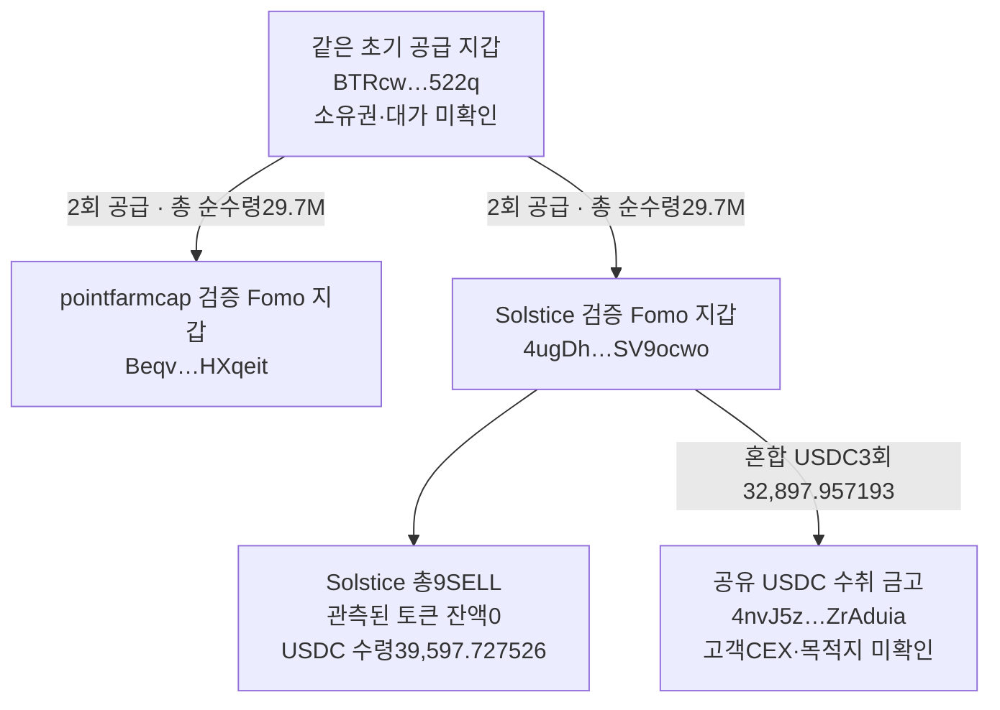

# 초기 Top10 후속 조사 — ARTHUR 매수와 공통 공급 지갑

배치 `top10-60d-20261008-v1-batch005`. 원래 Top10(raw141)을 대상으로 기존 5개 `gpt-6-luna`/`max` 작업자가 분석하고, 본체가 원문을 독립 대조한 뒤 SQLite에 추가 저장했다.

고정 조사 구간은 **2026-08-08T04:43:41Z ≤ t < 2026-10-07T04:43:41Z**다. 아래 시각은 모두 UTC이며, 자료 수집 시각과 실제 거래·게시 시각은 구분했다.

## 이번 결과

- **Werey의 ARTHUR 실제 매수 한 건을 시총 100만 달러 이하 조사 대상으로 승인했다.** 매수 37초 전의 CoinGecko 역사적 유통 시총 표본은 약 59.5만 달러다.
- 해당 풀의 3시간 거래 613건을 분석했다. 실제 매수 직전 60초의 매수 군집은 관측되지 않았으며, 직전 5분·15분 매수 빈도도 대조 구간과 비슷했다.
- **pointfarmcap과 Solstice가 같은 공급 지갑·토큰 계좌에서 각각 STONKCATS 2,970만 개를 순수령했다.** 공급자 소유권과 두 계정의 공조 여부는 미확인이다.
- Solstice는 관측된 STONKCATS 물량을 모두 매도했다. 실제 USDC 수령액은 39,597.727526이며, 초기 공급 물량의 원가가 없어 실현 수익은 미확인이다.
- Solstice의 USDC 회수 3건은 브리지 서버의 목적지 체인 매핑 미지원으로 미해결이다. 공통 고객 CEX 입금 주소는 확인되지 않았다.

## 1. ARTHUR — 어떤 매수를 승인했나

검증된 Werey Fomo Solana 지갑은 `DmopudSGaQQenK4cW5NgmHUsexMB3sEJNn6n1EfLKs28`다.

| 항목 | 확인 내용 |
|---|---|
| 정확 토큰 | Solana `6e8LLHkqCTa4mzGuL1PoUxSfeHmDeceJ3DaJSSUNg937` |
| 실제 매수 | 2026-10-02 08:00:37, +178,066.809486 ARTHUR / −110 USDC |
| 거래 원문 | raw196 `/result/data/725`, 새 풀 조회 raw2289 `/response/result/data/413` |
| 역사적 시총 | CoinGecko `arthur`, raw2274 `/payload/market_caps/29`, 08:00:00의 595,241.9577189017달러 |
| 표본 차이 | 매수 37초 전. 현재 운영 가정인 사전 300초 이내 조건 충족 |
| 판정 | **이 실제 BUY 한 건만 적격**. 수집 전 승인 raw2286 |
| 공개 기록 | 해당 매수의 Fomo BUY 알림·대외 노출 시각은 미확보. 확보한 THESIS는 10/3 10:33:00 |

[실제 매수 거래](https://explorer.solana.com/tx/3HMM3C31cwfaNo6Xb3x1rYsXCptemBWZqfuanLSERZrxY32zvSAAucoG1zeDfgZRYLwjKPUaB6kgjWfg8bBqNLpf)에서 성공 여부, 지갑 서명, 최종 ARTHUR·USDC 잔액 변화를 대조했다. 이 지갑은 **9/30 02:10:34에도 이미 ARTHUR를 매수했다.** 10/2 거래는 추가 매수이며, 그 앞의 매수를 최초 Fomo 매수 이전이나 최초 공개 이전으로 표현하지 않는다.

CoinGecko의 역사적 `market_caps`는 공급자가 산정한 표본이다. 특정 순간의 확정값이나 RPC가 증명한 시총을 뜻하지 않는다. 정확 mint 매핑(raw2268)을 확인했고, 현재 시총·FDV·현재 유통량을 과거 기준에 대입하지 않았다. [공식 역사 차트 API](https://coingecko-api-v3.readme.io/reference/coins-id-market-chart-range)와 [시총 산식·역사 자료 수정 안내](https://support.coingecko.com/hc/en-us/articles/61976309053337-Why-do-historical-market-cap-values-change-shortly-after-a-date-then-settle)를 raw2272에 출처로 보존했다.

### 나머지 시총 판정

Werey의 SI·MONEROCHAN·ARTHUR 실제 BUY 81건과 확보 THESIS 3건, 총 84개 기준 이벤트를 검토했다. 적격 1건, 유효한 사전 표본이 시총 기준을 초과한 2건, 보류 81건이다. 이 수치는 **이번 실제 지갑 거래 검토 목록**이며, 기존 canonical Fomo 알림 대기목록을 교체한 집계가 아니다. Fomo 이벤트 ID와 native 거래 signature는 별도로 유지했다.

| 대상 | 남은 문제 |
|---|---|
| SI | raw2266 역사 차트가 첫 BUY·THESIS를 포함한 요청 구간에서 빈 배열을 반환했다. 현재 시총과 풀 분봉만으로는 과거 유통 시총을 확정하지 못했다. |
| MONEROCHAN | raw2273은 요청 시작보다 늦은 9/16부터 표본을 반환했다. THESIS 직전 시총 1,275,783.6111850135달러는 305초 전으로 현재 300초 기준 밖이다. 실제 BUY 27건에도 조건에 맞는 사전 표본이 없었다. |
| ARTHUR THESIS | 10/3 10:33 게시 직전 표본은 10:00으로 1,980초 전이다. 11:00 표본은 게시 후여서 사용할 수 없다. |
| ARTHUR 일부 BUY | 10/1 17:02:02·20:03:17 매수의 사전 시총 표본은 각각 약 115.3만·105.9만 달러로 현재 선별 기준에서 제외했다. |

−1·0 시총 표본은 결측으로 제외했다. **300초는 시총·가격 표본의 신선도에 관한 운영 가정이며 선행 매수 탐색 기간이 아니다.** 닫히지 않은 분봉도 제외했다. 예를 들어 MONEROCHAN의 20:23 시작 분봉은 20:24까지 이어져 매수 시각 20:23:50의 사전 고저종가로 사용할 수 없다. ARTHUR THESIS 분봉(raw2280)은 HTTP429를 반환해 gap으로 남겼다. 이번 재시도는 0회다.

## 2. ARTHUR 전후 매수 군집

풀 `Ftejc2f8dKL9q9RmrtTen6aXPhNdbr8dvNvDbEx56p3H`의 **10/2 06:00:37–09:00:37** 거래를 조회했다. raw2289에 613개의 고유 성공 거래가 있고, 같은 필터·cursor를 사용한 raw2297은 빈 후속 페이지와 null cursor를 반환했다. 해당 풀·3시간의 provider 페이지 회수는 끝났다. 다른 풀·전체 토큰 시장·60일 이력의 완전성은 미확인이다.

최종 owner가 서명하고, 성공 swap에서 같은 owner의 ARTHUR와 USDC가 반대 방향으로 변한 거래는 **184건: BUY 115·SELL 69, 매수 지갑 63개**다. 서명자가 토큰을 받은 swap 중 USDT·다른 quote 9건, 명시적인 SPL quote 차감이 없는 113건은 별도로 분리했다. 내부 풀 계좌, 서명하지 않은 수령자, native SOL·수수료·rent를 구분할 수 없는 흐름을 이 매수 집계에 넣지 않았다.

| 추가 매수 직전 창 | USDC BUY 수 | 서로 다른 매수 지갑 | 비중첩 대조창 중앙값 / 최대 |
|---|---:|---:|---:|
| 10초 | 0 | 0 | 0 / 2 |
| 30초 | 0 | 0 | 0 / 2 |
| 60초 | 0 | 0 | 0 / 3 |
| 5분 | 3 | 3 | 3 / 9 |
| 15분 | 9 | 9 | 8 / 15 |

직전 5분 3건·15분 9건은 관측된 배경 빈도와 비슷하다. 60초 내 3주소라는 조건은 탐색용 가정이며 공모나 통계적 유의성을 의미하지 않는다.

추가 매수 **2초 뒤**에는 한 지갑이 200 USDC로 323,896.723876 ARTHUR를 사고 **24초 뒤** 같은 수량을 팔아 194.826155 USDC를 받았다. 해당 토큰 잔고는 0 → 323,896.723876 → 0으로 변했다. 정확 지갑·signature·전후 잔고는 worker raw2301에 보존했다. 이 왕복 거래의 의도·소유권·Fomo 공개에 대한 반응·실현 수익은 확정하지 않았다.

원래 Top10의 정확 지갑과 일치한 매수자는 Werey뿐이었다. 공통 fee payer AgmL…은 92/613 거래에 등장하지만 서비스·고객 역할은 미확인이다. 실제 매수의 대외 노출 시각도 없어 2초 차이를 카피트레이딩 반응 지연으로 해석하지 않는다. Chrome 거래 화면(raw2291)은 Loading, 프로그램 화면(raw2292)은 빈 본문으로 UI 라벨 근거를 추가하지 못했다.

## 3. STONKCATS — 공통 초기 공급

공급 owner/authority는 **`BTRcwVTSoBwXg9XXEXcK4UYYCTmhd6iv81TZggFG522q`**, source token account는 **`7cW4WMB4UY1sn14D1QzZhGkiUwbnEvXYY9fYqDnGrDSk`**다. 동일 mint `9h5AzEQzYu9CV5K6uLtFRMD1KcbxZSFNxZEgBTNfw5Na`의 네 전송에서 이 주소들이 일치한다. pointfarmcap의 기존 raw2212를 재사용하고 Solstice raw2282를 추가 대조했다.

| UTC | 수령 지갑 | 전송량 → 순수령 |
|---|---|---:|
| 9/15 03:11:51 | pointfarmcap | 15,000,000 → 14,850,000 |
| 9/15 03:12:00 | Solstice | 15,000,000 → 14,850,000 |
| 9/15 05:19:07 | pointfarmcap | 15,000,000 → 14,850,000 |
| 9/15 05:23:32 | Solstice | 15,000,000 → 14,850,000 |

Solstice의 [첫 공급](https://explorer.solana.com/tx/34jZFyhy9PeE1LsLeRqDyj9c14SSyXECJ9Rm8MSKnw1CHhHnnLVGjkDY6NngFkioefN3859Acms7hsJti5XTyN7K), [두 번째 공급](https://explorer.solana.com/tx/25WDKJ3PgRQstStkyLZgMu648RQCg9exnzYzAJwgjQCYZgDEearpp3dfzq6n6cmtf4it17zjhrN8j7XS3ZqqXfTc)를 확인할 수 있다. 기존 pointfarmcap 거래와 정확 원문 locator는 raw2299 `common_initial_supplier`에 함께 저장했다.

전송별 gross 1,500만·net 1,485만의 차이 15만을 기존 Token-2022 전송 수수료 근거와 구분해 보존했다. 첫 공급의 시각 차이는 9초, 두 번째는 4분25초다. 같은 공급 계좌·authority를 통한 분배는 확인했지만, 공급자가 미리 장내 매수했는지, 대가가 무엇인지, 어느 개인의 뒷지갑인지까지는 미확인이다.

### Solstice의 후속 보유·매도

| 단계 | 확인한 변화 |
|---|---|
| 9/15 | 두 transfer에서 총 29,700,000 순수령 |
| 9/28 | 6SELL, 10,436,075.808491 토큰 처분 / 26,935.324975 USDC 수령 |
| 9/29 | 3BUY, 272,135.727389 추가 취득 / 431.074375 USDC 순지출 |
| 10/4 18:15:25 | 확보한 THESIS 시점의 보유 물량 19,536,059.918898 |
| 10/7 | 3SELL로 나머지 물량 처분 / 12,662.402551 USDC 수령 |

**29,700,000 + 272,135.727389 − 29,972,135.727389 = 0.** 관측된 정확 계좌의 잔액 흐름은 잔차 0이며, 총 9SELL의 USDC 수령액은 **39,597.727526**이다. 초기 공급 lot의 원가·대가는 미확인으로, 이를 수익으로 표시하지 않았다. 9/28의 6SELL은 확보한 THESIS보다 앞선 매도다.

raw2288에서 같은 ATA·필터·cursor의 빈 종료 페이지를 확인했다. 다른 과거·폐쇄 ATA, 전체 지갑 60일, 절대 최초 공개는 별도 미확인이다. STONKCATS의 역사적 유통 시총도 보류이며 신규 전체 토큰 시장 군집 조회는 실행하지 않았다.

## 4. DARK — 처음 관측한 재고는 transfer

Solstice의 exact DARK account `FE4h8SmxyKes1KkrG3Y6YsavGhGr3SnxEUzaHJ3e7zCg`를 raw2281·2287에서 검토했다.

- **10/2 01:40:43:** `2KNoBqc81eP9Narp8p77fgMYTncLGJRMt7xBGMZU52iF`에서 10,136,955.790203 DARK가 [전송](https://explorer.solana.com/tx/1iZ877Z12puJ72nBG9KWHSjjy9Wc36oc4njgZpQzisWQN6B9uouUTZGwSoXuinhmwUYxSHeHTbEowwqW6EM5QJk)됐다. 해당 거래의 USDC 지급이 없어 매수로 분류하지 않았다.
- **10/3 23:40:48:** 실제 BUY로 +234,073.819331 DARK / −273.968614 USDC. 두 변화로 다음 매수 직전 재고 10,371,029.609534를 정확히 설명했다.
- **10/4 22:16:17:** 기존 검증 BUY +1,951,812.443185 DARK / −3,123.595706 USDC.
- 확보한 DARK THESIS는 **10/6 22:59:05**(raw2167)로 위 거래보다 뒤다. 절대 최초 공개, 공급자 소유권, 초기 재고 원가는 미확인이다.

## 5. 회수 금고·CEX/Bridge 한계

Solstice의 3회 **32,897.957193 USDC**, Werey의 8회 **40,413.451333 USDC**가 같은 수취 token account `4nvJ5zWdVspxJiNZzB127U6amPH98SFFkBx2JZrAduia`로 이동했다. 당시 authority는 `7uTT8Xi5RWXzy7h9XL244GRgEycDYDhLjr3ZyNdXi8pZ`, DepositToken 프로그램은 `99vQwtBwYtrqqD9YSXbdum3KBdxPAVxYTaQ3cfnJSrN2`로 일치한다. 기존 RZD 자료는 비교에 재사용했으며 단독 추적을 재개하지 않았다.

Solstice 세 원본 거래에 대한 로컬 Bridge 응답(raw2283–2285)은 HTTP200·unresolved다. source 전송 근거는 맞지만, 각각 `relay_status_destination_chain_is_not_mapped`/unsupported와 pending_indexing이 반환됐다. **관측 0은 목적지 매핑 gap이며 브리지 부재의 증거가 아니다.** 도착 체인·정확 수령 지갑·공통 고객 CEX 입금은 아직 미확인이다.

raw2298의 현재 계좌 메타데이터에서도 USDC authority와 실행 가능한 프로그램을 확인했다. 현재 잔고·프로그램 loader로 운영자나 고객 입금 역할을 확정하지 않는다. Solstice 전송 창에는 여러 토큰 매도·기존 USDC가 섞여 있어 금고 이체 전부를 STONKCATS 매도대금에 귀속하지 않았다. 공유 금고의 전체 입출금을 개별 trader에게 연결하지 않는다.

[Relay 공식 문서 목록](https://docs.relay.link/llms.txt)에서 Requests v3·SVM Depository 참조를 찾았으나, 두 상세 문서는 도구에서 접근하지 못했다(raw2295·2296). 이 상태에서 프로그램 운영자 라벨이나 개별 주문을 확정하지 않았다. [Relay Vaults 설명](https://docs.relay.link/references/protocol/vaults/overview)의 유동성 Vaults와 Settlement 구분도 유지했다.

## 저장·다음 작업

- SQLite 추가: **실제 거래193, 정규화 활동18·토큰 변화23, transfer 연결11**. 중복 native signature는 재사용했고 충돌은 0이다.
- 기존 collector state37개와 지갑 판정11행을 보존했다. Fomo404개 이벤트·기존 알림·시총 대기목록은 변경하지 않았다.
- 시장API15회(429 포함), 직접RPC7회, Bridge3회, Chrome2회, 공식 문서 lookup5회. **Fomo·credits·Nodit indexed·BigQuery 신규 사용은 0**이다. 남은 예약은 해제했고 배치를 닫았다.
- 본체 review **raw2305**, 구조화 근거 **raw2299**, 작업자 review raw2300–2304, 수집 전 적격 승인 raw2286.
- 새 재개 지점은 `collector_state.initial_top10_arthur_case_and_supply_review_v1`다. 배치 폴더에 원문 정수·UTC·locator, 5개 작업자 산출물, 재현 도구를 저장했다. 별도 프로그램 테스트나 legacy 데이터 전체 재빌드는 하지 않았다.

다음은 승인한 ARTHUR 구간을 재사용해 실제 비서비스 공급·반환·후속 매도가 연결되는 후보만 좁혀 검토한다. 공통 STONKCATS 공급의 출처·대가와 시총 근거, 공유 금고 개별 주문의 목적지 매핑도 후속 과제다. 추가 수집에는 새 배치 예약이 필요하다. 현재 공통 고객 CEX, 뒷지갑 실소유, 선행매수 의도, 실현 수익은 미확인이다. Top100 확대와 단독 RZD 추적은 중단 상태를 유지한다.
