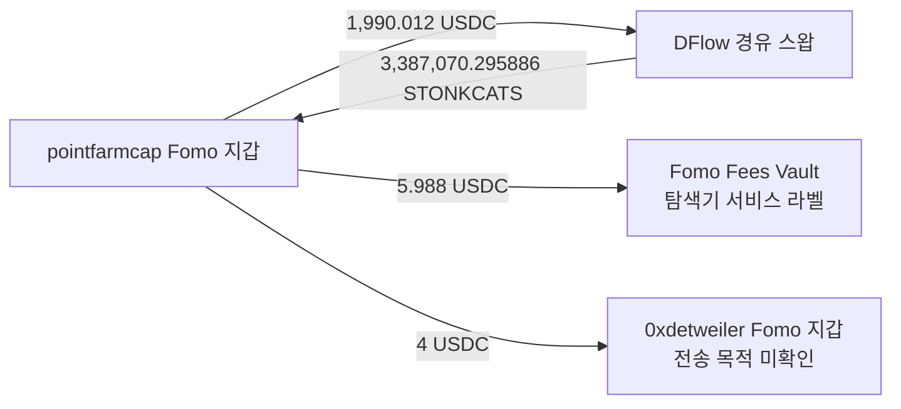

# 초기 지정 10명 첫 조사 배치

검토 시각: 2026-10-07T14:40:14.803Z. 고정 표본: raw141의 원래 Top10. 배치: `top10-60d-20261007-v1-batch001`.

## 이번에 수행한 작업

작업자5개를 `gpt-6-luna`/`max` 설정 그대로 재사용해 2명씩 배정했다. 본체가 Fomo REST와 시장자료를 순차 수집하고 기준 SQLite 적재·실제 거래·작업자 결과를 검토했다. 작업자는 모두 읽기 전용 DB와 보존 자료를 분석했으며 외부 요청은0회다. 기존 Top100 표본이나 단독 RZD heartbeat를 새 대상으로 배정하지 않았다.

기준 구간은 **2026-08-08T04:43:41Z 이상, 2026-10-07T04:43:41Z 미만**이다. 현재 확보한 이벤트는 **404건: THESIS 171, BUY 123, SELL 110**다. 이전232건에서 **172건**이 추가됐다. THESIS와 BUY를 별도 기준 사건으로 둔 선별 목록은 294개, 정확한 chain/token 조합은 138개다. BUY 알림 수는 실제 체결 수가 아니다.

**60일 전체 수집은 미완료다.** 확보된 가장 오래된 기록은 2026-08-19T18:07:00.000Z다. 요청 시작을8월8일로 지정했어도 실제 반환 목록은 대부분10월에 몰린다. `hasMore=false` 페이지가 이전 capture의 사건을 누락한 사례도 있으므로 결과 회수 완료와 역사적 coverage를 구분한다. 고정 종료 뒤의 원문은 capture에 보존하고 이 목록에서 제외했다.

## 계정별 진행

| 원래 순위 | 계정 | THESIS | BUY 알림 | SELL 알림 | 검증된 지갑 수 | 가장 오래된 확보 UTC | 전체 이력 |
|---|---|---:|---:|---:|---:|---|---|
| 1 | pointfarmcap | 5 | 5 | 0 | 1 | 2026-10-04T19:08:20Z | 일부 확보 |
| 2 | The__Solstice | 22 | 1 | 5 | 0 | 2026-08-19T18:07:00Z | 일부 확보 |
| 3 | theveeman | 28 | 3 | 2 | 0 | 2026-09-01T19:58:45Z | 일부 확보 |
| 4 | RareDualJay | 22 | 2 | 0 | 0 | 2026-09-01T14:21:50Z | 일부 확보 |
| 5 | 0xdetweiler | 16 | 60 | 65 | 1 | 2026-09-15T08:30:55Z | 일부 확보 |
| 6 | pricedin | 5 | 0 | 1 | 0 | 2026-09-06T03:24:50Z | 일부 확보 |
| 7 | RunningClam | 14 | 0 | 0 | 0 | 2026-08-28T21:57:00Z | 일부 확보 |
| 8 | econoar | 27 | 12 | 8 | 1 | 2026-08-27T18:02:10Z | 일부 확보 |
| 9 | RZDxbt | 21 | 20 | 12 | 2 | 2026-09-01T00:23:25Z | 일부 확보 |
| 10 | motiyawerey | 11 | 20 | 17 | 1 | 2026-08-30T03:21:10Z | 일부 확보 |

검증 지갑은 **5명에게서6개**를 재사용했다. 아직 미검증인 나머지 주소는 후보다. 단일 EVM 주소를 Ethereum에서 검증한 것이 모든 EVM 체인 이력 완료를 뜻하지 않는다. 계정의 공개 handle은 변할 수 있어 raw141의 user ID로 연결한다.

## THESIS 조회에서 확인한 차이

처음 UUID로 조회한 pointfarmcap·Solstice·pricedin·RunningClam·econoar의 THESIS endpoint는 `upstream-unavailable`을 반환했다. 이를 빈 이력으로 처리하지 않았다. pointfarmcap은 이미 이전 실패의 제한된 재시도까지 수행해 추가 반복을 중단했다. 나머지4명은 지원되는 handle 입력으로 각각1회 재시도했고, 반환 문서의 `userId`가 정확한 대상 UUID와 일치하는지 확인했다. 이 경로에서 고정 구간 THESIS51건을 새로 적재했다(raw2167–2171). 다른 저자의 문서는0건이다. minEquity/minLikes 응답은0/0으로 기록했다.

신규 author-page 확보 사례에는 Solstice8월19일, Werey8월30일, theveeman9월1일, detweiler9월15일의 게시 기록이 있다. 기존 원문은 보존하고, 같은 글의 재노출은 새로운 공개 사건으로 중복 계산하지 않는다. 네 계정의 성공 재조회가 모든 계정의60일 완전성을 보장하지 않는다.

## 당시 시총 선별

심층 조건은 **게시 또는 실제 BUY 당시 유통 시총≤$1M**이다. 선별 목록은 {"pending_cap": 292, "excluded_above_cap": 2}이고, 심층 배정 확정은 0개다. 이전 $10M 판정을 가져오지 않았고, 기존 $1M 검토도 같은 user/token/시각의 근거만 재사용했다.

이번 시장자료8회에서는 다음3토큰을 조회했다.

| 토큰 | 확인한 자료 | 현재 판정 |
|---|---|---|
| STONKCATS | exact mint에 대응하는 CoinGecko ID. 10/6 05:00 시총 $565,641.7543554384, 06:00 $630,198.5288340229. detweiler9/16 글의 창은 표본0개 | 05:14:35 글 직전 표본은875초 전이다. 운영 가정300초 밖이라 시간 해상도 보류. 두 인접 표본 모두 $1M 아래여서 우선 후보 |
| CODEC | exact mint에 대응하는 역사적 cap 표본2개.9/20 07:00 $9,444,642.254203329,08:00 $9,734,233.091255205 | 07:22:05 글과의 시간 차이 때문에 그 시각 확정은 보류. 관측 표본은 상한보다 큼 |
| App | CoinGecko429를1회 재시도 후 중단. GeckoTerminal 현재 FDV $52,264.8165827576, 유통 cap null | 현재 FDV는8/30 게시 당시 유통 시총을 증명하지 않아 보류 |

300초 제한은 연구자가 둔 운영 가정이며 사용자가 정한 상한은 $1M다. 이번에 시간 기준을 완화하거나 인접 시간대 값을 게시 당시 값으로 바꾸지 않았다. 시총 gap이 해결된 사건부터 선행 매수 군집을 배정한다. 새 BigQuery 시장 검색은 아직 실행하지 않았다.

## 실제 거래와 계정 간 접점

pointfarmcap의 보존 RPC4건을 최종 owner·token/quote 잔고로 재검토했다. SNDK·ZCAT·KNOTS의 기존 검토를 재사용하고 **STONKCATS의 이전 검토 보류와 저장 match의 불일치를 새 focus 검토에서 해소**했다. 기존 Top100 review는 수정하지 않았다.

STONKCATS [실제 거래](https://solscan.io/tx/2LN6M61Lw8XMiRAvgtjTPg1FQhoSV2o78cWx2A5pN8imbtkj9moYPYq1mXJusSwjjF1c4p3KtxGFZpyYP7FTLywR)는 2026-10-06 **01:08:07Z**에 성공했다. pointfarmcap 지갑은 **2,000 USDC 감소,3,387,070.295886 STONKCATS 증가**다. Fomo BUY source 시각01:08:10Z와는3초 차이가 있다. 거래 중간에 거친 STONK의 최종 지갑 delta는0이므로 추가 취득 토큰으로 세지 않는다. 본체가 Chrome Solscan의 Overview/Balance Changes와 독립 RPC raw686을 대조했다.

같은 거래에서 **0xdetweiler의 검증 Solana 지갑이4 USDC를 수령**했다. parsed transfer authority는 pointfarmcap이며, 수신 token-account historical owner와 전후 잔고도 일치한다. quote의 구성은 아래와 같다.

1,990.012+5.988+4=2,000 USDC이며 SOL 비용은 별도다. 4 USDC는 전체 quote 감소의0.2%다. **수수료·추천 보상 성격의 가능성이 있는 관계 후보**로 기록했다. 나머지3개 재검토 거래에서는 해당 수신 지갑의 USDC delta를 찾지 못했다. 반복 자금 공급·동일 소유자·뒷지갑·선행매수 근거로 승격하지 않았으며 funding/identity graph도 변경하지 않았다. 이 사례는 token 매매와 서비스 성격의 지급을 구분해야 함을 보여준다.

추가로 기존 자료에서 detweiler의 ZSHIB·HIGGS·OTC 실제 signer SWAP와 JUF 후보 지갑 거래, Werey ZCAT/SNDK 직접 match 등을 재사용해 시간표를 만들었다. JUF는 두 BUY 알림이 같은 trade ID를 쓰고 각 알림이 두 서명에 모호하게 연결돼 사용자 소유나1:1 매핑을 확정하지 않았다. OTC의 첫5개 실제 매수는 확보한 THESIS보다 앞서지만 당시 cap·전체 최초 공개·외부 지갑 관계가 부족하므로 선행매수 의도라고 결론 내리지 않았다.

## Chrome 추적과 CEX

Chrome에서 econoar Arkham 주소와 Ethereum Etherscan, 위 Solana 실제 거래를 열었다. Arkham의 공개 요약은 Coinbase **출금→지갑** $264.28K를 표시하지만 개별 전체 transfer가 로그인으로 잠겨 있었다. deposits Total$0은 USD≥$1·65일 요약의 표시이며 고객 입금 부재 증거가 아니다. 보이는 미검증 preview hash도 독립 거래로 채택하지 않았다.

Etherscan 주소 페이지의0.005 ETH 유입은 별도 탐색기 assertion으로 기록했고, 고객 CEX deposit이나 공급자 소유권으로 확정하지 않았다. **이번 배치에서 새 공통 고객 CEX 입금 주소는 확인되지 않았다.** 조건이 확정된 토큰의 외부 선행 매수 지갑부터 처분·quote 회수·bridge·정확한 deposit 주소를 조사하는 작업은 아직 미착수다. 조회하지 않은 경로와 조회했지만 결과가 없는 경로를 분리했다.

## 요청량과 저장

- Fomo HTTP20회, 실제 응답 credits **10,875**. 마지막 응답 잔액 **225750**(응답 시점 기준). 예약15,000 내에서 실행했고 미사용분은 배치 종료 시 반환했다.
- 시장자료8회, 새 직접 RPC0·Nodit indexed0·Bridge0·BigQuery 유료0·dry run0. 기존 직접 RPC proof4건과 기존 BQ 결과는 재사용했다.
- Foundation raw2158, retry raw2171, 새 inventory raw2174, 본체 review raw2175, 계정 관계 raw2172, Chrome 관측 raw2173. SQLite 상태는 `initial_top10_lowcap_event_inventory_v1`와 `initial_top10_primary_review_v1`이다.
- 기존 `wallet_resolutions`와 이전 collector state 전체 SHA256 보존을 확인했다. 기존 alert importer가 generic newest-event watermark를 갱신한 것을 발견해 저장해 둔 전체 이전 state SHA256으로 정확한 원래 행을 대조·복원했다. 사용자별 native cursor와 RZD/연우 frontier는 그대로다. 새 focus 상태만 추가했다.
- 실행 전 자동 승인 검토의 모델 용량 오류1회가 있었고 해당 시도는 실행되지 않았다. 재검토 승인 후 수집했다. 실행 중 watermark 보존 검사 중단은 이미 저장된 capture만 재사용해 복구했고 외부 요청을 중복 실행하지 않았다.
- 재현용 실행 helper와 원문·시장자료·5개 작업자 결과는 ignored `data/research/parallel/top10-60d-20261007-v1-batch001/`에 보존했다. 정규화·근거 적재의 기준은 SQLite다. 테스트 추가/실행은 하지 않았다.

## 다음 frontier

1. **STONKCATS**의 실제 BUY01:08:07Z와 THESIS05:14:35Z를 정확히 구분하고, 더 가까운 가격·역사적 유통량/시총 근거를 확보한다. detweiler9/16 문서의 토큰 역사와 pointfarmcap 공개 이전 재고도 따로 검토한다. 인접 시간 표본만으로 심층 조건을 통과시키지 않는다.
2. 보존된 실제 quote·owner 근거가 있는 **ZSHIB·OTC**를 다음 cap 검토 후보로 둔다. BUY-only와 공개 이후 BUY를 분리하며 Fomo provider 반복 알림을 체결 수로 대신 쓰지 않는다. 다른 작업자가 제안한 JUF·GOMO·Ash·IMD·ORBIO·ZCAT·SNDK 등은 각 보고서의 대기 목록에 유지한다.
3. 적격 token/event가 확정되면1~3개에 한해 공개/매수 전2시간·후1시간의 실제 외부 매수자를 찾고 후24시간의 매도·quote 회수를 연결한다. 미확인 외부 지갑 검색에 BQ가 유리할 때만 dry run과 cap을 예약한다. Chrome에서 label/개별 tx를 검토하고 핵심 송금·bridge를 RPC로 대조한 뒤 같은 정확한 고객 CEX chain/address를 비교한다.
4. 원문 조회가 누락하는 기간은 별도 coverage 보완으로 남기고, 기존 완전한 capture는 재수집하지 않는다.10명 확대는 이 사례 경로와 비용·coverage 검토 뒤에 한다.

이번 완료는 **초기10명 첫 배치의 수집·근거 검토·저장 완료**다.60일 전체 이력·뒷지갑·공통 CEX·원가/실현 수익 조사는 완료되지 않았다.
