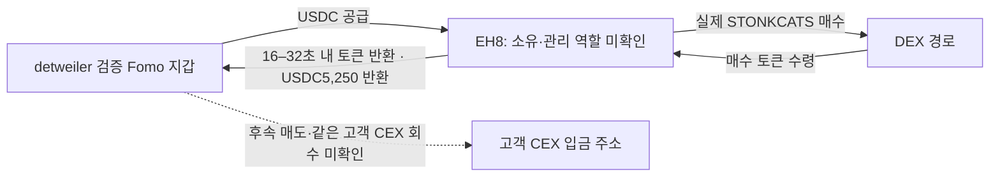

# 초기 Top10 방향 재점검과 연관 지갑 추적 — 배치008

작성: 2026-10-08 KST. 본체 review **raw2410**, 근거 **raw2409**, state `initial_top10_hidden_wallet_direction_review_v1`.

## 결론과 조사 방향

**동일 토큰의 실제 취득 → 공개 기록과의 시점 비교 → 자금 공급·반환 → 매도와 회수 → 정확한 고객 CEX 입금 주소 비교** 순서를 유지한다. 공통 주소가 발행자·풀·보상 권한·라우터·Relay 서비스인지 먼저 확인해야 한다. 입금 주소 일치만으로 동일인이나 선행매수 의도를 확정하지 않는다.

이번에는 새로운 뒷지갑 선행매수를 확정하지 않았다. 대신 다음을 확인했다.

| 사례 | 확인한 사실 | 현재 해석 | 남은 근거 |
|---|---|---|---|
| detweiler ↔ EH8 | 본지갑 USDC 공급, EH8 실제 매수3건,16–32초 내 동일 gross 물량 반환,USDC5,250 반환 | 본지갑 자금으로 실행한 매수·중개 경로 후보 | 플랫폼 관리/역할·최초 공개 전 취득·매도와 회수·공통 고객 CEX |
| BTR → point/Solstice/detweiler | 공식 발행자의 같은-token 초기 배분; EC2 수령자를 기존 검증 detweiler 지갑과 대조 | 발행자 배분·프로모션·수동 에어드롭 대안 우선 | 9/15 초기 지급 자격·당시 NFT/allowlist·대가 |
| Solstice HyperCore →66cf |10개 송금 중2개 개별 Relay 주문이 verified Solstice Solana 지갑으로 반환 | 검증된2개 주문의 Relay 입금 경로; 고객 CEX 아님 | 나머지8개 개별 목적지·10/7 최종매도대금 귀속 |
| point → Solstice 소액 quote |0.38/0.57 USDC 반복 쌍이 동일 route 거래에 공존 | route-split/수수료 구조와 정합, 지급 목적 unknown | 서비스 역할 확인; 개인 공급 관계로 쓰지 않음 |

이전 batch007의 수수료 회수→STONK 홀더 보상도 개인 자금 공급·동일 소유 근거에서 제외한다. 역할은 raw 검토 overlay이며 전체 자동 분류기를 구현한 것은 아니다.

## 1. detweiler → EH8 → detweiler: 실제 자금과 토큰 반환

- 검증 Fomo user: `72460ae6-1ddc-5a56-b155-f8e187a4f388`, 초기5위 `0xdetweiler`.
- 검증 지갑: `EC2f5DnHzuNRit1ExqghSifDbp1wgrzktsRRZCtU92MJ`.
- 연관 실행 지갑 후보: `EH8pNWx5K5vCnnrNrraB4wR3ntJa3EUAV5rTH1Eq1KX`. 개인 소유·Fomo 관리 여부는 unknown.
- 정확 token mint: `9h5AzEQzYu9CV5K6uLtFRMD1KcbxZSFNxZEgBTNfw5Na`(STONKCATS,6decimals).
- EH8 target ATA: `2KxgVSvEva9tGJih2HRunHCh6gFHtEVDmWJspQpZR8fK`; quote ATA: `5wmSmMVN1jcknd51ea8F6KB5ZxJ7tNAYpVQHHBBpK5Sc`.

모든 시각은 UTC다. 매수 quote는 **EH8 owner-level USDC 지출**이며 순수 AMM 대가와 수수료를 분리한 수치가 아니다.

| 실제 매수 UTC | USDC 지출 | EH8 순취득 STONKCATS | 반환까지 | detweiler 순수령 | 거래 |
|---|---:|---:|---:|---:|---|
| 2026-09-27T07:33:18Z | 5,000.000000 | 1,576,929.565525 | 22초 | 1,561,160.269869 | [매수](https://solscan.io/tx/5Cne1a3PRys4huJ4uBh3LdhaVsVo6bzZKS2KsuHeC3dpNcK5dtQjqoiNjp64bx6Cmpx9b9wkBpQX1pEnTMgpUqjv) · [반환](https://solscan.io/tx/356htVTyo7yqxoVRPR4f3ajTkADzMrgiU7VeJgxnBPvdJjwyv1GqEMzW1L9RghEbXQmpEYNVYVaRrvwa9dUcVyy8) |
| 2026-09-29T06:07:31Z | 2,000.000000 | 1,455,698.054270 | 16초 | 1,441,141.073727 | [매수](https://solscan.io/tx/2WNTt4dzJf5haSWo7rjQXPwCXirpS6BUqWju6rJiVzhY1bT61UfJ6LhB5kV7GH7QgrRY4w6kg38b97PBhL156jLG) · [반환](https://solscan.io/tx/4x8VsWVopGHYqmAzgCeZHujBnFTT1gg49orJejYoLURYKrg1LQZAuYBceztmwME9GuVQzKDuHWthqhjfozNJSE4s) |
| 2026-09-29T06:09:03Z | 2,500.000000 | 1,718,405.672543 | 32초 | 1,701,221.615817 | [매수](https://solscan.io/tx/3ktvumYax2F2gm4P9m7fpJ7vtJdeH6osPjner3wmKo11rFATraoS4h9gfegg7KdPXQmNijv3uarD7yCEooGwWPPk) · [반환](https://solscan.io/tx/nuq8oQthVtAZTcAhysHm8GkvKzYbfkbUhrftmBWEKC7zSvhmo98ogrARdT4q1GsCXbgwPJYWTvzKUMTZFnHixKj) |

세 매수의 USDC 지출 합계는 **9,500 USDC**다. 반환은 매수 순취득과 동일한 gross 물량이며, 수령자는 추가1% transfer fee를 차감한 net 물량을 받았다. 이전에 저장한 마지막 반환(raw2186)은 재사용했고 새 edge로 중복 추가하지 않았다.

### 첫 매수의 자금 출처

[9/27 07:32:46Z detweiler→EH8 5,000USDC 공급](https://solscan.io/tx/4LvGpBRwn3wvZRA2Pzg8UJQAm28cdkM2bcg17Mpx2kUgzJNKneEuqDHvt7kGyam3NwGNUxQ8judunkJh8ECTN4EX)(raw871)은 매수32초 전 같은 EH8 quote ATA에 정확히5,000USDC를 넣었다. 이 계정의 해당 전송 잔액은0.0033→5,000.0033USDC다. 이후 EH8이 signer/fee payer로 매수하고22초 뒤 토큰을 detweiler에 돌려보냈다. 실제 swap accountKeys에는 검증 detweiler EC2f5 주소가 없다.

이는 EH8의 독립 자금 매집보다는 **detweiler 자금으로 실행한 매수·중개** 설명을 강하게 지지한다. 같은 개인이 서명했는지, 플랫폼/서비스가 관리하는지, 어떤 주문을 받았는지는 확인하지 못했다.

### 9/29의 자금과 USDC 반환

저장 raw870에는 detweiler→EH8 01:16:42Z250USDC와05:49:02Z15,000USDC 공급이 있다. 후자의 같은 quote ATA 잔액은250.0022→15,250.0022USDC였다. raw2402의 짧은 이력에서 **06:05:24Z5,250USDC를 EH8이 detweiler 소유 CtfTos… ATA로 직접 반환**한 것을 확인했다.

[5,250USDC 반환 거래](https://solscan.io/tx/4mwe6E5xBZDajmiW7r6K7Nxzu6DPe1C9fovvTpYAqnoCmYDk6VTsehYTvbE2EtUxb86FgEp1yqd5kP2m8GViRnf3) · raw2402 `/response/result/data/3`.

반환 전후 EH8 계정은15,250.0033→10,000.0033USDC, detweiler 수령 ATA는185.687962→5,435.687962USDC다. 별도 주소의0.0012USDC 소액 입금과 합쳐 기존5,249.9988USDC net 감소 차이가 설명된다. 그 소액 발신자는 검증 EC2f5 주소와 다른 전체주소이므로 소유권·공급 그래프에서 제외했다. 이어2,000·2,500USDC를 매수에 사용했다. 자금은 혼합되므로 개별 입금 lot의 달러를 임의로 특정 매수 원가에 배정하지 않았다.

### 선행매수 판정

확보된 detweiler의 첫 STONKCATS THESIS는 **2026-09-16T06:20:35Z**(raw2147)다. 세 EH8 매수는9/27·9/29이므로 **이 THESIS 이전 매수는 아니다.** 저장 Fomo 이벤트에는 해당3개 signature에 대응하는 BUY 알림/매칭이 없다. 자료 미확보는 알림의 절대 부재나 비공개 주문 부재를 뜻하지 않는다. 따라서 Fomo 플랫폼이 실행했다고 확정하지 않았다.

후속 조사에서는 반복 자금 공급90건만 늘려 세기보다, 적격 동일 토큰의 **최초 확보 공개 기록 이전 실제 취득**, 이후 실제 매도·quote 수령, 정확한 고객 CEX 귀결이 이어지는지 확인해야 한다. 현재 동일 소유·선행 의도·실현 PnL은 unknown이다.

## 2. BTR 초기 공급: 세 Fomo 지갑, 발행자 배분 대안

기존 raw2308/2339의 초기13회 분배 수령자를 검증 wallet resolution과 다시 대조했다. pointfarmcap·Solstice 외에 **detweiler EC2f5 지갑**도9/15 03:12:12Z gross15M/net14.85M STONKCATS를 받았다. 기존 수령 주소는 새로 생긴 것이 아니라 이번 대조에서 Fomo 계정과 연결한 것이다.

- BTR은 공식 creator/발행자다. BTR의 실제 BUY19건과 배분은 별개 사실이며, 그 BUY가 Fomo 이용자들의 숨은 선행매수라는 증거는 아니다.
- raw2379의 짧은 BTR wallet slice에서93개 Metaplex Core 생성과 collection `9bxFnciJ6PBRiEzqRhfoqypD5FjjUgxt8STkz9PVeaUR`를 확인했다. NFT 생성 지급93×0.006SOL=0.558SOL은 NFT 문맥이며 target 토큰 구매 대가로 합산하지 않는다.
- 현재 [프로젝트 페이지](https://stonkcats.xyz)는 동일 collection을 링크한다. [Diamond Paws](https://stonkcats.xyz/diamond-paws)는 초기 커뮤니티 배분과9/17 NFT-holder drop을 언급하고 exact target mint의 보상 API를 링크한다. [Hall of Fame](https://stonkcats.xyz/hall-of-fame)의 현재 honorary 명단에는 `0xdetweiler`가 있다(raw2383/2399/2400).
- 페이지는10/8 확보본이다. 작성/수정 시각,9/15의 지급 자격·snapshot·allowlist와 해당10수령자 membership을 확인하지 못했다. honorary 이름도 지갑/NFT 소유 증거가 아니다. **9/17 NFT drop 설명을9/15 분배의 원인으로 확정하지 않는다.**

따라서 배분 자격은 unknown을 유지하며 발행자 배분/프로모션/수동 에어드롭 대안을 먼저 검토한다. 초기 지급을 독립 매수자 군집이나 개인 공급자 군집으로 합산하지 않는다.

## 3. Solstice → HyperCore66cf: 두 주문은 본지갑 반환

주소 `0x66cf0aace1b4e562593bec10ec7868fba9932224`로 보낸 역사10개 native 송금 중 아래2개를 native 원문(raw2327), Relay 개별 주문(raw2381/2382), 독립 Solana receipt(raw2388/2395)의 source hash·수량·recipient·memo/orderId로 대응했다.

| HyperCore 출발 UTC | 반환 USDC | native source hash | Solana 지급 |
|---|---:|---|---|
| 2026-10-03T17:12:01.736Z | 1,345.465638 | `0xf094b79698b7c420f20e0445c394d8020263007c33bae2f3945d62e957bb9e0b` | [Solstice 수령](https://solscan.io/tx/5DrEanKAJXg8TctCnyXzrmgDRstvfct47kZ3g5LmKfsftMQBchqf8kddsGLRzPVfBgF1FAuRx2PbJeSLCQw24hyt) |
| 2026-09-02T21:08:50.032Z | 10,613.661096 | `0x1bde9ea75c3019161d5804438c507802013b008cf73337e8bfa749fa1b33f300` | [Solstice 수령](https://solscan.io/tx/5NrGDkiVH2VeFTMvUc2awaYCSrBxYVtTvZcuQoVAVsxb9GMWRr5U3ZGda8y9ErZvSRMssSQa2w8owzouAft94LaC) |

총 **11,959.126734USDC**가 검증 Solstice 지갑 `4ugDhHJ8XDXAeABmrNmGffFaLbJb9BkPyiFGVSV9ocwo`의 USDC ATA `GhE45gSNXPpGuYBCVYdHnDK6SY3VNiBe7ekz9nyPo6fU`로 들어왔다. F7p3… signer/Q4Um… source ATA는 이2개 주문의 서비스 지급 문맥이다. 해당 pooled 지급을 개인 공급자나 고객 CEX로 귀속하지 않는다.

이 결론은 **해당2개 주문**에만 적용한다. 나머지8개의 목적지는 미확인이다.9/2 송금은 STONKCATS 발행 전이고10/3 송금도10/7 최종 SELL보다 앞이므로10/7 매도대금의 회수로 연결할 수 없다. HyperCore는 `hyperliquid:hypercore-mainnet`/Relay logical1337이며 EVM chain1337 또는 HyperEVM999가 아니다.

### 별도 증분: Solana→Robinhood Chain4663

10/7 19:58:09Z·22:19:06Z의 새로운 Solstice Relay source USDC 출금2개는 각각1,793.186559·1,084.630988, 합계 **2,877.817547USDC**다(raw2377, Relay raw2390/2391). Relay는 chain4663 `0xd1c77a04b87393e98a1220532e72e8f7d0a31c5a`에 WOOD를 지급한 것으로 응답한다.

첫 [목적지 거래의 전체 토큰 전송](https://robinhoodchain.blockscout.com/tx/0x8b878c271cee93fb6a59c1310f769c41b43144d7c069e8af3b40389ed649573d?tab=token_transfers)을 visible Chrome에서 확인했다(raw2404/2406/2408). Blockscout은 성공한 Relay swap과 마지막 Relay Router→정확한d1c7 recipient 전송을 표시하며, Relay exact output은 **374,252.390031312191548977WOOD**다. 독립 destination RPC receipt/owner delta는 아직 없으므로 **Relay+별도 explorer assertion**으로 유지한다. 두 번째 주문은 Relay assertion만 확보했다.

Robinhood Chain은 블록체인 이름이다. 이 전송 자체를 Robinhood 거래소 고객 입금으로 분류하지 않는다. 같은 hex 주소가 HyperCore와 chain4663에 나타나도 소유권을 자동 통합하지 않는다. 자금 혼합으로 STONKCATS 최종 매도대금의 특정 lot이라고 확정하지 않았다.

## 4. pointfarmcap: 소액 관계를 개인 공급으로 쓰지 않기

기존 고정구간과 이번 증분의 exact USDC ATA에서0.38USDC 전송214건은 모두 같은 signature의0.57USDC→R4r 전송과 일대일로 공존한다. source authority는 Beqv, signer pair는AgmL+Beqv이고 route/aggregator 로그가 있다. Solstice owner 수령 subset은47건/17.86USDC다. 이는 반복 route-split/수수료 구조와 정합하지만 수취 역할·지급 목적은 unknown이다.

기존 고정구간의 “0.57USDC230건” 주장과 exact quote ATA raw2217–2219에서의 **140건/79.80USDC**는 범위가 다르거나 불일치한다. 원래 기록을 지우지 않고 scoped correction을 남겼다. dust·반복 소액만으로 두 계정의 동일 소유나 사적 자금 공급을 판정하지 않았다.

## 5. 초기10명 진행 범위

기존 기초 자료와 검증 지갑은 재사용했다. 이번에는1·2·5위의 알려진 경로를 재검토했다. 아래 이벤트 수는 고정60일 구간에서 **확보된** THESIS/BUY/SELL이며60일 전체 수집 완료를 뜻하지 않는다. 기존 지갑 판정11행을 유지했다.

| 초기 순위 | 계정 | THESIS / BUY / SELL | 기존 지갑 판정 | 이번 작업 |
|---|---|---:|---|---|
| 1 | pointfarmcap | 5 / 5 / 0 | solana: verified | 본 배치 재검토: quote 반환/route split |
| 2 | The__Solstice | 22 / 1 / 5 | solana: verified | 본 배치 재검토: Relay 회수·증분 |
| 3 | theveeman | 28 / 3 / 2 | solana: verified | 이전 조사 자료 재사용; 신규 전체 이력 수집 없음 |
| 4 | RareDualJay | 22 / 2 / 0 | solana: candidate | 이전 조사 자료 재사용; 신규 전체 이력 수집 없음 |
| 5 | 0xdetweiler | 16 / 60 / 65 | solana: verified | 본 배치 재검토: EH8 매수·반환 |
| 6 | pricedin | 5 / 0 / 1 | solana: candidate | 이전 조사 자료 재사용; 신규 전체 이력 수집 없음 |
| 7 | RunningClam | 14 / 0 / 0 | 검증 판정 미확보 | 이전 조사 자료 재사용; 신규 전체 이력 수집 없음 |
| 8 | econoar | 27 / 12 / 8 | ethereum: verified | 이전 조사 자료 재사용; 신규 전체 이력 수집 없음 |
| 9 | RZDxbt | 21 / 20 / 12 | ethereum: verified; solana: verified | 기존 자료 유지, 단독 추적 중단 |
| 10 | motiyawerey | 11 / 20 / 17 | solana: verified | 이전 조사 자료 재사용; 신규 전체 이력 수집 없음 |

## 6. Coverage·저장·비용

고정 역사 구간은8/8 04:43:41Z≤t<10/7 04:43:41Z(60일), 이후 증분은10/7 04:43:41Z≤t<10/8 03:17:00Z로 분리했다.

| 종료 확인한 조회 | 자료 | 실제 범위/한계 |
|---|---|---|
| EH8 exact STONKCATS ATA | raw2387 8tx+raw2394 빈page |8/8부터9/29 06:09:35Z **직전**까지의 지정 slice; 마지막 반환은 기존raw2186 재사용; 전체지갑60일 아님 |
| EH8 exact USDC ATA | raw2402 7tx+raw2403 빈page |9/29 05:49:02≤t<06:09:36Z의 짧은 slice |
| Solstice finalSELL 후 exact USDC ATA | raw2376 124tx+raw2384 빈page |10/7 02:08:40Z~고정cutoff 직전 |
| Solstice 증분 exact USDC ATA | raw2377/2385 1,172tx+raw2392 빈page |지정 증분 기간; 전체자산/전체지갑 아님 |
| point 증분 exact USDC ATA | raw2378/2386/2393 2,338tx+raw2398 빈page |지정 증분 기간; 전체자산/전체지갑 아님 |
| BTR NFT 생성/payment | raw2379 100tx |9/14 19:36:18~20:03:39Z만; cursor447063003:255 미완료 |
| HyperCore 증분 non-funding ledger | raw2375 0행 |해당ledger/time만; 다른체인/거래활동 부재 아님 |

SQLite에 실제 BUY3건, 새 transfer3건(토큰2+USDC1), 개별 service BRIDGE2건을 추가했다. 기존 마지막 토큰 반환1건은 중복 방지했다. 기존 collector state40행·wallet resolution11행·Fomo404건·매칭·cap 판정을 보존하고 새 review state1개를 추가했다. ownership/PnL·고객 CEX 신규 확정은0이다. 새 테이블·수집기·자동 분류기는 만들지 않았다.

외부 사용은 직접RPC18회(HTTP408과단일재시도 포함), Relay4회, Chrome navigation3회, 원본문서/검색/UI read10회다. Fomo/시장자료/Nodit indexed/BigQuery는0회다. 첫 search native 응답 미보존(raw2380 추출본만), X403(raw2397), Chrome tab click timeout(raw2405), 미완료 BTR cursor를 gap으로 남겼다. Chrome은 표시된 전체 전송 URL로 읽기를 완료했고 CAPTCHA 우회는 하지 않았다.

## 7. 다음 작업 순서

1. **적격 이벤트와 공개 전 취득**: STONKCATS 역사 유통 시총 pending을 보완하되 같은 세 EH8 매수를 선행매수로 재분류하지 않는다. 이미 적격인 Werey/ARTHUR 사례에는 실제 매수 군집 이상이 강하지 않았으며 독립 비서비스 연결부터 검토한다. THESIS 없는 BUY도 실제 Fomo 매수·노출 이전 취득 기준을 유지한다.
2. **연관 지갑 역할과 반환 이후**: detweiler/EH8의 funded execution 경로가 다른 적격 token/event에서도 반복되는지 저장자료부터 비교하고, 반환 토큰의 실제 매도·quote 수령·회수 transaction을 연결한다. 플랫폼/서비스 관리 여부가 밝혀지기 전 숨은 개인 계정으로 승격하지 않는다.
3. **회수와 정확한 CEX endpoint**: Solstice의 chain4663 receipt/후속 출금, 미확인66cf8주문을 개별 대응한다. 정확한 chain/address/memo/tag와 고객deposit 역할이 확보된 뒤 두 경로가 겹치는지 비교한다. sharedsolver/hotwallet/pool 제외.
4. **기초 coverage 확장**: 원래10명의 retained60일 Fomo 페이지와 당시 cap를 작은 batch로 채운다. 알려진 서비스 지갑의 전체 이력을 계속 늘리는 것은 우선하지 않는다. Top100 확대·단독RZD는 중단 상태를 유지한다.

새 전체-token 매수 군집/BQ는 historical circulating cap≤$1M 적격 확인 후에만 배정한다. 현재 STONKCATS는 `pending_cap`; 최초 공개 이전 숨은 지갑 매수·조종 의도·실현 수익은 확정하지 않았다.
