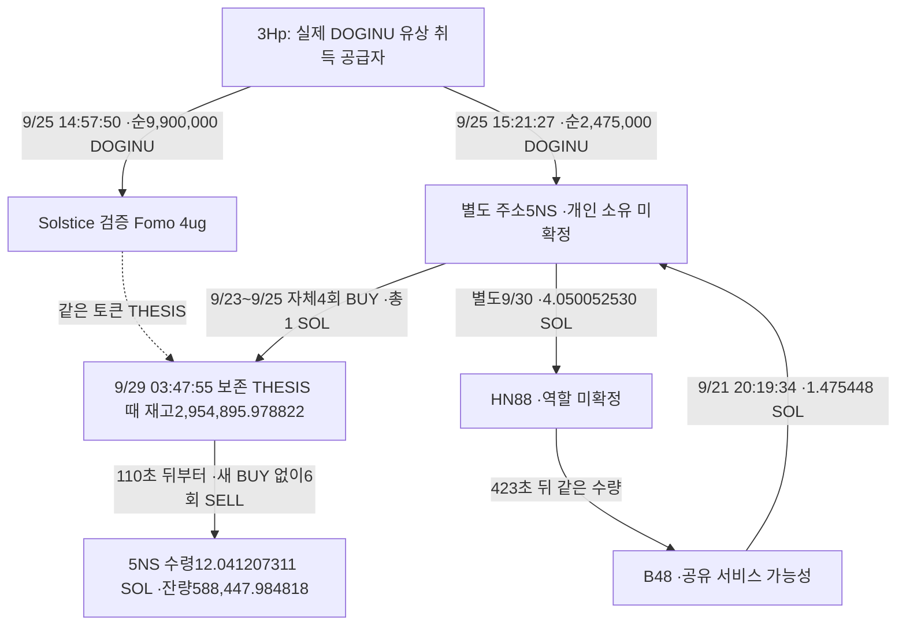
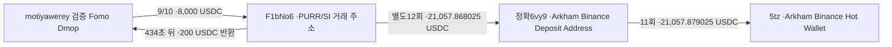

# 초기 Top10 뒷지갑 추적 — 거래 패턴·거래소 회수·미확정 조건

## 현재 결론

**사례 연구를 쓸 자료는 있다. 그러나 “같은 사람이 숨긴 지갑으로 저시총 토큰을 선매수하고 thesis로 가격을 올려 이익을 실현했다”는 결론은 아직 뒷받침되지 않는다.** 가장 강한 후보는 The__Solstice / DOGINU다. 공통 공급자를 통한 토큰 연결, 별도 주소의 유상 선매수, 보존된 thesis 시점 재고, 같은 주소의 게시 후 매도와 SOL 수령까지 확인했다. 개인 소유·의도·정확한 당시 유통 시총·lot별 원가와 이익은 미확정이다.

이번에는 기존 자료의 비용을 재검산하고, 사용자 Chrome에서 정확한 회수 주소 네 개의 공개 라벨을 확인했다. 거래소 입금 주소와 공유 브리지를 구분했다. 연구 전체의 완성 사례 수는 **0**으로 유지한다. 이는 뒷지갑이 없다는 결론이 아니다.

- 대상: 최초 리더보드의 10명(raw141). Top100 확대와 RZD 단독 추적은 재개하지 않았다.
- 거래 조사 구간: **2026-08-08 04:43:41 UTC 이상, 2026-10-07 04:43:41 UTC 미만**.
- 아래 시각은 UTC. 현재 주소 라벨은 거래 시점의 라벨·고객 신원을 입증하지 않는다.

## 1. 가장 강한 후보: The__Solstice / DOGINU

정확한 토큰은 `5JgioXRQSq1Nw4VJvpRyXxnvm8jVtLSUC7vbf1zzDg3L`(decimals6), 검증된 Fomo 지갑은 `4ugDhHJ8XDXAeABmrNmGffFaLbJb9BkPyiFGVSV9ocwo`, 별도 매수 지갑은 `5NSXD54Ljcezm5ohSbDSiD7Yr7dL93mn5TBzMsvurZFj`다.

마지막 송금 경로는 실제지만 DOGINU 매도대금의 특정 lot로 귀속하지 않는다. B48의 다른 입출금이 많고, HN88의 고객·역할도 확인되지 않았다. **공통 공급자는 주소 간 토큰 연결의 근거이며, 동일인 소유나 협의된 거래의 증거와는 구분한다.**

### 보존된 거래 시간표

| 항목 | 확인한 사실 |
|---|---|
| 첫 유상 매수 | 9/23 21:12:38. 0.25 SOL 투입, 순188,849.460332 DOGINU 취득 |
| thesis 전 자체 매수 | 총4회 / gross wrap1 SOL / 순779,895.978822 DOGINU |
| 별도 공급 | 3Hp에서 순2,475,000 DOGINU 이전. 매수 체결·원가0으로 분류하지 않음 |
| thesis 전 매도 | 300,000 DOGINU 처분 |
| 보존 thesis | 9/29 03:47:55. 당시 5NS 재고2,954,895.978822 DOGINU |
| 첫 게시 후 매도 | 9/29 03:49:45, +110초. 350,000 DOGINU / 수령1.016704346 SOL |
| 새 매수 전6회 매도 | 2,366,447.994004 DOGINU / 수령12.041207311 SOL |
| 그 뒤 잔량 | 588,447.984818 DOGINU. 이후 추가 매수·매도가 있으므로 첫6회를 전체 청산으로 표현하지 않음 |

[첫 매수 거래](https://explorer.solana.com/tx/3LQFf23nsL9hD358BW8kGVp6EqfdQzY98gWxEbvbC921zdWW1ZMB3EJE5NgoknJ7eBPs3eKJTjEtkXgdxrpzcDFC)는 raw3437/data0에 있다. 첫 게시 후 매도는 저장된 전체 거래와 독립 RPC raw3453이 일치한다. 시간표·순수량·역사 owner·서명·quote는 지정 ATA 원문과 대사했다. 절대 최초 공개 시각은 Fomo 과거 보존 제한 때문에 별도 미확정이다.

### 정산과 수익의 구분

5NS의 지정 DOGINU 성공 거래 24건은 15 BUY / 9 SELL이다. 아래는 **해당 성공 거래의 SOL 흐름**이며 지갑 전체 수익이 아니다.

| 항목 | SOL |
|---|---:|
| 매수 때 gross wrap | 7.540000000 |
| 사용하지 않은 WSOL 환불 | 0.002900000 |
| 매도 때 지갑으로 전달된 quote | 13.132228465 |
| 별도 native 전송 | 0.230527919 |
| 성공 거래 network fee | 0.016819979 |
| 남아 있는 token account 임대 | 0.001574800 |
| 이24개 성공 거래의 native 잔액 순변화 | **+5.346205767** |

`13.132228465 − 7.54 + 0.0029 − 0.230527919 − 0.016819979 − 0.001574800 = 5.346205767`로 일치한다. quote는 route 처리 후 지갑 수령액이므로 이미 빠진 route 수수료를 다시 차감하지 않는다. 별도 전송을 전부 특정 서비스 수수료로 단정하지 않았다.

실패 비용도 따로 기록했다. DOGINU ATA all-status27건의 fee0.019234977 SOL과 마지막 owner all-status의 지갑 부담 실패8건/0.006740000 SOL은 **서명2개가 겹친다**. 중복을 제거한33건은 **0.023864977 SOL**이다. 다른 payer가 낸 실패14건/0.000126 SOL은 5NS 비용에서 제외했다. 이것은 해당 두 조회의 합집합이며 전체60일 모든 실패 비용의 완전한 합계는 아니다.

공급자3Hp의 성공 swap은 2 BUY/gross1.6 SOL, 2 SELL/owner quote2.331978464 SOL이다. main4ug의 공급받은9.9M 전량 매도 수령1.451978565 SOL에서 fee0.000158586와 별도 native 전송0.000010000을 빼면 native 증가1.451809979 SOL이다. **세 주소의 금액을 한 사람의 이익으로 합산하지 않는다.** 무상 이전의 취득 원가·내부 대가·보유 lot의 원가가 없고 동일인 소유도 확인되지 않았다.

### 시총 조건

역사적 최초 발행 거래에서 총공급 상한10억 DOGINU와 mint authority 폐기를 확인했다(raw3470/독립3475). 정확 mint의 완료 분봉 HIGH와 이 상한을 곱하면 첫 BUY 직전 약**$146,822.98**, 보존 THESIS 직전 약**$435,103.58**이다. 분봉 종료는 각각98초/55초 전이다.

이는 **단일 풀 가격과 역사 총공급 상한을 이용한 조건부 평가**다. 이벤트 시점 전체 시장 가격·정확 유통량으로 확정한 유통 시총이 아니므로 `pending_cap_proxy`를 유지한다. 첫 매수의 중간 USDC→TKLS→DOGINU 가격 교차검산도 해당 거래의 가격 근거이지 전체 시장 시총 증명은 아니다. 시총 기준을 충족했다고 처리하거나 새 전체 토큰 군집 수집을 시작하지 않았다.

## 2. Werey 연결 F1b의 실제 Binance 입금 경로

정확 입금 주소는 [6vy9yXosShBGNPU5SbqTods2CF8YLnpELcJf5rrSEf9J](https://arkm.com/explorer/address/6vy9yXosShBGNPU5SbqTods2CF8YLnpELcJf5rrSEf9J)다. 이번 사용자 Chrome raw3886에서 **Binance Deposit / Binance Deposit Address**가 표시됐다. 역사적 전송은 이전 지정 ATA 원문과 독립 RPC로 검증했고, 현재 라벨은 별도 provider assertion으로 저장했다.

화면에서 보인 예시도 원문과 맞는다. [F1b→입금 주소](https://explorer.solana.com/tx/2TKo7AYFHFJm6DFzMubnrA1pBRZyuvchEA9eSRiB56TWsZFH9jZwoTqh3nhocNFVqLQdvXGtM4FqDDA8KKYuHf9z)는10/1 04:30:19 /1,250.000000 USDC, [입금 주소→hot wallet](https://explorer.solana.com/tx/5mH8u16WUSWoJYGDZyz9z1BT9DDuy4Q5b8M6zQgW9sfvsR8EcQYMr7MAfBYyQzgtKDjZ6sAs8hNt1aPcsvgmpzL3)는04:42:54 /1,250.001100 USDC다. Arkham의1.25K 반올림을 정확한1:1 회수로 쓰지 않는다. 6vy의 지정 ATA 유입·유출 차이는 다른 소액 유입0.011 USDC를 포함해 대사된다.

Werey 본지갑의 닫힌 USDC ATA47,612행과 6vy ATA43행 사이에 직접 송금·공유 거래 서명은 해당 범위에서 관측되지 않았다. **Werey 본지갑과 F1b가 같은 정확 입금 주소를 썼다는 공통 귀결은 미확인**이다. 같은5tz hot wallet만으로 고객을 연결하지 않는다. F1b의 PURR/SI 선매수·게시 시점 재고·게시 후 매도는 사례 후보지만 역사적 시총·원가·첫 공개·고객 관계가 남아 있다.

## 3. 공통 수취 주소 중 공유 서비스로 구분할 것

| 정확 주소 | 이번 현재 화면 | 해석 |
|---|---|---|
| [B48kNVXs4YK4amkBCH2XokQiv1SeiVQGHDR17xDeKAAn](https://arkm.com/explorer/address/B48kNVXs4YK4amkBCH2XokQiv1SeiVQGHDR17xDeKAAn) | entity/address 라벨 없음. High Transacting·다른 토큰 생성 태그 | 여러 거래소 상대방 표시와 DSc nonce 운영·많은 상대방은 공유 서비스 대안. 특정 고객 소유는 미확정 |
| [HN88xT9rYmWYPMShC3MN3GANUBR3ZKmLYWhBCyP7a4xg](https://arkm.com/explorer/address/HN88xT9rYmWYPMShC3MN3GANUBR3ZKmLYWhBCyP7a4xg) | 별도 entity/CEX 라벨 없음. 기존 송금2개 표시 | 5NS→B48 중간 주소. 화면에 라벨이 없다는 사실은 역할 부재의 증명이 아님 |
| [7uTT8Xi5RWXzy7h9XL244GRgEycDYDhLjr3ZyNdXi8pZ](https://arkm.com/explorer/address/7uTT8Xi5RWXzy7h9XL244GRgEycDYDhLjr3ZyNdXi8pZ) | Relay.link ·Bridge ·Crosschain Interoperability | CEX·개인 뒷지갑으로 분류하지 않음. 개별 주문과 목적 체인 수령을 연결해야 함 |

7uTT에 대한 기존 실제 USDC edge는62건/송신주소9개다. 원래 계정 중 theveeman38건, Werey8건, Solstice4건, detweiler2건이 포함된다. **공유 브리지에 모인 것은 그 네 계정이 같은 사람이라는 근거가 아니다.** 전체 pooled flow를 한 계정에 귀속하지 않는다. 미해결 bridge 주문은 원래 미해결 상태를 보존한다.

B48은 Solstice가 아닌 theveeman 본지갑에도98.495448 SOL을 보냈다. 원래 B48→F5 전송은 raw3702/독립3738이 일치한다. “B48과 연결됐다”는 기준만으로 작성자가 서로 다른 DOGINU와 CALI 사례를 하나의 개인으로 합치지 않는다.

## 4. 초기10명에서 사례집에 넣을 것과 제외할 것

| 계정 | 현재 확보한 핵심 | 핵심 제한 / 사례 분류 |
|---|---|---|
| pointfarmcap | STONKCATS 공급·재고·게시 후 매도 | 발행자/커뮤니티 배분·보상 대안. 별도 유상 선매수 완결 사례 아님 |
| The__Solstice | DOGINU 3Hp 공통 공급, 5NS 자체 선매수·게시 재고·게시 후 매도 | **가장 강한 거래 패턴 후보**. 개인 연결 강도·역사 유통 시총·lot 원가 미확정 |
| theveeman | CALI 공급자 유상 매수·LP 출자/회수·Fomo 자금 공급·Roobet 라벨 경로 | LP 원금/수수료 회수는 spot SELL과 구분. 특정 매수 lot 수익·시총·고객 미확정 |
| RareDualJay | 후보 Solana 주소의 지정 owner1,121행 종료 | Fomo 지갑 연결이 후보. 본인 지갑으로 임의 승격하지 않음 |
| detweiler | 반복 공급자, 실제 실행·토큰 반환, 여러 공급자의 동일8FX Binance 라벨 입금 | 본지갑의 동일8FX 직접 입금·같은 토큰 선매수/게시 후 처분 연결 미확인. STONK 실행 일부는 thesis 이후 |
| pricedin | 후보 Solana 주소 지정 owner776행 종료 | Fomo 지갑 검증 부족·후보 유지 |
| RunningClam | 보존 thesis·지원 체인 정보 | 실행 지갑/거래 hash 미확보, Robinhood RPC403. 거래 부재로 해석하지 않음 |
| econoar | 실제 EVM 취득·개별 bridge 양체인 경로 | 서비스 중간 주소를 개인 소유로 묶지 않음. 대상 시총·source 비용 미확정 |
| RZDxbt | 앞선 연결·반환·bridge·거래소 출금 맥락 보존 | 사용자 지시에 따라 단독 추가 추적 중단. 최초 공개 이전 매수 판정 미확인 |
| motiyawerey | F1b 자금 공급/반환, PURR/SI 거래·실제6vy Binance 입금 | 같은 고객·본지갑 동일 deposit·역사 시총 미확정 |

사례집에는 **관측된 거래 패턴**, **공통 서비스로 인한 오탐**, **게시 전 전량 처분**, **게시 후 플랫폼 실행**, **조건부 시총과 확정값의 차이**를 각각 근거와 함께 쓸 수 있다. 범죄·악용 의도나 확정 이익을 제목이나 결론에 넣을 근거는 없다.

## 5. 완료한 검토와 남은 조사

이번 주소 역할 확인4/4와 저장 DOGINU 거래 정산은 완료했다. RPC/Fomo/Bridge/시장/BQ 추가 요청은0회, 현재 Chrome 정확 주소 조회4회다. 새 경제 거래·trace edge·지갑 검증 추가는0개이며 기존81states/11wallet resolutions/4,569trades/626edges를 보존했다. 새 검토 state만 추가한다.

**전체60일 자료나 모든 ATA가 완성됐다는 선언은 하지 않는다.** Fomo의 올바른 older cursor 요청 raw3245는 `available=false`, source=memory로 과거 페이지가 미가용이었다. 비어 있는 이력·절대 최초 공개·전체60일 완료와 다르다. 독립 웹 과거 게시 원천과 이벤트 시점 유통 시총의 가용성을 추가 확인해야 한다.

다음 작업은 이미 닫힌 거래를 다시 수집하는 것이 아니라 **DOGINU의 독립 과거 공개·시총 근거를 찾는 것**이다. 불가능하면 어떤 원천이 어떤 날짜를 제공하지 않는지 기록한다. 시총·실제 author 연결 없이 전체 토큰/BQ/서비스 pooled flow를 넓히지 않는다. 같은 CEX deposit은 유용한 보강 증거지만 완결 사례의 필수 조건은 아니다.

원문 라벨 raw3884–3887, 실제 전송 raw3488/3492/3493/3496·3702/3738·3226/3227 및 독립3224/3230, DOGINU3435/3437·실패3480/3482, 역사 발행3470/3475·분봉3484/3485를 보존했다. 이번 evidence/review/report 번호와 거래별 정산 파일은 실행 manifest와 최신 state에 함께 기록한다.

실행 식별: 근거 raw3894 /검토 raw3895 /cap raw3893; state `initial_top10_exact_Binance_Relay_role_and_DOGINU_money_ledger_review_v1`. 최신 배치 `top10-60d-20261010-v1-batch049`.

## 배치053 보충: 공급자의 정확 Binance 경로

[공급자 후속 보고서](doginu-supplier-crosschain-wallet-review.md)에서3Hp→Relay→Ethereum213d→3081→487Binance라벨 실제경로와 잔액 연속성을 확인했다. 9/15로DOGINU매수전이며 선행매수 이익 또는 작성자 소유로 확정하지 않는다. 본지갑의 같은exactchain/address 회수는 아직 미확인.
