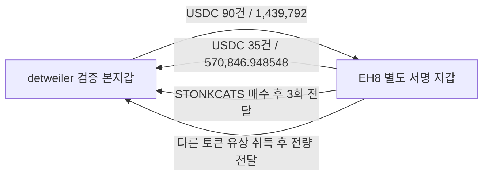
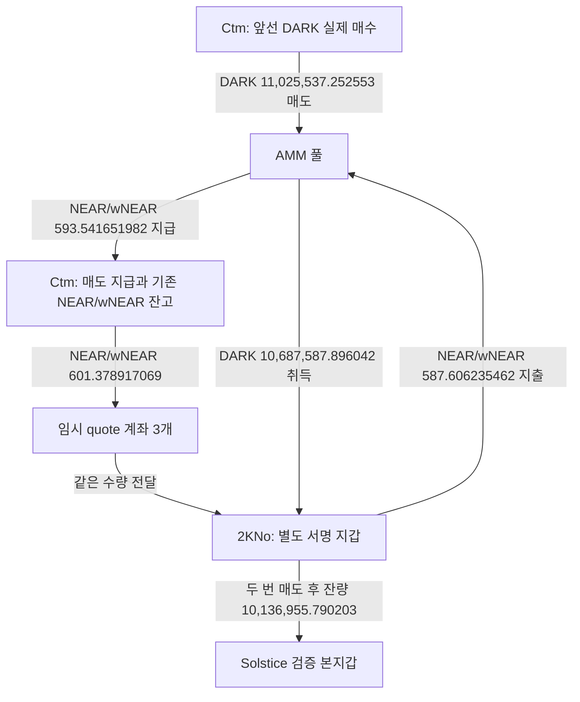

# 초기 10명: 연관된 별도 지갑 중심 추적

갱신: 2026-10-08. 고정 조사 구간은 **2026-08-08 04:43:41 UTC 이상, 2026-10-07 04:43:41 UTC 미만**이다. 처음 지정한 Top10 사용자 ID를 유지했고, 기존 5개 `gpt-6-luna / max` 작업자는 저장 자료를 읽기 전용으로 분석했다.

## 이번에 바꾼 판단 기준

**핵심은 Fomo 본지갑의 선매수 자체가 아니라, 본지갑과 연결된 별도 지갑의 실제 거래다.** 공급·반환·회수와 같은 토큰의 취득·처분을 먼저 확인한다. 본지갑 BUY→THESIS는 배경 시간표로 사용한다.

구분해야 할 두 가지가 있다. 다른 주소가 실제 거래한 사실과 본지갑에 자산을 보낸 사실은 온체인으로 확인할 수 있다. 그 주소를 같은 사람이 관리한다는 사실은 별도 증거가 필요하다. 매매 대행·플랫폼 관리·지갑 이전·발행자 배분·보상·브리지 서비스 가능성을 함께 남긴다.

| 연결 후보 | 확인한 사실 | 현재 판단 |
|---|---|---|
| detweiler ↔ EH8 | USDC 공급 90건, 반환 35건, STONKCATS 및 다른 토큰 매수 후 본지갑 전달 | 반복 자금·매매 실행 연결 확인. 개인 부지갑과 대행 역할은 미확정 |
| Ctm → 2KNo → Solstice | Ctm의 DARK 매도·quote 전달, 2KNo의 실제 DARK 매수·본지갑 전량 전달 | 별도 지갑의 실제 취득과 공급 연결 확인. 공동 서명·지갑 이전/서비스 대안 존재 |
| 6개 공급자 → 4X → detweiler | CODEC 잔고 집계 후 본지갑 전량 전달 | 집계·전달 확인. 실제 매수와 원가는 미확인 |

**새롭게 저시총 적격으로 승인한 사건은 없다.** 아래는 이미 본지갑과 연결된 지갑·정확 토큰 계좌의 기초 검증이다. 역사적 유통 시총 $1M 이하가 확인되기 전 신규 전체 토큰 시장 수집이나 BigQuery 군집 조회를 실행하지 않았다.

## 1. detweiler와 EH8: 반복 실행·반환

- 검증된 detweiler 본지갑: `EC2f5DnHzuNRit1ExqghSifDbp1wgrzktsRRZCtU92MJ`
- 별도 거래 지갑: `EH8pNWx5K5vCnnrNrraB4wR3ntJa3EUAV5rTH1Eq1KX`

EH8의 정확 USDC 계좌 661건과 주소 직접 이력 737건을 서명 기준으로 합쳤다. 중복 541건을 제외한 **857개 고유 거래**에서 양쪽 소유 토큰 계좌의 실제 이체를 대조했다.

| 방향 | 고유 전송 수 | 정확 수량 |
|---|---:|---:|
| detweiler → EH8 | 90 | 1,439,792 USDC |
| EH8 → detweiler | 35 | 570,846.948548 USDC |

반환 합계의 원시 정수는 `570846948548`, USDC 소수 자릿수는 6이다. 첫 반환은 5,000.927107 USDC, 마지막은 19,896.251409 USDC다. 공급과 반환의 차이 868,945.051452 USDC는 **관측 이체의 산술 차이**다. 채무·투자 잔액·매도 수익으로 해석하지 않는다.

### 두 번째 토큰에서 확인한 실제 취득·전달

정확 mint는 `8K5X85PAJHAAVSvYaAzgVPPAPsqqHmvx16ZyBiscYF8L`이다. 여기서 `8K5`는 주소 축약이며 확정한 토큰 이름이 아니다.

1. **9월 1일 08:41:43 UTC** — EH8가 단독 서명해 7.5 SOL을 wSOL로 감쌌다. AMM 경로 입력은 7.4625 wSOL, 별도 경로 수수료 이체는 0.0375 wSOL이었다. 중간 토큰 `Xsf…`는 순변동 0이며 최종 EH8 취득분은 **655,618.272880162개**다.
2. **08:43:57 UTC, 134초 뒤** — EH8가 위 취득분 전량을 검증된 detweiler 토큰 계좌로 직접 보냈다. EH8 해당 토큰 잔고는 0이 됐다.

확인 거래: [EH8의 유상 취득](https://explorer.solana.com/tx/287umBLNaQHRqpxcoMbmExLxmwCvBqExw7FNmWVqsPYuAsqTrGbfW1ZWTEeSeWy5mLBE66K1YVHqQHiYu6Jsg85F), [detweiler로 전량 전달](https://explorer.solana.com/tx/3Y2cWd3WP4beZ9b6JpRBundWAELDnEDU7qWgPkf9oT32dmHKadpwFFjG9SByjAqwR31nrPFx77dB5AvNdPUZy25).

EH8의 SOL 순변화 `-7504189272` lamports는 7.5 SOL 원금, 거래 수수료 13,272 lamports, 남아 있는 토큰 계좌 자금 4,176,000 lamports와 대조했다. USDC 공급·반환 총액을 이 SOL 주문의 재원으로 직접 귀속하지 않았다. USD 원가·수익은 계산하지 않았다.

이 mint의 보존 Fomo 게시·BUY 이벤트가 없어 공개 전 매수라는 시간 판정은 할 수 없다. 역사 유통 시총도 미확인이다. **STONKCATS 외에서도 매수 후 본지갑 전달이 반복됐다는 사실**이 이번 조사에서 유용한 새 근거다. STONKCATS 매수 3건은 모두 보존된 9월 16일 THESIS 이후였다는 기존 판정을 유지한다.

보존 근거: raw2453/2457, raw2459/2462, 독립 거래 조회 raw2475/2476. 기존 STONKCATS 방향 검토 raw2409를 재사용했다.

## 2. Solstice: 별도 지갑의 DARK 실제 매수와 공급

- 검증된 Solstice 본지갑: `4ugDhHJ8XDXAeABmrNmGffFaLbJb9BkPyiFGVSV9ocwo`
- 직접 공급 지갑: `2KNoBqc81eP9Narp8p77fgMYTncLGJRMt7xBGMZU52iF`
- 그 매수 자금의 직전 출처: `Ctm86tHoUygaxDRbt9ELRacLt8zYt8UsZHbq1HLddMGp`
- DARK mint: `7KEPApdbBMByrmqihz3bht2uMhFQcatjfSFQCKq66kH3`
- 결제 토큰 NEAR/wNEAR mint: `3ZLekZYq2qkZiSpnSvabjit34tUkjSwD1JFuW9as9wBG`. 아래 NEAR/wNEAR 수량은 달러 금액이 아니다.

정정(배치013): 정확 3ZLek mint는 Solscan NEAR / 공식 wNEAR 표기다. 이전 STONK 이름만 교정했고 수량·주소·raw는 유지했다. [새 보상 역할·시점 검토](top10-linked-wallet-prebuy-chronology.md)를 함께 읽는다.

### 실제 순서

| UTC | 확인 거래 |
|---|---|
| 10/1 18:17:26 | Ctm이 SOL 경로로 NEAR/wNEAR 231.010701107개 취득 |
| 10/1 18:17:54부터 | Ctm의 DARK 매수 시작. 보존 계좌에서 매수 9회·매도 7회, DARK 시작/종료 잔고 0 |
| 10/2 00:28:17, 슬롯 452448604 / tx index 234 | Ctm이 DARK 11,025,537.252553개를 풀에 매도. 풀 지급 NEAR/wNEAR 593.541651982개와 기존 잔고가 섞인 상태에서, 임시 계좌 3개를 통해 2KNo로 NEAR/wNEAR 601.378917069개 전달 |
| 같은 슬롯 / tx index 235 | 2KNo가 NEAR/wNEAR 587.606235462개를 지출해 DARK **10,687,587.896042개 실제 매수** |
| 그 뒤, 전송 전 | 2KNo가 두 차례 합계 DARK 550,632.105839개 매도 |
| 10/2 01:40:43 | 남은 DARK **10,136,955.790203개 전량을 Solstice 본지갑으로 전송** |
| 10/6 22:59:05 | 확보된 Solstice DARK THESIS. 절대 최초 공개라는 뜻은 아님 |

확인 거래: [Ctm 매도와 quote 전달](https://explorer.solana.com/tx/59jt7C7HBnbjf4ZGFFuwykTFnRKzn2YUh8rAyMM6e6yzcWZmhmyniMYWfaRaaiPfwgkthmQojLEXmC8oZZeCno8Z), [2KNo 실제 매수](https://explorer.solana.com/tx/3TDM6urbdPpJ3AacpTnnzYcfVkAx4oqurUJzGWnyX3XmeoKUpGSE5ZVGXXqtRNiUDN3XJzqCmULcD5mpcW9nmq4r), [Solstice로 전량 전달](https://explorer.solana.com/tx/1iZ877Z12puJ72nBG9KWHSjjy9Wc36oc4njgZpQzisWQN6B9uouUTZGwSoXuinhmwUYxSHeHTbEowwqW6EM5QJk).

매도와 quote 전달 거래의 서명자는 5개다. Ctm이 임시 계좌를 만들고 닫은 구조, 같은 슬롯의 연속 매도·재매수 때문에 **지갑 이전·공동 실행·서비스 역할**도 유력한 검토 대상이다. AMM으로 들어간 Ctm의 토큰 개체가 2KNo로 그대로 나왔다고 추정하지 않았다.

Ctm의 최종 매도 거래에서 본인 quote 계좌는 13.772681607 → 5.935416520 NEAR/wNEAR다. 풀 지급 593.541651982와 외부 전달 601.378917069을 각각 기록했으며, 최종 quote 순변화 `-7.837265087`을 추가 매수 비용으로 세지 않았다. Ctm의 앞선 9회 매수 quote 지출은 **420.455435402 NEAR/wNEAR**다.

2KNo의 exact DARK 계좌 전체 보존 이력은 매수 9회·매도 19회·Solstice 전달 1회다. 이 매도들은 10월 2일 활동으로, 보존 THESIS 이후 매도 정황이 아니다. 고정 종료 시점의 이 계좌 잔고 5,068.289664 DARK, quote 계좌 잔고 66.318026114 NEAR/wNEAR는 별도다. 아직 본지갑의 후속 처분과 연결해 원가·수익·CEX 귀결을 확정하지 않았다.

같은 `5tzFkiKscXHK5ZXCGbXZxdw7gTjjD1mBwuoFbhUvuAi9`에서 Ctm과 2KNo로 각각 0.038311·0.041831 SOL이 들어왔지만 역할은 미확인이다. 소액 공통 출처 하나를 동일인이나 같은 고객 CEX 계정 증거로 사용하지 않는다. Ctm의 실제 SOL 매수 자금 전체의 출처도 미확인이다.

현재 CoinGecko의 DarkSwap 데이터에는 유통량 0.0이 표시된다. 이는 과거 유통 시총 0달러 또는 $1M 이하를 증명하지 않는다. 기존 분봉은 가격 자료이며 역사 유통량·시총이 아니다. **DARK 시총 판정은 pending_cap을 유지한다.**

보존 근거: raw2452/2456, 2460/2463, 2461/2464, 독립 거래 조회 2465/2466, Ctm quote 2469/2472, 2KNo 주소 2470/2473, Ctm 주소 2477/2478. 기존 본지갑 전송 raw2281을 재사용했다.

## 3. CODEC: 실제 매수와 구분한 토큰 집계

`4X7FEZ283wQhRuyBjrgiNv76pnVasFXdRJqzFcG86HxY`의 정확 계좌에 9월 19일 14:15:05–14:17:10 UTC 동안 6개 송신자가 자기 계좌 잔액을 보냈다. 유입 합계는 **17,560,836.508432 CODEC**이고, 첫 관측 전 잔고 **2,500,000 CODEC**를 더해 **20,060,836.508432 CODEC**가 됐다. 마지막 유입 35초 뒤 4X가 이를 detweiler 본지갑으로 전량 전달했다.

[본지갑 전달 거래](https://explorer.solana.com/tx/4F5JCkWy4L7mjZSMkM9CKRYwJ5tBLD3D5NCtURyjzxyAMVxceWKAYarJtysXm5Ffxeb4dkMWrXzzYoYA64J9GZkG). 확보된 CODEC THESIS보다 17시간 4분 20초 전이다. 보존 거래 7건에는 실제 매수나 quote 지급이 없다. 5M 최대 공급 계좌의 추가 조회에서도 알려진 출금만 확인됐고, 이전 취득은 미확보다. 시작 잔고·과거 취득·서비스/집계 역할을 임의로 채우지 않는다.

THESIS 주변 보존 시총 표본은 약 $9.44M/$9.73M로 상한보다 높고, 엄격한 표본 시간 조건도 충족하지 않는다. 현재 저시총 적격 사건으로 승격하지 않았으며 우선순위를 낮춘다. 명단 밖 계정 전체나 60일 밖 이력을 자동 확대하지 않았다. raw2451/2455, 2471/2474, 기존 raw873/2147/2163을 보존했다.

## 제외한 신호와 남은 한계

- 공통 BTR 발행자 배분·5KX 다수 수신자 보상은 개인 funding으로 사용하지 않았다. EH8와 본지갑의 소액 ZEC 공동 수령도 같은 원칙을 적용했다.
- Relay의 F7/f70·7uTT 금고, Agm/Pimlico의 공유 실행·수수료 지급을 개인 지갑 연결로 승격하지 않았다.
- EH8의 기존 BitGo Custody 라벨 주소 `6cVV…`는 provider 주장이다. 실제 전송 근거와 별도로 고객 deposit·개인 통제는 미확인이고 이번에 새로 확인한 CEX 접점은 없다.
- Chrome의 EH8 페이지는 탐색 오류/빈 화면, Solana 거래 읽기는 이전 Base 화면이 반환돼 해당 거래 증거에서 제외했다. 정확한 신규 Solscan 탭을 확인한 뒤 공통 소액 공급자 페이지를 읽었지만 접근 화면만 확보했다. 브라우저 조회 실패를 라벨 없음·CEX 없음으로 해석하지 않는다.
- 페이지 종료를 확인한 것은 요청한 주소·계좌·필터다. `tokenAccounts=none` 주소 이력과 일부 정확 ATA의 합집합은 모든 과거 폐쇄 ATA·체인·60일 전체 지갑 거래 완료를 뜻하지 않는다.

## 저장과 다음 추적

원문 capture·정확 정수 수량·최종 지갑·UTC·거래 locator를 SQLite에 추가 보존했다. 기존 지갑 resolution 11행과 collector state 42행, 고정 표본 Fomo 이벤트 404건은 변경하지 않았다. 추가 매매를 Fomo 게시 이벤트에 임의로 연결하지 않았다.

1. **EH8:** 이미 확인한 공급·반환·매수/전달을 기반으로 플랫폼 실행 역할을 검토하고, 실제 후속 회수 상대와 본지갑의 정확 고객 CEX 입금 후보를 비교한다. 기존 완전 capture는 다시 조회하지 않는다.
2. **DARK:** Solstice가 받은 뒤 실제 매도한 거래의 quote 수령·혼합 잔고·개별 bridge 주문·회수 주소를 이어 붙인다. Ctm/2KNo가 같은 endpoint로 보내는지도 실제 전송과 고객 deposit 역할이 있을 때 비교한다.
3. **저시총 조건:** 별도 지갑 실제 매수/게시 시점의 역사 유통 시총이 확인된 사건부터 전체 시장 매수 군집을 확장한다. 현재 pending 사례를 적격 조사 성과로 세지 않는다.

같은 개인의 숨은 계정, 선행매수 의도, 동일한 정확 고객 CEX 입금 주소, 최종 USD 수익은 모두 **미확정**이다. 이번 성과는 **연결된 별도 지갑의 실제 거래와 자금·토큰 이동을 새로 확인한 것**이다.

### 본체 적재 기록

근거 raw2481, 검토 raw2482, state `initial_top10_linked_wallet_core_review_v1`. 실제 매매 44행·연결 43행을 추가했다. Ctm의 복합 최종 매도는 풀 지급과 외부 quote 전달을 검토 원문으로 보존하고, 단순 거래 행의 순수령으로 강제하지 않았다.

요청량: 직접 RPC 25/30, 시장자료 1/4, Chrome 예약 4/5(탭 읽기 포함, 실패 포함). Fomo·Nodit indexed·Bridge·BigQuery 신규 요청 0. 배치 종료는 이번 예약 회수·검토 완료이며 전체 지갑 history 완료가 아니다.
