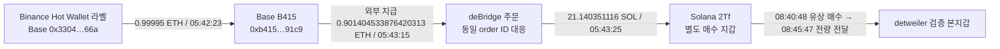
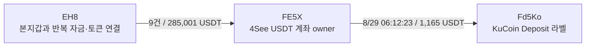

# 초기 10명: 별도 매수 지갑과 거래소·브리지 회수 경로

갱신: 2026-10-08. 배치 `top10-60d-20261008-v1-batch011`.

조사 표본은 SQLite raw141의 원래 Top10 사용자 ID다. 고정 구간은 **2026-08-08 04:43:41 UTC 이상, 2026-10-07 04:43:41 UTC 미만**이다. 모든 시각은 UTC이며, 이후 활동을 이 구간에 섞지 않았다. 기존 5개 `gpt-6-luna / max` 작업자가 저장 원문을 분석했고 본체가 외부 조회·거래 검증·DB 저장을 담당했다.

## 이번 조사에서 확인한 내용

**detweiler 본지갑으로 토큰을 공급한 별도 지갑 2Tf의 실제 유상 매수와 전량 전달을 확인했다.** 이 지갑의 첫 자금 유입은 Base의 Binance 핫월렛 라벨 주소에서 시작해 B415의 실제 deBridge 주문을 거쳐 Solana로 이어진다. EH8의 반복 USDT 전송 상대 FE5X에서는 KuCoin Deposit 라벨 주소로 보내는 실제 전송도 확인했다.

다른 주소의 거래와 본지갑 연결은 확인됐지만 **같은 개인이 소유한 뒷지갑이라는 판정, 최초 공개 전 매수, 공통 고객 CEX 입금 주소, 선행매수 의도와 실현 USD 수익은 아직 미확정**이다. 플랫폼 매매 실행·대행·자금 이전 가능성을 함께 남긴다.

| 대상 | 확인한 사실 | 남은 판단 |
|---|---|---|
| 2Tf → detweiler | 21 SOL 원금으로 8K5 취득, 299초 뒤 취득분 전량 전달 | 주소 통제 주체·대행 여부·최초 공개 시각 |
| Binance 라벨 → B415 → 2Tf | Base 송금, 같은 deBridge 주문, 실제 Solana 수령 대응 | 출금한 고객·주소 소유자·개별 자금 lot 귀속 |
| EH8 → FE5X → KuCoin 라벨 주소 | 9회/285,001 USDT 전송, 별도 1회/1,165 USDT CEX 라벨 주소 전송 | 본지갑과 동일 고객 deposit인지, 자금 혼합 속 귀속 |
| detweiler 8K5 | 33 BUY·28 SELL, 토큰 계좌 0으로 끝남 | 공급자별 매도대금·수익, 후속 Relay 목적지 |
| Solstice DARK | 공급 후 두 차례 추가 BUY, 최종 관측 12,322,842.052719개 | 고정 구간 이후 처분은 별도 조사 필요 |

8K5와 DARK는 역사적 유통 시총이 여전히 `pending_cap`이다. 아래는 이미 연결된 주소·정확 토큰 계좌의 기초 검증이며, **시총 $1M 이하가 확인된 신규 전체 시장 군집 조사로 분류하지 않는다.**

## 1. 2Tf의 실제 매수와 detweiler 본지갑 전달

- 검증된 detweiler: `EC2f5DnHzuNRit1ExqghSifDbp1wgrzktsRRZCtU92MJ`
- 별도 매수·서명 지갑: `2TfNQKaAHqAMtUmTMsFwmNABp29x5PFrGEmAJB3kNFtp`
- 정확 mint: `8K5X85PAJHAAVSvYaAzgVPPAPsqqHmvx16ZyBiscYF8L`, decimals 9
- source 토큰 계좌: `G1NjsjMsf7zKUd42fGdh54eMzEMtBRs2Xkh6vWrNaMnY`
- 본지갑 토큰 계좌: `8RXurYS7xzBhKhKoMHRakQGFL1iHZMWgbva9KBkHR1Wc`

`8K5`는 mint 주소의 축약이며 확정된 토큰 이름이 아니다.

| 시각 | 실제 거래 | 수량·대가 |
|---|---|---|
| 9/1 08:33:11 | 본지갑의 이 계좌 첫 BUY | 2Tf 매수보다 먼저 발생 |
| 9/1 08:40:48 | 2Tf 서명 BUY, 해당 토큰 계좌 0→취득 | **1,871,224.456686468개**, wrapped 원금 21 SOL |
| 9/1 08:45:47 | 2Tf 서명 직접 전송, source 토큰 잔고 0 | 위 취득분 **전량**, 본지갑 수령량 동일 |

매수와 전달 간격은 **299초**다. [실제 매수 거래](https://explorer.solana.com/tx/548opA8YMSQnqnAXX5Fo2rUcZ1Rj9CU85aoEm1MP9baaE6Uee5d1T7D1npsAMBuTiRsMcfp36nhLnRYE9sKzg4F8), [본지갑으로 전량 전달한 거래](https://explorer.solana.com/tx/2oR5bmxM46dtX476tkQ6jDt4bcx3uuTBran5wyeZGtZBbVAg1DahDEEWmac8y9orRLpY8w35gLrjvCHeo1NbW6eh).

21 SOL 중 실제 AMM 입력은 **20.895 wSOL**, 별도 주소 지급은 **0.105 wSOL**이다. 별도 지급의 용도는 미확정이다. 2Tf native 잔액 감소 21.004200481 SOL에서 네트워크 수수료 0.000024481 SOL과 계좌 rent 0.004176 SOL을 분리했다. 중간 mint `Xsf…`의 최종 순변동은 0이므로 최종 취득 토큰으로 세지 않는다.

이전 배치에서 확인한 EH8의 655,618.272880162개 전량 전달도 본지갑의 같은 토큰 계좌로 들어왔다. **2Tf와 EH8 모두 본지갑의 첫 BUY보다 뒤에 매수했다.** 확보된 Fomo 기록에 이 mint의 정확한 공개 event가 없어 공개 전 매수 여부는 판정하지 않았다.

근거: indexed raw2492, 독립 getTransaction raw2501·2502, 본지갑 raw2486. signer·과거 owner·source/recipient 잔액과 전량 일치를 대조했다.

## 2. 첫 자금의 원래 송신자는 Base B415

공유 deBridge 지급자만 따라가지 않고 실제 원래 주문 송신자를 찾았다.

| 단계 | 정확 주소·거래 | 검증 내용 |
|---|---|---|
| 거래소 라벨 출처 | `0x3304e22ddaa22bcdc5fca2269b418046ae7b566a` → `0xb4156f783c682b1a5edf2691cb07278f12d991c9` | Base, 9/1 05:42:23, 실제 **0.99995 ETH**. [거래](https://basescan.org/tx/0xe0660854e1d7cc8e603fa4cb79a2785b526dc436bc29109d0222304ec380ccda) |
| 원래 주문 송신 | B415 → `0x663dc15d3c1ac63ff12e45ab68fea3f0a883c251` | Base, 05:43:15, 외부 tx value **0.901404533876420313 ETH**. [거래](https://basescan.org/tx/0xa9965239e09335ea6e03000eeaa79fa0aba9f553ae2a2abac940543cb72dd7b6) |
| 실제 Solana 수령 | 서비스 fulfiller `2snHHreXbpJ7UwZxPe37gnUNf7Wx7wv6UKDSR2JckKuS` → 2Tf | 05:43:25, **21.140351116 SOL**. [거래](https://explorer.solana.com/tx/7sBAyZW2QwrDFa6evabgPvJyGK3GCBzKE7AhdFtA7VLBMweUFkHBDQdJgXZYrpYRbpfNbVd9o4PdFwtAH9F2MMp) |

주문 ID는 `0x5949c0ea79942f8a94927f5080f94d27099cdbaaa859f7908291938266a0d145`다. Bridge provider의 resolved/completed 응답, Base 성공 receipt의 주문·수령 공개키 bytes, Solana 성공 로그의 같은 주문 ID와 실제 native 수령량을 대조했다.

원문 근거는 Bridge raw2507, Base tx/receipt/block raw2508–2510, Solana getTransaction raw2511이다. 선행 Base 입금은 Chrome raw2516의 **Binance Hot Wallet 라벨**과 독립 RPC raw2517–2519를 분리해 저장했다. 화면의 1 ETH는 반올림 표시였으며 실제 0.99995 ETH로 바로잡았다.

이는 **거래소 라벨 주소 → 지갑 출금 방향**이다. 고객 CEX 입금이나 고객 신원 증거는 아니다. 주문 내부 USDC 입력 2,222.026022와 route 2,233.110959는 외부 지갑의 ETH 지급과 별도 자산 단계다. 이를 USD 원가로 쓰지 않는다. 시간 순서와 실제 주문 연결은 확인됐지만 B415와 2Tf·본지갑의 동일 개인 소유, 첫 지급분의 매수 lot 귀속은 미확정이다.

### 나머지 자금 유입과 반복 전송

2Tf 주소의 고정 구간 54행 및 빈 종료 페이지에서 **11건/599.066033298 SOL**의 실제 deBridge `FulfillOrder Native Flow` 수령을 확인했다. 원래 source 주문을 대응한 것은 위 1건이다. 다른 10건 중 2건은 Bridge 도구가 unsupported/unresolved를 반환했고, 8건은 주문 조회를 하지 않았다. 공유 fulfiller의 전체 자금을 한 사람의 자금으로 귀속하지 않는다.

2Tf가 서명해 다음 네 주소에 보낸 native SOL은 **7건/577 SOL**이다.

| 정확 수령 주소 | 건수 | SOL | 관측 시각 |
|---|---:|---:|---|
| `8eHfCkYzY6m7XrgZCmD4ZWuit3JswT37PX65Ma24u3ZY` | 3 | 212 | 9/8 09:16:56, 9/13 06:50:25·16:08:28 |
| `55n5jK7hvQSvMWkphF9n82K3WyudoTfkxuz52rwCGi3A` | 2 | 200 | 9/26 07:34:59·13:38:08 |
| `BxM9sd8h5E8K14YM7CArXm5bivNCVp7gbV2CXf4pcNgG` | 1 | 50 | 9/12 07:04:29 |
| `B92h7JQM7Gw3gnGgQUq7cymgC7XQhoyrcCGMveFP83z6` | 1 | 115 | 9/18 06:21:27 |

실제 System transfer、2Tf 서명과 recipient 잔액 증가를 대조했다(raw2495, footer2496). 수령 역할·CEX 여부·특정 토큰 매도대금 귀속은 unknown이다. 8eHf Chrome 조회는 timeout/탭 접근 실패(raw2520)로 라벨을 확인하지 못했다. 유사 주소의 극소량 dust는 위 자금 연결에서 제외했다.

## 3. EH8 반복 송금 상대와 실제 KuCoin 라벨 주소 전송

- EH8: `EH8pNWx5K5vCnnrNrraB4wR3ntJa3EUAV5rTH1Eq1KX`
- recipient USDT 토큰 계좌: `4SeeEG6cbkynb4Gr6y2kMTy77Lg9NECYtfBfMR6jNFXb`
- 이 계좌의 역사적 owner: **`FE5X4YZ8HX1CdJC91oQMnSjSewgsyJiFYZWoxbuuxYTT`**
- KuCoin Deposit 라벨 endpoint: **`Fd5KozoQpRMqgACQt7BsZsNSkz9fJVRhTey2vBedDueN`**

4See는 지갑 owner가 아니라 토큰 계좌다. EH8→FE5X의 직접 USDT 전송은 **9건/285,001 USDT**다. 8/26 60,001, 8/31 50,000, 9/4 75,000, 9/9 100,000 USDT로 합산된다. 실제 signer/authority·recipient owner·raw 수량과 잔액 변화를 대조했다. raw2484/2488 및 1 USDT 표본의 독립 RPC raw2505가 근거다.

**8/29 06:12:23**, FE5X가 서명해 위 정확 Fd5Ko endpoint 소유 토큰 계좌로 **1,165 USDT**를 보냈다. [확인 거래](https://explorer.solana.com/tx/4hwLwGBsvbVbMt3aQRmnZAeKswg6rzyr7V57BjKLQBPr7kUwCLGLaJoJYfqM2FLQ5eo66NxPBsqorbriDWCC8UQX). FE5X 잔고 46,605.178397→45,440.178397, recipient 0→1,165를 확인했다. indexed raw2487/data51과 독립 getTransaction raw2504가 일치한다. Chrome Arkham raw2494의 정확 상대 주소 링크에 **KuCoin Deposit** 라벨이 표시됐다.

FE5X의 이 USDT 계좌에는 185개 유입 전송 leg/744,157.497552 USDT와 27개 유출 leg/739,375.309357 USDT가 있다. source 계좌는 67개다. 여러 상대의 자금이 섞이므로 FE5X를 EH8 전용 고객 입금 주소로 판정하지 않는다. 이후 8/31·9/4·9/9 전송분은 8/29 KuCoin 전송보다 늦다. **285,001 전체가 1,165 송금의 재원이라는 의미가 아니다.**

KuCoin 라벨은 Arkham의 주장이고 RPC는 전송을 검증한다. 본지갑과 같은 정확 고객 CEX deposit이라는 연결은 아직 확인되지 않았다. 기존 BitGo Custody 라벨 주소 역시 고객 CEX 역할이 확정된 것은 아니다.

## 4. 공급받은 8K5의 본지갑 처분과 후속 Relay 입금

본지갑의 정확 8K5 계좌 63거래와 빈 종료 페이지(raw2486/2490)를 대조했다. **33 BUY·2개 외부 전량 공급·28 SELL**이다. 시작·마지막 잔고는 0이며, 세 차례 잔고 0 이후 새로 매수한 구간을 구분했다.

| 항목 | 관측 수량 |
|---|---:|
| 본지갑 자체 BUY의 owner USDC 순지출 합계 | 155,049.999996 USDC |
| SELL 거래의 owner USDC 순수령 합계 | 185,315.733476 USDC |
| 첫 구간의 잔고 0 매도 | 9/1 16:53:36, 2,652.989150 USDC 수령 |
| 두 번째 구간의 잔고 0 매도 | 9/3 00:10:50, 3,138.354164 USDC 수령 |
| 마지막 잔고 0 매도 | 9/9 07:42:10, 6,344.967629 USDC 수령 |

[첫 잔고 0 매도](https://explorer.solana.com/tx/3sh9p7f9wNXXsgJ9oa6QyHmXm4xEyCUEzEejmb7sMhym7YLvs1ZYGchiH3jCiUNaDzaixwvGxDKqZmnM4HuZyfTJ), [마지막 잔고 0 매도](https://explorer.solana.com/tx/5XjURGf3C7Qd8S4JzMEUY1Y7Z1H6wQ56uRdS1fhgP3PxaRdHMT1wFBRTahUJ1kGdBMR7zbYRWLAQZ5Kn8n3YarTa). 첫 잔고 0 매도는 독립 RPC raw2503으로도 대조했다.

EH8 전달 전 이미 본지갑 자체 매수 5건/5,100 USDC로 5,966,792.935166106개를 보유했다. 이후 EH8·2Tf 공급분과 추가 본지갑 매수분이 섞인다. 위 수령·지출 차이는 공급자별 원가·quote·네트워크 비용·기존 재고를 반영한 실현 수익이 아니다. **개별 공급 lot 매도대금이나 USD PnL은 계산하지 않았다.**

같은 본지갑 USDC 계좌의 후속 Relay source deposit은 저장 원문에서 다음 두 건을 찾았다.

| 시각 | 수량 | 매도와의 간격·상태 |
|---|---:|---|
| 9/1 19:41:00 | 3,500 USDC | 첫 잔고 0 매도 후 2시간 47분 24초. [입금 거래](https://explorer.solana.com/tx/4YSW44WVZN4q5NxjBT9DJ5hCCiLTV38shTPKfQQ4BXLJ7LiZy2PSXo2BYHEzygXzyFHrRUanVuV6Wkkt35NUsiov) |
| 9/9 09:23:26 | 2,500 USDC | 마지막 매도 후 1시간 41분 16초. [입금 거래](https://explorer.solana.com/tx/5uhwQVPzya9UZoLNZAR2VnjxEcY3RBVxMEwbhNmc6Ma1zrQk3fgNjPGqLVcnaisDDdBZxTxtyKVPjrxGGsuWVSkM) |

실제 source는 본지갑 `Ctf…` USDC 계좌, recipient owner는 shared Relay vault `7uTT8Xi5RWXzy7h9XL244GRgEycDYDhLjr3ZyNdXi8pZ`다. raw879/data19와 raw876/data84의 성공·서명·compiled SPL TransferChecked bytes·과거 owner·정확 잔액 변화·DepositToken instruction을 검증했다.

두 Bridge 조회(raw2514/2515)는 HTTP 200이지만 **`unresolved / relay_status_destination_chain_is_not_mapped`**였다. 입금 자체는 확인됐고 목적지 해석이 미완료다. source TRANSFER만 저장했고 destination BRIDGE edge를 임의로 만들지 않았다. USDC 혼합 잔고 때문에 이 두 입금을 특정 8K5 매도 lot의 회수로 확정하지 않는다.

## 5. DARK: 고정 구간에는 본지갑 처분이 관측되지 않음

Solstice 검증 본지갑 `4ugDhHJ8XDXAeABmrNmGffFaLbJb9BkPyiFGVSV9ocwo`의 정확 DARK 계좌 `FE4h8SmxyKes1KkrG3Y6YsavGhGr3SnxEUzaHJ3e7zCg`를 이어 조회했다. mint는 `7KEPApdbBMByrmqihz3bht2uMhFQcatjfSFQCKq66kH3`, decimals 6이다.

| 유입 | 토큰 수량 | 대가 |
|---|---:|---:|
| 10/2, 2KNo 공급 | 10,136,955.790203 | 전달 대가 미확정 |
| 10/3 본지갑 BUY | 234,073.819331 | 273.968614 USDC |
| 10/4 22:16:17 본지갑 BUY | 1,951,812.443185 | 3,123.595706 USDC |
| 마지막 관측 잔고 | **12,322,842.052719** | 처분 없음 |

raw2281/2287과 raw2485/2489는 인접 구간이며 정확 계좌의 성공 거래는 세 건이다. 마지막 관측 이후 고정 cutoff까지 SELL·토큰 유출이 반환되지 않았다. raw2231의 기존 9개 STONKCATS SELL에서도 DARK 잔액 변화는 0이다. 다른 토큰의 매도를 DARK 처분으로 쓰지 않는다.

기존 작업 명세의 시간 표기를 수정했다. epoch `1791152177`은 **2026-10-04 22:16:17 UTC**이며 13:22:57이 아니다. 이전 frozen packet은 보존하고 이번 검토에서 명시적으로 교정했다. 이 결과는 해당 정확 계좌의 성공 거래 scope이며, 모든 토큰 계좌·전체 지갑·cutoff 이후의 처분 부재는 아니다.

## 6. 찾은 것과 아직 조회하지 못한 것

| 질문 | 현재 상태와 한계 |
|---|---|
| 별도 지갑이 실제 대가를 지불해 본지갑에 토큰을 공급했나? | 2Tf와 EH8에서 확인. 같은 개인의 사적 지갑인지는 미확정 |
| CEX 연결은 없나? | Binance 라벨 주소 출금→B415와 FE5X→KuCoin 라벨 endpoint 전송을 확인. 방향·고객 귀속은 별도 |
| 본지갑과 후보가 같은 customer deposit에 입금했나? | 아직 확인되지 않음. 본지갑 USDC 60일 전체를 끝까지 읽은 상태가 아님 |
| 2Tf의 반복 수령인 8eHf·55n은 CEX인가? | actual 전송 확인, 역할 unknown. 8eHf는 Chrome 접근 실패, 55n 역할 조회는 남아 있음 |
| 매도 뒤 Relay 목적지는 어디인가? | source 입금 2건 확인, 도구의 chain mapping 미지원으로 destination 미해결 |
| 다른 10개 deBridge 지급의 original source는? | 2건 unsupported 조회, 8건 미조회. 입금 부재가 아님 |
| 최초 공개 전 같은 토큰을 산 것인가? | 8K5 정확 public event 미확보. 본지갑 첫 BUY 기준으로는 두 공급자의 BUY가 뒤임 |
| 당시 유통 시총이 $1M 이하인가? | 8K5·DARK pending_cap. 확정 저시총 사례나 조작 사례로 승격하지 않음 |

본지갑의 정확 USDC 계좌는 raw2497–2500으로 **4,000개 고유 거래**를 받았지만, 마지막은 **8/30 22:04:42 UTC**다. cursor `442988166:1157`가 남아 있어 이후 9월·10월이 미완료다. 이 prefix에서 FE5X·Fd5Ko·기존 BitGo endpoint 등의 일치가 없더라도 60일 전체의 부재 증거로 쓰지 않는다. Chrome raw2506의 보이는 전체 기간 상대방 요약 일부 역시 전체 거래 이력이 아니다.

정확 ATA 페이지 종료는 provider가 지정 필터에 반환한 성공 거래 페이지를 끝까지 회수했다는 뜻이다. 다른 ATA·닫힌 계좌·provider 누락과 전체 지갑 60일 coverage는 별도다. 실패 거래는 경제적 성공 매수·전송으로 적재하지 않았다.

## 7. 저장과 다음 조사

- 검토 raw **2522**, 근거 raw **2521**, state `initial_top10_linked_wallet_exit_review_v1`.
- 새 actual onchain trade **62건**, wallet trace edge **22건**을 additive로 저장했다. 기존 collector state **43개**, wallet resolution **11행**과 Fomo 고정 표본 **404건**(전체 1,338건)을 보존했다. 지갑 ownership을 승격하지 않았다.
- Bridge·Chrome·RPC의 역할과 원문 위치, 정확 raw 수량·UTC·미해결 원인을 함께 보존했다. 근거와 5개 작업자 결과는 ignored `data/research/parallel/top10-60d-20261008-v1-batch011/`에 있다.
- 실제 사용: direct RPC **28/30**, Bridge **5/5**, Chrome 직접 탐색 **4/5**(접근 실패 포함). Fomo·Nodit indexed·시장·BigQuery 신규 요청은 0회다. 인증 실패한 Nodit 키를 반복 재시도하지 않았다.

다음 배치는 아래 순서로 필요한 좁은 조회를 새 예산에 예약한다.

1. **2Tf→8eHf 212 SOL/3건과 →55n 200 SOL/2건의 정확 수령 역할·후속 회수**를 확인하고 본지갑의 동일 endpoint 사용을 비교한다. 같은 거래소 이름이나 핫월렛 겹침은 customer deposit 겹침과 구분한다.
2. **본지갑 Relay 두 주문**을 저장된 실제 deposit/order ID에서 지원되는 provider 경로로 대응한다. 미지원 도구를 같은 입력으로 반복하지 않는다.
3. **다른 10개 2Tf 지급의 original 주문 송신자**를 정확 order ID로 확인한다. 공유 fulfiller 전체 이력으로 확대하지 않는다.
4. 본지갑 USDC는 첫 네 페이지를 다시 받지 않고 **필요한 exit/CEX 시간 창만 좁혀 조회하거나 저장 cursor에서 재개**한다. 완료 checkpoint는 미완료를 유지한다.
5. DARK cutoff 이후는 별도 고정 증분 구간을 만들 때 조사한다. 기존 60일 원문을 재수집하지 않는다.
6. 정확 공개 시간과 역사적 유통 시총 $1M 조건을 보완한 뒤에만 신규 전체 토큰 군집·BigQuery를 배정한다.

초기10명 범위를 유지한다. 단독 RZD 예약과 Top100 확대를 재개하지 않았다. 이번 검증은 저장 원문의 서명·owner·수량·시간·잔액·주문 연결 assert 대조이며, 신규 수집기 구현이나 정식 테스트 스위트 실행은 하지 않았다.
