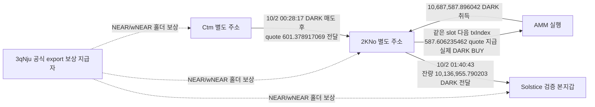

# 초기 Top10 연관 지갑의 매수 시점·보상 역할 검토 — 배치013

작성: 2026-10-08T09:09:09.418Z. 초기 raw141의 사용자 ID 10명을 유지했다. 고정 조사 구간은 **2026-08-08 04:43:41 UTC 이상, 2026-10-07 04:43:41 UTC 미만**이다. 기존 5개 `gpt-6-luna / max` 작업자가 저장 근거를 검토했고, 본체가 Chrome·RPC 조회와 SQLite 적재를 담당했다.

근거 raw2590, 검토 raw2591, 재개 상태 `initial_top10_linked_wallet_prebuy_chronology_v1`. 이전 [공통 Binance 라벨 입금 주소 조사](top10-repeated-exit-endpoint-review.md)는 재사용했다.

> 2026-10-08 종합 대조 정정: DARK 본지갑의 가장 이른 보존 실제 매수는 10/3 23:40:48 UTC(raw2281)다. 10/4 거래를 첫 매수로 표현했던 부분을 정정했다. [전체 현황 보고서](research-status-report-2026-10-08.md)를 함께 읽는다. 기존 검토 원문 raw2591과 보고서 원문 raw2592는 당시 기록으로 보존한다.

## 1. 핵심 결과

- **8eHf의 실제 단일 매수·매도 29건**을 확인했다. STONK 6Gm 8 BUY·11 SELL, 8K5 4 BUY·3 SELL, CARDS 1 BUY·2 SELL이다. 추가로 detweiler 본지갑의 앞선 STONK BUY 1건을 직접 대조해 **새 canonical trade 총 30건**을 저장했다. CARDS 처분과 별도 SOL 지출을 합친 거래 1건은 전체 취득 토큰을 CARDS 매도대가로 귀속할 수 없어 복합 경로 근거로 따로 남겼다.
- **8eHf의 8K5 첫 매수는 본지갑보다 15분 13초 늦다.** 본지갑 매수에 앞선 뒷지갑 선행매수라는 판단을 지지하지 않는다. EH8·2Tf의 실제 취득 후 본지갑 전달은 기존 사실이며, 이 둘의 매수도 본지갑 최초 보존 매수 뒤다.
- **DARK의 Ctm·2KNo·Solstice는 같은 공식 홀더 보상 지급자로부터 토큰을 받은 거래가 확인됐다.** 공통 지급자는 개인 funding/동일인 증거에서 제외한다. 기존 유상 DARK 매수와 2KNo→Solstice 1,013만 DARK 전달은 별도 거래다.
- **DARK 결제 토큰 이름을 정정했다.** 정확 mint `3ZLek…`를 이전 보고서에서 STONK로 표시했으나 Solscan은 NEAR, 공식 보상 문서는 wNEAR로 표시한다. 실제 STONK `6Gm…`와 다른 자산이다. 정확 mint·원시 수량·시각은 바뀌지 않는다.
- STONK의 8월 21일 역사 시총 시간 표본은 **약 $5.60M~$7.19M**다. $1M 이하 조사 확대 대상으로 우선하지 않는다. 매수에 가장 가까운 시총 표본도 300초 조건 밖이므로 기존 canonical `pending_cap`은 유지했다. DARK는 역사 시총 응답이 비어 있어 보류한다.

이번 결과는 별도 지갑의 실제 매매와 서비스 보상을 구분하는 근거다. 동일 개인 소유, 선행매수 의도, 공통 거래소 고객이나 실현 USD 수익을 확정한 결과는 없다.

## 2. detweiler 연결 지갑: 실제 매수 순서

검증된 본지갑: `EC2f5DnHzuNRit1ExqghSifDbp1wgrzktsRRZCtU92MJ`. 별도 주소: `8eHfCkYzY6m7XrgZCmD4ZWuit3JswT37PX65Ma24u3ZY`. 8eHf는 이전에 2Tf로부터 3회·212 SOL을 받은 연결이 있으며, 55n과 같은 정확한 Binance 라벨 주소 8FXdW1로 전송했다. 그 연결은 특정 토큰의 원가·매도대금·개인 소유를 자동 증명하지 않는다.

### 8K5 — 본지갑 최초 매수 뒤 별도 지갑들이 거래

정확 토큰 mint: `8K5X85PAJHAAVSvYaAzgVPPAPsqqHmvx16ZyBiscYF8L`. 확정 이름 대신 주소 축약으로 표시한다.

| 2026-09-01 UTC | 실제 활동 | 해석 |
|---|---|---|
| 08:33:11 | detweiler 최초 보존 native BUY, 200 USDC 지급 | raw2486 data[0], 기존 33 BUY/28 SELL 조사 재사용 |
| 08:40:48 | 2Tf 21 SOL 지급 실제 BUY | 본지갑보다 늦음, raw2501 |
| 08:41:43 | EH8 7.5 SOL 지급 실제 BUY | 본지갑보다 늦음, 기존 raw2475 |
| 08:43:57 | EH8 취득분 전량 본지갑 전달 | 기존 raw2476 |
| 08:45:47 | 2Tf 취득분 전량 본지갑 전달 | raw2502; 299초 뒤 |
| 08:48:24 | 8eHf 10 SOL 지급, 729,024.251719156개 취득 | [거래 확인](https://solscan.io/tx/5CJSwEF7Kp9hiWs4EruqSM897iK8t1ix4PFBBWgKUWayyCKCffLaUAPF1Tu2dZ2tKhhJeexsRYbACMJ6QydBCVpS), raw2577 |
| 09:10:56 | 8eHf 364,512.125859578개 매도 | [거래 확인](https://solscan.io/tx/5BDFuwXucbX45DcmRaS3cvLJYTGNmizHuhi9kbqePFL5qpChFvDy7rnq1jLjLgrTG2V4w8XB232oQ8cF9DHfCAy1), raw2578 |

8eHf 첫 매수에서 10 SOL 중 9.95가 swap 경로, 0.05가 별도 경로 수수료다. 네트워크 수수료·계좌 자금은 매수 원금에 더하지 않았다. **22분 32초 뒤 최초 취득량의 절반에 해당하는 수량을 매도**했다. 14.650901198 WSOL 지급에서 경로 수수료 0.073254505를 제외한 실제 owner 수령은 **14.577646693 WSOL**이다.

이후 추가 매수·매도·LP 활동이 섞이며 위 한 거래를 전체 수익으로 확대하지 않는다. 9/8 매수와 9/10 매도는 XSF mint를 대가로 썼으므로 SOL 금액으로 더하지 않는다. 정확 8K5 계좌 31행은 4 매수·3 매도 외에 LP/claim 양수 13행·음수 2행·target 변동 0인 9행을 포함한다. 잔액 연결 잔차는 0이며 마지막 관측 잔고는 **1,201.237640692개**다. LP에서 받은 물량을 새 매수로 세지 않았다.

보존 Fomo 이벤트에서 이 정확 mint의 BUY·SELL·THESIS는 **0건**이다. 온체인 실제 매수는 확인되지만 앱에서 언제 노출됐는지, 절대 최초 CALL은 아직 판단할 수 없다. 실제 8eHf→본지갑 8K5 직접 전달도 이번 정확 계좌 근거에서는 확인하지 못했다. 주소·계좌별 종료는 모든 자산의 부재 증명이 아니다.

### STONK 6Gm — 본지갑보다 늦고, 저시총 확대 우선순위를 낮춤

정확 mint: `6GmAFSYs4gk3FDao5FzzySQpPZaWsa4rUJHacpMpUNgx`. DARK 결제 토큰 3ZLek와 구분한다.

| UTC | 실제 거래 | 대가 | 근거 |
|---|---|---|---|
| 2026-08-08T06:50:17Z | 본지갑 441,144.329028711 STONK 취득 | 3,744.055704 USDC | [거래 확인](https://solscan.io/tx/29FSam4i6g3U6KLMo7f8ufwkggxdDqp1sd79RH6NVXVJnw38ubZJN9So4XgW5n5HKQvyjC1z7qvSxARNLWrZ4Zy1), raw2574 |
| 2026-08-21T14:46:13Z | 8eHf 334,858.088145748 STONK 취득 | 30 SOL, 경로 29.97+수수료 0.03 | [거래 확인](https://solscan.io/tx/64xkEX6mJka12sTygQv96bWV6DbYAyFQ1SS5SAbo8G5jhuFtjRyMymrP6MgwJFBFomJQdhVBHqbRpkSvKu3g5hh5), raw2572 |
| 2026-08-26T22:26:06Z | 8eHf 69,000 STONK 매도 | 9.427616094 WSOL net 수령 | [거래 확인](https://solscan.io/tx/5adwE65qCVskKDizZNkiGjD9thY3hVxwLaUAfgwGTSewVL9Wa9MhFVDQVR53YJ1Jn78d5nx2BkLpPn3xYQxNedB3), raw2573 |

본지갑 8/8 매수는 이번 60일 안이다. 별도 보존된 8/5 매수는 기간 밖 문맥으로만 사용했다. 8eHf의 8/21 매수는 본지갑보다 뒤이고 보존된 본지갑 10/3 THESIS보다 앞이다. **보존 THESIS 이전 보유**와 **본지갑 매수에 앞선 선행 취득**은 구분한다. 전체 최초 공개는 확인되지 않았다.

CoinGecko exact coin `stonk-3`의 8/21 시간 표본 25개의 유통 시총 범위는 **$5601481.263055175~$7188296.609170818**(raw2581)다. 마지막 매수 전 표본은 14:00 UTC 약 $6.364M, 매수 2,773초 전이고 다음 15:00 표본은 약 $7.012M, 매수 827초 뒤다. 300초 조건은 시총 표본의 시간 근접성 기준이며 60일 선행매수 조회 범위를 줄이는 조건이 아니다. 당시 정확 분초의 확정 시총으로 승격하지 않았고, $1M 이하 적격으로 승인하거나 신규 전체 시장 데이터를 수집하지 않았다.

## 3. DARK: 공통 보상 지급자를 개인 공급자로 오인하지 않음

[DARK 공식 문서](https://darkswap.app/docs), [보상 대시보드](https://rewards.darkswap.app), [공개 지급 원문](https://rewards.darkswap.app/api/rewards/proof)을 확보했다(raw2583/2584/2588). 문서는 홀더 wNEAR 지급, 마케팅 DARK 에어드롭, treasury/LP를 구분한다. 현재 정책 설명을 과거 모든 날짜에 자동 적용하지 않았다.

공개 export 6,824 receipt행에서 Ctm 2·2KNo 2·Solstice 12로 **총 16행**이 맞았다. 그중 고정 cutoff 안은 provider createdAt 기준 **14행**, 뒤는 2행이다. 첫 지급 각 1건, 총 3건을 독립 getTransaction으로 대조했고 나머지 13행은 제공자 주장으로 남겼다. 고정 구간 안만 세면 RPC3·제공자만11이다. `firsts` 3행은 16행 안의 부분집합이므로 19행으로 더하지 않는다.

| 실제 blockTime UTC | 실제 recipient owner | NEAR/wNEAR 수량, decimals 9 | 확인 거래 | 독립 RPC |
|---|---|---|---|---|
| 2026-10-01T20:48:06Z | `Ctm86tHoUygaxDRbt9ELRacLt8zYt8UsZHbq1HLddMGp` | 1.250323393 | [거래 확인](https://solscan.io/tx/3caJvWmDrz7Bxm4574fxJqChHxA6Jizp2dsWuGiCofT5YRT6B3jwbmNuZ1vtjutezB59DrmyJJhkJUM5reWExZrd) | raw2585 |
| 2026-10-02T04:56:17Z | `2KNoBqc81eP9Narp8p77fgMYTncLGJRMt7xBGMZU52iF` | 0.176167243 | [거래 확인](https://solscan.io/tx/37LvGbM1MY34dUjdAVLXkpAfwJcQeEZa4HfGNp8tyW8HBEuEub7c8vSefysr7tK8k9xoj2GmbBp8Z5Gkuf3FvNYh) | raw2586 |
| 2026-10-02T04:50:11Z | `4ugDhHJ8XDXAeABmrNmGffFaLbJb9BkPyiFGVSV9ocwo` | 3.495006394 | [거래 확인](https://solscan.io/tx/5eueqpxPxAoo5ZffKgjbHcmPodPiq4vKWqVQihLr4myxMvpX7GEBsCoVVRLnDZKhYeqNsxNuu4xeKdmMAwa7fTR5) | raw2587 |

세 거래의 정확 source owner·실제 signer·전송 authority는 모두 **`3qNjuHy3uxB5fq7H5PgXc3CLBeorpjD3LejLT6RS1x5C`**, source ATA는 **`8LhmASXX6jKYPZ8Sdx1kwr95L49T6fPFpZPgjNEVD8xz`**다. 역사 token account owner, 성공 여부, `transferChecked`의 exact mint/수량, 수취인의 실제 잔액 증가가 공개 receipt와 일치한다. 배치 지급에는 다른 수취인도 있으므로 전체 source 감소를 세 개인의 수령량으로 귀속하지 않았다.

이 source를 **공식 export에 대응하는 홀더 보상 지급자 역할**로 분류하고 private funding·동일인 지갑군집에서는 제외했다. 현재 대시보드의 creator 링크 `BTb67…`를 이 세 지급의 송신자로 바꾸어 쓰지 않았다. 발행자 지갑의 소유권 전체를 조사한 것도 아니다.

provider createdAt과 실제 blockTime 차이는 Ctm +13.423초, 2KNo 0초, Solstice +1.775초다. 공개 receipt 작성/표시 시각과 블록 시각은 각각 저장했다. 현재 누적 USD 표시를 과거 원가·수익으로 쓰지 않았다.

### 기존 DARK 유상 취득·본지갑 전달은 별도 근거

실선은 기존 actual trade/transfer, 점선은 이번 보상 역할이다. 소유자 통합을 뜻하지 않는다. Ctm 매도와 2KNo BUY는 slot452448604의 index234/235로 연속이며 실행/지갑 이전/서비스 대안이 남아 있다. 실제 quote 전달은 AMM service의 전체 잔액을 사적 자금으로 귀속한 것이 아니다.

2KNo의 최초 확인 보상은 **DARK 매수와 본지갑 전달 뒤**라 해당 선행 거래의 재원이 될 수 없다. Ctm의 앞선 보상 역시 그의 첫 보존 DARK BUY보다 뒤다. 단순 공통 보상 수령을 매수 준비 funding으로 바꾸지 않았다.

[2KNo 실제 BUY](https://solscan.io/tx/3TDM6urbdPpJ3AacpTnnzYcfVkAx4oqurUJzGWnyX3XmeoKUpGSE5ZVGXXqtRNiUDN3XJzqCmULcD5mpcW9nmq4r) 후 [거래 확인](https://solscan.io/tx/1iZ877Z12puJ72nBG9KWHSjjy9Wc36oc4njgZpQzisWQN6B9uouUTZGwSoXuinhmwUYxSHeHTbEowwqW6EM5QJk)로 전달한 **10,136,955.790203 DARK**는 위 반환 export에 없었다. 이 부재는 해당 반환 목록 범위에 한정되며 전체 과거 에어드롭 부재나 개인 소유의 증명이 아니다. 따라서 이 거래를 공식 보상/마케팅 배포라고 판정하거나 유상 취득 근거를 삭제하지 않는다.

본지갑의 가장 이른 보존 actual BUY는 **2026-10-03T23:40:48Z**(raw2281 data[1], 234,073.819331 DARK / 273.968614 USDC)이며, **2026-10-04T22:16:17Z** 거래는 Fomo BUY 알림에 대응한 추가 매수다. retained THESIS는 **2026-10-06 22:59:05 UTC**다. DARK 전달은 첫 보존 본지갑 실제 유상 매수보다 **1일 22시간 5초**, retained THESIS보다 **4일 21시간 18분 22초** 앞이다. 이 실제 전달 시간표는 후보 사례로 남긴다. 절대 최초 공개·같은 개인 소유·조종 의도는 별도 판단이다. 본지갑 exact DARK 계좌는 고정 cutoff까지 12,322,842.052719개 보유/처분 미관측이라는 기존 결과를 재사용했으며, 게시 이후 회수·CEX 귀결·실현 수익은 아직 확인되지 않았다.

역사 시총 조회 raw2582는 `prices=[]`, `market_caps=[]`였다. 빈 응답이나 현재 유통량0 표시는 당시 시총0/$1M 이하의 증명이 아니다. **pending_cap 유지, 신규 전체 토큰 군집/BQ 조회 0**이다.

## 4. 결제 토큰 표기 정정

- 이전 DARK 보고서의 STONK `3ZLek…` → **Solana NEAR / 공식 wNEAR 표기**로 교정했다.
- [정확 mint의 Solscan 화면](https://solscan.io/token/3ZLekZYq2qkZiSpnSvabjit34tUkjSwD1JFuW9as9wBG)은 `NEAR (NEAR)`/decimals9를 표시했다(raw2589). 공식 docs·receipt는 같은 mint를 wNEAR로 설명한다. native NEAR 계정으로 해석하지 않는다.
- STONK `6Gm…`와 정확 주소가 달라 가격·시총·수익을 서로 대입하지 않는다.
- 이전 raw/collector 상태 및 canonical exact mint·amount는 보존한다. 사람이 읽는 이전 DARK section은 이름만 정정하고 새 검토 링크를 붙였다. historical immutable raw의 symbol 오류는 이번 역할/identity overlay로 해석한다.

## 5. 조회 범위와 제외한 신호

| 조회 | 결과 | 종료 범위 |
|---|---|---|
| 8eHf native owner 성공 이력 | 기존 48h63행+이번 인접1,677행=고유1,740행 | 고정 60일의 3연속 구간, 각각 empty/null footer |
| 8eHf STONK 정확 ATA | 497행+footer | 해당 성공 계좌 조회 |
| 8eHf 8K5 정확 ATA | 31행+footer, 잔액 연결 잔차0 | 해당 성공 계좌 조회 |
| 2Tf 8K5 정확 ATA | BUY→전량 전달 2행+footer | 해당 성공 계좌 조회 |
| EH8 native continuation | 기존 cursor 다음 빈/null footer | 기존 성공 native-owner 조회 종료 |
| 개별 독립 RPC | 매수·매도5, 보상3 | exact signature의 명령·signer·잔액 대조 |

native owner `tokenAccounts=none` 종료는 모든 과거 폐쇄 ATA·토큰 전송·실패 tx·다른 자산을 포함하는 전체 지갑 조사 완료와 다르다. 완전한 capture는 재수집하지 않았다. 고정 60일 밖 receipt/current dashboard는 맥락으로만 보관하며 신규 활동 집계로 섞지 않는다.

CARDS 복합 거래는 target −9,000개와 WSOL −2.501884902, AWG +1,850,227.466170이 함께 발생했다. 전체 AWG를 CARDS 단독 매도대가로 저장하지 않았다. CARDS의 기존 econoar 자료는 10/5 SELL 2건만 있으며, 8eHf와 econoar의 직접 funding/개인 소유 연결이나 초기 본지갑 BUY·THESIS는 확인되지 않았다. 8RVB의 KNOTS 처분만으로 이전 취득·원가를 만들지 않았다. 55n의 Jupiter Lend 지분 예치/인출도 새 저시총 거래로 세지 않았다.

8eHf·55n 공통 Binance 라벨 입금 주소는 이전 배치012 사실이다. 이번 새 token sale quote를 특정 입금에 lot별로 귀속하거나 568 SOL 전체를 2Tf 212 SOL과 동일 자금으로 판정하지 않았다. 같은 거래소 이름·핫월렛·보상payer·공유 solver만으로 같은 고객이라고 판정하지 않는다.

## 6. 저장과 다음 조사

SQLite에 새 trade 30건을 additive 저장했다. 새 private funding/TRANSFER edge와 Fomo event는0건이다. 기존 **collector 상태45·wallet resolution11·Fomo 전체1,338/고정표본404·trace edge349**와 기존776trade를 보존했다. worker별3종 결과, 복합처분, 보상 역할·token identity 정정 overlay, 원시 수량·UTC·정확 source locator를 함께 저장했다.

사용량은 **RPC20/30, 시장자료3/6, Chrome3/4, 공식 문서2/6**다. Fomo REST·Bridge·Nodit indexed·BigQuery 신규 조회는0회다. Nodit401 동일키를 반복하지 않았다. 남은 예산은 배치 종료 때 해제했다.

1. **DARK 실제 유상취득→본지갑 전달 후보의 역할과 역사 시총**을 우선한다. 보상 서비스와 별개인 실제 control/매매 대행 근거를 찾고, 본지갑의 신규 실제 처분·quote 회수 근거가 생기면 개별 bridge·정확 customer endpoint로 잇는다. 이미 종료한 고정 DARK 계좌를 반복 조회하지 않는다.
2. **8K5는 본지갑 매수 뒤 거래·공급 구조**로 유지한다. Fomo 최초 노출이 없는 상태를 임의 CALL 시각으로 채우지 않는다. 2Tf exact ATA·EH8 native·8e ATA 종료 근거를 재사용한다.
3. STONK는 $1M 이하 확대 우선순위를 낮추고, **원래10명 중 실제 linked lowcap 후보**로 옮긴다. CARDS의 같은 토큰명만으로 다른 사람을 연결하거나 ARTHUR의 일반 군집을 Fomo 부지갑이라고 부르지 않는다.
4. 남은 2Tf 개별 bridge 원출발 주소, detweiler USDC cursor `442988166:1157`, chain4663 독립 RPC 경로 gap은 보존한다. 공유 solver/서비스의 pooled flow나 명단 밖 전체 지갑으로 확장하지 않는다.

미확인: 별도 지갑의 동일인 소유, 절대 최초 공개, DARK 역사 유통 시총, 고객 전용 CEX 주소, 특정 lot의 실현 USD 수익. 위 사실이 확인되기 전 선행매수 조작을 확정하지 않는다.
