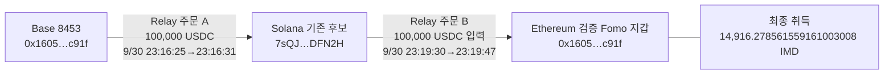

# 초기 Top10 — 공개 전 매수·전량 매도와 실제 크로스체인 자금 경로

2026-10-08 · 배치 `top10-60d-20261008-v1-batch009` · 본체 검토 raw2450 / 근거 raw2449.

원래 Top10 raw141, 기존 5개 `gpt-6-luna` / `max` 작업자를 유지했다. 목표 기간은 **2026-08-08T04:43:41Z ≤ t < 2026-10-07T04:43:41Z**이며 아래 시각은 모두 UTC다. 60일 전체 수집 완료 보고서가 아니다. 기준은 게시 또는 실제 BUY 당시 유통 시총 **100만 달러 이하**다.

## 이번에 확인한 결과

1. **detweiler 본지갑의 HOOKED 매수 → 보존 THESIS → 전량 매도**를 실제 거래로 재구성했다. 최초 매수는 THESIS 14초 전이며, 정확한 토큰 계좌의 재고는 0에서 시작해 0으로 끝났다.
2. **Econoar의 Base → Solana → Ethereum IMD 취득**을 두 개의 개별 Relay 주문과 양쪽 전송으로 연결했다. 사적 공급자처럼 보이던 F7 주소는 이 주문의 정산 지급 경로였다.
3. **Werey의 USDC 입금 5건**은 공식 Omni Bridge 현재 코드와 맞는 FinalizeTransfer였다. 현재 ABI상 출발 체인 값은 NEAR이며, 기존 Wormhole Sequence를 출발 주문 번호로 사용할 수 없음을 확인했다.

**뒷지갑의 동일 소유·최초 공개 이전 매수 의도·공통 고객 CEX 입금은 아직 입증하지 못했다.** 위 사실은 본지갑의 매매와 자금 경로를 보여 준다. 서비스 경로가 겹친 것을 동일인 증거로 바꾸지 않았다.

## 1. detweiler / HOOKED — 매수부터 전량 매도까지

검증 Fomo Solana 지갑: `EC2f5DnHzuNRit1ExqghSifDbp1wgrzktsRRZCtU92MJ`.

HOOKED mint: `C1mBfBoDkwWfd6uTFZp62ARHLjeVp3bDpCDMfMZtPngE`.

정확한 토큰 계좌: `23doQ5wahWdGQJ9myoPDTwWpHbtGZSrMZxEJkkmhWsgj`.

| 순서 | UTC | 확인된 사실 | 원문 |
|---|---|---|---|
| 최초 실제 BUY | 10/1 06:53:51 | +10,279,973.530147 HOOKED, −11,000 USDC, 본지갑 서명·성공 swap | raw2416 첫 행; 이전 raw870/data/1 |
| 보존된 최초 THESIS | 10/1 06:54:05 | “fine, smol. fine.”, BUY보다 14초 뒤 | raw2147/theses:8, canonical THESIS |
| 최초 후속 SELL | 10/1 13:03:34 | −119,768.090265 HOOKED, +240.359267 USDC | raw2416, 이전 raw869/data/184 |
| 마지막 관측 SELL | 10/3 16:34:56 | 이후 이 토큰 계좌 잔고 0 | raw2416 마지막 행 |

[최초 BUY 거래](https://explorer.solana.com/tx/2LdiitUsLxK78GADQu1nLKJHpAbY9iUQqcvczwhdLTxGVoyzrgLYcQGRHw4bcrCwNnsentT1nSQZ9YYJEUWdPQjs), [최초 SELL 거래](https://explorer.solana.com/tx/3hyfkYNKrpdgt1YqJyRPvHBdJEqLr5HAqVwpoaNdkCYCSPAgdd3uK9VGyByagPdpWEii5XYjoTbj7YFgendjofCd), [마지막 SELL 거래](https://explorer.solana.com/tx/5czYXDujJpfPoWJQQ8ecN3r22ppTwEJQ8avePTvqfydCNkWkqn1zMyb36hC3wVj3MuTi3GZ7GEdwZSFwZsJV5g9u).

raw2416의 46개 고유 거래 모두 성공했고 본지갑 서명과 target/USDC 반대 방향 변화를 확인했다. BUY 10건과 SELL 36건이다. 모든 행의 이전 잔고가 앞 행의 마지막 잔고와 일치했다. 매수 합과 매도 합은 각각 **20,644,946.805997 HOOKED**로 동일하며 잔차는 0이다. raw2423은 같은 계좌·필터·커서의 빈 후속 페이지와 null cursor를 반환했다.

| USDC 변화 | 수량 |
|---|---:|
| BUY 거래에서 본지갑 순지출 | 39,799.999998 |
| SELL 거래에서 본지갑 순수령 | 181,356.519484 |
| 차이 | **+141,556.519486** |

이 차이는 **해당 46개 거래에서의 USDC 순현금흐름**이다. 최종 달러 실현 수익으로 확정하지 않았다. 매매에 동반된 USDC 부가 이체 57건/338.236752 USDC가 순변동에 포함되어 있으며 목적은 미분류다. 이를 다시 차감하지 않았다. 작업자는 parsed USDC transfer leg 127개와 거래별 owner 잔액 변화를 대조했고 불일치가 없었다. 네트워크 수수료 합 24,769,536 lamports는 Agm 보조 서명자가 부담했고, 본지갑 SOL 순변화는 0이다. 토큰 계좌 생성·임시 wSOL 계좌 생성과 반환도 실제 관측 범위로만 기록했다.

### 공개 시점과 알림 매칭의 한계

THESIS는 확보한 공개 기록의 최소값이다. 다른 플랫폼 게시물·삭제된 글·더 이전 BUY 노출을 모두 확보했다는 뜻은 아니다. 따라서 **“보존 THESIS 14초 전 본지갑 실제 매수”**로 표현한다.

Fomo SELL 알림은 14건이다. ±5초로 대조하면 12건은 단일 후보이고 2건은 각각 2개·3개의 실제 SELL이 겹친다. 모호한 5개 연결을 따로 저장했다. 가장 가까운 거래를 골라 14건 전부가 확정 매칭이라고 표현하지 않는다. 실제 46개 매매 자체의 검증과 알림별 대응은 별개다.

### $1M 조건은 아직 보류

정확한 mint의 CoinGecko identity raw2419와 역사 유통 시총 raw2422를 확보했다.

| 시총 표본 UTC | 유통 시총 USD | 최초 BUY와 차이 |
|---|---:|---:|
| 10/1 06:00 | 703,181.4474602597 | 3,231초 전 |
| 10/1 07:00 | 1,283,094.3460301058 | 369초 뒤 |

THESIS 기준으로는 각각 3,245초 전·355초 뒤다. 시간별 두 표본 사이에 $1M 경계를 가로지르므로 실제 BUY/THESIS 순간의 시총은 확정할 수 없다. **`pending_cap`을 유지**했고 신규 전체 토큰시장·BigQuery 군집 조회는 실행하지 않았다. [역사 시총 원문 API](https://api.coingecko.com/api/v3/coins/hooked/market_chart/range?vs_currency=usd&from=1790812800&to=1791068400).

### EH8 참여는 확인되지 않았다

기존 연관 실행 지갑 `EH8pNWx5K5vCnnrNrraB4wR3ntJa3EUAV5rTH1Eq1KX`의 USDC 계좌를 9/30–10/4로 제한해 조회했다. raw2436의 25건과 raw2439 빈 후속 페이지에서 HOOKED mint 이동·매수는 발견되지 않았다. 이 구간의 det→EH8 USDC는 39,950, EH8→det는 19,896.251409였다. 목적·소유권은 unknown이다. 기존 STONKCATS의 자금 공급·매수 실행·반환 경로와 혼동하지 않는다.

raw2431의 현재 HOOKED token account 조회는 빈 결과였다. 과거 폐쇄된 계좌의 부재 증거가 아니다. 본지갑 HOOKED 계좌의 46개 거래에는 외부 토큰 공급 대신 실제 swap 취득이 이어지지만, EH8의 모든 과거 계좌나 독립 보유까지 배제하지 않는다.

## 2. Econoar — 사적 공급자 후보가 실제로는 Relay 지급 경로

검증 Ethereum Fomo 지갑: `0x1605b59dfe3c1742c815d604aab6a2faa3a5c91f`.

기존 Solana 후보: `7sQJttJLutWjHkxbusTgE4GpSj5z4fegouv2USHDFN2H`. 후보 상태를 유지하며 개인 소유권을 확정하지 않았다. Base 주소는 검증 Ethereum 지갑과 같은 hex다. 체인이 다르므로 같은 주소 문자열만으로 소유권을 승격하지 않았다.

| 단계 | 실제 UTC·수량 | 검증 내용 |
|---|---|---|
| Base 입력 | 9/30 23:16:25, 100,000 USDC | raw2445 성공 receipt Transfer log0x32, raw2446 tx, raw2447 block UTC |
| Solana 정산 수령 | 23:16:31, 100,000 USDC | raw2440/data/322; F7 소유 Q4 USDC 계좌→7sQ 소유 DHcg 계좌, 서명·양쪽 잔액·memo 확인 |
| Solana 재입력 | 23:19:30, 100,000 USDC | raw2430; 7sQ 서명·잔액 감소, 공유 서비스 금고 7uTT 증가 |
| Ethereum 최종 취득 | 23:19:47, 14,916.278561559161003008 IMD | 기존 raw2252 성공 receipt log0x1c0, raw2253 block UTC |

첫 주문은 Relay raw2443의 `0x17908101815ad5d3f3d564dd74be2b7dbb4fe267515b1cf1a35da7e7acc404d7`, 두 번째는 raw2429의 `0x17908103671b2cf058fc0f1b4e5f665b84f5fefcb3b95e4804eacc0a363054d4`다. 주문 연결은 Relay assertion이며 각 체인의 실제 전송·수량·최종 recipient·거래 hash는 별도 RPC로 대조했다. 첫 주문은 Base calldata의 quote ID와 Solana 지급 memo도 맞는다. Solana 수령에서 다음 입력까지 179초다.

- [Base 출발 거래](https://base.blockscout.com/tx/0xb4cd03792e6b3b7802ed9a6385a78db22a80dbd7e9cb78989ba68849ee7dc4a3)
- [Solana 100,000 USDC 수령](https://explorer.solana.com/tx/5PLgMGUQL64dSyjGiDMF1kdzWdeksBMhKq5xwBCgk6XvSPccFy52xU6QDXswRxudzdxooP7PQDdMRtCkGhxE6D9H)
- [Solana 재입력](https://explorer.solana.com/tx/34F9hTATTifBdDZzRsSpN5V783S4wYVHtsjN5p1J4UkHnTbrweNzuCDWWLvXFy993roiFnSYKq1V9AhUH5AkXQu4)
- [Ethereum IMD 취득](https://etherscan.io/tx/0x9aabd8a740342de572074c11f8e47847ebf1d139a4bde73025a771f541e8353a)

### 잘못된 뒷지갑 연결을 방지한 지점

`F7p3dFrjRTbtRp8FRF6qHLomXbKRBzpvBLjtQcfcgmNe`가 IMD 구매 직전 100,000 USDC를 공급했지만 **그 송금은 위 Base→Solana 주문의 정산 지급**이었다. 개인 공급자·같은 고객 CEX로 분류하지 않았다. 해당 Q4 계좌는 이전 Solstice Relay 지급에도 쓰인 공유 경로다.

`0xb92fe925dc43a0ecde6c8b1a2709c170ec4fff4f`는 Ethereum에서 USDC와 최종 토큰을 중계하고 로그를 내보낸 contract다. 독립적인 IMD 매수 지갑이라는 근거가 아니다. Agm 공유 보조 서명과 Base Pimlico bundler/Entry Point 표시 역시 동일인 증거가 아니다. Base receipt의 log0x31은 Approval이고 log0x32가 Transfer이므로 두 송금으로 세지 않았다.

100,000 USDC는 **이 한 개 교차체인 취득 주문의 실제 입력**이다. 기존 IMD 취득 6건 전체의 원가나 PnL을 뜻하지 않는다. 이 취득은 확보한 첫 IMD Fomo 이벤트(다른 사용자의 10/5 14:50:20 BUY)보다 4일 15시간 30분 33초 앞섰지만, 그 기록이 절대 최초 공개는 아니다. Econoar 본인의 IMD THESIS는 보존 자료에서 미확보다.

정확 contract는 `0xd34a99bc0f67ae1bbd63c660e6d0b0dd03e263b7`다. Relay 현재 metadata의 VIBE/Vibe Coins 표기와 Fomo 당시 IMD 표기를 주소로 구분했다. CoinGecko exact contract 조회 raw2433은 404여서 역사 유통 시총은 `pending_cap`이다. 고객 CEX 회수와 해당 토큰 매도는 새로 확인되지 않았다.

## 3. Werey — NEAR 경로와 잘못된 Sequence 해석 수정

검증 Fomo Solana 지갑 `DmopudSGaQQenK4cW5NgmHUsexMB3sEJNn6n1EfLKs28`의 기존 원문에서 9/13–9/20 USDC 입금 5건, 합 **160,750.793873 USDC**를 검토했다.

| 관측 순서 | USDC net raw | destination nonce | origin nonce | destination Wormhole Sequence |
|---:|---:|---:|---:|---:|
| 1 | 20999979710 | 349879 | 469459 | 634273 |
| 2 | 19999979344 | 352603 | 473233 | 639518 |
| 3 | 74750834819 | 358111 | 482455 | 650709 |
| 4 | 40000000000 | 367885 | 500265 | 670669 |
| 5 | 5000000000 | 373971 | 511293 | 682931 |

공식 [프로그램 배포 설정](https://github.com/Near-One/omni-bridge/blob/main/Makefile), [FinalizeTransfer payload](https://github.com/Near-One/omni-bridge/blob/main/solana/programs/bridge_token_factory/src/state/message/finalize_transfer.rs), [처리 코드](https://github.com/Near-One/omni-bridge/blob/main/solana/programs/bridge_token_factory/src/instructions/user/finalize_transfer.rs), [SignedPayload 구조](https://github.com/Near-One/omni-bridge/blob/main/solana/programs/bridge_token_factory/src/state/message/mod.rs), [ChainKind 매핑](https://github.com/Near-One/omni-bridge/blob/main/near/omni-types/src/lib.rs)을 raw2421/2427/2428/2432/2437로 보존했다.

현재 공식 코드의 프로그램 ID가 `dahPEoZGXfyV58JqqH85okdHmpN8U2q8owgPUXSCPxe`와 일치한다. 5개 payload의 `amount:u128`은 실제 수취 잔액과 정확히 일치하며 `origin_chain=1`은 current ABI에서 NEAR다. 다만 당시 배포 binary/version은 입증하지 않았으므로 현재 코드로 해석한 근거임을 유지한다.

`omni-relayer.bridge.near` 문자열은 `fee_recipient` 필드다. 출발 지갑이나 출발 contract 이름이 아니다. Wormhole Sequence는 지급 뒤 실행되는 `post_message()`에서 나온 destination 번호로, origin nonce와 다르다. 가장 큰 [74,750.834819 USDC 지급 거래](https://explorer.solana.com/tx/3TKzihY1ZvE9s838PoEReGzK5MVtEo9Z1h4d9RzpdSTVrPaBM64PQNCzFN2vAUYj18QhM84ZbyMdqVzWKmME7n7U)의 출발 추적에는 origin nonce482455가 다음 단서다.

로컬 Bridge aggregator raw2413은 `not_bridge`를 반환했다. 여기서는 **해당 adapter의 미탐지**로 해석한다. 실제 bridge 지급 부재로 바꾸지 않았다. NEAR 출발 tx·송신자와 CEX 역할은 아직 미확인이다.

## 4. ARTHUR의 초기 매수자 F73 — 연관성 약한 후보로 낮춤

기존 적격 actual BUY raw2286(10/2 08:00:37, 역사 유통 시총595,241.9577189017, 37초 전 표본)을 유지했다. 새 F73 정확 ARTHUR 계좌 raw2417에서는 9/30 09:17:54 생성 시 잔고0→405 BUY/141 SELL→10/2 05:58:24 잔고2,959,354.546748을 재구성했다. 첫 취득은 4,424.041948 ARTHUR /9.254751 USDC였다. 546개가 성공 서명·Jupiter route와 맞으며 재고 잔차는0이다. raw2424 빈 후속 페이지를 확인했다.

이처럼 많은 반복 매매는 일반 자동매매·마켓메이킹 대안도 검토해야 한다. 검토한 target546행과 USDC 첫1000행에서 기존 Top10 검증 지갑 접점은 찾지 못했다. USDC 첫 page는8/8–8/9이고 이전 잔고3,312.614788의 출처는 미확인이다. F73를 뒷지갑으로 승격하거나 그 전체 quote 이력을 대량 수집하지 않았다. pool의 08:59:32 매도는 실제 사건이지만 공개 이후 exit인지, 같은 사용자 소유인지 미확인이다.

## 초기 10명 상태

| 원래 순위 | 계정 | 이번 변화 |
|---:|---|---|
| 1 | pointfarmcap | 이전 STONKCATS 발행자 배분·홀더 보상 해석 유지 |
| 2 | Solstice | 이전 매매·HyperCore/Relay 회수 검증 유지; 공유 Q4 지급을 동일인 근거로 쓰지 않음 |
| 3 | theveeman | 기존 지갑·매매 검증 유지 |
| 4 | RareDualJay | 기존 후보·coverage gap 유지 |
| 5 | detweiler | HOOKED 실제46거래, 재고0→0, USDC 현금흐름·알림 모호성 추가 |
| 6 | pricedin | 기존 후보·PERPSPAD 시간 관계 유지 |
| 7 | RunningClam | Robinhood 조회 경로·coverage gap 유지 |
| 8 | econoar | Base→Solana→Ethereum 실제 두 주문 추가; 사적 공급자 오분류 방지 |
| 9 | RZD | 단독 조사 중단·기존 frontier 보존 |
| 10 | Werey | 기존 pre-THESIS BUY/후속 SELL 유지; Omni origin nonce/NEAR 경로 구체화 |

## 저장·조회 범위와 남은 작업

- SQLite에 HOOKED 실제 매매46건, 알림 연결17행(단일12·모호5), 개별 bridge edge2개를 추가했다. 기존 collector state41행·wallet resolution11행은 보존했다. 초기10명 Fomo 고정구간404건과 전체DB Fomo1338건 모두 변하지 않았다.
- 본체 근거 raw2449, 검토 raw2450, 새 state `initial_top10_material_case_review_v1`, 배치 `primary/reviewed-evidence.json`과 작업자 결과3종을 저장했다. 기존 canonical 시총·소유 판정은 덮어쓰지 않았다.
- 실제 사용은 RPC16, Bridge4, Nodit indexed1, 시장3, Chrome4, 공식문서/검색10이다. Fomo·BigQuery 신규 호출은0이다. 최초 두 검색의 부분 보존·사후 예산 계상 예외는 raw2411/2412에 남겼다. 이후 프로그램 검색 raw2420은 전체 native 응답을 보존했다.
- Etherscan과 Arkham Chrome은 Cloudflare challenge여서 라벨을 확인하지 못했다. Solana Explorer는 성공·UTC 요약을 보였지만 상세 Loading이 남았다. Base Blockscout은 실제 거래 상세를 표시했다. UI 라벨은 assertion이고 주요 전송은 RPC로 따로 확인했다.
- 저장된 Nodit 인증은 indexed와 Ethereum RPC에서 HTTP401 `AUTHENTICATION_FAILED`였다. 이 실패를 빈 이력이나 `debug_traceTransaction` 미지원으로 해석하지 않았다. Base 공식 공개 RPC는 정상 동작했다.
- exact ATA의 빈 후속 page는 해당 요청 범위의 종료다. Econoar source의60일 첫1000행은8/21까지·cursor가 남았고,9/30 하루324행+footer는 별도다. F73 quote1000행과 Fomo 과거60일 전체 coverage 역시 미완료다.

**다음 우선순위:** HOOKED 실제 BUY/THESIS 순간의 역사 시총 보완 → 적격 토큰의 비서비스 연관 매수·exit 검증 → 정확한 고객 CEX chain/address 대조. Werey는 위 NEAR origin nonce로 개별 출발 tx를 찾는다. Econoar의 IMD 매도·회수 근거가 생기면 검증된 두 주문 경로 뒤를 잇는다. 현재 API의 forward alert cursor를 과거 pagination으로 쓰거나 unsupported THESIS cursor를 만들어 요청하지 않는다.
