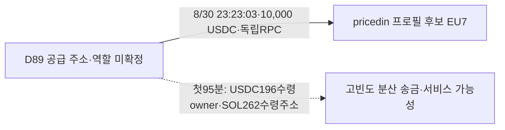

# Rare·pricedin 후보 지갑의 거래와 공급 주소 검토

## 결론

**프로필 후보 지갑의 게시 전 매수·게시 후 매도는 확인했지만, 연관된 별도 지갑의 매수→게시→그 별도 지갑 매도로 완성된 사례는 아직 없다.** pricedin 후보로10,000 USDC를 보낸 별도 주소의 실제 전송을 검증했다. 다만 짧은 구간에도 수백 주소에 송금해 서비스 가능성을 남겨뒀으며, 개인 뒷지갑으로 분류하지 않았다.

원래 Top10(raw141)의 고정60일 **2026-08-08T04:43:41Z ≤ t < 2026-10-07T04:43:41Z**를 유지한다. 모든 시각은 UTC다. 당시 유통시총100만 달러 이하, THESIS 없는 BUY도 조사 대상으로 삼으며 기존5개 Luna/max 작업자가 읽기 전용 분석을 맡았다.

## 후보 주소 이력의 확보 범위

| 계정 | 정확 후보 주소 | 거래 행 | 실제 반환 구간 UTC | 종료 근거 |
|---|---|---:|---|---|
| Rare | `AXN4A7HNzncqzD9KGSbiSzE58vqvQmQxn8jhfYCKx9ai` |1,121|8/11 22:31:13~10/6 21:14:55|raw2820/2821/2824/2825/2826 + 빈2827|
| pricedin | `EU7FSVgkt8eZYV199enSCoQa3qoH6h6HP8v9BqpGDeG5` |776|8/30 23:23:03~10/7 04:11:21|raw2822/2823/2828/2829 + 빈2830|

각 주소 안의 signature는 중복 없고 두 조회의 합집합은**1896개**다. `succeeded`, `finalized`, `tokenAccounts=none`, full transaction, 오름차순 조건의 해당 주소 조회는 빈 페이지/null cursor로 끝났다. **모든 과거 토큰 계좌·폐쇄 계좌·모든 자산·평생 이력의 완료를 뜻하지 않는다.** 원래1,000행 요청 두 번은504였고 각 한 번250행으로 줄여 성공했다. 기존 wallet resolution11행은 변경하지 않았다.

## pricedin 후보의 본지갑 배경 거래

| 토큰 | THESIS UTC | 게시 전 실제 owner 매수 | 토큰 수령 합계 | USDC 지출 합계 |
|---|---|---:|---:|---:|
| BUTTHOLE |9/6 04:49:10|6건|6,431,623.192553366|21,974.370638|
| PERPSPAD |9/16 15:36:20|6건|3,257,195.947238|14,313.623707|
| BUTT |9/17 20:18:35|6건|7,186,827.599259|4,978.084671|

정확 mint·signature·owner delta·서명·UTC·raw locator는 작업자 정규화와 근거raw2850에 보존했다. PERPSPAD는9/16 15:36:34에261,115.542336 token/1,000 USDC의 추가 매수도 있다. 모두 같은 프로필 후보 주소의 활동이다. 실제 보유자와 프로필의 동일성, 별도 주소의 거래, 최초 공개, 조종 의도는 각각 별도 증명이 필요하다.

JEANPHIL `GTBxUiw6wJdmmkCGZgRHLyYxqu1vG4KtRpeox6yDpump`은 후보 잔고0에서10/4 03:24:24에**1,887,798.353163/10,000 USDC**로 들어와10/6 21:02:27에 전량 처분하고**9,104.041652 USDC**를 받았다. [매수](https://solscan.io/tx/avkUyiPvg2pPiUvPMXZV61KVhia9zzrswGK2RGvNNT2gDybZF47aakyWznFZieE6b3smmjm8SAAuJ7XxfEWRHAA) · [매도](https://solscan.io/tx/34k7yTfoDzEdE9xPJp11mFXZmoihnoaiFNXMWDLqmVXu18e5PYiEU5rC3uHC1WMRF6ZyZmh2LtAzHcrUjWKjiC5D). 단순 USDC 차이는−895.958348이지만, USD 실현수익·수수료 포함 손익으로 표시하지 않는다. 같은 작성자 JEAN THESIS 연결과 별도 지갑 매수 근거도 없다.

**매도 뒤1,500/1,089.72 USDC 출금을 pricedin 회수로 붙인 작업자 초안을 원문 대조로 제거했다.** 두 유출은Rare raw2826에 속한다. pricedin raw2829 data21~25에는 owner USDC pre/post가 없다. 따라서 이 잘못된 연결의 bridge·CEX 분기를 확장하지 않았다.

## 실제 공급 주소 D89

정확 공급 주소는 `D89hHJT5Aqyx1trP6EnGY9jJUB3whgnq3aUvvCqedvzf`다. [검증 거래](https://solscan.io/tx/5vtVTDC2ykLgCQQQNwNTZKngi3qExYNQjK7h7QXXudaqo7UV8orV1FB4ksD8rXZBxyctYM147aZXZjTGBBJiRCmU)에서 D89가 유일한 signer·전송 authority이고, source ATA `ZaUEpMj6qeBDGRwxJxUvXmuQbjR1dqSHgqx23Chzobq`의 역사 owner도 D89다. destination ATA `CiayTLQ9zVbg777VbiP2S57JEvLdzV6uiYQnQnVABuWP`는 EU7 소유로 새로 생성됐다. `transferChecked`의10,000,000,000 정수수량/decimals6, source−10,000 USDC/destination+10,000 USDC, ATA rent2,039,280 lamports가 일치한다. 직접RPC raw2835와 indexed2822 data0은 같은 signature다.

D89 조회raw2836/2837은**8/8 04:43:53~06:19:25의500행, 약95분짜리 앞부분**이며 cursor `437940322:44`가 남았다. 이 구간에는 USDC202전송/196수령owner/45,912.078215 USDC, native290전송/262수령주소/381.462406159 SOL이 있다. **8/30 공급 시점은 포함하지 않는다.** 다른 자산과 정수수량을 합산하지 않았다. 이 빈도는 단일 개인 공급자라는 가정을 약화하지만 CEX·서비스·본인 소유를 확정하지도 않는다. 전체 pooled 흐름을 확장하는 대신 역할 미확정을 남겼다. Chrome Solscan raw2838은 Cloudflare challenge로 라벨 근거가 없다.

## 당시 시총과 선별

| 기준 이벤트 | UTC | 직전 역사 유통시총 USD | 표본 차이 | 판단 | 원문 |
|---|---|---:|---:|---|---|
| NPC | 2026-09-25T22:02:10Z | 3380851.8253971334 | 130초 | 제외: 100만 달러 초과 | raw2839/2843 |
| BUTT | 2026-09-17T20:18:35Z | 629208.9908776373 | 1115초 | 보류: 시각 차이 | raw2842/2844 |
| PERPSPAD_actualBUY | 2026-09-16T15:03:53Z | 2030337.156837234 | 233초 | 제외: 100만 달러 초과 | raw2832/2834 |
| PERPSPAD_THESIS | 2026-09-16T15:36:20Z | 2030337.156837234 | 2180초 | 보류: 시각 차이 | raw2832/2834 |

NPC exact mint→CoinGecko `npcs`, PERPSPAD→`perpspad`, BUTT→`buttensor-2`를 계약 lookup으로 확인했다. **NPC THESIS와 PERPSPAD의9/16 15:03:53 실제 매수는100만 달러 초과로 제외한다.** PERPSPAD THESIS의33초~분 단위 시각을 매수 판정으로 대체하지 않았다. BUTT는629,208.9908776373달러의 낮은 표본이 있지만18분35초 전이라 운영상300초 기준 밖이다. 게시 뒤 값을 소급 대입하거나 기준을 임의 완화하지 않았다.

Ash(raw2831), ALX(2840), BUTTHOLE(2841)는 정확 mint lookup404이고 DARK chart2833은 빈 배열이다. 미확인 값을 현재 시총·FDV로 메우지 않고 **pending_cap**을 유지한다. 신규 전체 토큰·BigQuery 수집은0회다.

## Rare와 다른 원래 계정

Rare의 Ash `F5WvFdG9sCfhv3bVYAMJNWiwpx5e3X2uvpXDtLtdsDJs`는Fomo BUY10/4 16:40:30의1초 전 후보 서명 거래에서8,256,201.426318/6,179.96 USDC로 취득했고,10/5 01:22:43에3,781,310.033135/1,529.96 USDC를 추가했다. 확보 구간 마지막까지 같은 토큰 debit은 관측되지 않았다. THESIS가 없다는 이유로 제외하지 않는다. 실제 매수의 대외 노출·별도 지갑 연결·시총은 미확인이다.

RunningClam은 보존 THESIS14건이 있지만 체인별 실제 fill·wallet 검증이 부족하다. Robinhood RPC403은 접근 실패다. econoar의 IMD 최신 거래raw2819는 외부 caller `0xca7ded7e4f4ba8ab3b10009236ae6d1b95094589`→router `0xccc88a9d1b4ed6b0eaba998850414b24f1c315be`, native value0으로 확인했다. 이전 token credit은 보존하되 quote·원가 없는 credit을 유상 매수로 올리지 않았다.

## 저장과 다음 추적

직접RPC17회(5042회와 각 한 번 축소 재시도 포함), 시장자료10회(4043회·빈 배열1회 포함), Chrome1회다. Fomo·Bridge·Nodit indexed·BigQuery0회이며 unused 예약은 해제했다. SQLite에는 **실제 공급 TRANSFER1건**만 추가해 연결385개가 됐다. 기존52states·11wallet resolutions·1,055trades·384edges·Fomo1338/고정Top10 404·match73을 보존했다.

근거raw2850/검토raw2851, state `initial_top10_candidate_owner_and_funding_role_review_v1`부터 재개한다. 다음은 시총 승인raw2286의**ARTHUR 실제 외부 매수자62개 중 제한된 후보의 매수 자금·후속 매도·회수**를 조사하고, Werey 본지갑과 실제 비서비스 접점이 있는지 역으로 찾는다. 기존613행을 재사용하고 전체 토큰 조회를 반복하지 않는다. 원래10명·60일·100만 달러 이하·THESIS 없는 BUY·5Luna/max를 유지한다. 연구목표는 아직 진행중이다.
