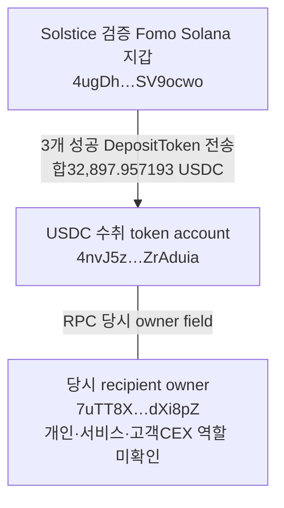

# 초기 Top10 후속 조사 — 나머지 7명, 2026-10-08

배치 `top10-60d-20261008-v1-batch004` · 기존 5개 `gpt-6-luna` / `max` 작업자 재사용 · 본체 독립 근거 검토·단일 적재.

원래30d Top10 raw141의 계정을 고정했다. 이번 담당은2·3·4·6·7·8·10위7명이다. 고정 구간은 **2026-08-08T04:43:41Z ≤ t < 2026-10-07T04:43:41Z**이며 모든 시각은 UTC다. 이 보고서는 기초 지갑·실제 거래·저장된 과거 재고 검토 결과다. 신규 전체 토큰시장 탐색은 실행하지 않았다.

## 확인된 변화

- **Solstice와 theveeman의 Solana Fomo 지갑을 검증했다.** 각각6개·2개의 서로 다른 BUY/SELL 기록이 성공 거래·최종 보유 토큰·지갑 서명·실제 USDC 잔액 변화와 맞는다. beneficial ownership이나 뒷지갑 소유권을 확정한 뜻은 아니다.
- **Werey의 Fomo 본지갑에서 공개보다 며칠 먼저 매수하고 공개 뒤 매도한 사례를 확인했다.** SI는 확보한 THESIS 전24BUY/뒤27SELL, MONEROCHAN은 전22BUY/뒤1SELL이다. 공개 이전 매수 사실과 뒷지갑·의도는 별도다.
- **Solstice에서 같은 프로그램 금고로 USDC3회, 합계32,897.957193 이동**을 확인했다. 실제 수취 owner와 토큰 계좌를 저장했지만 고객 CEX 입금 주소인지는 미확인이다.
- econoar 검증 Ethereum 지갑의 IMD 취득은 기존2건과 새4건으로 총6건이다. 지급 서비스의 USDC 경로와 EOA 원가는 구분했다.

## 10명 진행 상태

| 원래 순위 | 계정 | 현재 상태 | 확인 내용·남은 한계 |
|---|---|---|---|
| 1 | pointfarmcap | 이전 배치 조사 | STONKCATS 최초 공급·공개 후 매도 검토 유지 |
| 2 | The__Solstice | 지갑 검증·매매 확인 | Solana 매매6건 검증; 같은 금고 USDC3회 전송 |
| 3 | theveeman | 지갑 검증·매매 확인 | GOMO BUY/OCTO SELL2건 검증; JUF 기존 모호 매칭 보존 |
| 4 | RareDualJay | 일부 확보 | Ash BUY1건; 지갑 후보·Robinhood 거래 gap |
| 5 | 0xdetweiler | 이전 배치 조사 | ZSHIB/OTC 및 후속 자금 이동 검토 유지 |
| 6 | pricedin | 일부 확보 | JEANPHIL SELL1건; PERPSPAD는 THESIS14초 뒤 BUY, 지갑 후보 유지 |
| 7 | RunningClam | 조회 경로 미확보 | THESIS14건; BUY/SELL source unavailable·Robinhood RPC403 |
| 8 | econoar | 과거 취득 보완 | 검증 Ethereum 지갑 IMD 취득6건; Solana CARDS 매칭 모호성 유지 |
| 9 | RZDxbt | 단독 조사 중단 유지 | 기존 RZD·CEX/Bridge frontier 보존 |
| 10 | motiyawerey | 과거 재고·매도 검토 | 7토큰의 저장 원문 재계산, 신규 tail125tx+빈 후속page |

원래10명 전체의 보존 Fomo 이벤트는404건(THESIS171/BUY123/SELL110), 이번7명은200건이다. 이번에 Fomo 신규 요청을 하지 않았으므로 게시 기록은 늘지 않았다. 현재 원래10명 중7명에서8개의 chain별 지갑이 검증돼 있다. 전원60일 수집 완료를 뜻하지 않는다.

## Solstice — 매도와 회수 지점

검증 주소: `4ugDhHJ8XDXAeABmrNmGffFaLbJb9BkPyiFGVSV9ocwo`.

raw2230의 DARK BUY는10/4 22:16:17, Fomo22:16:15보다2초 뒤다. 실제 +1,951,812.443185 DARK / −3,123.595706 USDC이고, 거래 직전 DARK10,371,029.609534가 이미 있었다. 이 거래를 최초 취득으로 판정하지 않았다.

raw2231에서10/7 02:01:36·02:01:44의 STONK2SELL은 합100,493.326191853 STONK를 팔고19,960.984537 USDC를 수령했다. STONKCATS3SELL은02:06:38·02:08:18·02:08:40, 합19,536,059.918898 토큰/12,662.402551 USDC다. 각각 Fomo SELL과 −1~+3초 이내로 대응한다. 비용이 확인되지 않았으므로 매도대금은 수익이 아니다.

전송 시각/수량은02:02:08/19,966.501244, 02:07:00/4,658.858499, 02:09:06/8,272.597450 USDC다. 정확 owner는 `7uTT8Xi5RWXzy7h9XL244GRgEycDYDhLjr3ZyNdXi8pZ`, 수취 token account는 `4nvJ5zWdVspxJiNZzB127U6amPH98SFFkBx2JZrAduia`다. 프로그램의 DepositToken 명칭만으로 Bridge나 CEX로 분류하지 않는다. 이 창에는 HEV 매도·기존 USDC도 있어 금고 전송 전체를 STONKCATS 매도대금으로 귀속하지 않았다.

첫 전송 [Solana Explorer](https://explorer.solana.com/tx/2RJ4ML8E9LtMCLdhY2FKCCc2wKRS3eXZ9Ss5er4D4JJhgoUwpfofqLwABALsqeEZ2NxVbW1nEgKcyPCSEHA1dW6K), 나머지 [전송2](https://explorer.solana.com/tx/55T7xFz6GLHffUjbwnoBQcRPGMv2WbHnZCeW5ac5bKXXEJ7RzFgW3iWaPQgZQ14yu5u9hsa1gx61JVesBowMe7gP), [전송3](https://explorer.solana.com/tx/2fMrK6rEk8tfgGoeLGN7SNdNfy5KNUfDLJWpe6yEAjoVDbEyzRNdk4xvi8QPURtpDgbba6DxDXMEk46cicnkZkTC). raw2231의 inner SPL transferChecked·양쪽 owner·raw balance를 독립 검토했다. Chrome raw2244는 첫 거래 성공/UTC를 표시했고 상세 영역에는 Loading이 남았다. Arkham owner 페이지 raw2256은 Cloudflare여서 라벨을 확인하지 못했다.

**반대 근거:** STONKCATS THESIS47초 전으로 보였던 raw2236/2242는 다른 mint `6dRETusz6e3NMJXa3XEH9k8PNiZygr98jAzZmHACpump`였고 서명자는 Solstice가 아니었다. exact STONKCATS 선행 매수 증거에서 제외했다. 2분 창의 조회를 더 오래된 취득 부재 증거로 쓰지 않는다.

## theveeman · RareDualJay · pricedin

theveeman 검증 주소는 `F5hkYsi8JxjyA2JHN5CA7MbnnhWubkXB2ZQB7Gkaxqs6`다. [GOMO BUY](https://explorer.solana.com/tx/2WwrfL8sW5JnfjdLPpVy5wfMPwR256dQ47y6Xa9s3JXxnpvBSZVgWArSiN8c5oUQkSFFxnSQzJBrfxTHtQ2TAZ86)는10/6 19:47:11, +2,457,190.315417 GOMO/−5,000 USDC. [OCTO SELL](https://explorer.solana.com/tx/2TYVqyr3FVjXn53nKtZC52EZmUk8hWPJXoP1QwKLFqKv2MfcQsEs53YS8GXbkJDRztuKHbfLNwVgYREkWL6L3chk)는10/7 00:59:03, −3,764,649.910291 OCTO/+2,713.864965 USDC다. raw2232에서 source와 각각1초/3초 차이가 난다. OCTO THESIS는10/2 19:07:00으로 매도보다 앞서지만 최초 취득과 원가는 남아 있다. JUF의 기존2tx/4개 ambiguous 매칭은 보존했다. 고정창 뒤 GOMO THESIS를 이번 공개 전후 판정에 섞지 않는다.

RareDualJay의 [Ash BUY](https://explorer.solana.com/tx/56uk1jQWuNsbaVJ4HBdSpy8cASYTH5oMQogjSbzsbdLMFyGUmiHgZoVNpzF22bVSsQXSkwaptBZpimSmNABMLuxB)는10/4 16:40:29, +8,256,201.426318 Ash/−6,179.96 USDC(raw2233). 후보AXN4가 서명했지만 독립 BUY/SELL 이벤트는1건이므로 후보 상태다.

pricedin의 [JEANPHIL SELL](https://explorer.solana.com/tx/34k7yTfoDzEdE9xPJp11mFXZmoihnoaiFNXMWDLqmVXu18e5PYiEU5rC3uHC1WMRF6ZyZmh2LtAzHcrUjWKjiC5D)은10/6 21:02:27, −1,887,798.353163/+9,104.041652 USDC(raw2234). PERPSPAD는raw2237에서9/16 15:36:34의 실제 BUY를 확인했지만 THESIS15:36:20보다14초 뒤다. 거래 직전 재고가 있었다고 THESIS 이전 취득 시각까지 판정하지 않는다. 독립 BUY/SELL source 매칭1건이어서 지갑은 후보다. 서로 공유하는 보조 signer AgmLJBM…은 역할 미확인이며 같은 사용자 근거로 쓰지 않는다.

## Werey — 더 오래된 매수와 공개 후 매도

검증 Fomo 지갑 `DmopudSGaQQenK4cW5NgmHUsexMB3sEJNn6n1EfLKs28`의 기존 raw196–210과 신규 raw2235를 재사용·재계산했다. 아래는 **본지갑의** 실제 거래와 확보한 최초 THESIS 관계다. 모든 대상은 당시 유통 시총 보류라 아직100만 달러 이하 적격 사건으로 승인하지 않았다.

| 토큰 | 최초 관측 실제 BUY | 확보한 최초 THESIS | THESIS 전 BUY 수 | THESIS 뒤 SELL 수 |
|---|---|---|---:|---:|
| MONEROCHAN | 2026-09-08T20:23:50Z | 2026-09-20T15:05:05.000Z | 22 | 1 |
| STUPIDINU | 2026-10-03T10:13:31Z | THESIS 미확보 | 해당 없음 | 해당 없음 |
| STONK | 2026-08-24T01:46:26Z | 2026-09-29T20:18:30.000Z | 40 | 0 |
| ARTHUR | 2026-09-30T02:10:34Z | 2026-10-03T10:33:00.000Z | 23 | 0 |
| SNDK | 2026-10-04T22:02:11Z | THESIS 미확보 | 해당 없음 | 해당 없음 |
| SI | 2026-09-22T21:05:01Z | 2026-09-25T18:04:40.000Z | 24 | 27 |
| ZCAT | 2026-08-31T00:23:45Z | 2026-09-30T00:59:45.000Z | 20 | 0 |

SI는9/22 첫 BUY→9/25 THESIS→이후27SELL, MONEROCHAN은9/8 첫 BUY→9/20 THESIS→뒤1SELL이다. ARTHUR의 THESIS 전23BUY도 본지갑 활동이다. 시점 관계만으로 선행매수 뒷지갑·동일인·조종 의도를 확정하지 않는다. BUY/SELL은 서로 다른 tx이며 동일 trade ID의 알림 반복을 거래 수로 대신하지 않았다.

ZCAT 최초 관측 BUY는8/31이지만 같은 날6BUY(USDC 순지출4,500) 뒤2SELL(순수령2,629.147414)로02:49:21에 토큰 잔액0이 됐다. 이후 다시 매수했다. 따라서9/30 THESIS까지 최초 물량을 한 달 계속 보유했다고 해석하지 않는다. 원문 gross/fee/net과 전체 원가를 분리한다.

STONK는8/24 최초6,796,599.058063404 유입이 BUY가 아닌 transfer였다(raw210). 이후10 USDC 실제 BUY와 토큰 재전송이 따로 있다. 공급 쪽3yUM…의 소유권은 미확인이다. 신규10/6 17:11:54 BUY는77,469.056459072 STONK/16,108.092878 USDC로 decimals9를 적용했다.

새 tail raw2235는125tx, raw2240은같은 cursor/필터 후속 빈 페이지다. account-key·succeeded·tokenAccounts=none 조회의 종료를 확인했다. raw2255의8/8~8/24 이전 구간도 빈 응답이었다. ATA-only 이동·provider 보존 한계·지갑 생성·전체60일 completeness는 별도이고, 이전 raw210 cursor를 전역 complete checkpoint로 바꾸지 않았다.

Fomo 매칭은 주요21개 사건 중19개가 엄격한5초 창에서 단일 후보였다. SNDK10/4 22:02:10·22:02:15의2개 알림은 서로 가까운2fill이 함께 들어와4개 연결을 ambiguous로 저장했다. 5초는 clock 대조의 운영 가정이며 cap 가격 표본의300초나 선행 매수 lookback과 다르다.

## econoar — IMD 과거 취득과 자금 유입

검증 Ethereum 지갑 `0x1605b59dfe3c1742c815d604aab6a2faa3a5c91f`의 정확 IMD contract `0xd34a99bc0f67ae1bbd63c660e6d0b0dd03e263b7`만60일 indexed 조회했다. raw2243에서6행, raw2245에서빈 후속 page를 확인했다. 기존10/5 취득2건에 다음4건이 추가됐다.

| 새로 검증한 UTC | 최종 수령 IMD | 거래 | receipt/block 근거 |
|---|---:|---|---|
| 2026-09-30T23:19:47Z | 14916.278561559161003008 | [거래](https://etherscan.io/tx/0x9aabd8a740342de572074c11f8e47847ebf1d139a4bde73025a771f541e8353a) | raw2252/raw2253 |
| 2026-10-02T02:19:23Z | 1625.366665980560045015 | [거래](https://etherscan.io/tx/0x570366ee8d8dd2bc98065e5e7ca1cb176c84a10f1337309ceb77cfd01c3b941d) | raw2250/raw2251 |
| 2026-10-04T03:55:59Z | 1484.414007076691010609 | [거래](https://etherscan.io/tx/0x0a134e7d7def5120f928646d3be28a7e680eb5dba7495a1fcbbea13366fa6149) | raw2248/raw2249 |
| 2026-10-07T04:28:11Z | 317.02677850252192369 | [거래](https://etherscan.io/tx/0xfe236392734280c74a2aac17fe68c20022798a766f82f8d047230d73a92d38fc) | raw2246/raw2247 |

6건의 실제 유입 합은22,002.159795540427167465 IMD다. 기존 Fomo fill ID 직접 연결2건, raw911의이전3fill은시각·표시 수량 상관관계,10/7 건은 BUY 알림 후보 관계로 구분했다. 입력 USDC가 서비스 경로에서 지급돼 EOA 소유자의 실제 원가·실현 수익을 확정하지 않았다. 새4건은 quote/cost 미확인 취득으로 DB에 저장했다. cap·공개 이전 군집 판정은 보류다.

별도로[0.005 ETH 유입](https://etherscan.io/tx/0xd6ff714452f4d8174cbed3c5048363c44498cedaf9386d684cb8295330fac66d)은10/2 01:36:59, `0xbfd26274e94cbc3826d25f3217d4a756a8c25c3b`→검증 지갑이며 raw2238/2239/2241의 성공 receipt·block로 확인했다. 송신자 소유권과 IMD 매수 자금 연관은 미확인이다. Chrome Etherscan raw2254는 Cloudflare, 기존 Arkham Coinbase 요약은 exchange assertion이며 정확 고객 deposit 증거로 쓰지 않는다.

## RunningClam과 미확보 범위

보존 THESIS14건(13Robinhood/1BSC)을 정리했다. BUY/SELL 반환 원문은 unavailable이고 THESIS에 native execution hash·author wallet이 없었다. Robinhood endpoint HTTP403은 접근 실패여서 거래 부재나 지갑 무활동 근거가 아니다. 기존403을 다시 요청하지 않았다. 이 계정은 완료 계정이 아닌 source gap 계정으로 유지했다.

## 저장·검산·다음 작업

SQLite 추가 적재: Solana 실제 거래253, quote/cost 미확인 EVM 취득4, 정규화 action168/token delta210, 단일 이벤트 매칭27, ambiguous 연결4, 자금 transfer edge4, 지갑 resolution4(verified2/candidate2), indexed movement6이다. 기존 모든 state·기존 지갑 resolution 행·JUF/CARDS ambiguous 행은 보존했다. 원문 정수·Decimal·UTC·최종 owner·서명 header·instruction 이름을 본체가 다시 계산했다. 별도 테스트 실행이나 기존 데이터 재빌드는 하지 않았다.

원문 RPC22회·Nodit indexed2회·Chrome 직접 탐색3회. Fomo/시장자료/Bridge/BigQuery 신규 요청0회. 남은 예약은 해제했고 batch는closed다. 보호된 state와 DB 수량, source별 요청 ledger,5개 워커 JSON/JSONL을 확인했다. 본체 review **raw2265**, 계정 목록 **raw2264**, 근거 raw2257 / `collector_state.initial_top10_remaining_accounts_review_v1`가 이번 재개 지점이다. ignored 배치 폴더에 worker 결과·원문·정규화·재현 도구를 보존했다.

다음은 **Werey SI/MONEROCHAN/ARTHUR의 사건 당시 유통 시총부터 확인**하고 적격1~3개를 선정한다. 적격이면 더 오래된 exact token-account 재고와 미확인 매수 군집을 탐색하고, 후보의 공급·반환·실제 매도·회수·정확 CEX 고객 입금을 대조한다. Solstice 금고의 역할과 source deposit/order/destination도 별도 한도로 확인한다. 현재는 공통 고객 CEX 입금·뒷지갑 소유권·선행매수 의도·실현 수익을 확정한 단계가 아니다.
