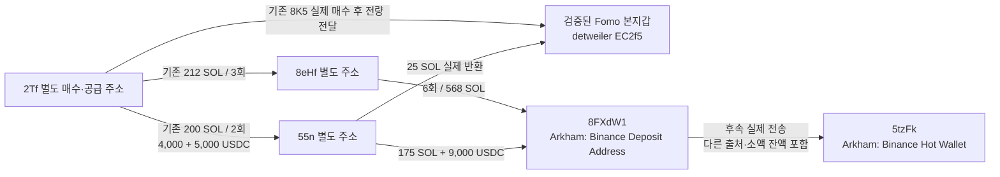

# 초기 Top10 연관 지갑의 공통 거래소 입금 경로 — 배치012

작성: 2026-10-08T08:06:22.413Z. 표본은 raw141의 원래 10명이며, 이번 대상은 원래 5위 **0xdetweiler와 실제 전송으로 연결된 별도 주소들**이다. 기존 5개 `gpt-6-luna`/`max` 작업자가 보존 근거를 병렬 검토하고 본체가 Chrome·RPC 조회와 SQLite 적재를 담당했다.

고정 조사 구간: **2026-08-08 04:43:41 UTC 이상, 2026-10-07 04:43:41 UTC 미만**. 근거 raw2559, 검토 raw2560, 재개 상태 `initial_top10_repeated_exit_endpoint_review_v1`다.

## 1. 이번에 확인한 내용

- **8eHf와 55n은 같은 정확한 Solana 주소 8FXdW1로 자금을 보냈다.** Chrome의 Arkham 주소 헤더는 `Binance Deposit`, 주소 태그는 `Binance Deposit Address`로 표시한다(raw2532).
- 8eHf는 **6회·568 SOL**, 55n은 **175 SOL과 9,000 USDC**를 보냈다. 성공 서명·전송 명령·역사 계좌 소유자·실제 수령 잔액을 직접 RPC와 대조했다.
- **55n→검증된 Fomo 본지갑 25 SOL 반환**도 확인했다. 2Tf→55n의 200 SOL은 이전 근거이고, 4,000+5,000 USDC 공급은 이번에 별도 검증했다.
- 8FXdW1에서 Arkham이 `Binance: Hot Wallet`로 표시한 5tzFk로 후속 전송이 이어진다. 55n 입금 뒤 USDC는 **6분 1초**, SOL은 **7분 59초** 뒤 각각 9,000.002 USDC·175.000002 SOL이 이동했다.
- 이 주소의 고정 60일 SOL 조회와 정확한 USDC 계좌 조회에서 **Fomo 본지갑의 직접 입금은 관측하지 못했다.** 다른 자산·다른 계좌·다른 기간의 입금을 부정하는 결론은 아니다.

여기까지는 **연결된 별도 지갑들의 공통 거래소 라벨 입금 경로**다. 동일 개인 소유, 같은 거래소 고객, 선행매수 의도나 수익을 입증하지 않는다. 거래소 입금은 법정화폐 환전·출금의 증명이 아니다.

## 2. 연결 구조

화살표는 실제 자금/토큰 전송을 뜻한다. 주소들의 소유자를 통합하는 표시는 아니다. 8eHf의 앞선 100·36 SOL 입금은 첫 확인된 2Tf→8eHf 공급보다 이르다. **568 SOL 전체를 2Tf의 212 SOL에 귀속하지 않는다.**

| 역할 | 정확한 주소 |
|---|---|
| 검증된 Fomo 본지갑 | `EC2f5DnHzuNRit1ExqghSifDbp1wgrzktsRRZCtU92MJ` |
| 별도 매수·공급 주소 2Tf | `2TfNQKaAHqAMtUmTMsFwmNABp29x5PFrGEmAJB3kNFtp` |
| 별도 주소 8eHf | `8eHfCkYzY6m7XrgZCmD4ZWuit3JswT37PX65Ma24u3ZY` |
| 별도 주소 55n | `55n5jK7hvQSvMWkphF9n82K3WyudoTfkxuz52rwCGi3A` |
| 공통 입금 주소, Arkham 라벨 | [`8FXdW1ZcR3ebEqsNNDBbZ5m39Zdif3WSYuicKrXibxwJ`](https://arkm.com/explorer/address/8FXdW1ZcR3ebEqsNNDBbZ5m39Zdif3WSYuicKrXibxwJ) |
| 공통 입금 주소의 역사 USDC 계좌 | `A3WQ2ZaakxDiWXgC3SgpV7JNLrRayXg39jYxmNeQJQBK` |
| 후속 핫월렛 주소, Arkham 라벨 | [`5tzFkiKscXHK5ZXCGbXZxdw7gTjjD1mBwuoFbhUvuAi9`](https://arkm.com/explorer/address/5tzFkiKscXHK5ZXCGbXZxdw7gTjjD1mBwuoFbhUvuAi9) |

## 3. 직접 확인할 입금·반환 거래

### 8eHf→공통 Binance 라벨 입금 주소

| UTC 시각 | 정확한 수량 | 탐색기 | 독립 getTransaction 근거 |
|---|---|---|---|
| 2026-08-29T09:32:26Z | 100 SOL | [거래 확인](https://solscan.io/tx/euVQTYgmLAgVaUYaPsyvLfKwMCueDUToRUCiiNzAmb34V42xaxJZaUFNFXaApvLekFBUAyzW7Z34CqcuNqtWCVr) | raw2555 |
| 2026-09-06T09:00:58Z | 36 SOL | [거래 확인](https://solscan.io/tx/3UVcp2WCMDqDj2WGjjrMKPb4T5JeDzHEZax7xxLNKY5y2c12SB8TBu3snLQTnQ8bgNhDRpGsDJAygkD89ZaSpYPa) | raw2556 |
| 2026-09-08T09:31:42Z | 40 SOL | [거래 확인](https://solscan.io/tx/2o5jGrTJhHDz64dMzmRRT2y5vdPHu33GSXd718V7Q4T8KCzohQCPAJ79WbfMoZp8i27XQs8FF8qpGACaEEKvpxGw) | raw2534 |
| 2026-09-13T06:53:47Z | 110 SOL | [거래 확인](https://solscan.io/tx/DqD6fGQaEiCDRUZZaNYZ7TGAMQtG5NhXXQWJKAmyCuMVTJSnXuik1eGTirjC6R8U7Lm1HQHhxjYhpYaHosfNGsr) | raw2546 |
| 2026-09-13T22:49:33Z | 82 SOL | [거래 확인](https://solscan.io/tx/5KnbcFvDzm8CZUPcuy9qZmwzrCKBr8yenwssuQ6117vLzPAYbbKVUtFjhxDwRWDwvzPUwpD4q872hfo7CtbfYysT) | raw2547 |
| 2026-09-16T14:58:48Z | 200 SOL | [거래 확인](https://solscan.io/tx/2i5amNey3CR9E47vndrMpquTLCP5qTh7hxJwXtvzLMxRUD3Y71q5pAC52UDstsmSYHpBkSkniHbtZMpQ6Kw8aNMm) | raw2548 |

총 **568 SOL / 6건**. 최초 표본의 40 SOL 전송은 2Tf에서 40 SOL을 받은 지 14분 46초 뒤 발생했다. 시간·수량이 가까워도 동일 자금 단위의 전달이라고 확정하지 않는다.

### 55n의 두 입금과 본지갑 반환

| 방향 | UTC 시각 | 수량 | 탐색기 | RPC 근거 |
|---|---|---|---|---|
| 55n→본지갑 | 2026-09-27T07:05:40Z | 25 SOL | [거래 확인](https://solscan.io/tx/2R8kWzGZ7hGgenvXtfuB84LcfckT8pSxjKbsbGKTRmciExxZQBfURn2h9cUwUUFRcDxo5RxkMGXkrpwyEV6kgCYK) | raw2535 |
| 55n→8FXdW1의 USDC 계좌 | 2026-09-29T07:16:55.000Z | 9,000 USDC | [거래 확인](https://solscan.io/tx/eXfQ1Dst4bqfKSbCnH2iALWHH2eZfXHWxM5Xd5mhbxPC2RKiqAGVTUD89UTWFNQErgK8NaeBUWhYVB8LWcDJB3a) | raw2536 |
| 55n→8FXdW1 | 2026-09-29T07:17:13Z | 175 SOL | [거래 확인](https://solscan.io/tx/2JHBj28Y46KCD9jRJFBXGj8iR4cWxNqaX8PGCMuZL4KyBJFqVTsAN3DhyXjcfjcMdMZwbxv1DyZwarqqGz6fF5gk) | raw2537 |
| 8FXdW1→5tzFk의 USDC 계좌 | 2026-09-29T07:22:56Z | 9,000.002 USDC | [거래 확인](https://solscan.io/tx/5bQuRSaAT5PbFBSvVcTvLFr7rdMnwAStXrnvZaYLanKuSjAyprahLPNN1PAwFoLDwhxyQYWePS1MDixc4n8FHyRr) | raw2544 |
| 8FXdW1→5tzFk | 2026-09-29T07:25:12Z | 175.000002 SOL | [거래 확인](https://solscan.io/tx/2562hShZvDZJLVfZ1c7nisthBx4MWn76Z2qvwUu898KGTQ89QZeUDbqdHTWcD4tAoDEyWSKgTmRUpntvCWZHUvCZ) | raw2545 |

USDC의 실제 목적지는 토큰 계좌이며 역사 `owner`는 정확한 8FXdW1이다. 후속 USDC 목적지 계좌의 역사 `owner`는 5tzFk다. 화면의 `9K`·`175`는 반올림 표시이고 위 표는 원시 수량을 환산했다.

## 4. 예치·인출을 매매로 잘못 세지 않도록 교정

55n의 거래 5건은 정확한 `jup3YeL8QhtSx1e253b2FDvsMNC87fDrgQZivbrndc9` 프로그램을 호출하고 `Deposit`/`Withdraw`·`PreOperate`/`Operate` 로그와 지분 토큰 mint/burn을 남긴다. 공식 [프로그램 주소](https://developers.jup.ag/docs/lend/program-addresses.md)와 [Earn CPI 설명](https://developers.jup.ag/docs/lend/earn/cpi.md)은 이 프로그램을 Jupiter Lend Earn으로 설명한다(raw2541/2542). 현재 문서와 역사 거래의 실제 동작을 함께 사용했다.

USDC는 2Tf에서 받은 4,000+5,000에 서로 다른 주소의 소액 0.0024가 더해져 **9,000.0024 USDC 예치**로 이어진다. 지분 토큰 `9BEcn9aPEmhSPbPQeFGjidRiEKki46fVQDyPpSQXPA2D` 8,474.884556을 발행받았다가 전량 burn하고 **9,001.560817 USDC 인출**을 받았다(raw2557/2558, 역사 원문 raw2528). 이후 9,000 USDC가 8FXdW1로 이동한다.

SOL 지분도 예치 후 인출로 분류한다. 174.548017060 WSOL 지급과 본래 SOL 잔액 변동 174.549488297에는 계좌 정리 등의 차이가 있어 서로 바꾸어 쓰지 않는다. 이 5건을 저시총 토큰 BUY/SELL, CALL 뒤 매도나 토큰 조종 수익으로 저장하지 않았다.

## 5. 같은 고객·소유권에 대한 남은 한계

8FXdW1에는 8eHf·55n 외에도 Arvzr·H5vj·Dyurt·HVn·5pyLMA 등 정확히 다른 주소의 유의미한 입금이 있다. 이 주소들은 보존된 원래 Top10 Solana 후보와 정확히 일치하지 않았으며 신원은 미확인이다. 이름·주소 앞뒤 글자·소액 전송으로 동일 소유를 판정하지 않았다.

예를 들어 200 SOL의 8eHf 입금과 140 SOL의 Dyurt 입금이 섞인 뒤 340.000012 SOL이 핫월렛으로 전송된다. 이 전체 수량을 8eHf나 Fomo의 매도대금으로 귀속할 수 없다. 전체 입금 주소의 12건·1,042.586619398 SOL 전송과 두 건·18,000.0045 USDC 전송은 **주소 전체의 문맥**이며 개인의 회수액/수익 총계가 아니다.

따라서 현재 근거는 ‘같은 정확한 거래소 라벨 주소를 사용했다’까지다. 해당 주소가 고객별 전용인지, 같은 고객에게 귀속되는지, 관리 서비스·공유 출납 주소인지의 독립 근거는 남아 있다. Fomo 본지갑과 같은 주소에 직접 입금한 증거도 이번 범위에서는 없다.

## 6. 본지갑의 Relay 주문 두 건 복원

이전에 목적지 체인 매핑 오류로 미해결이던 원문 `DepositToken`의 order ID를 복원해 Relay 공개 v2에서 찾았다. 정확한 source 서명·예치자·USDC 수량과 응답의 order ID가 일치한다. 두 응답 모두 성공을 보고하며 같은 기존 EVM 후보 `0x838a336d19ae121a0ca754ebbdd57282de656dfa`가 목적지로 표시된다.

| source UTC | 예치 | provider 토큰 표기 | provider recipient credit (18 decimals) | 목적지 거래 | 근거 |
|---|---|---|---|---|---|
| 2026-09-01T19:41:00Z | 3500 USDC | worth | 1545769.285034131796934236 | [목적지 거래](https://robinhoodchain.blockscout.com/tx/0x4ba2b82cb5eceee04c37b8ae1c430f9904adb4b22625e7968d806f33e3dd64da) | raw2530 |
| 2026-09-09T09:23:26Z | 2500 USDC | FAB | 1897226.101997519433771181 | [목적지 거래](https://robinhoodchain.blockscout.com/tx/0x33fe2f289f40a204e103e0e13249f32d542390b29545d516f84fba313895b211) | raw2531 |

목적지는 **Robinhood Chain 4663**이다. Robinhood 거래소 입금으로 분류하지 않는다. `worth`/`FAB` 메타데이터와 실제 수령이라고 보고한 원시 수량은 Relay 주장이고 독립 목적지 receipt는 미확보다. 보존된 public RPC 403 경로를 맹목적으로 반복하지 않았다. 해당 EVM 후보의 wallet resolution·소유권, canonical BRIDGE/trade는 승격하지 않았다. 예상 출력과 실제 recipient credit도 구분했다.

## 7. 조회 범위·오류·보존

| 조회 | 결과 | 완료로 볼 수 있는 범위 |
|---|---|---|
| 8eHf 첫 확인 수령 이후 48시간 | raw2526 63행 +2527 빈/null footer | 해당 성공 native-account 조회만 |
| 55n 첫 확인 수령~고정 종료 | raw2528 31행 +2529 footer | 해당 성공 native-account 조회만 |
| 8FXdW1 고정 60일 | 이전 raw2551 21행+2552 footer / 이후 raw2538 43행+2539 footer | 연속 두 구간의 성공 native-account 64행 |
| 8FXdW1 정확 USDC 계좌 고정 60일 | raw2553 19행 +2554 footer | 단일 정확 계좌 조회만 |
| 직접 개별 거래 대조 | getTransaction 16건 | 핵심 입금·반환·공급·스윕·예치/인출 |

native-account 조회는 토큰 계좌만 건드린 USDC 입금을 놓칠 수 있었다. 55n의 9,000 USDC는 정확 ATA 조회와 개별 거래로 보완했다. footer는 해당 provider/query의 종료이고 다른 토큰 계좌, 실패 거래, 모든 자산·지갑 평생 이력의 완전성을 뜻하지 않는다.

raw2533은 `lt`에 UTC 문자열을 넣어 거절된 요청이다. 동일 고정 종료를 정수 시각으로 한 번 교정한 raw2538에서 성공했으며 실패 응답을 부재 근거로 쓰지 않았다. Chrome 8eHf 기존 화면 raw2525는 제한된 화면 읽기 뒤 조작 중단이 있어 전체 CEX 라벨 부재로 판정하지 않았다.

SQLite에는 **새 TRANSFER edge 19개, 새 spot trade 0개**를 추가했다. 기존 44개 collector 상태와 11개 지갑 resolution, Fomo 전체 1,338건/고정 표본 404건, 기존 onchain trade 776건을 보존했다. 작업자별 한글 보고서·정규화 결과·raw refs와 재현 자료는 ignored `data/research/parallel/top10-60d-20261008-v1-batch012`에 보관했다.

사용량: 직접 RPC **28/30**, Bridge **2/5**, Chrome **2/5**(기존 탭 읽기·실패 포함), 공식 문서 검색/조회 **3/6**. Fomo REST·시장자료·Nodit indexed·BigQuery 신규 조회는 0회다. 기존 시총 `pending_cap`을 유지했다.

## 8. 다음 조사

1. 이번 공통 입금 경로를 재사용해 **연결된 별도 지갑들의 같은 토큰 실제 매수·대가·첫 공개 전후·처분·회수**를 대조한다. 기존 2Tf/EH8의 8K5 BUY는 본지갑 최초 BUY보다 늦으므로 그 자체를 본지갑 매수 전 선행매수로 쓰지 않는다. retained 공개 시각과 당시 시총을 따로 확보한다.
2. 본지갑의 같은 입금 주소 직접 사용은 남은 자산/계좌의 실제 회수 근거가 생길 때 좁게 조사한다. 이번에 종료한 8FX SOL·USDC 조회를 반복하거나 같은 핫월렛으로 간 것만으로 같은 고객이라 판정하지 않는다.
3. 2Tf의 나머지 실제 bridge 원출발 주소는 개별 order로 복원한다. 공유 solver의 pooled flow를 개인 공급으로 확대하지 않는다. Relay worth/FAB는 작동이 확인된 목적지 원장 경로를 확보한 후 대조한다.

신규 전체 토큰 매수 군집·BigQuery는 해당 사건 당시 유통 시총 ≤$1M 확인 뒤 실행한다. 초기 10명 범위와 60일 고정 종료, 단독 RZD/Top100 중단을 유지한다.
