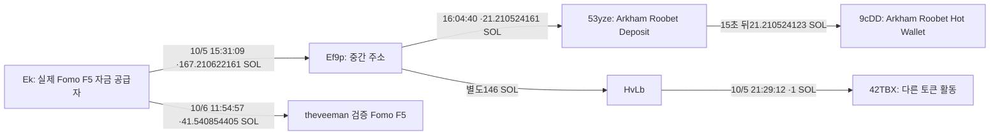

# 초기 Top10 추적: Roobet 입금 경로와 완결 사례의 남은 조건

## 이번에 새로 확인한 사실

**theveeman의 실제 자금 공급자 Ek에서 출발한 송금이 Arkham이 Roobet 입금 주소로 표시하는53yze를 거쳐 Roobet Hot Wallet 라벨9cDD로 이어졌다.** 전송은 이전독립RPC로 검증했고, 이번에는 사용자Chrome의 로그인세션에서 주소라벨을 읽었다. 격리된Chrome에서의보안확인실패를 모든브라우저의접근불가로해석하지않는다.

이는 **Roobet 라벨 주소로의 자금 전송 경로**다. CEX입금으로분류하지않으며 고객신원·동일소유·실제도박행위·특정CALI매도수익 귀속은미확정이다. 당시유통시총100만달러조건까지충족한뒷지갑완결사례도아직0이다.

대상은원래Top10/raw141와고정60일 `2026-08-08T04:43:41Z ≤ t < 2026-10-07T04:43:41Z`. 아래시각은UTC다.

## 1. 공급 지갑에서 플랫폼 입금 주소까지

Ek→Ef9p/53yze→9cDD는기존raw3837/3841·독립3843/3845/3847의실제전송이다. [중간지갑→입금주소](https://explorer.solana.com/tx/5W7WjQyyPRAh8JH5c7B7EhKGmi4UFzDaqBB3u1vdksAW1MTrzMB1rWsKnPkAeyTctwHMzvRQcmNJVE7TUBnTJc44), [15초뒤집금](https://explorer.solana.com/tx/4uZkC92vdD2zsMGtGVi8NBUqEuu3dDhgSZvyj3BqCdVyr7D2gDLEZSMXZtuvC7Gxv3diUfkkaBKUXwKxB7PqDosU).

**현재Arkham라벨**은raw3873/3874에보존했다. [정확53yze](https://arkm.com/explorer/address/53yzeZk6eA8Vxn1fVbK1wkUn4xaKRp1C9a3wrJc12BUE)는“Roobet Deposit / Roobet Deposit Address”, [정확9cDD](https://arkm.com/explorer/address/9cDDJ5g2wPqVZUZwpPuwqzxN7ouvc6QFauFwrX2TTTAX)는“Roobet / Hot Wallet / Gambling”이다. 거래당시라벨의유효성을독립확정한것은아니다. 이전raw3863/3864보안화면과3859/60·3871/72검색무라벨결과도보존했다.

지정53yze쿼리281행에는23개실질source에서65회입금, 같은9cDD로65회집금이있다. 스윕의nonceAuthority는Ebs이고두주소가함께서명했다. 운영스윕을보내는권한과입금고객의소유권은다르다. 본지갑F5의직접53입금은해당쿼리에서관측되지않았다. B48이F5에98.495448 SOL을공급하고53에4회108.812291990 SOL을보냈다는교집합도있지만B48의서비스역할·고객귀속은별도검토가필요하다. 이경로의LP원금·다른입금·기존잔고는섞여있다.

## 2. 42TBX 후속 행동의 오탐 제거

정확주소 `42TBXVuBbWE3wk8F6J8Dybgb14U5JyBW5HaQZfBa4fzC`의지정owner성공조회는66행+빈후속페이지(raw3861/3862)로종료했다. 전체ATA·평생이력은아니다.

- **10/5 21:29:12**, HvLb→42TBX 1 SOL. raw3861/data54는기존3839/data3와전체거래동일하다. HvLb가서명·수수료를부담했고42TBX는수령자/non-signer다. 작업자의이전21:29:18표기는정정했다.
- **58초뒤21:30:10**, 42TBX가별도Token-2022토큰4,960,000개의burn명령과 `burn68h9dS2tvZwtCFMt79SyaEgvqtcZZWJphizQxgt`로0.5 SOL송금을실행했다. tokenaccount의owner는incinerator, burnauthority는42다. 주소이름만으로0.5 SOL수령자의역할·소각가능성·CEX를추정하지않는다. [거래](https://explorer.solana.com/tx/5SEk1h5xFEQu5ML7tn84TNbGjvewGgJvW8yxBRta4SepSjJLgseYTYML5WrGBVEv13CrmFPo12ZJckymoBiUaHfu), 독립3865/Chrome3869.
- **10/6 22:26:26**, CALI와다른SHIB13,467,864.7562를DEX에서교환했다. 임시WSOL수령0.636912898 SOL−영구USDC계좌임대0.001488440−수수료0.000009100=**native증가0.635415358 SOL**. USDC중간수령77.303064중77.225993은다시교환돼최종USDC는0.077071만남았다. 중간USDC와최종SOL을중복합산하지않는다. [거래](https://explorer.solana.com/tx/38XRrPhaykKeeAAKHV7UhjYXUXTkcoosYhLVGwhmLVJMbKE3c9M4yU4qVsRnEUxeJjXgjYeGCzzU6Mgsh4L5HGeo), 독립3866/Chrome3870.

성공조회에서38,000 lamports가빠진원인은 **10/4 21:29:55/21:29:57의실패Jupiter거래두개**, 각각수수료19,000이었다. 해당59초allstatus12행+빈후속3867/68로대사잔차0이다. 실패는매수체결로세지않는다.

66행의accountKeys에는검증된Top10체인지갑9개와CALI mint직접일치가없었다. 후보지갑·다른ATA·다른체인·중간경로의연결부재까지증명한것은아니다. 따라서42SHIB매도를CALI게시후뒷지갑매도로넣지않는다.

## 3. 가장 강한 선매수 후보 DOGINU

기존Solstice연결5NS는자체유상사전매수4회/1 SOL, 공통공급자3Hp의순이전2.475M DOGINU, 보존THESIS때2,954,895.978822재고, **110초뒤부터추가매수없이6회매도/quote12.041207311 SOL**이실제다. [개별보고서](solstice-doginu-linked-recipient-prebuy-review.md)의과거누락은후속owner894·역사mint검증으로보완됐으며닫힌원문은재조회하지않았다.

이번에는첫매수의중간USDC28.545560→TKLS→DOGINU를재검산했다. TKLSgross0.063827652는두번의0.2%transferfee로지갑전송0.063699996, 최종풀수령0.063572596이된다. DOGINUgross190,757.030639→1%fee후188,849.460332다. 거래내USDC/TKLS환산과같은분차트는가격의교차검산이지사전분봉·전체시장시총확정값이아니다.

검증역사총공급상한1B와완료분봉HIGH조건평가$146,822.98(첫BUY)/$435,103.58(THESIS)는 `pending_cap_proxy`다. 정확당시유통시총·원가귀속·개인동일소유·절대첫공개·USD실현이익은남아있다. 3주소의quote합계를한사람의수익으로합치지않는다.

## 4. 마감한 것과 이어갈 것

원래10명의보존Fomo이벤트404(THESIS171/BUY123/SELL110), onchaintrades4,569를보존했다. 새nativeTRANSFER1개→edges626, collectorstate81이며기존80states/11walletresolution/625edges/전체trade행을정수·원문대로검산했다. 보호된기존walletresolution은변경하지않았다.

실제요청RPC6/30,Chrome6/6,문서검색4/6,시장/Fomo/Bridge/Nodit/BQ0이다. 실제사용자Chrome접근발견후무료Chrome2회를사전에추가예약했다. 남은예약은해제했다. 근거3881/검토3882/cap3880, state `initial_top10_Roobet_endpoint_labels_42TBX_recovery_and_case_readiness_review_v1`.

**이번주소라벨확인과42후속검토는완료했다. 전체연구는계속진행한다.** 새접근경로로기존직접흐름의B48/HN88·6vy/5tz·8FX라벨을읽을수있으므로현재조사가능범위를소진했다고판정하지않는다. 다음은그정확주소들의고객입금역할비교와기존DOGINU체결별비용정산이다. 새로운전체토큰군집/BQ는시총적격근거가생긴경우에만실행한다.
