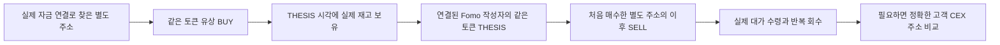
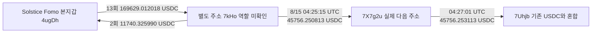

# 초기 Top10 별도 지갑의 매수 보유 게시 후 매도 조사

작성 시각: 2026-10-08T11:50:29.764Z. 이번 조사의 핵심은 **별도 지갑에서 유상 매수하고 보유한 상태에서 연결된 Fomo 작성자가 같은 토큰의 THESIS를 쓰고, 그 별도 지갑에서 이후 매도하는 흐름**이다. 검토한 범위에서 이 조건과 실제 자금 연결을 함께 충족한 사례는 아직 0건이다. 이는 모든 뒷지갑이 없다는 결론이 아니다.

새로 **Solstice와 7kHo의 USDC 양방향 연결**을 확인했다. 본지갑에서 13회·169,629.012018 USDC를 보내고, 반대 방향으로 2회·11,740.325990 USDC를 받았다. 특정 큰 입금은 두 단계의 후속 송금까지 검증했다. 이 주소의 역할과 토큰 선행매수는 분리해 판단한다.

## 조사 기준과 범위

초기 raw141의 원래 사용자 ID 10명, 고정 구간 **2026-08-08 04:43:41 UTC 이상부터 2026-10-07 04:43:41 UTC 미만**을 유지했다. 새 전체 토큰 시장·군집 조회는 사건 당시 **유통 시총 100만 달러 이하**를 확인한 경우에 한정한다. 시총 보류인 이미 연결된 주소의 정확 거래·역할 검증은 기초 자료이며 저시총 적격 사례가 아니다.

토큰을 Fomo 본지갑으로 보낼 필요는 없다. 오히려 별도 주소가 계속 보유하다 파는 흐름을 우선한다. 주소 간 연결은 개인 자금 공급·반환·반복 회수의 실제 거래로 검증하며, 공통 라우터·보상 지급자·거래소 핫월렛만 공유하는 경우는 소유권 연결에서 제외한다. 유상 매수, 배분·에어드롭, 언스테이크, 대출 지분, 순간 경유를 구분한다.

보존 THESIS는 관측한 게시 시각이다. 삭제된 글과 더 이른 외부 CALL을 모두 확보한 절대 최초 공개라고 단정하지 않는다. THESIS 없는 BUY는 별도 카피트레이딩 노출 가설로 유지하며 실제 노출 시각을 대신 만들지 않는다.

## 새 연결 Solstice와 7kHo

검증된 Solstice 본지갑: `4ugDhHJ8XDXAeABmrNmGffFaLbJb9BkPyiFGVSV9ocwo`. 별도 주소: `7kHoDVivC5b9JJN4WArSw2ssc2u5mZBjcy2cobJn7nAF`. 정확 USDC 계좌: `FaWiLsi1VQMmn2JJT2F7YFey3tURrFxFDBYqmgZkd23p`. USDC mint는 `EPjFWdd5AufqSSqeM2qN1xzybapC8G4wEGGkZwyTDt1v`, decimals 6이다.

### 본지갑에서 보낸 13건

| UTC | USDC | 실제 거래 | 원문 |
|---|---:|---|---|
| 2026-08-08T09:26:35Z | 3687.473068 | [거래 확인](https://solscan.io/tx/3xxZqro8N53kSAPsatAiEn5nJjcW33YAK62U24EAKiHKbCEpzggThvLP8W2X9YEedk4yzp2bfLnEBSUb4joQQ9YZ) | raw2625 data[0] |
| 2026-08-15T04:23:58Z | 45756.248246 | [거래 확인](https://solscan.io/tx/2HrndYJsUVFDC2LGd4j96HUfFZ4Kv5BfdMDmVfFHP7hnuM4PapxjkSyBjV91W1p2yKyN8eVympvWWKQHdriHpvUx) | raw2625 data[29] |
| 2026-08-16T00:52:27Z | 3963.334239 | [거래 확인](https://solscan.io/tx/4zfnSn68PGtEZCTU23buyg6LyHobqyqq5uEwFM7znkTnoc1ncmqGduWGRKbcth9suRJe4zTJaGHL2Pumt99ks7dE) | raw2625 data[36] |
| 2026-08-22T01:34:49Z | 2033.070415 | [거래 확인](https://solscan.io/tx/45LTxdGqKSkijCyEk9tSpkG5n4v2S6RLtWuVrJEQSXVYo3HrprtLjW74TFLFVBayFANf1g5jwMxwG1PwPZ14DUUM) | raw2625 data[41] |
| 2026-08-24T22:52:26Z | 1552.863097 | [거래 확인](https://solscan.io/tx/5AhHiDbwFodTCVL4aepdjbih4JvtUCxnKukZKrkZseUZWGmBFi7B1nyQ3wHbCMFW8Rp865EnQEhaQy5Nzak8qbMj) | raw2625 data[48] |
| 2026-08-26T03:15:25Z | 393.916085 | [거래 확인](https://solscan.io/tx/3ne1tRdxLBXZKP5ThrYuFD64jS3MeJcx87WANWZgxSCiZr6D7bKrGdFHTDNvGe6Rkv6WLAr3HzsYwUPc7eDhH2YV) | raw2625 data[56] |
| 2026-08-27T06:39:55Z | 100.000000 | [거래 확인](https://solscan.io/tx/LhN9JoR7cnnG7huSwgSx2yLRE5baCF2PcUFuurX8DXVu7c7rLQFV5vazAz4zjuFN1FbETK8ppXqEjfWJwdtuWPc) | raw2625 data[63] |
| 2026-08-27T07:24:31Z | 800.000000 | [거래 확인](https://solscan.io/tx/3Zj9MEohdx13eMNsSVg5fHzd7aZvY1h12pNS3ZTTMhMLmZDTsguwi7qA8xhYagusuifuJckGsm55DQbDTnDi7uo7) | raw2625 data[67] |
| 2026-08-31T19:56:18Z | 6043.760560 | [거래 확인](https://solscan.io/tx/5P21itxfRw9NfmXUbX6cdPwsEuyQF5htqbKbqkmC45JYSPUoz5q3nrc1LvjfVLP9UptYVeFenWyPnmcti5A1Zmb5) | raw2625 data[75] |
| 2026-09-01T04:59:38Z | 1564.012289 | [거래 확인](https://solscan.io/tx/J3p7wkQQK63eFU36VrFokbPdttYC7u9KcXsJmgyJnyjnERbC7H12nD1BunXX989oTs1tLzR3yCnicsFNhp6jHzS) | raw2625 data[81] |
| 2026-09-01T18:51:54Z | 50015.706438 | [거래 확인](https://solscan.io/tx/2AkJQTCb2Gyc1W6E7PDAdWsdgwXEZEmvzNgyvaKxkR6rB3GDHzBxfMiNuPCTU3xbVSMdYDuFQdpqoFULFKLSt3yd) | raw2625 data[87] |
| 2026-09-05T02:57:46Z | 49718.627581 | [거래 확인](https://solscan.io/tx/2hCMNKsiuA1adkr4ZqjBHyWtHscy94uou4TYFSmX1HegsWwJShWNbH5WJB9HYkuJm2gsE3gE6QgjtoWsEjwXW2SB) | raw2626 data[17] |
| 2026-09-10T17:55:16Z | 4000.000000 | [거래 확인](https://solscan.io/tx/4iEcqF8PKELVDzejUACqYmZZccGeDcoXaq1W1cG6KSPaRg9Q2ZoH6a38nJhvczmucrtAq47rouHvzimwQP6GJxom) | raw2626 data[50] |

**합계 169,629.012018 USDC.** 초기 본지갑 페이지에서는 8회·58,286.905150만 보였으나 수신 USDC 계좌 조회를 통해 나머지 5건을 추가 확인했다. 두 합계를 더하면 중복이다. 13건 모두 실제 본지갑 authority와 정확 계좌·역사 owner·성공 instruction을 대조했다. 8/15의 45,756.248246 건은 독립 getTransaction raw2614도 확인했다. 나머지 직접 전송은 저장된 제공자 인덱스 거래 원문을 근거로 하며 각각 독립 RPC를 호출한 것은 아니다.

### 별도 주소에서 본지갑으로 돌아온 2건

| UTC | USDC | 실제 거래 | 원문 |
|---|---:|---|---|
| 2026-08-12T06:39:36Z | 8443.111393 | [거래 확인](https://solscan.io/tx/3We16aUSXmoq6h3n4gqDBmBHsfy3nxgLuQ1FjZwcqksFxgtxPNgvf6dPpJ9B51ww9ugUxfrbjswHLGmv7FUVXYSt) | raw2625 data[19] |
| 2026-08-12T11:48:30Z | 3297.214597 | [거래 확인](https://solscan.io/tx/33uoxbqtJWL2RqSbcN8fqPkmevwzEj4MebXi4ZxRd4aZwaRMb7irurMWQ2kTq5LQ7k38knCuXxZ6E9YawZXHqy9R) | raw2625 data[24] |

**합계 11,740.325990 USDC.** 7kHo가 직접 서명했고 본지갑 USDC 계좌의 실제 owner와 잔액 증가가 맞는다. 양방향 연결은 확인되지만 개인 소유·환불·수익·채무를 증명하지 않는다. 두 방향 합계 차이를 수익으로 계산하지 않았다.

두 번째 반환 직전에는 7kHo가 **3,300 USDT를 USDC로 바꾼 거래**가 있다(raw2625 data[23], 8/12 11:48:03 UTC). 기존 USDC 0.001200을 포함한 3,297.214597 USDC를 27초 뒤 본지갑에 보내고, 본지갑은 다시 **15초 뒤 FRIES를 실제 매수**했다(raw2607 data[59], 11:48:45 UTC). 이는 별도 주소의 자금이 본지갑 매수로 이어진 구체적인 시간 관계다. FRIES 매수자는 본지갑이므로 요청한 뒷지갑 매수·보유·매도 사례로 분류하지 않았다. FRIES 보존 THESIS는 9/9 15:48:20 UTC이며 당시 시총과 게시 시점 보유는 별도 공백이다.

### 큰 입금의 후속 송금

8/15 04:23:58 UTC의 45,756.248246 입금은 77초 뒤 7kHo에서 전액 회수되고, 다음 주소에서도 106초 뒤 전액 회수됐다. 첫 후속 [송금](https://solscan.io/tx/ZjFws9tBs5my7iTDzQYJqUDck7AZjYWsx9UXdt39hvwjpSW4itC7VH6Dqa1dfmKqzbrLuD7cR4uM18iAntHrnwj)은 raw2618, 다음 [송금](https://solscan.io/tx/Kb7DiiPbo6Wat9QnMaNBRdiCRufWQSWoHMXjYroEtLKY2RWiX3joqWMySBiYaSnLcVmhKVyX5QSqtXrMS851qwg)은 raw2623의 독립 RPC로 대조했다.

정확한 다음 주소는 `7X7g2uPY4JLfwWfMoQFLqsA4wfkoFvkBP4F2ptgZ8bkU`, 다음 집금 계좌의 owner는 `7UhjbynicBP8rqcobwsAJDfRMjwgHSgdxcYNJmLwxfms`다. 뒤 계좌에는 기존 **125,281.632220 USDC**가 있었다. 각 송금의 미세한 금액 차이는 기존 잔고와 소액 입금 때문이다. 후속 전체 혼합 자금을 Solstice의 특정 매도 수익으로 귀속하지 않는다.

주변의 `4ugDJw…`, `7kHoa…`, `7X7g31…`, `7UhjD63…`는 실제 주소와 다른 유사 주소이고 0.0001·0.001 수준 입금이 있다. 동일인 연결·자금 공급 후보에서 제외했다. 실제 큰 송금에는 정확 주소·서명·authority·역사 token owner를 사용했다.

개별 원입금 브리지 조회 raw2621은 `not_bridge`, role `unknown`을 반환했다. 지원 resolver의 분류이며 모든 브리지·서비스 가능성을 배제하는 증명은 아니다. Chrome Arkham 3주소와 Solscan의 확인은 보안 challenge에 막혀 CEX·고객 입금 라벨을 검증하지 못했다. **이 경로를 거래소 입금이라고 발표하지 않는다.**

### 이 별도 주소에서 선행매수가 확인됐는가

7kHo owner 조회 200행은 **8/8 09:27:20부터 9/2 20:10:53 UTC**까지 일부다. 그 행들의 7kHo 최종 token balance 변화와 보존 Solstice THESIS의 정확 Solana mint 16개를 대조한 교집합은 **0개**다. 라우터가 중간에 건드린 토큰을 최종 보유로 바꾸지 않았다. 이후 기간과 다른 token account는 미완료라 전체 부재 판정은 아니다.

8dH 토큰 1,018,854.266740992의 유입·후속 전량 처분은 관측됐다. 유입은 8/20 `UnstakeToOwner`이고 7kHo는 서명자가 아닌 수신자다(raw2628 data[6]). 8/24 route-out은 7kHo 서명이지만 해당 mint는 Solstice의 보존 THESIS 토큰이 아니다. 언스테이크 수령을 유상 BUY로, 임시 CASH·WSOL 경유를 최종 취득으로 세지 않았다. 별도 주소의 모든 Jupiter 경로를 현물 매매로 분류하지 않았다.

## 기존 후보의 매수 보유 게시 매도 대조

| 후보 | 확인한 거래와 시점 | 요청한 핵심 흐름에 대한 판정 |
|---|---|---|
| Solstice와 2KNo DARK | 2KNo 실제 9 BUY·19 SELL, 10/2 본지갑에 10,136,955.790203 전달. 10/6 22:59:05 THESIS 때 exact ATA에 5,068.289664 잔고 | 유상 취득·연결·게시 때 잔여 재고까지 있으나 별도 지갑의 게시 후 SELL이 미관측 |
| Ctm DARK | 9 BUY·6 순수 SELL과 10/2 복합 최종 처분 1회, exact 계좌 잔고 0 | 게시 전에 처분 완료. Ctm 매도를 Solstice 게시 후 처분으로 바꿀 수 없음 |
| detweiler와 EH8 ZEC | 같은 source에서 58회 합계 0.45921665 지급; 9/1 전량 처분, 최종 396.777742 USDT 순수령 | 유상 BUY 증거 없음. exact ZEC THESIS는 Werey 9/7이며 매도보다 늦고 EH8와 해당 작성자 연결도 미확인 |
| 8eHf STONK 6Gm | 8/21 BUY, Solstice/Werey 9/29 게시 때 74.840342370 보유, 10/1 잔량 매도 | 달력 시점만 맞음. 두 작성자와 비서비스 연결 없음. 연결된 detweiler의 10/3 게시보다 매도가 먼저임 |
| 2Tf·EH8·8eHf의 8K5 | 실제 BUY·전달·매도 일부 확인 | 정확 mint의 Fomo THESIS 미보존. 본지갑 첫 보존 BUY보다 별도 주소 BUY가 늦음. THESIS 사례로 꾸미지 않음 |
| pointfarmcap STONKCATS | 본지갑 초기 발행자 배분·추가 매수와 게시 후 처분 | 별도 매집 주소가 보유하다 파는 흐름의 증거와 다름. 발행자·보상 역할 통제 유지 |

DARK 2KNo의 정확 ATA는 고정 구간 조회를 재수집하지 않았다. **고정 cutoff 이후부터 2026-10-08 11:03:14 UTC 미만**만 별도로 조회한 raw2608은 0행·null cursor다. 그 증분 구간까지 source의 게시 후 매도는 관측되지 않았다. 기존 본지갑 가장 이른 보존 DARK actual BUY는 **10/3 23:40:48 UTC raw2281 data[1]**이고 10/4 거래는 추가 BUY라는 정정을 유지했다. 다른 계좌와 이후 활동까지 없다고 단정하지 않는다.

ZEC 지급자의 5KX signer는 다른 보상 흐름에서도 보였지만 ZEC의 지급 규칙·수수료 원천은 미확인이다. 분배형 실행과 실제 quote 지출 부재를 근거로 유상 BUY에서 제외했으며, 특정 에어드롭 목적을 확정하지 않았다. 첫 지급 raw2601과 전량 exit raw2602를 독립 대조했다. 396.777742 USDT는 실제 owner 수령량이며 확정 이익이 아니다.

STONK 6Gm의 8/21 시간별 유통 시총 표본은 기존 raw2581 약 **560만~719만 달러**다. 정확 매수 시각 표본이 300초 밖이라 canonical 보류를 유지하지만 100만 달러 이하 신규 시장 확대 대상으로 우선하지 않는다. DARK·STONKCATS·새 연결의 관련 토큰도 역사적 유통 시총 보류를 임의 해제하지 않았다.

## 초기 10명에서 남은 조사 공백

| 원래 순위와 계정 | 이번 기준의 현황 |
|---|---|
| 1 pointfarmcap | 발행자 배분·보상과 개인 자금 구분. 본지갑 매매만으로 별도 지갑 사례를 판정하지 않음 |
| 2 The__Solstice | DARK source 재고/게시 후 SELL 대조, 새 7kHo 양방향 자금 연결. source 역할과 7kHo 나머지 기간이 미완료 |
| 3 theveeman | 본지갑 누락 기간 200행 추가, 8/17까지 partial. STONK 공급은 전달과 BUY를 분리. 새 같은 토큰 별도 지갑 흐름 미확인 |
| 4 RareDualJay | 본지갑 후보의 Ash BUY 근거. 같은 mint 게시·별도 지갑·후속 SELL 연결 미확인 |
| 5 0xdetweiler | EH8·2Tf·8eHf·55n 근거 재사용, EH8 ZEC 분배/매도 false-positive 제외, USDC 추가 4,000행 조사 |
| 6 pricedin | 후보 PERPSPAD BUY는 보존 THESIS 14초 뒤. 게시 전 취득 사례와 다름 |
| 7 RunningClam | 매매 source와 확정 본지갑 미확보. 기존 Robinhood RPC 403은 접근 공백 |
| 8 econoar | 실제 IMD 크로스체인 경로 재사용. 서비스 경유를 개인 뒷지갑으로 승격하지 않음 |
| 9 RZDxbt | 기존 결과만 사용. 단독 예약 추적 중단 유지, 새로운 최우선 사례로 임의 재시작하지 않음 |
| 10 motiyawerey | SI 등의 본지갑 BUY·THESIS·SELL과 기존 적격 ARTHUR 근거. 유의미한 별도 매수자 연결은 아직 미확인 |

## 수집 범위와 다음 재개 지점

| 자료 | 이번 확보와 완료 범위 | 남은 지점 |
|---|---|---|
| EH8 exact ZEC ATA | 60행 + raw2596 빈 footer, 고정 구간의 해당 계좌 쿼리 종료 | 전체 지갑·다른 ATA의 완료는 아님 |
| detweiler USDC ATA | 기존 cursor에서 추가 4,000행, raw2597–2600 | `444718695:228`, partial |
| theveeman owner | 새 200 고유 행, raw2606/2612, 8/17 19:41:45까지 | `439912001:1347`, 원래 종료 경계 1791315990 |
| Solstice owner | 새 500 고유 행, raw2607/2610/2613, 8/29 03:46:46까지 | `442507788:1244`, 원래 종료 경계 1791137640 |
| 2KNo exact DARK 증분 | raw2608, 10/7 04:43:41–10/8 11:03:14 UTC, 0행/null | 다른 기간과 계좌는 별도 작업 |
| 7kHo exact USDC ATA | raw2625/2626 174행 + raw2630 빈 footer. 해당 고정 구간의 계좌 조회 종료, 잔액 연결 잔차 0 | 마지막 보존 balance 0.001100 USDC. 전체 자산을 닫은 것은 아님 |
| 7kHo owner | raw2627/2628 200행, 9/2 20:10:53까지 | `443784815:369`, partial |
| 큰 송금 후속 두 ATA | 65분 7행+raw2616 footer, 60분 6행+raw2620 footer | 짧은 지정 범위만 종료, 전체 지갑 아님 |

RPC는 **실패를 포함해 30회**, Bridge 1회, 보이는 Chrome 직접 탐색 5회다. Fomo·Nodit indexed·시장 신규 조회·BigQuery는 0회다. 504 4건은 그대로 보존하고 각 요청은 한 번만 축소 재시도했다. 초기 10명의 전체 60일 확보를 선언하지 않았다.

다음 우선순위는 **새로 실제 양방향 연결된 7kHo의 미확보 owner 기간을 saved cursor에서 이어받고, 최종 소유 토큰을 Solstice의 정확 THESIS와 비교하는 것**이다. 토큰의 실제 취득·게시 시점 재고·게시 후 동일 주소 매도가 잡히면 정확 ATA와 quote를 확인하고, 그다음 반복 회수·같은 정확 고객 입금 주소를 비교한다. 기존 DARK의 이미 닫힌 구간과 단순 본지갑 수익 계산을 반복하지 않는다.

기초 공백과 별개로 초기 10명의 기존 적격 ARTHUR 사건은 후보 발굴 경로로 유지한다. 새 전체 토큰 군집 조회는 당시 유통 시총 조건을 통과한 정확 사건만 배정한다. CEX 이름만 같은 주소, shared solver, 중간 토큰, dust를 연관 매수자에 추가하지 않는다.

## 저장과 검토 근거

기준 저장소는 SQLite `data/research/fomo.sqlite3`이다. 근거 raw2636, 본체 검토 raw2637, 재개 상태 `initial_top10_same_wallet_thesis_exit_review_v1`에 판정과 frontier를 추가했다. 작업자 5명은 기존 `gpt-6-luna / max`이며 네트워크·기준 DB 쓰기는 본체가 담당했다. 기존 46개 state와 11개 지갑 연결 행을 보존했다.

새 실제 TRANSFER edge **17건**을 추가했고 총 edge는 **366건**이다. 개인 funding/동일인 판정을 추가한 것은 아니다. Fomo 이벤트 **1,338건**, 초기10명 고정구간 이벤트 **404건**(THESIS171/BUY123/SELL110), actual trade **806건**, event-trade match **73건**, normalized action **44,604건**과 token delta **63,178건**은 유지했다. 신규 raw와 worker 결과·정확 수량·UTC·실패·cursors를 별도로 보존했다.

작업자 표현 중 Ctm의 단일 페이지를 전체 이력으로 취급한 부분은 빈 footer와 복합 최종 처분을 포함해 본체가 정정했다. JEET 단위의 1000배 환산 오류는 raw `96385809641473`/decimals9에 따라 **96,385.809641473**으로 정정했다. raw857은 pointfarmcap slice로서 EH8 근거가 아니다. 이전 raw를 덮어쓰지 않고 새 검토에서 정정 우선순위를 기록했다.

현재 확인한 것은 실제 거래·시점·주소 간 연결이다. **실소유자, 매집 의도, 시세 조종, 확정 실현 수익과 새 경로의 고객 CEX 역할은 미확인**이다.
