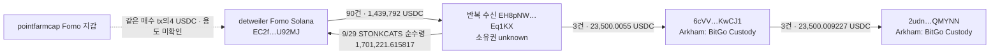

# 초기 지정10명 후속 조사 — 반복 수신 지갑과 custody 연결

검토 UTC: 2026-10-07T16:02:28.991Z. 배치 `top10-60d-20261007-v1-batch002`. 고정 표본은 raw141의 원래10명이고, 조사 창은 **2026-08-08T04:43:41Z 이상 ~ 2026-10-07T04:43:41Z 미만**이다. 모든 시간은 UTC다. 작업자5개는 `gpt-6-luna`/`max`로 저장 자료를 분석했고, 본체가 Chrome·외부 조회·근거 대조와 SQLite 적재를 맡았다.

## 이번 결과

**새로 확인한 주요 연결은 detweiler의 반복 수신 상대 EH8과 BitGo Custody 라벨 주소 사이의 경로다.** detweiler→EH8 USDC90건, 합계1,439,792 USDC를 저장된 full 거래에서 중복 제거했다. EH8→같은6cVV 주소의3건과6cVV→같은2udn 주소의3건을 Nodit RPC로 검증했다. EH8→detweiler의 STONKCATS 수령도 있어 일방적 수신 관계보다 강한 조사 후보다.

이는 **거래·반복 주소 연결**이다. EH8 소유권, BitGo 고객/특정 CEX 계정, 같은-token 선행 매수 의도, 특정 토큰의 매도대금 귀속은 확인하지 못했다. 라벨은 Arkham 주장이고 RPC는 명령·잔액 이동을 확인한다. 서비스 주소의 전체 자금을 trader에게 귀속하지 않는다.

이번에 Fomo 원문을 새로 수집하지 않아404건(THESIS171/BUY123/SELL110),294개 기준 사건·138개 토큰은 유지됐다. 시총 적격은0, 보류292, 제외2다. **60일 전체 원문·지갑 이력은 미완료**다. STONKCATS 분 단위 가격과 최초 발행/발행 권한 폐기 화면을 확보했지만 역사적 RPC가null이라 시총 gate를 통과시키지 않았다.

## 계정별 상태

T/B/S는 보존 THESIS/BUY알림/SELL알림 수다. 알림 개수는 실제 체결 개수와 다르다.

| 원래 순위 | 계정 | T/B/S | 검증 지갑 | 60일 coverage | 이번 후속 작업 |
|---|---|---|---:|---|---|
| 1 | pointfarmcap | 5/5/0 | 1 | 일부 확보 | STONKCATS 재고·시점 검토 |
| 2 | The__Solstice | 22/1/5 | 0 | 일부 확보 | 기존 자료 유지·추가 심층 미착수 |
| 3 | theveeman | 28/3/2 | 0 | 일부 확보 | 기존 자료 유지·추가 심층 미착수 |
| 4 | RareDualJay | 22/2/0 | 0 | 일부 확보 | 기존 자료 유지·추가 심층 미착수 |
| 5 | 0xdetweiler | 16/60/65 | 1 | 일부 확보 | ZSHIB·OTC 매매/반복 수신·custody 검토 |
| 6 | pricedin | 5/0/1 | 0 | 일부 확보 | 기존 자료 유지·추가 심층 미착수 |
| 7 | RunningClam | 14/0/0 | 0 | 일부 확보 | 기존 자료 유지·추가 심층 미착수 |
| 8 | econoar | 27/12/8 | 1 | 일부 확보 | 기존 자료 유지·추가 심층 미착수 |
| 9 | RZDxbt | 21/20/12 | 2 | 일부 확보 | 기존 자료 유지·추가 심층 미착수 |
| 10 | motiyawerey | 11/20/17 | 1 | 일부 확보 | 기존 자료 유지·추가 심층 미착수 |

RZD 단독 heartbeat, 연우 단독 확대, Top100 다음10명 수집은 재개하지 않았다. 검증 지갑은5명·6개를 재사용했으며 미검증 후보 주소의 소유권을 변경하지 않았다.

## 반복 수신·custody 구조

화살표는 각각 확인된 전송이다. 연결된 여러 전송이 동일한 원래 자금이라는 주장은 아니다. 4USDC 관계는 수수료/추천 가능성의 기존 검토이며 funding graph에는 추가하지 않았다.

### 정확한 주소

| 역할 | Solana owner 주소 |
|---|---|
| detweiler 검증 Fomo 지갑 | `EC2f5DnHzuNRit1ExqghSifDbp1wgrzktsRRZCtU92MJ` |
| 반복 수신 상대 | `EH8pNWx5K5vCnnrNrraB4wR3ntJa3EUAV5rTH1Eq1KX` |
| BitGo 라벨 수신 주소 | `6cVVpC4WWSonemUeLkq7jWmQM7M5uZ7vWN5RTFeKwCJ1` |
| BitGo 라벨 후속 주소 | `2udnBR9Qe6Hb7QvZq6qP63nbJXzjD3g32qjiZXnQMYNN` |

det→EH8는2026-08-10 00:14:44부터10-02 16:38:12까지90건을 관측했다. 서명+명령 인덱스+mint로 중복 제거했고 sender 서명/authority, 역사적 token-account owner, 양쪽 잔액 변화와 exact raw 수량을 본체가 재계산했다. 상세 페이지에 이어가기 값이 남아 전체60일 건수로 보지는 않는다. 마지막 [10,000USDC 송금](https://solscan.io/tx/3MRJjFnrLQkK2hwZEYA45Pb5h422AmUX3BKYALSKWfJysuyYVUH5KRD7XrPF5HRALuUxyUArZxm9crcA9Ee5YvR)은 raw869다.

### RPC로 검증한 custody 거래

| UTC | 방향 | USDC | 실제 tx | raw |
|---|---|---:|---|---:|
| 2026-09-28T03:15:17Z | EH8→6cVV | 5000 | [거래](https://solscan.io/tx/ef3cH7Dd9omGVy2fkuWKnwNfbfCGz1cYafwWsWb46Ki85RynKkvGRpLwthy73epdTYiXexxAbanoHWyAk1TLvy9) | 2193 |
| 2026-09-28T10:29:21Z | 6cVV→2udn | 5000.000151 | [거래](https://solscan.io/tx/hmm13qXtiX1aTbyh54k4crgNfJjA3DqUxa6BeZXnPD1EoQzP1N3c7KtkPuWpw8DSGkJhYW9JBUy3cmRNGcgMwMt) | 2196 |
| 2026-09-29T06:19:48Z | EH8→6cVV | 4500.0055 | [거래](https://solscan.io/tx/5rqrMfRpSyJJqoev6FbuXgXpvm44Hc1ukaMZgUZk61jXn2jMDGhvyn7DrRhFArw3ZDH9FDDva6pzDcmvH6h5zJAy) | 2192 |
| 2026-09-29T12:47:28Z | 6cVV→2udn | 4500.0078 | [거래](https://solscan.io/tx/2gJKD5ScGyS23LNaSwZTwb9gEPTJntPuqHWMcPuciyVg2HbocXgAbSc5sYmQ6Sbu4pvxi6h9YGJG6hRiSCsKWa24) | 2195 |
| 2026-10-02T16:51:28Z | EH8→6cVV | 14000 | [거래](https://solscan.io/tx/3MZW3m5n8cMZv8AxtqKZha7q6JEndgtjiEv6sSXzg1fFDEJdiWFJx4hTXvs4E6dqaQr1RiJfzct7EoxP8m6mZr4S) | 2185 |
| 2026-10-05T13:43:16Z | 6cVV→2udn | 14000.001276 | [거래](https://solscan.io/tx/26FafmbGc25yBQfqoAN7oQAaUqHNNAfyfxpd4tPSqdagTZzTZtmvfKoDaks3KepAs7JayFjiDiNnQkYoXkQtJAph) | 2189 |

EH8→6cVV 합계23,500.0055와 후속 합계23,500.009227은 다르다. 미세한 기존 잔액/추가 수신이 섞여 전체 원가나 같은 자금으로 계산하지 않았다. 10/2 det→EH8 10,000USDC 뒤13분16초에 EH8→6cVV 14,000USDC가 발생했지만, EH8의 선행 잔액이 포함된다. **ZSHIB 거래는10/3부터라 이10/2 송금을 ZSHIB 매도대금으로 볼 수 없다.**

Arkham의6cVV 페이지에서 같은 EH8·2udn 상대와 추가20K 행도 보였지만,20K의 양쪽 RPC raw2194/2197은 HTTP200/result null이라 거래 edge로 추가하지 않았다. USD≥$1 필터와 첫 페이지(1/9) 관측은 전체 이력이 아니다. BitGo는 화면의 custody 서비스 라벨이며 특정 CEX 고객 입금 주소의 확정 근거는 없다. 기존 verified 주소 집합과 CEX주소 집합의 단순 비교는 두 trader의 공통 고객 입금 주소 비교가 아니므로 작업자의0건 비교값을 그 결론으로 채택하지 않았다.

### STONKCATS 역방향 수령

9/29 06:09:35 [EH8→detweiler 거래](https://solscan.io/tx/nuq8oQthVtAZTcAhysHm8GkvKzYbfkbUhrftmBWEKC7zSvhmo98ogrARdT4q1GsCXbgwPJYWTvzKUMTZFnHixKj)(raw2186): 명령량1,718,405.672543, det의 실제 증가1,701,221.615817 STONKCATS다. 차이17,184.056726은1% 올림 패턴과 일치한다. 현재 mint RPC raw2190도 transferFeeBasisPoints=100이지만 당시 변경 이력/withheld 상태는 따로 확인하지 않았으므로 역사적 수수료 설정의 독립 proof로 쓰지 않는다. quote 감소가 없는 **TRANSFER**이고 매수나 취득 원가로 분류하지 않는다.

## 실제 매수·공개 시점 검토

### STONKCATS

pointfarmcap의10/6 01:08:07 [실제 BUY](https://solscan.io/tx/2LN6M61Lw8XMiRAvgtjTPg1FQhoSV2o78cWx2A5pN8imbtkj9moYPYq1mXJusSwjjF1c4p3KtxGFZpyYP7FTLywR)는2,000USDC 감소/3,387,070.295886 STONKCATS 증가다. 거래 직전23,569,174.924737을 보유해 **추가 매수**다. 저장된 이전 BUY110건/SELL9건/transfer1건은 이전 재고의 전체 원가를 완결하지 않는다.

detweiler9/16 06:20:35, Solstice10/4 18:15:25의 retained THESIS가 이 BUY보다 이르다. pointfarmcap 본인의 글10/6 05:14:35는 BUY 뒤4시간6분28초다. 따라서 본인 글보다 먼저 샀다는 사실을 절대 최초 공개 이전 매수로 바꾸지 않는다. 저장 wallet history는10/6 03:09:29까지만 있어 **본인 THESIS 뒤 매도는 미수집**이다. Solstice의10/7 SELL알림3개는 다른 계정·같은 tradeId의 반복 알림이고 actual fill/지갑 검증이 없다.

### THESIS 미확보 ZSHIB

detweiler의 실제 BUY5/SELL3을 보존 full 거래에서 검토했다(raw868/745). 첫4BUY는10/3 17:40:02~17:40:30의28초 안에 있었지만 **한 지갑의4건**이다. 여러 별도 지갑의 동시 선행 매수 군집은 아직 조사하지 않았다. exact mint의 retained THESIS는 없으며 절대 글 부재로 해석하지 않는다.

8거래의 토큰 취득/처분 합계는 각각17,894,666.003572 ZSHIB, USDC 지갑 이동은 매수−17,950/매도+11,015.598417, 합산−6,934.401583이다. 이는 관측 거래의 현금 흐름이며 lot/이전 재고가 미완료라 **실현 손익은unknown**이다. 네트워크 비용410,627lamports의 payer는 Fomo cosigner 주소이므로 전부 trader 비용으로 부과하지 않았다. alert에 native signature가 없어 임의 fill match도 추가하지 않았다.

### OTC

detweiler BUY6/SELL1을 raw868에서 검토했다. 첫5BUY는10/4 07:34:46~07:38:11이고 retained THESIS07:38:50보다 빠르다. 이는 확보한 글과의 시점 관계이며 최초 공개·의도 확정은 아니다. 역사적 시간별 cap은 약$5.12M~$6.67M이라 현재 $1M 연구의 우선순위를 낮췄다. 정확한 기준 시점의 cap은 보류한다. RZD의45.065317 OTC receipt와 pointfarmcap의19,168.170405 receipt는 transfer/미확인 원가이며 공동 매수·동일 소유 증거로 쓰지 않았다.

## 시총 gate와 남은 근거

| 토큰 | 이번에 확보한 자료 | 판정 |
|---|---|---|
| STONKCATS | actual BUY487초 전 cap$530,757.9473745384; primary pool의01:08 분봉 고가$0.0006173782702970317; THESIS 직전05:12 분봉. 최초 발행/권한폐기 Solscan 화면 | 역사적 유통 cap 보류 |
| ZSHIB | 정확한 mint CoinGecko404; GT현재 cap null/현재 FDV약$229k | 역사적 cap 보류 |
| OTC | 정확한 mint 매핑과 당시8개 시간별 cap, 모두$1M 초과 | 정확 anchor는보류·우선순위 낮춤 |

CoinGecko의 과거 짧은 기간 auto 표본은 시간 단위이고 `interval=5m` 요청은 Enterprise 접근401을 반환했다. [공식 range 문서](https://docs.coingecko.com/reference/coins-id-market-chart-range)와 raw2176을 함께 보존했다. 시간 차이300초는 연구자가 둔 운영 가정이며 사용자가 지정한 조건은$1M이다. 이번 실행에서 가정을 완화하지 않았다.

[STONKCATS 최초 발행 화면](https://solscan.io/tx/5R9DhgY69VCxv3yHXbaHys8CDxedqmb2AwqKxsaqQ1TicfJk3SiyAKqzeMo8o6RZ6WiGRs5CxFJcnjdpFFShu8nN)은9/15 01:49:24에10억개 mintTo, mintTokens 권한none을 표시한다. 현재 [getAccountInfo](https://solana.com/docs/rpc/http/getaccountinfo) 응답(raw2190)은 supply999,800,730.066128/mintAuthority=null이다. 현재 상태를 과거 상태로 소급하지 않았다. 최초 거래의 Nodit raw2191은null이므로 독립 역사적 proof gap이다. 분 가격×10억의약$617,378 가설적 상한은 역사적 supply/시장가격 인증이 끝나지 않은 후보 계산이며 유통 시총이나 적격 판정으로 저장하지 않았다.

## 저장·요청 사용량

- 기준 SQLite에 **TRANSFER97건**을 추가했다: det→EH8 90, EH8→det STONKCATS1, custody 관련6. 전부 ownership unknown이며 거래 raw/명령 위치/역사적 owner/정확 수량/UTC/Chrome 라벨 출처를 보존했다.
- 작업자5개 원문 결과와 JSONL을 배치 경로에 복사했다. 본체는 전송97건과 ZSHIB/OTC15매매의 원문 잔액·서명·swap log를 재계산했다. ZSHIB10/4 BUY의 작업자 raw ref745 오기를868로 고친 후 채택했고6cVV 주소 끝문자/14,000.001276 잔고 표기 오기도 본체 검토에서 바로잡았다.
- 신규 요청은 시장자료11/RPC11, Chrome 직접 탐색4+링크 탐색1이다. RPC3건의null도 사용량에 포함했다. Fomo·Nodit indexed·Bridge·BigQuery 신규 요청과 새 유료BQ 비용은0이다. 사용하지 않은 예약은 해제하고 batch를closed로 기록했다.
- 새 본체 review raw2207, inventory raw2206, cap raw2204, evidence raw2205, Chrome raw2203. 상태는 `initial_top10_followup_review_v1`와 `initial_top10_lowcap_event_inventory_v2`다.
- 기존 raw·collector state 전부와 wallet resolution을 보존했다. 비밀키/인증URL은 환경설정에서만 사용했다. 원문·재현 helper·검토 파일은 ignored `data/research/parallel/top10-60d-20261007-v1-batch002/`에 있다. 테스트는 추가/실행하지 않았다.

## 다음 순서

1. **STONKCATS cap 근거를 마무리한다.** 실제 BUY와 각 THESIS 시각의 유통 cap을 확인하거나 역사적 발행량 상한을 독립 검증하고 가격 범위를 정한다. 분봉이나 현재 FDV만으로 통과시키지 않는다.
2. **pointfarmcap의10/6 03:09:29 이후~고정 종료 이력을 보완한다.** 본인 글 뒤 실제 SELL/quote 회수 여부를 확보한다. 다른 저자의SELL 알림과 섞지 않는다.
3. **적격 사건1~3개가 정해지면 별도 매수자→공통 자금/반환→처분→정확 고객 CEX endpoint를 비교한다.** 새 market-wide 탐색은 필요한 시간창만 잡고 BQ dry run/cap을 적용한다. EH8/BitGo는 이미 저장한 연결을 재사용하며 실제 token 처분대금 연결이 생길 때만 더 확장한다.

새 공통 고객 CEX 입금 주소·동일인 뒷지갑·선행매수 의도·실현 수익은 아직 확정하지 않았다. 현재는 반복 수신·custody 경로를 좁히고 실제 거래/시총/exit gap을 분리해 놓은 단계다.
