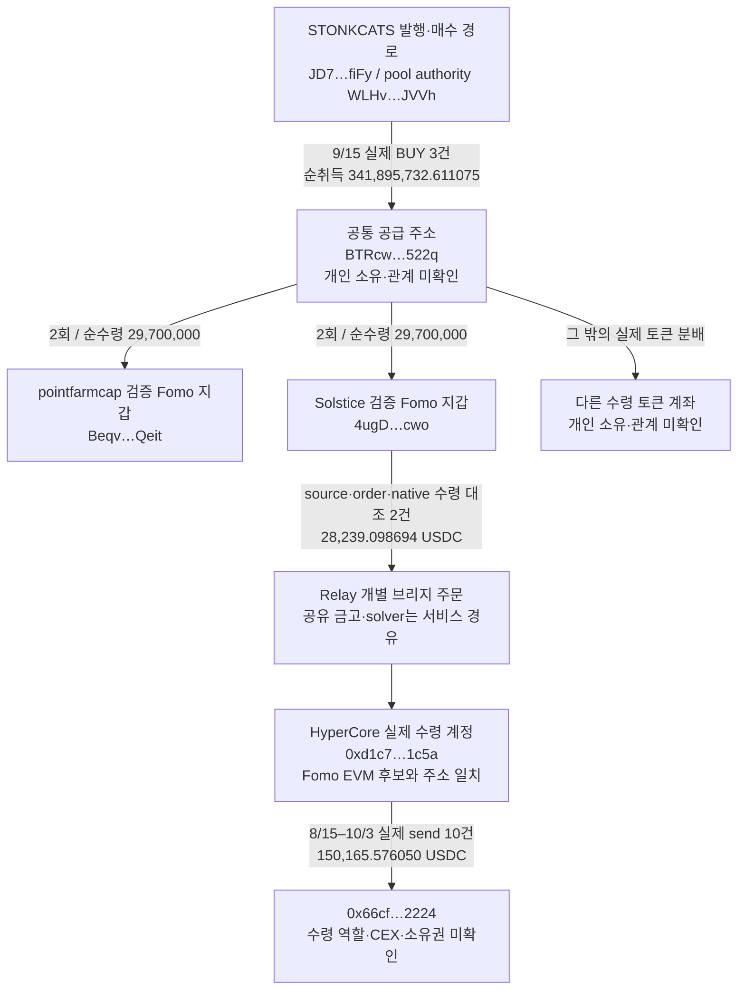

# 초기 Top10 후속 추적 — STONKCATS 공급자의 실제 매수와 Solstice 회수 경로

**2026-10-08 후속 역할 검토:** [수수료·홀더 보상 재검토](stonkcats-fee-reward-role-review.md)에서 BTR의 공식 발행자 역할과 별도 5KX 수수료 회수/STONK 보상을 확인했다. 아래 실제 거래 근거는 유지하며, 초기 분배를 뒷지갑 선행매수로 해석할 때 발행자 배분·에어드롭 대안을 우선 적용한다.

작성: 2026-10-08T00:28:12.226Z. 모든 거래 시각은 **UTC**다. 대상은 처음 지정한 raw141의 Top10이며, 고정 구간은 **2026-08-08 04:43:41 ≤ 시각 < 2026-10-07 04:43:41**다. 기존 5개 `gpt-6-luna`·추론 `max` 작업자가 원문을 분석하고 본체가 수량·거래·연결을 재검토했다. 예약 RZD 지시는 이번 실행에 적용하지 않았다.

## 이번에 추가로 확인한 내용

1. **공통 공급 지갑 BTRcw는 STONKCATS를 실제로 매수했다.** 발행 거래 안의 첫 매수를 포함해 3건에서 순수령한 물량은 **341,895,732.611075개**다. 이후 13건으로 10개 토큰 계좌에 순수령 합계 **193,050,000개**를 분배했다. 이 중 pointfarmcap과 Solstice는 각각 **29,700,000개**를 받았다.
2. **Solstice의 Solana USDC 입금 두 건은 Hyperliquid의 같은 HyperCore 계정으로 연결된다.** 소스 거래·정확한 Relay 주문 ID·목적지 해시·native 원장 수령까지 일치하며 합계는 **28,239.098694 USDC**다. 가운데 4,658.858499 USDC도 같은 계정의 수령은 확인됐지만 해당 소스와의 완전한 주문 대조가 남아 있다.
3. 이 HyperCore 계정은 고정 60일 구간에서 **같은 정확한 주소로 10회, 150,165.576050 USDC**를 보냈다. 수령 주소의 CEX·서비스·개인 지갑 역할과 소유자는 아직 확인하지 못했다.

**현재 결론:** 공급자의 실제 취득 → 알려진 Fomo 지갑으로 전달, Solstice의 개별 브리지 → 반복 회수 주소까지 연결됐다. **같은 고객 CEX 입금 주소, 뒷지갑 동일 소유, 선행매수 의도, 실현 수익은 미판정**이다. STONKCATS의 당시 유통 시총 역시 `pending_cap`이다.

## 1. 실제로 확인된 구조

화살표는 각각의 실제 토큰 이동 또는 개별 주문 대응이다. 마지막 회수 10건은 **10/7 STONKCATS 최종 매도보다 과거**이며, 앞선 STONKCATS 거래 대금이 마지막 회수로 이어졌다는 수익 귀속을 뜻하지 않는다.

## 2. BTRcw의 초기 취득과 분배

### 주소와 실제 매수

- 공급 주소: `BTRcwVTSoBwXg9XXEXcK4UYYCTmhd6iv81TZggFG522q`
- 정확한 토큰 계좌: `7cW4WMB4UY1sn14D1QzZhGkiUwbnEvXYY9fYqDnGrDSk`
- STONKCATS mint: `9h5AzEQzYu9CV5K6uLtFRMD1KcbxZSFNxZEgBTNfw5Na`, decimals **6**.
- 직접 결제 자산 STONK mint: `6GmAFSYs4gk3FDao5FzzySQpPZaWsa4rUJHacpMpUNgx`, decimals **9**.

| 실제 BUY 시각 UTC | 공급 계좌 순취득 STONKCATS | 목표 매수 명령의 직접 quote | 원문 거래 |
|---|---:|---:|---|
| 2026-09-15T01:49:24Z | 146414207.604438 | 2339.526248052 STONK | [거래](https://explorer.solana.com/tx/5R9DhgY69VCxv3yHXbaHys8CDxedqmb2AwqKxsaqQ1TicfJk3SiyAKqzeMo8o6RZ6WiGRs5CxFJcnjdpFFShu8nN?cluster=mainnet-beta) / raw2308 |
| 2026-09-15T03:10:51Z | 185560741.473713 | 7760.093617602 STONK | [거래](https://explorer.solana.com/tx/28ipNgRChBUBiskgnVbsuzpiNijEN1vK7JwLun2Um9sPDuHGtgzKLnEnUy7owmbK3RTQcFMV5mvz76AXLjNVHrWt?cluster=mainnet-beta) / raw2308 |
| 2026-09-15T03:40:11Z | 9920783.532924 | 1057.876001241 STONK | [거래](https://explorer.solana.com/tx/YxcTTUW1CJN8hfAaDtY51X3tZ39yNxFQjbJFYiVNQcZTt52d6FbCP7qhM5H4zgbX5QFTeeyy1hJSWo39i6j1heE?cluster=mainnet-beta) / raw2308 |

첫 거래는 발행·mintTo와 `BuyExactIn`이 같은 성공 거래 안에 있다. BTR이 서명하고 BTR 소유 quote 계좌가 STONK를 지출했으므로 **초기 무료 할당으로 처리하지 않는다.** 최초 10억 개 발행과 mint 권한 폐기도 raw2210에서 재확인했다. `WLHv…`는 이 경로의 프로그램·풀 authority이며 개인 자금 공급자로 분류하지 않는다.

두 번째 거래의 상위 경로는 15 SOL을 감싸서 14.925 SOL을 교환하고 0.075 SOL을 경로 수수료로 보내며, 세 번째는 2 SOL 중 1.99 SOL 교환·0.01 SOL 경로 수수료다. 이 금액과 최종 STONK quote는 **같은 경로의 서로 다른 단계**다. 두 단계를 원가로 더하지 않았고, 당시 USD 원가도 미확인이다.

### 분배 시각과 공개 기록의 관계

9/15 03:10:51 추가 매수 후 pointfarmcap의 첫 수령은 **03:11:51**, Solstice는 **03:12:00**이다. 추가 매수와의 간격은 각각 60초·69초, 두 수령의 간격은 9초다. 두 계정은 뒤에 한 번씩 더 받아 각각 29,700,000개가 됐다.

13건은 매번 전송 지시량 15,000,000개·수령 잔액 증가 14,850,000개다. Token-2022의 1% 전송 수수료 차이를 분리했고, 전체 gross 195,000,000·net 193,050,000개를 검증했다. **13개 주소가 아니라 13건·10개 토큰 계좌**다.

3건의 공급자 매수와 이 분배는 확보된 최초 STONKCATS Fomo THESIS인 detweiler의 **9/16 06:20:35**보다 이르다. Solstice 본인의 THESIS는 **10/4 18:15:25**, pointfarmcap은 **10/6 05:14:35**다. 이는 확보된 Fomo 기록과의 시간 관계다. 외부 SNS·삭제된 글을 포함한 절대 최초 공개나 동일 소유·조직적 매집은 확정하지 않았다.

### 공급 계좌의 보관·반환과 잔액

계약 예치 123,474,040.483703개(gross), 계약 수수료 경유 608,155.721785개, 이후 공급 계좌로의 반환 순수령 120,414,832.913509개도 구분했다. 예치 반환을 신규 시장 매수나 새로운 개인 공급자로 계산하지 않았다. 서비스 명칭보다 실제 계좌·성공 명령·잔액을 근거로 보존했다.

원문155건에서 공급 계좌의 처음 잔액0, 총 실제 순유입501,624,276.571394, 총 실제 지출501,624,276.571394, 마지막 관측 잔액0이 맞고 **잔차0**이다. 후속 빈 페이지까지 확인했다(raw2308·2312). 이 종료는 해당 토큰 계좌·요청 구간에 대한 provider 결과 회수이며, BTR의 다른 계좌·전체 풀 거래·모든 보유 자산 조사 완료를 뜻하지 않는다.

## 3. Solstice의 개별 Relay 주문을 HyperCore까지 대조

- 검증된 Fomo Solana 주소: `4ugDhHJ8XDXAeABmrNmGffFaLbJb9BkPyiFGVSV9ocwo`
- 실제 HyperCore 수령 주소: `0xd1c77a04b87393e98a1220532e72e8f7d0a31c5a`
- 위 주소는 보존된 Fomo EVM 후보와 일치한다. **수령 확인만으로 지갑 검증 상태나 개인 소유권을 바꾸지 않았다.**

| Solana 입금 시각 UTC | USDC | 소스 거래 | HyperCore 수령 해시 | 대조 근거 |
|---|---:|---|---|---|
| 2026-10-07T02:02:08Z | 19966.501244 | [Solana 입금](https://explorer.solana.com/tx/2RJ4ML8E9LtMCLdhY2FKCCc2wKRS3eXZ9Ss5er4D4JJhgoUwpfofqLwABALsqeEZ2NxVbW1nEgKcyPCSEHA1dW6K?cluster=mainnet-beta) | `0x390c23ba5db377f43a85044601b9e70207a8009ff8b696c6dcd4cf0d1cb751de` | source RPC＋Relay raw2318＋native raw2327 |
| 2026-10-07T02:09:06Z | 8272.59745 | [Solana 입금](https://explorer.solana.com/tx/2fMrK6rEk8tfgGoeLGN7SNdNfy5KNUfDLJWpe6yEAjoVDbEyzRNdk4xvi8QPURtpDgbba6DxDXMEk46cicnkZkTC?cluster=mainnet-beta) | `0x8dc8d619b0eedc318f42044601d0d3020cb700ff4be1fb033191816c6fe2b61c` | source RPC＋Relay raw2319＋native raw2327 |

소스 `deposit_token` 명령의 amount·32바이트 ID를 해독해 Relay `protocol.orderId`와 일치시켰다. `requestId`·`orderId`·`origin.onchainId`는 서로 다른 필드로 보존했다. 소스 서명·주소·금액, 목적지 해시·주소·금액·nonce가 공식 Hyperliquid 원장 응답까지 일치했다. [Relay SVM 명령 스키마](https://docs.relay.link/references/protocol/contracts/solana-depository), [Requests v2](https://docs.relay.link/references/api/get-requests-v2), [Hyperliquid 공식 SDK의 원장 조회](https://github.com/hyperliquid-dex/hyperliquid-python-sdk/blob/master/hyperliquid/info.py).

가운데 소스 [4,658.858499 USDC 입금](https://explorer.solana.com/tx/55T7xFz6GLHffUjbwnoBQcRPGMv2WbHnZCeW5ac5bKXXEJ7RzFgW3iWaPQgZQ14yu5u9hsa1gx61JVesBowMe7gP?cluster=mainnet-beta)은 **10/7 02:07:00**, 같은 HyperCore 계정의 수령은 **02:07:02.554**, 해시는 `0xd5bd0da473a65d7dd736044601ca05020849008a0ea97c4f7985b8f732aa3768`다. 금액·시각·수령자는 대응하지만 full Relay 주문을 이번 한도 안에서 회수하지 못했다. **수령 거래는 확인, 소스↔목적지 연결은 후보**로 남기며 검증 BRIDGE edge로 넣지 않았다.

예전 로컬 resolver의 `destination_chain_not_mapped`는 목적지를 매핑하지 못한 결과였다. 이번 실제 목적지는 HyperCore native 원장이고, Relay의 logical chainId는1337이다. 이를 `eip155:1337` 또는 HyperEVM999의 EVM 거래로 해석하지 않았다. 저장 체인은 `hyperliquid:hypercore-mainnet`이다.

## 4. 같은 정확한 주소로 반복 회수

공식 `userNonFundingLedgerUpdates` 조회는 고정60일에서64행을 반환했다(raw2327). 수령54건/572,929.126408 USDC는 Relay solver `0xf70d…dbef`에서 들어온 native send이며, 그 전부의 개별 소스 주문을 검증한 것은 아니다. 이 서비스 공유를 다른 Fomo 계정의 동일 소유 근거로 쓰지 않았다.

출금10건은 모두 다음 **동일한 HyperCore 주소**로 향했다.

**`0x66cf0aace1b4e562593bec10ec7868fba9932224`**

| 실제 send 시각 UTC | 원장 USDC 금액 | native 전송 해시 |
|---|---:|---|
| 2026-08-15T04:23:04.084Z | 45756.248246 | `0xaf2517b41e624aa9b09e044232837e01b8002f99b965697b52edc306dd662494` |
| 2026-08-19T17:22:51.214Z | 1505.0 | `0x48602b293d01f70d49d904428606700201f8000ed80515dfec28d67bfc05d0f7` |
| 2026-08-20T10:41:41.918Z | 11727.267477 | `0xe77fde38dd51ed2ce8f904429369f202043b001e78550bfe8b48898b9c55c717` |
| 2026-08-22T01:34:24.125Z | 2000.0 | `0x8632a06e31f5673487ac0442b16b9c0204430053ccf8860629fb4bc0f0f9411f` |
| 2026-08-22T04:54:31.038Z | 11000.0 | `0x2300bef70e0200a2247a0442b4000f02032d00dca9051f74c6c96a49cd05da8c` |
| 2026-08-22T09:21:26.606Z | 17000.0 | `0x72e3f1bc7f413869745d0442b774e002098c00a21a44573b16ac9d0f3e451254` |
| 2026-08-22T23:40:52.393Z | 700.0 | `0x4ec605b56f578377503f0442c288010201d0009b0a5aa249f28eb1082e5b5d61` |
| 2026-08-23T20:40:59.925Z | 48517.933593 | `0xc7ca2446aa119adec9430442d2dca6020663002c4514b9b06b92cf99691574c9` |
| 2026-09-02T21:08:50.032Z | 10613.661096 | `0x1bde9ea75c3019161d5804438c507802013b008cf73337e8bfa749fa1b33f300` |
| 2026-10-03T17:12:01.736Z | 1345.465638 | `0xf094b79698b7c420f20e0445c394d8020263007c33bae2f3945d62e957bb9e0b` |

합계 **150,165.576050 USDC**다. native 원장의 `sourceDex=spot`, `destinationDex=""`, fee문자열을 보존했다. 이는 CEX 출금 증거나 EVM receipt가 아니다. 해당 수령 주소의 Arkham 화면은 보안 확인 단계로 열려 라벨을 확인하지 못했다(raw2331). **역할 미확인이지 거래소가 아니라는 뜻은 아니다.**

수량은 원장 decimal 문자열을 그대로 보존했다. 그래프의 정수 저장값은 Relay 출력 decimals8과 맞춘 **보고용 환산값**이며, 이를 HyperCore의 독립 RPC raw 수량이라고 표현하지 않는다. 원장 전송64건과 검증 브리지2건은 자금 흐름의 다른 층이므로 서로 합산해 총 입금액을 중복 계산하지 않는다.

이10건은8/15–10/3의 전송이고,10/7 최종 STONKCATS매도보다 앞선다. 이번 cutoff까지 확보한 원장에는 그 최종 매도 후 새 출금이 없다. 이전 판매·다른 자산 거래·잔고·Hyperliquid 활동이 섞여 있으므로 **어느 토큰의 수익이 이 주소로 회수됐는지는 아직 미확인**이다.

## 5. USDC 원천과 다른 초기 Top10 검토

Solstice USDC 계좌 `GhE45gSNXPpGuYBCVYdHnDK6SY3VNiBe7ekz9nyPo6fU`는9/28–cutoff 요청에서1000행 상한에 도달했다. 실제 확보는 **9/28 00:00:06–09:06:05**이며 cursor는 `451273686:35`다. 다음 페이지와 그보다 앞선 기간이 남아 있다.

그 구간에서 다음을 별도로 확인했다.

- **9/28 08:49:47, 29,674.184016 USDC**를 Relay의 같은 Solana 금고로 보낸 DepositToken 1건. [소스 거래](https://explorer.solana.com/tx/4i1FckWCRRQmXrLWzCbmqGXEqTsP2XzjsUU6ULkYMf2jbp1ds6zBt5Q4sQj4gjvpkMYo7SSqytE5FMnqbv9rDDU9?cluster=mainnet-beta)이며, 이 날 STONKCATS 매도 시작09:14:57보다 앞서 해당 매도대금으로 귀속하지 않았다. 주문 목적지는 다음 대조 대상이다.
- 실제 서명한 DEX 매수4건에서 다른 mint `6XhzSy3VTTkwqMUSQsStM3ncGy6ozcPnzLVmv4HZ64cC`를 순수령하며 합계4,400 USDC를 지출했다. 알려진 지갑의 혼합 자금 설명을 위한 기초 검증이다. 이 토큰을 새 저시총 적격 대상으로 승인하거나 시장 전체를 수집하지 않았다.
- 정확한 USDC 직접 수령13건/6,445.559597. 그중 `F7p3dFrjRTbtRp8FRF6qHLomXbKRBzpvBLjtQcfcgmNe`에서9건/6,375.913282가 들어왔다. source ATA의 역사적 owner와 실제 서명자는 검증했지만 이 주소의 서비스 역할·자금 원천·소유권은 미확인이다. 과거 RZD 근거에도 같은 전송 출처가 보인다는 이유로 동일 소유로 묶지 않았다.

이전에 확인한 Solstice STONKCATS 초기29.7M 수령, 추가BUY272,135.727389, 총SELL29,972,135.727389·USDC수령39,597.727526·마지막재고0은 재사용했다. 초기 전송의 대가와 전체 수수료·원가가 없어 **39,597.727526을 이익으로 쓰지 않는다.**

ARTHUR의 적격 사건 raw2286과 기존63매수자를 별도 작업자가 기존 전송 근거와 대조했다. 새 비서비스 공급·반환·같은 고객 CEX 연결은 그 보존 범위에서 나오지 않았다. Werey와 Solstice가 같은 Relay 금고를 사용하는 사실은 **공유 서비스 접점**이며 두 사람의 자금 공유 증거가 아니다. 전체 뒷지갑 부재로 결론 내리지는 않았다.

## 6. 저장 결과와 남은 한계

SQLite `data/research/fomo.sqlite3`에 다음을 추가했다.

| 추가·재사용 항목 | 건수 |
|---|---:|
| 실제 BUY | 7 — 공급자3·Solstice 다른 mint4 |
| 신규 전송 edge | 90 — 초기분배9·계약예치/수수료/반환3·USDC입금1·USDC직접수령13·HyperCore64 |
| 기존 초기분배 edge 재사용 | 4 |
| source/order/native 검증 BRIDGE edge | 2 |

최신 본체 review **raw2340**, 근거 **raw2339**, 작업자 결과 **raw2333–2337**, 재개 state `initial_top10_supplier_hypercore_review_v1`다. 기존 collector state38개와 wallet resolution11행, canonical Fomo404건은 보존했다. 최신 raw는 최초적재raw2332/2338의 Solana chain alias중복2건을 조정한 판본이다. 과거 두 전송 근거는 그대로 두었으며 새 capture도 raw에 남아 있다. 작업자 decimals9 오기를 원문6으로 고친 내역과 최초 발행 출력 locator정정도 보존했다.

| 이번 실제 외부 사용 | 시도 수 |
|---|---:|
| 직접RPC·native 공개 원장 | 8 |
| Relay 주문 조회 | 5 — v3실패3·v2성공2 |
| 보이는 Chrome 탐색 | 4 |
| 공식 문서·SDK 조회 | 7 |
| Fomo·시장자료·indexed·BigQuery | 0 |

Nodit의 역사적 매수 point조회3건은HTTP200/result:null이다. 거래 부재로 해석하지 않았으며 QuickNode 보존 원문은 유효하다. Solana 탐색기Loading, Hyperliquid 일반거래 화면redirect, Hypurrscan 빈 화면, Arkham 보안 확인은 개별 거래·라벨 증거로 쓰지 않았다.

당시 **유통 시총≤$1M** 조건은 유지한다. STONKCATS는 가격·유통량의 역사적 확정 근거가 남아 보류이며, 이번에 새 전체토큰군집·BigQuery수집은 실행하지 않았다. ARTHUR의 기존 실제BUY 적격 승인만 유지한다. 300초 가격표본 차이 가정과 매수 시점 탐색 범위는 서로 다른 조건이다.

## 다음 작업

1. **HyperCore 반복 수령 주소 `0x66cf…2224`의 역할과 개별 후속 bridge/회수 경로**를 확인한다. 같은 고객 CEX 주소와 연결되는지를 먼저 좁히고 shared service 전체 흐름을 해당 인물에게 귀속하지 않는다.
2. **가운데10/7입금과9/28입금**의 exact Relay 주문을 새 예산에서 대조한다. v2조회는 이번에 성공했고 v3조회는 API key가 없어HTTP400으로 막혔다. [공식 v3 문서](https://docs.relay.link/references/api/get-requests).
3. 공급자의 다른 수령 계좌와 기존 Top10 간 실제 전송·반환·회수 접점을 검토하고, STONKCATS 시총 보류 근거와 다른 적격 사건을 보완한다.
4. Solstice USDC 남은 cursor와 다른 Top10의 미확보60일 기간을 필요한 범위로 수집한다. 단독 RZD예약·Top100확대는 재개하지 않는다.
