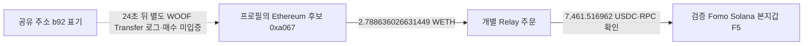

# theveeman 60일 자금 경로와 WOOF 매수 후보 정정

## 결론

**WOOF 수령 24초 전의 WETH 지출은 WOOF 매수 대가가 아니라, 기존 Fomo Solana 본지갑으로 USDC를 보내는 Relay 주문이었다.** 게시 전 같은 토큰 수령은 관측됐지만 유상 매수·별도 지갑 소유권·게시 후 매도·수익을 입증한 완성 사례는 아니다. 초기10명·당시 유통 시총100만 달러 이하 기준의 완성 사례는 이번 검토에서도0건이다.

이번에는 theveeman의 Fomo 프로필에 표시된 Ethereum 후보 `0xa0670863bd5cd0d60022bab2eed78e81e1a06bce`의 고정60일 ERC-20 전송을 보완했다. 구간은 **2026-08-08T04:43:41Z 이상~2026-10-07T04:43:41Z 미만**이고, 아래 시각은 UTC다. 이 후보를 검증 지갑으로 변경하지 않았다. Solana 목적지는 기존 검증 본지갑 `F5hkYsi8JxjyA2JHN5CA7MbnnhWubkXB2ZQB7Gkaxqs6`다.

## WOOF 수령과 인접 WETH 지출을 분리

정확한 WOOF 계약은 Ethereum `0xa912c71c0e53701153cad9ba73e9b7d854418eae`다. 보존 THESIS는10/5 17:29:35이고, BQ raw2795 `/payload/11`은9/28 12:11:59에 후보 주소로 들어온 이 계약의 Transfer를 기록한다. 게시보다**623,856초(7일5시간17분36초)** 앞이다. 토큰 정수 수량은 `6456647369054389833795297`이며 decimals·실제 balance는 이번 독립RPC로 확인하지 않았으므로 사람이 읽는 토큰 수량으로 변환하지 않는다.

24초 전에는 후보→공유 중개주소 `0xb92fe925dc43a0ecde6c8b1a2709c170ec4fff4f`로 **2.788636026631449 WETH**가 나갔다(raw2795 `/payload/10`, WETH decimals18). 상대 주소와 시간이 가깝다는 이유로 이를 WOOF 매수로 묶지 않았다. 정확한 source hash의 Relay raw2799는 **F5 본지갑으로7,461.516962 USDC**를 보내는 주문을 반환한다. 목적지 직접RPC raw2803의 역사적 계좌owner·성공 상태·잔액 증가·전송 instruction·주문 메모가 일치한다.

WOOF 수령 거래는 [별도 거래](https://etherscan.io/tx/0xc3f16a6547a1c6df83da813d6871fdbd4ab1ca127859d1c73bee04ed6d8d9c40)다. 해당 Transfer만으로 유상 매수나 실제 본인 보유를 단정하지 않는다. 조작된 from 로그·배분·서비스·보상 가능성은 미해결 대안이며, 실제 그런 행위라고 확정한 것도 아니다. 같은 후보 주소의 게시 후 WOOF 전송은 고정 조회에서0행이다. 역사 유통시총은 **pending_cap**, 손익과 소유권은 미확정이다.

## 새로 확인한 본지갑 자금 경로 두 건

| 출발 UTC | 출발 자산 수량 | Solana 실제 수령 | 확인 링크 |
|---|---:|---:|---|
| 2026-09-28T12:11:35Z | 2.788636026631449 | 7461.516962 USDC | [출발 거래](https://etherscan.io/tx/0x624f1a74f6bb1dee5f550f5ec8961dbf32280f3eb5b6c4a89e6a3e3beafb4410) · [실제 수령](https://solscan.io/tx/3rqtVds64xheN9VZ4qgZv7gqSsDrFiULVhWZ7FPwCFNEstZ4TfQx9UCHvijA8TqH9gjWT2kL5mDiNGxQG7hDcQ84) |
| 2026-08-20T00:06:35Z | 59994.960183 | 59994.960183 USDC | [출발 거래](https://etherscan.io/tx/0x8101f46da9be5b642e77e9ebd85ddbc397a8192d2374b6f5345478d564a04535) · [실제 수령](https://solscan.io/tx/5Qu7c8hcWK1cvAC6ZMjjvPhN9eCtT1JJTaujnLasQDkL2Z2suPQ9EKh98sU5KGZcGoPwjnbTfQQtNvcB8wao3axU) |

첫 행의 출발 자산은WETH, 두 번째는Ethereum USDC다. 수령 합계는**67,456.477145 USDC**다. 두 목적지 거래의 서명자는서비스키 F7p3이며 실제 token-account owner는F5다. 서비스키를 trader의 별도 지갑으로 분류하지 않았다.

출발은 정확BigQuery 로그와Relay 개별주문 근거이며, 목적지는독립Solana RPC다. **양쪽 독립RPC가 모두 확보된 것은 아니다.** PublicNode의 오래된 WETH 영수증 raw2798은HTTP200/result:null이라 후속같은source 조회를 중단했다. 이 null은 전송0이나거래실패를 뜻하지 않는다. 0x86ed의USDC 입금 영수증은첫null뒤미조회이며BQ-only다. 이전배치의최근Ethereum 직접영수증 성공과 구분한다.

## 스테이블코인 공급 출처는 네 주소, 역할은 미확정

후보에들어온뒤같은정수수량으로공유Relay depository `0x4cd00e387622c35bddb9b4c962c136462338bc31`에 나간 쌍을5건 찾았다. 다음은입금출처이고 trader 소유·CEX 역할을 의미하지 않는다.

| 출처 | 자산·수량 | 입금 뒤 후속 전송 |
|---|---:|---:|
| `0x86ed27ff97b01c96105623a9040eb6b0816b093b` | USDC59,994.960183 |120초|
| `0x0b45bb25990f4eceee715d5d836fe718d833bba9` | USDT59,998.908401 /49,998.948067 |168초 /984초|
| `0x18e296053cbdf986196903e889b7dca7a73882f6` | USDT1,708 |5,064초|
| `0x14e3d27d8ac89cf645028fd5514cb4b603333153` | USDT6,000 |84초|

8/20의59,994.960183 USDC는수량이같은Relay 주문과F5수령으로이어진다. 다른USDT 목적지는이번에확정하지 않았다. 비슷해보이는`0x0b451dbd0e5423a63046177646ae17fc6ba3bba9`는위`0x0b45bb…`와다른주소이며, 미확인토큰의from표시를실제공급자에합치지않았다. fd0bb 계약의수령·유출도유상매수나개인연결로승격하지않았다.

Chrome으로WOOF 수령거래와0x86ed Arkham 주소를열었으나두화면모두Cloudflare 보안확인이었다(raw2806/2807). CEX 라벨·고객입금주소·개인계정정보는미확인이다. 이접근실패를거래소연결부재로쓰지않는다.

## 조회 범위와 비용

세 연속 비중복 구간의ERC-20 결과는**15+78+35=128행**, 고유tx128개다. 이번 early/late 작업은SQL·DONE상태·결과테이블15/78행(raw2796/2797·2802/2808)으로전량회수를대조했다. 이전tail35행(raw2759/2773/2774)을재조회하지않았다. **정확주소의이ERC-20 쿼리결과완료**이며,native·내부전송·서명·모든자산·60일전체지갑coverage 완료를뜻하지않는다.

이번 dry run은22,923,434,145 /25,337,630,770 bytes, 실제청구는22,887,268,352 /25,301,090,304 bytes였다. 신규청구합계**48,188,358,656 bytes**, 각40GiB cap안이며,계정크레딧잔액이나원화청구액으로변환하지않았다. Top100·전체토큰시장BQ·신규적격시총승격은0이다.

Relay v2의세번째조회는429(raw2801)로중단했다. [공식v3 안내](https://docs.relay.link/references/api/api_guides/migrating-to-requests-v3)(raw2805)를확인했는데API키필수이고해당integrator가소유한요청만반환한다. v3를공개제3자지갑과거주문의대체API로가정하지않고새인증요청도하지않았다.

사용량은RPC3(ETH null1·Solana2),Bridge3(4291포함),Chrome2,공식문서1,BigQuery dry2·실행2·메타4다. Fomo·Noditindexed·시장자료0이며unused예약은해제했다.

## ARTHUR와 다음 조사

기존시총적격ARTHUR의매수자63개중Werey본지갑을뺀62개와보존Werey실제SPL/SOL전송주소의직접교집합은0이다. 이는검토한이력안의결과이며다중홉·미확보과거·전체뒷지갑부재판정은아니다. raw2240이짧은기존owner조회를이미빈/null로닫은것을확인해중복RPC를막았다.

이번에닫힌theveeman ERC-20 조회를반복하지않고초기10명의아직검토되지않은실제별도지갑유상매수·동일작성자토큰접점에다시우선순위를준다. Rare/pricedin/RunningClam/econoarc 등보존자료와수집gap을먼저대조한다. 새토큰시장수집은당시유통시총100만달러이하승인뒤에만한다. DARK와기존주요사례의닫힌capture를재수집하지않는다.

SQLite에는BRIDGE edge2건만추가해384개가됐다. BUY/SELL·Fomo source시각·walletresolution·기존51states·1,055trades·382edges·정규화자료는보존했다. 근거raw2814/검토raw2815, 재개state `initial_top10_ethereum_60d_falsepair_and_funding_review_v1`다. **연구목표는아직진행중이며뒷지갑유상매수→게시→같은지갑매도→원가·회수까지닫힌사례는없다.**
