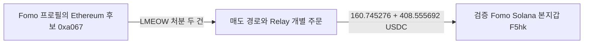

# theveeman 체인 간 회수 연결과 별도 지갑 매수 잔량 검토

**theveeman의 Fomo 프로필에 표시된 Ethereum 후보 주소에서 토큰을 처분한 뒤 검증된 Fomo Solana 지갑으로 USDC를 회수한 두 경로를 확인했다.** 목적지 수령 합계는 **569.300968 USDC**다. 양쪽 전송과 개별 Relay 주문은 연결됐지만, 별도 지갑 선행 매수와 같은 토큰 THESIS 뒤 매도까지 갖춘 저시총 완성 사례는 아직 없다.

기존 초기10명·고정60일 구간은 2026-08-08T04:43:41Z 이상, 2026-10-07T04:43:41Z 미만이다. DARK의 후속 활동 확인은 별도 증분 구간이다. 아래 시각은 UTC다.

## Ethereum 후보와 Fomo Solana 지갑 사이의 실제 회수

Ethereum 후보는 `0xa0670863bd5cd0d60022bab2eed78e81e1a06bce`, 검증된 Fomo Solana 지갑은 `F5hkYsi8JxjyA2JHN5CA7MbnnhWubkXB2ZQB7Gkaxqs6`다. Fomo 프로필 raw141의 wallets 표기와 반복된 원문은 주소 후보의 출처이고, 아래 실제 주문은 이 두 주소 사이의 자금 경로 근거다. wallet resolution을 임의 변경하거나 동일 개인 소유로 판정하지 않았다.

처분 토큰의 정확 주소는 Ethereum `0x18162f5cf35647be0910f30b4466be39295e4878`이다. Relay는 이를 LMEOW·18 decimals로 표시한다. 토큰 이름은 제공자 메타데이터이며, 이전 취득 원가와 당시 유통 시총은 미확정이다.

| Ethereum 실행 UTC | 처분 토큰 수량 | 원천 USDC 입금 | Solana 실제 USDC 수령 | 확인 링크 |
|---|---:|---:|---:|---|
| 2026-10-05T20:56:59Z | 415757.1977964868 | 160.877092 | 160.745276 | [Ethereum 처분](https://etherscan.io/tx/0xe5d62c029b6da67a4783fe043805f9a17cd3bc761ae6c3dc3f5b02d07cccc748) · [Solana 수령](https://solscan.io/tx/4UfAy8pG7b2YQCPZx4728XzQSim7NhK2uMEUWadWHRgmCRC2aeWogz2H2sPguZrfvLJutJW77Dwsu6HwW8cv7Qns) |
| 2026-10-06T00:00:23Z | 2096724.44829321777576863 | 408.859847 | 408.555692 | [Ethereum 처분](https://etherscan.io/tx/0x2f24ef5e6237f50ec13fb6c35e0f49dc9057fa15b00f8f7a5565375d97f345ca) · [Solana 수령](https://solscan.io/tx/2NFiq1SNtEyvVQJoq7SHJoswq3LiWHvRCRYeKTroffj1ZkQLYvWZ84JDagiNstZaNn2HQtnpuqonvAnh3dhpy3h4) |

Ethereum Transfer 로그는 BigQuery raw2759와 독립 PublicNode 영수증 raw2779/2780의 토큰 컨트랙트·from/to·정수 수량·블록·거래·로그 index가 일치한다. Relay raw2768/2769의 source hash, depositor, recipient, destination fill을 대조했고, 목적지 raw2770/2771에서 역사적 token-account owner와 실제 USDC 증가를 확인했다. 원천 처분은 해당 토큰의 유출이며, 후속 목적지 수령은 USDC다. 서로 다른 자산을 한 토큰의 단순 전송처럼 기록하지 않았다.

원천 주문 입금 합계 **569.736939 USDC**, 목적지 실제 수령 합계 **569.300968 USDC**, 차이 **0.435971 USDC**다. 차이를 원가·총 수수료·손익에 자동 귀속하지 않는다. Relay의 예상 수령액·현재 USD 표기는 실제 수령이나 수익 대신 쓰지 않았다.

외부 Ethereum 트랜잭션의 from은 후보 주소가 아니라 실행 서비스 주소다. 후보 주소는 실제 토큰 Transfer의 from이며, 주문은 그 주소를 user/depositor로 표기한다. 이 관계만으로 개인 서명자·뒷지갑 소유권·THESIS 악용 의도를 확정하지 않는다. 기존 EVM THESIS의 정확 토큰 6종과 이번 35행의 토큰 교집합은 **0종**이며, LMEOW의 같은 작성자 공개 이벤트·선행 유상 취득·100만 달러 이하 시총은 아직 확보하지 않았다. 두 경로는 CEX 입금이 아니다.

## 반복 SHIB 지급을 개인 공급자로 해석하지 않음

Ethereum 후보의 4일 ERC-20 전송은 35행으로, 유입33·유출2다. 31행은 같은 주소에서 반복된 SHIB 수령이었다. 대표 첫 거래 raw2778/2781에서는 같은 SHIB 컨트랙트·source의 전송 **200건과 서로 다른 수령자200개**를 확인했다. 후보 주소는 이 분배 배치의 한 수령자다. 보상·서비스·일반 분배 가능성을 유지하며 사적 공통 자금 공급자나 유상 매수로 승격하지 않았다. 역사적 source code 조회 raw2783은 HTTP403으로 목적·계정 유형은 미확인이다.

## DARK 별도 지갑의 게시 당시 잔량

Solstice와 실제 토큰 전달로 연결된 2KNo의 정확 DARK 계좌 `8ynVzUJLY99pZ8WUxgAhu1JDeHzz3QEeqQ34rfRt3Wu`를 보존 원문에서 다시 계산했다.

- 최초 스왑 취득 **10,687,587.896042 DARK**는 매도 **550,632.105839**와 본지갑 전달 **10,136,955.790203**으로 정확히 소진됐다.
- 전달 뒤 실제 스왑 BUY8회 **1,980,493.055482 DARK**, SELL17회 **1,975,424.765818 DARK**, 순잔량 **5,068.289664 DARK**다. quote 순지출·수령은 각각 **166.627422038 / 197.871490027 wNEAR**이며 서로 섞인 자금의 특정 lot 원가나 이익으로 쓰지 않는다.
- 공식 보상 API에 표시된 두 지급 **0.238485565**의 자산은 DARK가 아닌 결제 토큰 mint `3ZLekZYq2qkZiSpnSvabjit34tUkjSwD1JFuW9as9wBG`다. 그중0.176167243은 RPC, 나머지는 API assertion 근거다. 잔여 DARK를 직접 보상으로 받은 물량이라고 단정할 수 없다.
- 보존 THESIS **10/6 22:59:05** 당시 잔량은 있지만, 같은 계좌의 게시 후 매도는 미관측이다. 새 증분 raw2756은 **10/8 11:03:14부터10/9 01:17:19 미만**의0행/null cursor이며, 이전 raw2608과 별도로 범위를 기록했다. 다른 계좌·전체 지갑·평생의 부재를 뜻하지 않는다.

역사 유통 시총은 pending_cap이다. 게시 후 매도 없는 잔량을 완결 수익 사례로 분류하지 않았다.

## THICC와 detweiler의 반대 근거

Solstice의 THICC 정확 계좌 `537zGhXAyXapY9kfVB76Grxsk7BVShyEoKymqnpRqrng`는 고정60일211행과 빈 종료 페이지 raw2752/2753으로 회수를 끝냈다.189BUY에서33,559,603.367402 THICC와8,625 USDC 순지출을 확인했고,21행은 잔액 변화 없는 withheld-token 회수 동작이었다.

10/6 08:58:26의 [전량 처분](https://solscan.io/tx/4Bt1KYtGTgkpHK5vDnJ7GDgpQhU6z2KdB1ZgrqbSYHmQFrn2vEpfDqtcNPAPg4gpJcLtAJ8XNg3iqDeH2dTsJqD3)은 Jupiter/AMM 경로로 이루어졌다. gross WSOL279,956 raw에서별도 전송279와네트워크 fee10,032 lamports를 빼 본지갑 native 증가269,645와 일치한다. 임시 계좌 생성·종료 rent는 상쇄됐다. 원문/독립RPC raw2754를 대조했고 잔고는0이다. **본지갑 매도이며 풀 vault를 뒷지갑으로 판정하지 않았다.** 당시 시총과 USD PnL은 미확정이다.

작업자는 detweiler의 고정 이벤트141건과 EH8·2Tf·8e·55n 실제 거래를 정확한 mint로 대조했다. STONKCATS의 EH8 매수는 모두 THESIS 뒤였고16–32초 안에 본지갑으로 전달됐다.8e의 STONK 유상 재고는10/1에0이 됐으며,10/3 THESIS 때 재고는 이후 전송으로 형성됐다. 게시 뒤 유동성 회수·재예치 동작을 spot SELL로 분류하지 않았다. 닫힌 계좌를 반복 조회할 추가 요청은 배정하지 않았다.

## 비용과 조사 범위

BigQuery는 Ethereum 후보 **한 주소·10/3 00:00부터 고정 종료까지 ERC-20 전송**만 조회했다. dry run4,270,529,005 bytes, 실제 처리4,233,529,899 bytes, 실제 청구4,234,149,888 bytes로40GiB cap 안이다. 작업 `bqjob_r4b297f97bbd67772_000001a11e3e23ab_1`의SQL·완료 상태와결과테이블35행을 대조해35행 전부를 회수했다.60일 전체 이력·native transfer·모든 거래가 확보된 상태는 아니다. 원문 raw2758/2759, 비용·테이블메타 raw2773/2774를 보존했다.

기존 Ethereum 인증은HTTP401이었다. 사전 나열된6개 요청이 첫 인증 실패 뒤에도 실행된 운영상 예외를 그대로 남겼다. 같은 키 추가 요청을 중단했고 공식 공개RPC(raw2775/2776 안내)를 사용해 세 영수증을 확보했다. 공개RPC의archive code403은첫실패 뒤 즉시 중단했다. 이후 배치는첫인증실패 즉시 해당 source를 중단해야 한다. Chrome의Solscan·Etherscan 두 화면은challenge라 라벨 근거로 사용하지 않았다.

이번 사용량은RPC19(401 6회·archive403 1회 포함),Bridge4(서버2+공개주문2),Chrome2,공식endpoint안내2,BigQuery dry1·실행1·메타3이다. Fomo·시장자료·Nodit indexed 신규 요청은0이다. 지급 서비스 전체 자금 흐름·Top100 확대·단독RZD는 조사 범위에 추가하지 않았다.

## 결론과 재개 지점

**새 성과는 EVM 후보에서 기존 Fomo 본지갑으로 돌아오는 개별 회수 경로 두 건의 양쪽 전송 검증이다.** 별도 지갑의 유상 매수→게시 때 재고→같은 작성자·토큰 공개→같은 별도 지갑 매도·회수·원가→당시 시총100만 달러 이하까지 충족한 완성 사례 수는 여전히0이다.

다음은 EVM 후보의 미확보 과거 구간을 정확한주소·시간으로 보완해 같은 작성자의게시 토큰 실제취득과외부 비서비스 연결을 찾는다. 기존적격 ARTHUR 사례의 실제 자금 접점도 보존자료에서 우선한다. 신규전체토큰 시장 조회는역사 유통시총 승인 뒤에만 수행한다. THICC·DARK·8e의 이미 닫힌 조회를 반복하지 않는다.

SQLite에는본지갑 배경SELL1건과개별BRIDGE edge2건을추가했다. 기존50 collector states·11 wallet resolutions·1,054 trades·380 edges를보존했고, 합계는**1,055 trades/382 edges**다. Fomo1338·초기10명고정404·event matches73·정규화원문수는 유지했다. 상세검토 raw2790, 근거raw2789, 재개state `initial_top10_exact_token_and_theveeman_evm_bridge_review_v1`를 사용한다. 연구 목표는 아직 진행 중이다.
