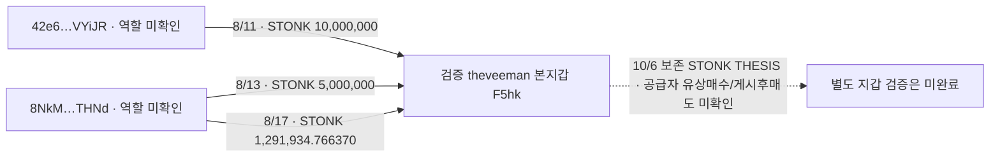

# 초기10명 후속 조사: theveeman INJ 시점과 토큰 공급 주소

**theveeman 본지갑은 INJ를 매수한 뒤 37초 만에 거의 전량 매도했고, 보존 THESIS는 매도 37초 뒤였다.** 게시 뒤 매도 사례로 분류할 수 없는 실제 반대 사례다. 별도로 본지갑에 STONK을 보낸 두 역사적 송신 주소와 반복 전송 세 건을 연결했지만, 송신자가 유상 매수했는지·같은 개인 소유인지·게시 후 매도했는지는 미확정이다.

이번 범위에서 **연결된 별도 지갑 유상 BUY → 같은 작성자 THESIS 때 보유 → 같은 별도 지갑 SELL** 완성 사례는 추가되지 않았다. 본지갑 거래와 토큰 지급을 뒷지갑 선행 매수로 바꾸지 않았다.

## 1. INJ 매수·매도·THESIS 순서

Fomo 작성자는 초기3위 `theveeman`, user ID `fc3ea5c0-afc4-553c-a295-f838907dc581`이며 검증된 Solana 본지갑은 `F5hkYsi8JxjyA2JHN5CA7MbnnhWubkXB2ZQB7Gkaxqs6`다. 정확 INJ mint는 `1NJMqVM4PadjuzYmeB7zV7q7DV8oB3ExaQCd9x6KsLz`, 계좌는 `5cnCZwGp7HpRQ7JwmqSmMa1jPQg8M2BCNd3y5fqpvDDt`, decimals9다. 시각은 모두 UTC이며 THESIS는 보존 raw2145 `theses[19]` / event `thesis_doc_e4a66f7a65f22cb6978ee8379798dc4d6b72b239a98a0cf2402478ca75f849b4` 기준이다.

| 2026-09-25 UTC | 실제 거래와 원문 |
|---|---|
| 15:18:46 | **43.493381686 INJ 매수**, 본지갑 USDC 순지출 **357.650000**. [매수 거래](https://solscan.io/tx/4DSp3dZ1GVHRfZCWewxyEZJ6qKyi52qEfjXahVMrF49NXc8LiejTpn7JpzzfRiRSAGMvsxiz6nxcRAprPy6FEC7P); raw2735 data92, 독립 raw2741 |
| 15:19:23 | **43.491586913 INJ 매도**, 본지갑 USDC 순수령 **353.789948**. 잔여 **0.001794773 INJ**. [매도 거래](https://solscan.io/tx/4dv5qnCMjERuhv4Y6tzj4ijMVmZMTqMQQSiE5wW1Wve3hAV2byTPZEtui5g4sEBUFgjFzDDhs4QMi6aEjSWAEV1c); raw2735 data95, 독립 raw2742 |
| 15:20:00 | 보존 THESIS `Inj to 50 again`; raw2145. 매수보다74초·매도보다37초 뒤 |

BUY 경로의 입력은356.7 USDC이고 별도 전송0.95가 있어 owner 순지출은357.65다. SELL의 gross 수령354.739948에서 별도0.95가 나가 owner 순수령은353.789948이다. Fomo `tradeUsd=356.7`을 원가나 실현 수익으로 쓰지 않는다. 두 거래의 순 USDC 차이는 **−3.860052 USDC**지만 잔여 INJ·native 비용·수수료/이전 조건을 모두 평가한 USD PnL은 아니다.

독립 직접 RPC로 성공 상태·역사 owner·F5 서명·target/quote 방향을 대조했다. exact INJ 계좌의 고정60일 조회 raw2739는 이 두 행, raw2740은 빈 데이터/null cursor였다. **이 계좌에서는 THESIS 뒤 매도가 관측되지 않았고 잔고는0.001794773**이다. 모든 계좌·전체 지갑·평생의 부재를 뜻하지 않는다. BUY 때 해당 계좌가 생성·초기화됐고 target의 첫 pre balance는0이며 이후 잔고 연속성이 일치한다.

두 거래의 공서명자 `AgmLJBMDCqWynYnQiPCuj9ewsNNsBJXyzoUhD9LJzN51`의 fee/rent 부담은 실행 서비스 대안과 구분해야 한다. 공유 서명·비용 부담만으로 개인 지갑 소유권을 연결하지 않았다. THESIS 시각도 확보한 공개 기록의 시각이며 절대 최초 공개·화면 최초 노출·의도는 별도다.

## 2. theveeman 본지갑의 역사적 토큰 공급 주소

보존 raw2606/2612에서 아래 exact STONK `6GmAFSYs4gk3FDao5FzzySQpPZaWsa4rUJHacpMpUNgx` 전송을 확인했다. 송신 owner·authority·서명과 F5 수신 계좌의 역사 owner·양수 잔고 변화가 일치한다. F5 수신 ATA는 `3tXv7zJydwjR92mPBwCBXtdazUK8HHDc9CFFg5RgWLqd`다.

| UTC | 역사적 송신 owner | STONK 수량 | 거래 |
|---|---|---:|---|
| 2026-08-11 17:25:30Z | `42e6KaraNpvvHUrcUt33GcQYmxaPN6vp5HdT39xVYiJR` | 10000000 | [전송 거래](https://solscan.io/tx/2vwxZg3BC64S9P6hs1NKr6VBxcUhAVV5Jv5iVMH4Y7pQSrtizjYKpKYY6FY8ERgYph7uHZxpzHvyCDgWwhPXMKfd) |
| 2026-08-13 18:32:05Z | `8NkMzBchjoxyABfX4kiZoAGtMBRog6iNp9KuwhucTHNd` | 5000000 | [전송 거래](https://solscan.io/tx/4nViZrKkCHf3hgFMnZ7RoXRw1GFzLnuJE5XPp94j9Daco4ZTHi7SSnCDwWbuXxN4tNvid5Bj7sGzSESrBryBbx62) |
| 2026-08-17 14:57:04Z | `8NkMzBchjoxyABfX4kiZoAGtMBRog6iNp9KuwhucTHNd` | 1291934.76637 | [전송 거래](https://solscan.io/tx/2MdaDBDVZMvh6SjJpthzvALCQfFdzZmvnSeJJDAY8NTdUAdQBYz9YAi43ZmcxszM9NDZWt5n4nEokdiLCVR8r5ki) |

이 세 거래에는 F5의 USDC 대가 지급이 없다. 마지막 반복 전송은 독립 raw2737과도 일치한다. **확인된 것은 토큰 공급 연결이며 유상 BUY·개인 소유·대가 없는 증여 확정이 아니다.** 거래 밖 정산·배분·서비스·보상 대안이 남는다. 원래 THESIS는10/6 14:37:45 UTC다. 송신자의 취득 이력과 같은-token 게시 후 처분은 아직 조사하지 않았다.

해당 STONK는 이전 역사 시총 검토의 높은 시총 맥락으로 우선순위를 낮춘 토큰이다. 이번에 새로100만 달러 이하로 승인하지 않았고, 송신자 전체 이력·시장 군집을 확대하지 않았다. 연결 근거를 보존하되 저시총 완성 사례에 포함하지 않는다. INJ·THICC도 당시 유통 시총100만 달러 이하를 확인하지 않았으므로 심층 적격으로 승격하지 않았다.

Chrome에서 반복 송신자8Nk의 Solscan을 열었으나 raw2738은 보안 확인 화면이다. 새 서비스/CEX 라벨은 확보하지 못했고, 계정 소유자나 CEX 역할은unknown이다.

## 3. Solstice THICC와 detweiler 대조

Solstice 미완료 owner 구간을900행 더 이어받았다. THICC mint `7JQ3MyKXkFxcmpekTebuwJV4p7MiPFzN2MYKDqJSnhTQ`에서 **본지갑 유상 BUY189건**이 확인됐다. 보존 THESIS9/19 08:22:30 UTC 전179건으로 **33,144,070.517832 THICC / USDC 순지출8,484**, 뒤10건으로 **415,532.849570 / USDC 순지출141**이다. 새 원문 범위는9/19 20:35:14 UTC까지이고 THICC 음수 변화·별도 주소로의 공급은 그 범위에서 없다. **본지갑 배경 거래**로 저장했으며 별도 매수 지갑 사례가 아니다. Owner 조회는 아직partial이다.

detweiler USDC 계좌에는1,000행을 추가했다. 새 페이지의 EH8 직접 대금 전송은 기존 canonical edge에 이미 있어 재적재하지 않았다. 이전 여러 부분 페이지를 더한62건/811,972 USDC 및24건/192,266.430500 USDC 수치는 그 부분 원문의 합계이며, 기존 전체 EH8 검토를 대체하거나 새로운 누적 송금으로 발표하지 않는다. Pool·Relay 내부 leg, 소액dust·유사 주소도 별도 개인 연결로 올리지 않았다. 2Tf/EH8의8K5 유상 매수는 DET 첫 실제 본지갑 매수 뒤457/512초의 사후 취득이며 기존 결과를 유지한다.

F5와DET가 같은 거래에서 서로 다른 owner로 무관 토큰을 일괄 배포받은 건도 개인 간 송금으로 분류하지 않았다. 공통 지급자·공서명자·풀을 공유했다는 사실과 사적 자금 공급은 별개다.

## 4. 초기10명 진행과 커버리지

전체 고정 구간은 **2026-08-08 04:43:41 UTC 이상~2026-10-07 04:43:41 UTC 미만**이다. 새 원문 회수2,650행은Solstice900 + F5 기존커서150 + F5 별도3일owner600 + DET1,000이다. 이 행 수는 서로 다른 조회 범위의 source rows이며 전체 distinct 거래2,650건이라는 뜻은 아니다. INJ exact ATA2행과 독립 RPC는 중복 검증 자료다.

| 초기 순위·계정 | 이번 상태와 남은 근거 |
|---|---|
| 1 pointfarmcap | 기존 issuer/홀더 보상 대조 재사용; 별도 사적 유상 매수 지갑 미확정 |
| 2 Solstice | owner prefix2,100행,9/19 20:35:14까지partial. THICC189 mainBUY; 새별도buyer 없음 |
| 3 theveeman | 기존 owner prefix350행,8/26 18:11:42까지partial. INJ3일owner600행partial, exactINJ ATA만종료. 새실제공급자2주소/3전송 |
| 4 Rare | 기존 AXN4candidate, verified 소유/별도buyer 미확정 |
| 5 detweiler | USDC exact query9,000행,9/6 17:01:18까지partial. 새1,000행의이미저장된edge중복제외 |
| 6 pricedin | 기존 candidate 유지; 새소유권/유상buyer 증명 없음 |
| 7 RunningClam | 원문/RPC403공백 유지; 실패를 거래0으로 해석하지 않음 |
| 8 econoar | 기존 EVM·bridge 연결 재사용. Solana CARDS candidate와2개공개SELL매칭은ambiguous |
| 9 RZD | 단독 조사 중단 유지, 기존 자료 재사용만 |
| 10 Werey | 적격 ARTHUR는mainBUY/THESIS 맥락; 저장63BUY주소slice에서새연결별도buyer 없음 |

저장된 현재 커서:

- Solstice owner **448517037:894**, 기존query end1791137640 유지. THICC exactATA/전체owner 종료로 올리지 않음.
- F5 기존 owner **441923169:896**, end1791315990 유지. 고정60일 중 앞부분 일부이며 이후known gap도 남음.
- F5 INJ 주변3일owner **450447782:670**, `[1790208000,1790467200)` 유지. 600행이게시시각을포함하지만아직9/25 19:33:23까지partial.
- DET USDC **444844361:1237**, 전체고정end1791348221 유지. Quote계좌이력과walletwide이력은구분.
- INJ exact ATA **raw2739/2740 종료**. 이 캡처는 재수집하지 않음.

## 5. 판단과 다음 작업

이번에 구체화된 연결은 **theveeman으로 토큰을 공급한 두 주소**다. 아직 공급자의 선행 유상 취득, 같은 작성자의 게시 후 처분, 공통 고객 CEX deposit을 확인한 단계는 아니다. INJ의 본지갑 매수·매도는 모두 게시 전이며 THICC도 본지갑 매수다. 전체 뒷지갑 부재·동일 개인·조종 의도·THESIS 악용 수익을 결론 내리지 않는다.

다음은 저장된 미완료 구간과 기존 적격 저시총 이벤트에서 **실제 비서비스 자금 연결과 별도 paidBUY**를 우선한다. THESIS없는BUY도같은token이전취득·노출·후속처분을분리한다. 새로운tokenwide/BQ는역사유통시총≤1M승인뒤dryrun/cap으로만수행한다. 높은시총STONK의sourcehistory를현재우선작업으로늘리지않는다. 공유Agm/Relay/pool 전체flow나이미닫힌EMBER·7kHo를반복하지않는다.

## 저장과 재개 근거

기존5개 **gpt-6-luna / max**가DBread-only·네트워크0으로검토했다. 본체는 **RPC25회 / Chrome1회**, Fomo·시장·Bridge·indexed·BQ·외부문서조회0회다. RPC25에는full address메서드와독립getTransaction이포함된다. F5 raw2718의HTTP504는100→50으로한번만축소재시도했고raw2725로성공했다. 실패·재시도를포함한수치다. 자동권한검토1회시간초과는네트워크실행전에발생했고같은준비작업재시도로완료했다.

SQLite에 **main background 실제trade191건(INJ2/THICC189)**과 **실제token TRANSFER edge3건**을추가했다. 총trade1,054/edge380이며기존863trades/377edges/49states/11walletresolutions는보존했다. Fomo1,338/초기10명고정404events·match73·normalized44,604/deltas63,178은유지했다. 본지갑새거래를새뒷지갑사례·Fomofill·ownership으로연결하지않았다.

근거raw2748,검토raw2749,새state `initial_top10_remaining_foundation_and_prethesis_exit_review_v1`. 정확rawamount·UTC·원문위치·요청·coverage·5개작업자결과와정정은SQLite및ignored `data/research/parallel/top10-60d-20261009-v1-batch017/`에보존했다. [이전EMBER검토](solstice-ember-recovery-review.md)는별도완료범위로재사용한다.
