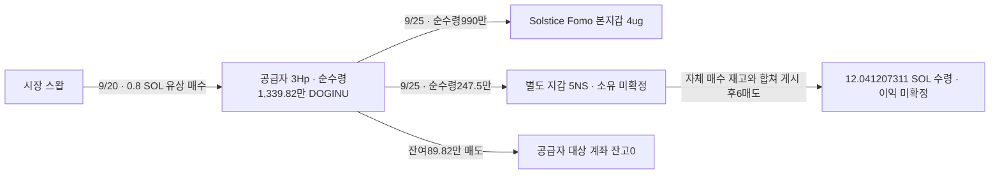

# 두 사례 후속 조사: 공급자의 역할과 역사 시총

2026년 10월 10일 · 배치063 · 모든 거래 시각은 UTC

## 이번에 확인한 내용

**DOGINU는 같은 공급자가 시장에서 실제 매수한 물량을 Fomo 본지갑과 별도 지갑에 나눠 보냈다는 수량 흐름을 독립 검증했다. Werey/PURR는 기존 8,000/200 USDC 양방향 일반 송금을 별도 RPC에서 확인하고, 최초 발행까지 확보했다.** 새 뒷지갑 소유자나 공통 개인 CEX 입금 주소가 확정된 것은 아니다.

초기 Top10·기존 60일 창을 유지했다. 닫힌 전체 이력을 다시 받지 않고 기존 원문을 재검토했다. 신규 요청은 정확 거래·토큰 발행 설정과 게시 원문 접근에 제한했다. 전체 토큰 군집·BigQuery·Fomo REST 수집은 실행하지 않았다.

## 1. DOGINU 공급 물량의 출처

- 공급자: `3HpNWdgjK9yMLMbmJdpsZcx6iiK39hPrDzTFYc65oQdr`
- Fomo 본지갑: `4ugDhHJ8XDXAeABmrNmGffFaLbJb9BkPyiFGVSV9ocwo`
- 별도 지갑: `5NSXD54Ljcezm5ohSbDSiD7Yr7dL93mn5TBzMsvurZFj`
- 정확 mint: `5JgioXRQSq1Nw4VJvpRyXxnvm8jVtLSUC7vbf1zzDg3L` · 6 decimals

| 시각 UTC | 공급자 거래 | 수량·해석 |
|---|---|---|
| 9/19 22:14:36 →22:18:29 | 0.8 SOL 매수 뒤 전량 매도 | 앞선 포지션은 종료. 다음 매수의 원가와 분리 |
| 9/20 01:37:59 | 새로 0.8 SOL 유상 매수 | 직전 대상 계좌 잔고0 → 순수령13,398,210.259337 DOGINU |
| 9/25 14:57:50 | Fomo 본지갑으로 직접 이전 | 공급자 차감10,000,000 → 본지갑 순수령9,900,000 |
| 9/25 15:21:27 | 5NS로 직접 이전 | 공급자 차감2,500,000 → 5NS 순수령2,475,000 |
| 9/25 16:49:18 | 잔여898,210.259337 매도 | 공급자의 해당 계좌 잔고0 |

수량은 정확히 맞는다.

`13,398,210.259337 = 10,000,000 + 2,500,000 + 898,210.259337`

두 이전의 송신 차감량과 수신 순증가가 다른 이유는 실제 Token-2022 이전 수수료1%다. 두 이전에서 합계125,000 DOGINU가 수수료로 유보됐다. 이는 토큰 소각이나 수신자의 매수 원가가 아니다.

이전 자체는 두 거래 안에서 반대 SOL·USDC 대가를 받는 매매가 아니다. 따라서 **5NS가 받은247.5만 개를 유상 매수로 세지 않는다.** 공급자가 지출한0.8 SOL을 수신자에게 임의 배분해 원가나 이익을 계산하지 않는다. 별도5NS의 기존 자체 유상 매수4건/1 SOL과 이 공급분은 구분한다.

기존 source owner 성공 조회65행과 빈 종료 페이지(raw3439/3440) 안에서 직접 DOGINU 수신자는 이 두 주소뿐이었다. 모든 ATA·실패 거래·전 생애·모든 배분 수신자를 조사한 것은 아니다.

### 독자가 확인할 거래

- [공급자의 0.8 SOL 매수](https://solscan.io/tx/26ShG7YnmqSNXHfkDpMiYpu5KBf3F7yGRmZQYWA2VdYt7EAQR9kBsVCg2J8hUEBuDhsHHWkerQKNETsCc91EYP8o): raw3439/42 ↔ 독립 공개 RPC4065
- [본지갑으로 공급](https://solscan.io/tx/5CE2myzw3pM7dRWpE2Ee5UfTtHpUgYk7ZFwEWfp7n9VJQ99DePDmHitKkvAvFfjqGWagEw1iN5mFWcerr9ohFVEu): raw3439/54 ↔4066
- [5NS로 공급](https://solscan.io/tx/3419sFXHtuPeX48p781QYm2zQWDSP7uhnHtQKZnaEd8oZBzNW7WJT2pNcTkKKPdrqk1VrQfh8i2BTRuctaZ5ibHz): raw3439/55 ↔4067
- [잔여 물량 매도](https://solscan.io/tx/5J4gvSZ9pCcWYhzJZrSUBuNQybPBtt1uqwxZoa8RP6aKH9ov3FNy25WUBYRVup7TKefddUZNcgZMKo24SfmZaREB): raw3439/56 ↔4068

각 거래의 서명·slot·UTC·성공 여부·명령·전체 토큰/결제 잔액이 기존 QuickNode 원문과 공개 Solana RPC에서 일치했다. 새 경제 연결로 중복 등록하지 않았다.

## 2. 에어드롭·수수료 보상 대안

[StonkFun 공식 개발 문서](https://www.stonkfun.xyz/developers)의 저장 원문raw2349를 재사용해 정확 토큰의 발행 기록과 발행 시 에어드롭 기록을 확인했다.

| 토큰 | 공식 발행 기록 | 발행 시 에어드롭 응답 |
|---|---|---|
| PURR | reward 모드·HYPE 페어·이전 수수료3% ·raw4069 | airdrop=null ·raw4071 |
| DOGINU | reward 모드·KALSHI 표기 페어·이전 수수료1% ·raw4070 | airdrop=null ·raw4072 |

원문은 [PURR 설정](https://www.stonkfun.xyz/api/public/v1/tokens/8RNUw4N655VSrZKuhGdywhbSMDTrheguFPfxbpE2NZHQ), [DOGINU 설정](https://www.stonkfun.xyz/api/public/v1/tokens/5JgioXRQSq1Nw4VJvpRyXxnvm8jVtLSUC7vbf1zzDg3L), 각각의 `/airdrop` 응답이다. 이는 **제공자가 보관한 발행 시 배분 기록**이다. 이후 보상·수동 배분·장외 거래의 부재를 뜻하지 않는다.

DOGINU의 해당3Hp 취득은 mintTo·보상 청구가 아닌 유상 스왑이었다. 그러나 그 뒤의 두 송금이 증여·장외 판매·프로젝트 배분·보상·사적 공급 중 무엇인지는 거래만으로 확정할 수 없다. “시장 매수에서 온 물량”과 “수신자가 자기 돈으로 매수했다”를 구분한다.

두 토큰의 수수료 유보분 회수 권한 주소는 `5KXDF6QnqhBj72hDtJNkkpFaQVUfbFXNybMsp3DiK6tD`로 같다. 이는 기술적 권한 접점이다. Fomo 작성자들의 개인 자금·공동 소유 관계로 올리지 않는다.

## 3. Werey/PURR 일반 자금 관계와 발행 근거

기존 [8,000 USDC 본지갑→F1b 송금](https://solscan.io/tx/4iAYy8JVVnVFg2MceLVARCsgUmreToZ8YMEAJB8bwxU5JGN4aufWwU7yEoixeerWBdjzpmYtr6ywpgxT3QPLZBNn)과 [200 USDC 역방향 송금](https://solscan.io/tx/55Uig5k7mo5VUSB3ubR2FpFGzDRcjNHgjHELYDPgfn6PgxyM9v9eP4qFQKu4MqmjgztrUm86HdKLGvXwaGmC6522)을 공개 RPC4074/4075에서 최초 교차 검증했다. 기존raw3161의 해당 거래와 명령·잔액이 일치한다. 일반 자금 연결은 실제지만 동일 소유·대여 반환·전체 PURR 매집 원금이라는 판정은 아니다.

저장된 F1b owner2,712행 및 정확USDC 계좌3,114행을 재검토했으나 기존 일반 송금2건과 수수료성 소액35건 외 새로운 직접 SOL·타 자산 송금 접점은 찾지 못했다. 해당 조회 범위 안의 결과이며 ATA-only 입금과 평생 부재를 뜻하지 않는다.

Chrome [정확 PURR 토큰 페이지](https://solscan.io/token/8RNUw4N655VSrZKuhGdywhbSMDTrheguFPfxbpE2NZHQ)의 최초 발행 링크를 확인한 뒤, [2026-08-20T01:07:00Z 발행 거래](https://solscan.io/tx/5KDQ7v3PBebQzGJpcgA2ShMFbkzGSUcGuYAPdGgs1ppzPe7Guiqmj6rLVTSptAfUoK4A6dC8F5gMYhjEEKpwpT6m)를 QuickNode4063과 독립 공개 RPC4064로 대조했다. 초기10억 개가 발행됐고 같은 거래에서 발행 권한이 폐기됐다. 현재 공급량963,277,812.189964701개는 raw4060에서 확인했다.

발행 권한 폐기 후 추가 발행이 불가능하므로 표준 Token-2022 동작에서는 현재 총량≤과거 총량≤초기10억 개라는 범위를 추론할 수 있다. **과거 유통량을 이 값으로 확정한 것은 아니다.** 수수료 유보분은 소각으로 취급하지 않는다.

주의할 제공자 필드 차이도 저장했다. 실제 최초 발행 서명자·권한·수령자는5CEb 주소인데 공식 발행 기록의 `creator`는93Fa 주소다. 필드의 의미가 해명되기 전 두 주소의 역할·소유를 합치지 않는다.

## 4. 100만 달러 기준을 통과했는가

**아직 두 사례 모두 역사 유통 시총 판정은 보류다.**

| 사례 | 이번에 좁힌 조건 | 남은 공백 |
|---|---|---|
| PURR | 보존 THESIS 인근 두 분봉 종가에서100만 달러 이하려면 유통량약1.24억~1.30억 개 이하. 두 표본의 최대 고가 기준약1.2232억 개 이하 | 당시 제외·비유통 물량, 전체 시장 가격·유통량 근거 |
| DOGINU | 초기 총량 상한10억 개. 기존 단일 풀 완결 분봉 고가×상한은약435,103.58달러. 공식 제공자 peak는909,822.48달러 | 정확한 역사 시총 산식·시각 범위·독립 시장 근거 |

PURR의 초기10억 개나 현재9.63억 개를 그대로 과거 유통량에 넣어 확정 시총을 계산하지 않는다. 두 보존 가격과 발행 상한을 곱한 금액 역시 전체 시장 시총이 아니다. DOGINU 공식peak는 검토를 우선할 단서지만 현재 응답에 역사 범위·산식이 없어 적격 확정으로 사용하지 않았다.

풀 목록 집계도 구분했다. raw4041의20행에는 THESIS 이전 생성으로 표시된 exact PURR **base-side8개와 quote-side1개**, 총9개의 관련 풀이 있다. 이전 문서의8개는 base-side 집계다. 전체 목록 완전성·당시 활성 여부는 미확정이다.

## 5. 공개 시점과 개인 CEX 목적지

Werey PURR는raw2156의9/15 23:39:50, Solstice DOGINU는raw2167의9/29 03:47:55가 가장 이른 보존 THESIS다. 두 원문 모두 외부 게시 링크가 비어 있고, 절대 최초 공개라는 보증은 없다.

이번 첫 Werey 정확 프로필 Chrome 조회도 로그인 랜딩을 보여줬다(raw4073). 기존 Solstice 접근 공백3985를 동일 조건에서 반복하지 않았다. 별도raw3245는 다른 사용자theveeman의 unavailable 응답이므로 이 두 계정의 공개 이력 부재 근거에서 제외한다.

기존 F1b→Binance 라벨 경로와3Hp의 Binance 라벨 경로는 유지한다. **본지갑과 매도 지갑의 같은 정확 개인 입금 주소는 새로 확인되지 않았다.** 5NS→HN88→B48 뒤 개인 목적지도 미확정이며, 공용 집금 주소의 전체 흐름을 개인 경로로 확대하지 않았다.

## 판정과 다음 순서

사례의 실제 자금·토큰 흐름을 독립 원천으로 보강했다. DOGINU는 공급자의 시장 매수→두 주소 배분이라는 경로가 구체화됐고, PURR는 일반 송금과 최초 발행의 원천이 강화됐다. 소유·통제·최초 공개·실현 이익은 미확정이다.

1. 저시총 우선 조사에서는 DOGINU의 이벤트 시총 산식·역사 가격과 공급 목적의 독립 근거를 먼저 확보한다.
2. PURR는100만 달러 기준에 들어갈 수 있는 과거 유통량 근거가 있는지 확인한다. 근거가 없는 동안 신규 전체 토큰 수집을 늘리지 않는다.
3. 실제 추가 비서비스 자금 관계나 개별 출금 주문이 생길 때만 개인 목적지를 확장한다. 로그인 접근이 바뀌면 게시 원문을 확보한다.

근거raw4082·검토raw4083·시총raw4081. 직접RPC9회, 공식 자료·탐색6회, Chrome2회. 탐색1회의 저장은 검색 결과 발견 메모이며 전체 도구 원문이 아니고 최종 주장 근거로 쓰지 않는다. Luna/max4명은 저장 자료만 읽었다. Fomo REST·Bridge·시장 신규 분봉·BQ0회. 기존95state·11지갑 검증·4,569거래·646연결은 보존했으며 검토state1만 추가했다. 전체 조사 완료를 선언하지 않는다.
