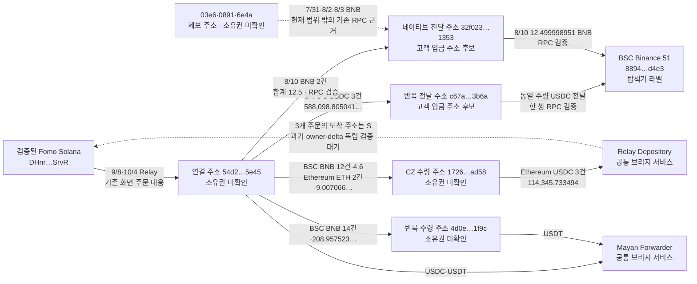

# 연우: 두 달 범위의 지갑·CEX·CZ 대조

조회 기준은 `2026-08-07T00:00:00Z`부터 `2026-10-07T04:43:41Z`까지다. KST로는 8월 7일 09시부터 10월 7일 13시 43분 41초까지이며, 약 61일이다. 사용자의 두 달 확장 요청에 따라 연우(`yeon__`)의 기존 연결 주소와 제보 주소를 조사했다. RZD는 이미 수집한 결과를 보존하고, 빠진 이전 한 달의 제한된 토큰 조회만 비교 자료로 추가했다.

이번 결과는 **이름 붙인 조회의 결과 회수 완료**다. 모든 체인·모든 토큰·두 달 전체 CALL 기록의 확보를 뜻하지 않는다. Fomo Solana 주소를 제외한 연결 주소의 소유권과 동일 거래소 고객 여부는 미확인으로 유지했다.

## 확인한 내용

1. `54d2 → c67a → Binance 51`에서 BSC USDC 3건이 동일한 수량으로 전달됐다. 합계는 **588,098.805041163975619333 USDC**다. 9월 8일 거래 쌍은 양쪽 직접 RPC 영수증의 실제 USDC 로그까지 검증했고, 나머지 두 쌍은 Nodit 인덱스 근거다.
2. `54d2 → 32f023 → Binance 51`의 8월 10일 **12.5 BNB** 공급과 후속 전송도 직접 RPC로 검증했다. 이 `32f023`은 사용자가 제보한 `32f0a`와 다른 정확한 주소다.
3. `54d2 → 1726`은 BSC에서 네이티브 BNB 12건·4.6 BNB, Ethereum에서 ETH 2건·9.007066109041094723 ETH가 조회됐다. 이 반복 공급 관계는 소유권을 증명하지 않는다.
4. Ethereum의 `54d2 → 1726 → Relay` USDC 3건·114,345.733494 USDC는 Bridge 도구가 기존 Fomo Solana 주소로 돌아오는 주문으로 연결했다. 도착 당시 토큰 계정 소유자·잔액 변화의 독립 검증은 남았다.
5. 첫 보관 CZ BUY 이전의 CZ 전송 14,668행·수령 주소 3,711개를 확보했다. 조사한 연관 주소 및 직접 공급 상대와 겹친 수령 주소는 **0개**였다. 이 결과로 모든 뒷지갑이나 선행매수의 부재를 단정할 수는 없다.

## 구조도

화살표는 보관한 전송 또는 주문 대응이다. 서로 다른 날짜의 자금을 하나의 연속된 코인 흐름으로 보장하지 않는다. 특히 8월 10일 BNB 출금은 위 9월 8일 Relay 유입보다 먼저다. 같은 Binance 서비스 주소로 끝나는 두 경로도 같은 고객 계정이라는 뜻은 아니다.

## 정확한 주소

| 역할 | 체인·주소 | 현재 판정 |
|---|---|---|
| 검증된 Fomo 지갑 | Solana `DHnrkgve2u4nGAmzSXdWoZSib8ksFea2xxz7N4asSrvR` | 기존 Fomo 거래 대응으로 검증 |
| 연결 자금 주소 | BSC·Ethereum `0x54d209d9d224a615e0e5f0476644886897b75e45` | 실제 Relay 수령·전송 관계, 소유권 미확인 |
| CZ 수령 주소 | BSC·Ethereum `0x172695ac783cc308fc3699e0a5d161494eb5ad58` | CZ 두 거래의 최종 수령 검증, 소유권 미확인 |
| USDC 전달 주소 | BSC `0xc67a6a9c928f26f08f191a71c038c5f6324f3b6a` | 고객 입금 주소 또는 전달 지갑 후보, 운영 주체 미확인 |
| BNB 전달 주소 | BSC `0x32f023e5bf084ae85429926379899e85b6701353` | RPC상 네이티브 수령·Binance 전달, 최신 code는 `0x` |
| 거래소 서비스 주소 | BSC `0x8894e0a0c962cb723c1976a4421c95949be2d4e3` | BscScan의 Binance 51 라벨, 고객별 주소 여부 미확인 |
| 반복 수령 주소 | BSC `0x4d0e5759e4f2af31b93b25277b77b7c59dbb1f9c` | 반복 자금 전송, 소유권 미확인 |
| 낮아진 제보 후보 | BSC `0x32f0a13185ec34a0ddee0d9f81b6f2bb2fc51353` | 미검증 BNB 이름 토큰 로그와 유사 주소 패턴, 소유권 판정 제외 |

`32f0a`가 받았다는 주요 기록은 실제 네이티브 BNB 전송과 같은 금액을 흉내 낸 미검증 토큰 이벤트였다. 이벤트에 제보 지갑이 `from`으로 표시돼도 실제 거래 제출자는 다른 주소였다. 주소 중독(address poisoning) 가능성을 의심하는 근거이며, 동일 소유자나 실제 자금 관계로 승격하지 않았다. 이 패턴은 [Etherscan의 주소 중독 설명](https://info.etherscan.com/what-is-address-poisoning/)과 맞지만, 공격 의도까지 확정한 것은 아니다.

## CEX 전송 증거

### c67a를 거친 USDC 3건

USDC 계약은 BSC `0x8ac76a51cc950d9822d68b83fe1ad97b32cd580d`, 수량은 18 decimals 기준이다. 아래 금액은 USD 평가액이나 매매 수익이 아니라 실제 토큰 수량이다.

| 54d2 → c67a 시각 (UTC) | c67a → Binance 시각 | 동일 수량 USDC | 간격 | 거래 확인 | 근거 |
|---|---|---:|---:|---|---|
| 9/4 12:47:57 | 9/4 12:53:16 | 299,032.477105 | 319초 | [유입](https://bscscan.com/tx/0xa0c6a72ea2874f3ed941de455a64987d561592c9c098f49fcb1cb3c27d85fde6) · [Binance 전송](https://bscscan.com/tx/0x762d096400cd1b3ef98ff72aad689e9a11737453ea5804adbe2ffcb58e1ceab3) | Nodit 인덱스, receipt 검증 대기 |
| 9/6 19:29:26 | 9/6 19:32:59 | 149,516.204703 | 213초 | [유입](https://bscscan.com/tx/0xad7841b0370f1c029a68d0086192fad26b5b2d505c56dfe5166de4bbe99b25c0) · [Binance 전송](https://bscscan.com/tx/0x9e716361be3efff365880104aadb09e616ad2e1de0f3a7497c203d0591194be6) | Nodit 인덱스, receipt 검증 대기 |
| 9/8 19:38:09 | 9/8 19:40:04 | 139,550.123233163975619333 | 115초 | [유입](https://bscscan.com/tx/0xb373e4acb5e53513bf07eea30777da02edc305a120cb9a2f8bb28229291087e9) · [Binance 전송](https://bscscan.com/tx/0x6e0369548a1a99b7e60ab2a6126e943eee235fbf831c153a115a25502db8f7ce) | 두 성공 receipt, log 187·89 검증; 시각은 인덱스 |

9월 8일 직접 검증 raw는 **1994·1995**다. 두 로그의 raw amount는 모두 `139550123233163975619333`이다. token contract, from/to, log index, block number가 Nodit 행과 일치한다. Binance 역할은 [BscScan 라벨](https://bscscan.com/address/0x8894e0a0c962cb723c1976a4421c95949be2d4e3)이며 RPC 자체가 거래소 소유권을 증명하지는 않는다.

같은 날 직전의 기존 Relay 도착은 `54d2`에 **139,548.477748 USDC**였다. c67a로 보낸 금액은 이보다 **1.645485163975619333 USDC** 많다. 따라서 c67a 전송 전액을 그 Relay 주문 하나의 잔액으로 배분하거나 수익·수수료로 해석하지 않았다. c67a의 별도 네이티브 BNB → Binance 3건도 인덱스에 있지만 독립 receipt 검증은 남았다.

### 32f023을 거친 BNB

| 시각 (UTC) | 전송 | 수량 | 거래 |
|---|---|---:|---|
| 8/10 12:43:39 | 54d2 → 32f023 | 7.5 BNB | [첫 공급](https://bscscan.com/tx/0x852bbd6e6e22cdf2f4be27f49367fba374fdf42ddc9fa473abe444a4fcf6e265) |
| 8/10 12:51:23 | 54d2 → 32f023 | 5 BNB | [둘째 공급](https://bscscan.com/tx/0x745216cc634f9210a3eda08329f6daf9fd25069493bcd0831967a23caea38da3) |
| 8/10 12:52:57 | 32f023 → Binance 51 | 12.499998951 BNB | [Binance 전송](https://bscscan.com/tx/0x3e8c20e7965868fd731c68bca913a712dfec8b46e73786b3ee23e4b03d1532bc) |

3건 모두 transaction·성공 receipt·block header를 직접 확인했다(raw1813–1821). 마지막 전송 가스는 `0.00000105 BNB`다. 중간에 다른 유사 주소에서 들어온 `0.000000001 BNB` dust를 더하면 **12.5 + 0.000000001 = 12.499998951 + 0.00000105**가 맞는다. Dust는 소유권 관계에 포함하지 않았다. 과거 balance 조회는 Nodit 오류로 실패했으므로 잔액 전량 출금까지 증명한 것은 아니다.

같은 정확한 `32f023`을 사용한 이전 제보 주소 3개는 다음과 같다. 현재 두 달 구간 밖의 비교 근거이며, 이번 수량 합계에 넣지 않았다. 기존 transaction·receipt 6개를 재조회 없이 raw1722–1733으로 보존했다. 이 주소 재사용은 조사 가치가 있지만 동일 거래소 고객이라는 확정 근거는 아니다. 고객 입금 주소 재사용을 다루는 [Ethereum 주소 군집 연구](https://fc20.ifca.ai/preproceedings/31.pdf)도 이러한 연결을 추론 기법으로 다룬다.

| 제보 주소 | 시각 (UTC) | 32f023으로 보낸 BNB | 거래 |
|---|---|---:|---|
| 부지갑1 `0x03e62790a18319292ded076160dade48cf549743` | 7/31 08:56:19 | 76.014522820235622923 | [전송](https://bscscan.com/tx/0xbf1a8f4bf6b489d63887d76e87c200507487a109c5e7d0609f70aaccfc6e12ad) |
| 부지갑2 `0x0891b8dc1a858323ce0505c9ad205d3f3cabaa48` | 8/2 05:44:38 | 25.285761765704346912 | [전송](https://bscscan.com/tx/0xaaf269e169909da4b2e891079b3dbfbed27159eefc69b99b230735bbfc45ff09) |
| 부지갑3 `0x6e4a468a8bc2e9226af96e83866fbb0e3e2d361b` | 8/3 02:28:01 | 31.360019370620204518 | [전송](https://bscscan.com/tx/0xff7c5c161ba68f0b4573373e3e47c3f12c5866aa2a88e71864adc0d55cd8029e) |

## 반복 공급과 크로스체인 회수

`54d2 → 1726`의 BSC BNB 12건·4.6 BNB는 8월 26일부터 10월 3일까지다. 첫 `0.2 BNB`와 마지막 `0.1 BNB`만 이번 직접 RPC 표본 검증을 했고, 나머지 10건은 인덱스다. Ethereum ETH 2건·9.007066109041094723 ETH도 확인됐다. `54d2 → 4d0e`는 8월 9일부터 10월 4일까지 BNB 14건·208.957523391224241017 BNB다. 이는 전송 근거이고 지갑 소유권·수익 근거는 아니다.

Ethereum에서는 `54d2`의 USDC 공급 뒤 `1726`이 같은 수량을 Relay로 보내는 3개 쌍이 나왔다.

| 날짜 (UTC) | USDC | 공급 → Relay 간격 | Relay 출발 거래 | Bridge 도구의 Solana 도착 |
|---|---:|---:|---|---|
| 9/8 | 69,296.325414 | 60초 | [Ethereum 출발](https://etherscan.io/tx/0xc0d8d2cc410d7560a754d40cae3aef76958e9b68e7abe58dfa8e2d3df64bb550) | [Solana 도착](https://solscan.io/tx/46rE4bYMDzDokM6YLvho1E8FCeRyTux2Cr5b4aTUx6tCTzu93H2W1PWWvMLiUVUFAm74yr1aZ4JRP35u6kV3SWhP) |
| 9/15 | 21,088.524100 | 36초 | [Ethereum 출발](https://etherscan.io/tx/0x38df11af9718d84fd1bf50b194f7dbbf574efe239d2a4257f45aaf687aa830a8) | [Solana 도착](https://solscan.io/tx/5tNDq2V7REVyFjHZyUcNKJPEVgscVPfbiV76eFajwYmVmiU4Jg1yUrZefPdhB6kBRTMEZaxqyhiNWri4wMKFhZvm) |
| 9/15 | 23,960.883980 | 24초 | [Ethereum 출발](https://etherscan.io/tx/0xb1f99aba68a70485cbc5eeb17f8338d27fa5a8bfb11daebdfead2142ca586c90) | [Solana 도착](https://solscan.io/tx/4Sk2UzhuiCHZpdF2iUjgSMFnf27zHekaDv9hB9D13xwAn3rGNCYbCQ2hbqdtQXhqng8FTV5RCq3Jbs74kYUXWA6M) |

도구 응답의 input 주소·token·raw amount가 각각 출발 전송과 맞고, output의 계정 주소는 세 건 모두 기존 Fomo Solana 주소다. 도구의 canonical evidence는 성공한 USDC instruction과 같은 수량을 제시한다. 다만 수령 token account `BY3X…s1nP`의 **당시 owner와 최종 wallet delta**를 별도 RPC로 확인하지 못했다. 주문의 `observedAt`이나 도구의 `checkedAt`을 도착 거래 시각으로 쓰지 않았다. 3개 주문은 아직 독립 검증된 bridge edge로 승격하지 않고 raw review의 후보로 보존했다.

`54d2`와 `4d0e`가 사용한 공통 `0x337685…c3e2`는 [BscScan의 Mayan: Forwarder](https://bscscan.com/address/0x337685fdab40d39bd02028545a4ffa7d287cc3e2)다. `0x4cd00…bc31`도 [Etherscan의 Relay: Depository](https://etherscan.io/address/0x4cd00e387622c35bddb9b4c962c136462338bc31)다. 두 서비스를 CEX 입금 주소로 분류하지 않았다. Mayan 2개 출발 거래 조회는 source evidence를 반환했으나 operation은 없었다. 이는 브리지가 없었다는 증거가 아니다.

## CZ 선행 취득 대조

토큰은 BSC `0xb1b798c76a9f7bc6f5002dd72c23cf0d64b76666`이다. 보존 Fomo 이벤트 중 첫 CZ **BUY**는 `2026-10-06T12:27:00Z`다. THESIS나 절대 최초 공개 CALL 시점은 확보하지 못했다.

| Solana 실제 USDC 감소 | BSC 최종 CZ 취득 | Fomo BUY 시각 | 판단 |
|---|---|---|---|
| 10/6 12:26:59 · 3,000 USDC | 12:27:00 · 4,989,029.010615887268807409 CZ | 12:27:00 | 동일 실행에 대응하는 수령, 별도 선행매수 근거 없음 |
| 10/6 13:20:06 · 5,000 USDC | 13:20:08 · 5,966,324.935287404180517680 CZ | 13:20:10 | 알림보다 2초 앞선 거래 실행, 별도 선행매수 근거 없음 |

Solana는 알려진 Fomo 주소의 서명·성공·USDC owner delta를 직접 확인했고, BSC는 성공 receipt의 최종 CZ 수령 주소 `1726`과 log135·71을 검증했다(raw1828–1835). 대응 주문은 기존 Relay 화면 raw1702에 근거한다. 주문 ID·deposit ID를 통한 추가 대응 검증과 경로 수수료 배분은 남아 있다. 실제 출발 quote 지출은 보존했으나 Fomo USD 표시를 원가·수익으로 쓰지 않았다. 매도·quote 수령·이전 재고와 비용 근거가 없어 실현 PnL은 미확인이다.

`0xb92fe925dc43a0ecde6c8b1a2709c170ec4fff4f`에서 나온 CZ Transfer를 토큰 배포 메타데이터 시각 `10/5 13:04:54`부터 첫 BUY 1초 전까지 조회했다. 페이지·시간 분할의 경계 중복을 `tx hash + log index + batch index`로 제거해 provider count와 **14,668행**이 일치했다. 3,711은 수령 **주소** 수이며 지갑 소유자 수가 아니다. `token0/token1` 호출은 revert했으므로 이 주소를 확인된 일반 DEX pool로 명명하지 않았다.

초기 10개 주소와 추가 `4d0e`, 그리고 `54d2`가 단순 네이티브 전송·직접 stable transfer로 자금을 보낸 주소와 수령 주소를 교차했다. 겹침은 0개다. 기존 관련 주소의 CZ 조회에서는 위 Fomo BUY에 대응한 취득 2건만 나왔고, `4d0e`는 0건이었다. **다른 실행 주소·풀·간접 수령 구조, 알 수 없는 뒷지갑, 과거 CALL 공백은 여전히 조사 밖 또는 미확인**이다. 14,668개의 Transfer를 전부 실제 매수로 판정하지 않았다.

## 수집 범위와 저장

| 조회 | 회수 행 수 | 범위·주의 |
|---|---:|---|
| BSC 54d2 상위 거래 | 994 | 두 달, 0-value·contract call 포함 |
| BSC 1726 상위 거래 | 12 | 두 달, ERC-4337 등 계약을 통한 활동 전체와 다름 |
| Ethereum 54d2 상위 거래 | 101 | 두 달 |
| Ethereum 1726 상위 거래 | 0 | 실제 USDC 활동은 별도 token 조회에 존재; 활동 부재 아님 |
| BSC 핵심 4주소 USDC·USDT 출금 | 26 | 토큰 계약을 제한한 조회 |
| Ethereum 54d2·1726 USDC·USDT 출금 | 13 | 토큰 계약을 제한한 조회 |
| BSC c67a 상위 거래·stable 출금 | 7·3 | 실제 전송 근거에 따른 한 단계 확장 |
| 관련 10주소 CZ · 추가 4d0e CZ | 2·0 | 같은 계약의 전송 결과 |
| 첫 보관 BUY 전 CZ 공급/실행 주소 전송 | 14,668 | 약 23시간, 다른 pool·route는 미확인 |
| RZD 기존 3주소 ETH USDC·STOCKER 보완 | 0 | 8/7–9/6의 제한된 이전 구간만, 전 활동 부재 아님 |

12개 조회 모두 저장한 필터의 결과를 끝까지 회수했다. 초기 CZ 4,000행의 물리적 capture는 partial로 보존하고, 이어 받은 시간 분할 합집합을 별도 complete manifest로 저장했다. [Nodit 거래 조회 문서](https://developer.nodit.io/en/api/bnb/web3-data-api/gettransactionsbyaccount/)의 날짜·relation·페이지 필터를 사용했으며, 결과 회수와 전체 체인 이력 coverage를 분리했다.

- SQLite `indexed_api_collections` **12행**, `indexed_api_movements` **15,826행**. 조회별 행 역할이 있어 같은 tx가 서로 다른 조회에 포함될 수 있다. 모든 수량은 정확한 raw 정수 문자열이다.
- `wallet_trace_edges` 신규 **15행**: 현재 구간 9행, 이전 비교 근거 6행. 미검증 Relay 도착 3개는 승격하지 않았다. 거래소·서비스 라벨은 별도 provider assertion이다.
- 최신 review **raw2014**, 상태 `collector_state.research_two_month_v1` 및 `yeon_wallet_trace_v1`. RZD frontier와 wallet resolution은 변경하지 않았다.
- 원문과 실행 provenance는 ignored `data/raw/two-month/2026-10-07/`, 결과 export는 ignored `data/research/two-month-review-2026-10-07.json`이다. DB가 기준이며 CSV를 기준 데이터로 쓰지 않았다.
- 이번 외부 조회는 Fomo REST **2페이지·250 credits**, Nodit Data API **196요청(재시도 포함)**, 직접 RPC **30요청**, Bridge **5개 신규 출발 거래**다. BigQuery 작업·billed bytes는 **0**이다. Nodit 잔액·이번 청구액은 응답에서 확인되지 않았다.

## 공개 시점 공백과 다음 조사

Fomo에 8월 7일부터 요청했지만 새 이벤트는 없었다. 연우는 보관 이벤트 9건이 10월 4일부터, RZD는 42건이 10월 3일부터다. 두 응답의 `hasMore=false`는 보관 결과의 끝이며 두 달 전체 활동의 끝이라는 증거가 아니다. 연우 THESIS는 현재 0건이다. 브라우저의 기존 프로필 경로는 로그인 버튼이 있는 홈페이지로 이동해 과거 타임라인을 확보하지 못했다.

다음 순서는 다음과 같다.

1. **c67a와 32f023의 고객 입금 주소 후보 역할 검증:** 나머지 USDC 두 쌍의 receipt, inbound 범위, 같은 정확한 중간 주소를 쓰는 독립 선행 취득 지갑을 비교한다. Binance 51 전체 pooled flow는 추적 대상에게 배분하지 않는다.
2. **Relay 3개 도착의 당시 owner·wallet delta·주문 ID 검증:** 보존한 응답을 재사용하고 새로운 RPC 한도에서 확인한다. Mayan은 operation 누락을 보완할 주문 근거가 필요하다.
3. **두 달 CALL 시점 확보와 Solana owner 이력 공백 보완:** 과거 Fomo 원본 또는 공개 게시물을 확보한 뒤 같은-token 취득 시각과 비교한다. Solana 8/7–9/6 owner 공백은 제한된 token/time 조회로 보완한다.
4. **취득 이후 exit·quote·원가:** 매도/bridge/CEX 전송을 연결한 뒤에만 실현 PnL을 계산한다. 이번 Binance 전송을 CZ 수익 현금화로 분류하지 않는다. 모두 CZ 첫 보관 BUY 이전의 전송이다.

현재 확인된 것은 **자금 관계와 거래소 전달 경로**다. 연관 주소가 최초 공개 전에 같은 토큰을 실제로 취득했고 같은 고객 입금 주소로 수익을 회수했다는 최종 가설은 아직 확인되지 않았다.
