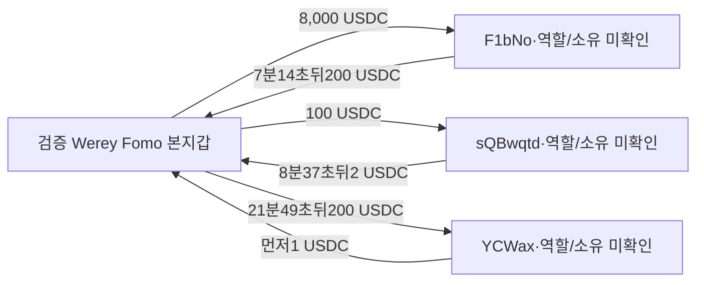

# Werey ARTHUR 외부 매수자62개와 본지갑의 직접 자금 상대

## 이번 결론

**기존 시장에서 선정한 ARTHUR 외부 매수자62개의 정확 대상 토큰 계좌 조회를 모두 마쳤다.** 이중 일부는게시전보유→게시후처분이실제이지만 Werey와의사적관계는미확인이다. 완료된것은해당계좌의고정60일성공거래query이며전체지갑/원래Top10연구완료가아니다.

본지갑USDC prefix를교차검토하면서 **기존62개와별개인3주소와의실제양방향일반송금6개**를찾았다. **F1bNo에는8,000USDC 송금 후7분14초뒤같은정확주소에서200USDC가왔고, sQBw에는100송금 후8분37초뒤2USDC가왔다.** YCWax는먼저1USDC를보낸뒤Werey로부터200을받은순서다. 이들은수수료분배swap과별개의일반전송이다.

그러나해당주소의매수·게시전재고·매도·서비스역할·소유가미확인이어서뒷지갑이나수익반환으로단정하지않는다. **연결된별도지갑의유상BUY→같은작성자게시→동일별도지갑SELL→회수·원가완성사례는0건**이다. 다음핵심은실제일반송금상대의취득토큰과작성자게시를맞추는것이다.

## 범위

원래Top10/raw141, **2026-08-08T04:43:41Z ≤ t < 2026-10-07T04:43:41Z**, 역사유통시총100만달러이하다. 모든시각UTC.

Werey 검증주소 `DmopudSGaQQenK4cW5NgmHUsexMB3sEJNn6n1EfLKs28`, USDC ATA `EiRmHBhQEx3KKXohp3rLpay5DARpshYZUqSy34XCmfWk`. ARTHUR mint `6e8LLHkqCTa4mzGuL1PoUxSfeHmDeceJ3DaJSSUNg937`/d6. 본지갑actualBUY10/2 08:00:37과보존THESIS10/3 10:33:00은별개다. 실제BUY시각이대외노출시각은아니며THESIS도절대최초공개라고하지않는다.

## 새 일반송금 상대3개

|정확상대owner|확보한방향·시간순서|실제관계|미확정|
|---|---|---|---|
|`YCWax7C3iqiBFuPJhJrSkNdTZv9ZRpCkkzrWVhHnrHm`|9/10 01:59:54 상대→Werey1USDC;02:21:43 Werey→상대200|실제양방향|소유·송금목적·취득·CEX|
|`sQBwqtdGFckvyADNs3TWXPQcGnn6R3nzFuVmmi4DpNJ`|03:40:56 Werey→상대100;03:49:33 상대→Werey2|8분37초뒤반대전송|원금반환·수익·역할|
|`F1bNo6w7c56fhTrWaQtpEPjpL54zrhEf2j4uA1dqbM4B`|23:44:51 Werey→상대8,000;23:52:05 상대→Werey200|7분14초뒤반대전송|원금사용·같은소유·역할|

6거래모두성공·실제sourceowner서명/authority·historicalATAowner·exactUSDCmint·parsedtransferChecked·양쪽잔액변화를대조했다. 각거래는compute설정과일반token transfer의outer명령2개이며innerInstructions없음이다. swap로그와Werey다른최종mint변화가없다. 현재는QuickNodeindexed원문검증이며독립제공자/직접조회는다음근거로남긴다.

같은fulladdress의반대방향전송이확인됐다는뜻이다. 거래사이상대의다른재고·자금사용이미확인이어서송금잔액이나이익·원금상환을계산하지않는다. **세주소는ARTHUR시장62매수자와다른주소**다. 조사우선순위를위해경제관계로보존하며같은개인이라고표시하지않는다.

유사YCWaCN/sQBwBz/F1bNY의0.0001/0.001USDC전송은다른정확주소이며위상대와병합하지않았다. 기타보존3y양방향(22입금301,967.187735/1출금60,000USDC)은기존근거이며새case로중복추가하지않았다. 공유F7 Relay/7u집계서비스의전체흐름도Werey에게귀속하지않는다.

## 마지막5개 매수자

|owner축약|조회행|게시전BUY/SELL|게시시ARTHUR|게시후BUY/SELL|최종관측ARTHUR|조회상태|
|---|---:|---:|---:|---:|---:|---|
|`CS4Ra…NyUd`|60|57/0|30,121,906.732082|0/3|25,040,520.198742|지정조회 종료|
|`CsU7p…35t7`|1|1/0|8,483.663499|0/0|8,483.663499|지정조회 종료|
|`ErQL9…jH3P`|21|5/4|1,981,667.135153|4/8|0.000000|지정조회 종료|
|`F6ojs…eeLc`|3|1/1|0.000000|0/0|0.000000|지정조회 종료|
|`Fanex…cukd`|8|2/0|118,164.058596|5/1|261,992.522585|지정조회 종료|

### CS4: 게시전물량에서부분매도

CS4는정확계좌opening0에서57BUY/0SELL로 **30,121,906.732082ARTHUR**를확보했고THESIS까지보유했다. 본지갑actualBUY직전이미28,388,974.025917을보유했다. THESIS후추가매수없이3SELL에서 **5,081,386.533340ARTHUR**를처분하고 **2,785.420407USDC**를받았다. 마지막25,040,520.198742ARTHUR는남아있다. 전량청산·전체수익사례가아니다. 작성자의사적연결은미확인이다.

ErQL은게시당시재고가있으나이후4BUY/8SELL이섞여기존lot만의매도·원가를분리할수없다. Fanex도추가매수와전량0후새매수가섞였다. CsU7은8,483.663499를보유한다.

F6o는 **10/2 08:02:05**에294,430.926582ARTHUR를182.443895USDC로취득하고 **08:22:01** 같은수량을전량매도해172.278874USDC를받았다. Quote차이는 **−10.165021USDC**이며게시전왕복이다. 토큰계좌종료1행은매매로세지않았다.

새93행은 **75BUY/17SELL/잔액변화없는1행**, 모든실제quote는USDC다. 중간wSOL왕복을추가원가나최종취득으로세지않았다. 시총은 **3적격·72보류(직전양수표본없음40/300초초과32)**,초과제외확정0. 적격은CS4 actualBUY2·F6BUY1의개별시점이며THESIS시총승인은아니다. 기존2286/2893/2933승인과THESIS보류유지.

## 본지갑20,000행은부분조회

새USDC queryraw3143–3162는고정60일요청이지만20페이지이후커서 **`446194389:216`**가남았다. 확보실제범위는 **8/24 01:46:19~9/11 15:46:00**이다. 고유signature20,000·ownerUSDC연속잔액19,999대조에서차이0을확인했다.

62매수자와의exactUSDC교차는3개뿐이며모두다른유상swap안의fee/service대안이다.8vEu1.8/AHs0.38/3oe0.3996USDC=**2.5796USDC**다. 이prefix는10월ARTHUR구간에닿지않아전체관계부재로사용하지않는다.

마지막5개targettransaction안의Werey지급11개합 **13.684656USDC**도수수료·추천분배대안이다. **일반송금6개와same-route지급을분리**하고소유권graph로승격하지않는다.

## 전송6개의검증링크

|UTC|source→destination 축약|USDC|실제거래·원문|
|---|---|---:|---|
|2026-09-10T01:59:54Z|`YCWax…nrHm`→`Dmopu…Ks28`|1.000000|[확인](https://solscan.io/tx/64DKBzdCmmozSuCHbNR4VdgAzPqsuu7CnGT9D3z7MFEqJFQZZ3jEu88XPUZAfRZMqnQfCdpBkXFV5HD1cvazG2oh) · raw3160 /response/result/data/392/transaction/message/instructions/1|
|2026-09-10T02:21:43Z|`Dmopu…Ks28`→`YCWax…nrHm`|200.000000|[확인](https://solscan.io/tx/pVbznACqw92NAbiwhaUuSLLnXjeiNLNNCTsRLY6PTE5CGR1bDUn7krNDz8pstYvS3J5ZJk5B3xuBB2fzDN2BspQ) · raw3160 /response/result/data/420/transaction/message/instructions/1|
|2026-09-10T03:40:56Z|`Dmopu…Ks28`→`sQBwq…DpNJ`|100.000000|[확인](https://solscan.io/tx/y7XFuCbcQTTMMUzsZ2QCxJyyNCD1qsh4i9GvYFrUwHbjM3mwiZh4M96MZVGkjDu7v6Fdg4FBV8B3dj1gNYZ6bwS) · raw3160 /response/result/data/521/transaction/message/instructions/1|
|2026-09-10T03:49:33Z|`sQBwq…DpNJ`→`Dmopu…Ks28`|2.000000|[확인](https://solscan.io/tx/5j6NrLFapFUbM1vqRyq2vgGqYcu5pcu6KuQS3zpnvP9ByPkYdjZxKbNZVMCNqB9H3TnLguhjQCQ1ciYwZV9PTssz) · raw3160 /response/result/data/540/transaction/message/instructions/1|
|2026-09-10T23:44:51Z|`Dmopu…Ks28`→`F1bNo…bM4B`|8,000.000000|[확인](https://solscan.io/tx/4iAYy8JVVnVFg2MceLVARCsgUmreToZ8YMEAJB8bwxU5JGN4aufWwU7yEoixeerWBdjzpmYtr6ywpgxT3QPLZBNn) · raw3161 /response/result/data/865/transaction/message/instructions/1|
|2026-09-10T23:52:05Z|`F1bNo…bM4B`→`Dmopu…Ks28`|200.000000|[확인](https://solscan.io/tx/55Uig5k7mo5VUSB3ubR2FpFGzDRcjNHgjHELYDPgfn6PgxyM9v9eP4qFQKu4MqmjgztrUm86HdKLGvXwaGmC6522) · raw3161 /response/result/data/875/transaction/message/instructions/1|

## 저장과다음조사

RPC30/30,기타외부요청0·5Luna/maxRO/network0. 신규swap85·실제TRANSFER6을추가해 **trades4,213/edges440/states61**이다. 기존7swap·60states·11wallet resolutions·4128trades·434edges·Fomo1338/구간404/match73을보존했다. 원문·cap·목적소유unknown·미완커서는additive로저장했으며walletresolution변경0이다. 시총raw3168/근거raw3169/검토raw3170,state `initial_top10_arthur_all62_and_author_USDC_counterparty_review_v1`.

다음은 **F1bNo/sQBw/YCWax 실제취득과같은작성자토큰게시의교집합**부터확인한다. 서비스인지여부·tokenquote·역사시총을먼저분리하고,같은토큰/게시전취득/게시후처분이확인되면그회수와CEXendpoint를이어간다.

ARTHUR관련9/29~고정종료의본지갑quote를별도로조회해62명과실제자금연결을우선대조한다. 이전20kprefix커서는보존하며별도window종료를60일종료로표시하지않는다. 기존62query·전체시장·pooledservice를재수집하지않는다.

원래Top10공개기록/BUY-only/native/quote/cap의미확보gap은남아있고연구전체는계속진행중이다. 소유·서비스역할·CEX고객·악용의도·수익은미확정이다.
