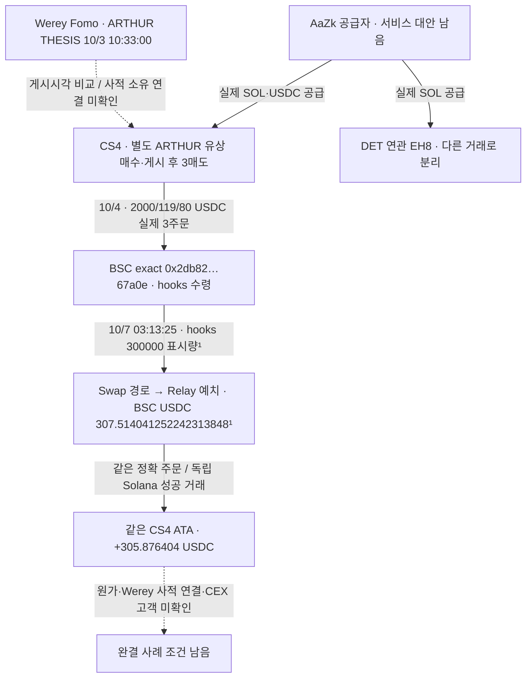

# CS4의 BSC 토큰 처분과 같은 Solana 주소로의 실제 반환

## 확인한 사실

**CS4가 Solana에서 보낸 세 주문의 실제 BSC 수령 주소가 토큰 일부를 처분했고, 같은 주문의 USDC 지급이 CS4의 정확한 Solana 계좌로 돌아왔다.** 주문 ID와 양쪽 성공 거래를 대응했다. 거래 구조상 연결은 확인됐지만 Werey의 사적 뒷지갑 또는 같은 사람 소유로 확정하지 않았다.

대상은 원래 Top10/raw141, 고정 **2026-08-08T04:43:41Z 이상–2026-10-07T04:43:41Z 미만**이다. 아래는 UTC이며 이번 실제 처분은 종료 시각 이전이다.

## 거래를 직접 확인하는 근거

|단계|정확 주소·자산·수량|근거|
|---|---|---|
|BSC 토큰 처분|`0x2db82e57590ae114bcea64a937de2d38b4167a0e` → Relay Router V3 라벨 주소, token `0x07bcb8e8226f671300e135b4a61dc157359b7777`, raw **300000000000000000000000**|[BscScan 거래](https://bscscan.com/tx/0x217b6f631511e1e5672a299b456201a8362b5b3355e77fd8f6e1340a4c1e8715) · receipt3381/header3382|
|BSC quote 예치|`0x4cd00e387622c35bddb9b4c962c136462338bc31`, depositor2db, USDC token `0x8ac76a51cc950d9822d68b83fe1ad97b32cd580d`, raw **307514041252242313848**|같은 receipt 로그48 · 정확 order ID 복원|
|실제 Solana 반환|`CS4RaxAyQYes9fHStTXc1hErzhByVsxWDKaASnigNyUd`의 ATA `C21J3rVdDtfgrg7Z3EGSsS1S7zFsx5LmjUnjMHsKgfJk`, canonical USDC raw **305876404**, decimals6|[Solscan 거래](https://solscan.io/tx/2vCzKY15phwePMdU3QNoiveKZSvanfA94WFcWAnvrf2t42Jkuvx146X4iyQ61FaH8oP8a6or2i3BKNnuZu6rMESx) · 기존 완전 raw3293 data166 재사용|

¹ hooks명·BSC 토큰18decimals는 provider assertion이다. primary 근거는 정수 raw와 성공 receipt이며 과거 토큰 공급·잔액·decimals 전체를 독립 검증했다고 주장하지 않는다.

정확 주문은 **`0xae5981189d029dd1dba98999c1cfe33faaf5e51220b3b11ec604d760a1d36ba9`**(Relay raw3384 success)다. source origin의 chain56·depositor·quote 주소·실제 예치량·source transaction이 receipt와 일치한다. destination chain792703809의 실제 fill signature는 Solana 원문과 일치한다. Solana 첫 memo가 정확 order ID, 두 번째 memo가 provider request/operation ID다. origin onchain ID는 또 다른 값이므로 이 세 ID를 합치지 않았다.

Solana transfer source의 역사 owner와 signer는 공용 지급자 F7이다. 목적지 역사 owner는 CS4이며 USDC 잔액 **85.097073 → 390.973477**, 순증 **305.876404**와 실제 instruction이 일치한다. F7 전체 pooled 금액을 개인 자금·새 사적 공급 edge로 등록하지 않았다.

BSC의 top-level sender는2db가 아닌 실행자이고 UserOperation 경로다. hooks의 로그상 처분과 swap/quote 라우팅,2db depositor의 실제 예치를 함께 연결했다. quote는 router에서 예금 계약으로 갔으며2db 자체 USDC 잔액 순증으로 쓰지 않는다. provider의 원래 견적307.577…/305.530547 대신 실제 source deposit과 destination delta를 사용했다.

두 체인의 quote 수량 차이나 토큰 처분 금액은 매입 원가·수수료 전체·USD 실현 수익이 아니다. 앞선 세 주문 lot과 나중에 들어온 다른 자금을 구분할 완전한 BSC 이력이 없으므로 이300k 전부를 특정 앞선 주문의 물량으로 지정하지 않는다.

## DET 접점의 재대조와 중복 정정

DET의 exact USDC saved cursor를500행 이어 확인했다(raw3380,9/6 17:01:32–20:36:20). DET→기존 연관 지갑 EH8의100,000·25,000·50,000 USDC 세 transferChecked는 source authority/역사 owner/실제 delta가 맞지만 **기존 raw877 graph edge 세 건과 같은 거래**다. 신규 관계로 추가하지 않았다. Agm 비용 후원 signer는 실제 DET authority와 분리했다.

EH8 exact USDC ATA raw2453의661행과 raw2457 빈/null footer는 이미 지정60일 query 종료 근거였다. 워커가 footer를 놓친 권고로3386을 한 번 재요청했으며 결과도 빈/null이다. **새 coverage0·불필요 중복 RPC1**로 남기고 과거 기록을 지우지 않았다. 이후 재조회 대상에서 제외한다. EH8 모든 자산/평생 이력 완전성을 뜻하지 않는다. DET exact ATA는 여전히 다음 cursor **444885063:1439**가 남았다.

## 조회 범위와 남은 판단

BscScan의 주소별 최신25 token rows에서 실제 source hash를 찾았다. 전체 이력 링크 클릭은 접근성 프레임 오류로 실패(raw3385). 독립 BNB RPC receipt/header는 성공했지만 역사 getLogs는 공식 endpoint disabled 또는 public archive 등록 필요(raw3373/3378)다. 접근 실패를 거래0으로 해석하지 않는다. Google 공식 지원 데이터 목록3372에서 BSC를 확인하지 못했으며 다른 제3자 데이터셋 전체 부재를 단정하지 않는다. 신규 BigQuery 실행0.

CS4는 후속 두 ARTHUR BUY의 cap만 적격(raw3168)이다. 첫 BUY와 Werey THESIS의 cap은 pending이고 실제 Werey 사적 원금 연결은 미확인이다. 실제 자금 연결이 있는 F1b PURR/SI의 역사 cap도 pending이다. **엄격한 저시총 완결 사례0**, 소유·의도·CEX 고객·원가·USD PnL은 unknown을 유지한다.

## 저장과 다음 추적

근거raw3393/검토3394/cap3392, state `initial_top10_CS4_BSC_disposal_and_exact_Solana_return_review_v1`. 신규 canonical BRIDGE1개로 edges481/states68, 기존67states/11wallet/4540trades/480edges/Fomo1338·고정404/matches73를 보존했다. 워커5개 Luna/max는외부0·읽기전용. 실제 RPC6/30,Bridge1/5,Chrome3/4,문서5/5,나머지0이며 남은예약 해제. 목표는 진행 중이다.

다음은 원래 Top10의 아직 닫히지 않은 정확 계좌 이력과 실제 연결된 별도 지갑의 같은-token paid BUY/게시 재고/SELL이다. 요청 전에 모든 기존 coverage/footer를 대조하고, closed EH8/Werey/62buyer와 pooled 공급자 전체 fanout은 반복하지 않는다. BSC 전체 역사 접근 공백과 cap/private author 관계를 명시해 둔다.
