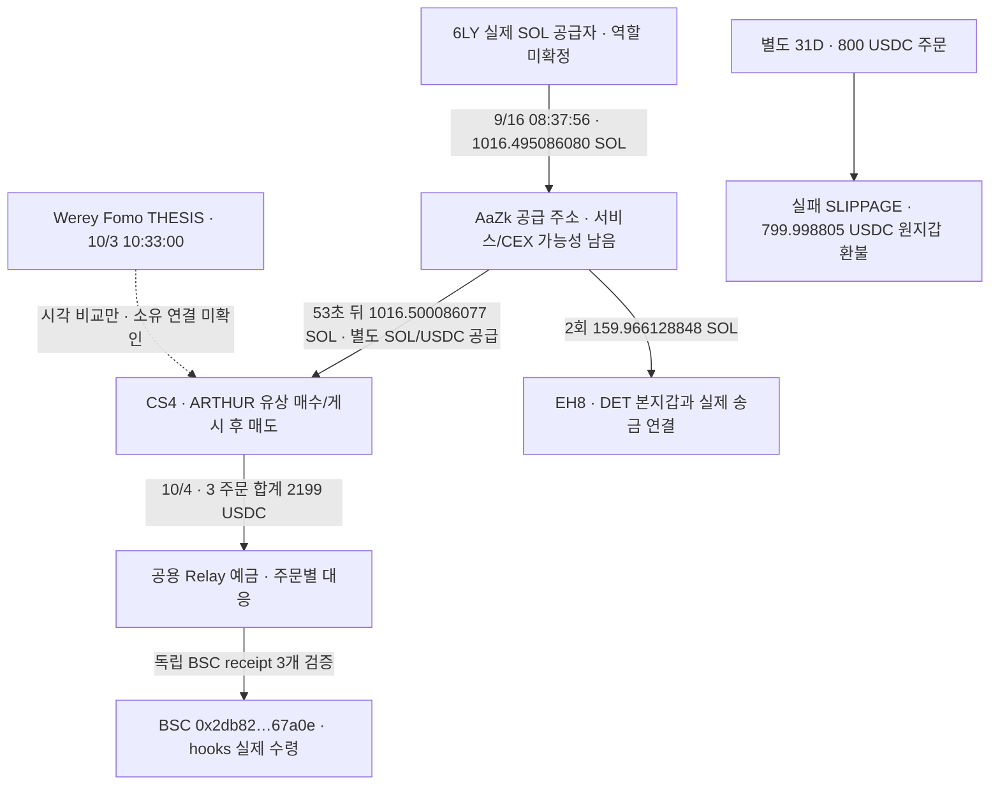

# Werey ARTHUR 후보 CS4: 실제 크로스체인 도착·공급자·환불 검토

## 이번에 확인한 사실

**CS4의 마지막 ARTHUR 매도 뒤 2,000·119·80 USDC 주문은 모두 성공했고, BSC의 같은 정확 주소에서 hooks 토큰을 받았다.** source 명령의 주문 ID, Relay 주문, 독립 BNB RPC receipt/header를 연결했다. 공용 Relay 예금 주소에서 추적이 끊겼던 부분을 거래별로 복원했다. 도착 자산은 토큰이며 CEX 입금으로 분류할 근거는 없다.

반면 다른 ARTHUR 매수자31D의 800 USDC 주문은 slippage 환불이다. Ethereum의 예정 주소를 실제 수령·매수·CEX 회수로 표시하면 잘못된 연결이 된다. 실제 환불799.998805 USDC를 Solana 성공 거래로 확인했다.

원래 Top10/raw141, 고정 **2026-08-08T04:43:41Z 이상–2026-10-07T04:43:41Z 미만**을 유지한다. 아래 시각은 UTC다. CS4는 Werey Fomo 지갑으로 검증된 주소가 아니다.

## 연결 구조

AA가 둘에게 송금했다는 사실은 확인됐다. AA의 조회 구간에는 많은 다른 상대가 있으므로 이 연결을 동일 개인·사적 공모로 해석하지 않는다. Werey와 AA/CS4의 사적 원금 연결은 아직 확인되지 않았다.

## CS4의 실제 BSC 수령

source owner `CS4RaxAyQYes9fHStTXc1hErzhByVsxWDKaASnigNyUd`, source USDC 계좌 `C21J3rVdDtfgrg7Z3EGSsS1S7zFsx5LmjUnjMHsKgfJk`. actual destination **`eip155:56 / 0x2db82e57590ae114bcea64a937de2d38b4167a0e`**, token **`0x07bcb8e8226f671300e135b4a61dc157359b7777`**.

|출발 UTC|실제 source 지급|실제 recipient token net|검증|
|---|---:|---:|---|
|2026-10-04T03:29:56Z|2000 USDC|2466110.817000346939497774 hooks¹|[BSC 거래](https://bscscan.com/tx/0x8fc85c9dadb6e75dbb30115870ed59383d5f99da221d46223a92ebcc9c7ad165) · 주문raw3326/receipt3350/header3351|
|2026-10-04T03:30:07Z|119 USDC|126630.722386779175647916 hooks¹|[BSC 거래](https://bscscan.com/tx/0x1fa335a14b7683c8bc32358f15e50982f5be5224a6cd1d38ae37ba336597548f) · 주문raw3327/receipt3352/header3353|
|2026-10-04T03:32:01Z|80 USDC|107597.31306141897284249 hooks¹|[BSC 거래](https://bscscan.com/tx/0x1ca59354b350731372f5859a325fb5a8d6d7a354f66b2640335668a00832e173) · 주문raw3337/receipt3354/header3355|

¹ 토큰명·기존18decimals는 Relay의 assertion이다. latest RPC decimals18도 확인했지만 역사 상태 eth_call은 unsupported였다. 정수 raw가 일차 근거이며 과거 decimals 저장값까지 독립 검증했다고 주장하지 않는다. receipt는 세 토큰 Transfer와 성공 상태·block/header 시각을 독립 확인했다. 합계 raw는 **2700338852448545087988180**다.

각 source명령은48bytes DepositToken의 amount와 orderID를 복원했고 provider의 출발 signature/amount/depositor 및 목적지와 맞췄다. 공용 Relay 금고의 다른 자금 전체를 귀속하지 않았다. 기존 CS4 USDC에는 매도 전 자금과 다른 swap 유입이 있으므로2,199 전부를 ARTHUR 수익으로 계산하지 않는다.

현재 목적지 code는 `0xef0100e6cae83bde06e4c305530e199d7217f42808555b`로 비어 있지 않다(raw3359). 이를 과거 code-free EOA·개인 소유·CEX 고객 주소라고 단정하지 않는다. 주소의 후속 처분·quote 수령·거래소 회수는 다음 추적 대상이다.

## 공급자의 실제 상류와 다른 연구 계정 접점

9/16 08:37:56 `6LY1JzAFVZsP2a2xKrtU6znQMQ5h4i7tocWdgrkZzkzF`→AA **1,016.495086080 SOL**. source signer·ordinary System transfer·source 수수료5,175 lamports·목적지 순증을 확인했다([거래](https://solscan.io/tx/4FbhcbSFEQhejeKk47H8yjnaoPQu79fap9H4iMy7YJYEBRHk5aFj8TA7ySDMbQXxTvKo7vgHqzX9YuYVSYoh6NbL), raw3331 data35/직접3346). 53초 뒤 AA→CS4 1,016.500086077 SOL이다. 액수 차이는0.004999997 SOL이며 AA의 선행 잔액649.203934260 SOL도 있다. 단위 자금의 동일 lot·소유·목적을 확정하지 않는다.

AA의 공급 직전 두24시간 window는 각각2,037·2,010행과 empty/null footer까지 확보했다. 일반 native 송금 형태의 유의미한740 legs, distinct counterparties656개가 있지만 이들을 개인 뒷지갑으로 등록하지 않는다. swap 표시가 없다는 것만으로 서비스 가능성이 사라지지 않는다. 두 window의 Werey/F1b 키 또는 historical token-owner 사적 송금 교차는0이다. 전체60일·lifetime 부재를 뜻하지 않는다.

73,992.466501 USDC 공급 전60분61행+footer에서는 첫 반환 거래 전부터152,948.973442 USDC가 있었다. 큰 신규 유입 없이 보유 자금에서 공급됐으므로 이전 축적 출처가 남아 있다. 이 구간 역시 Werey/F1b 사적 송금 근거를 찾지 못했다.

기존 저장 원문2459를 새로 대조해 **AA→DET 연관 실행 지갑 EH8**의 실제 송금2개를 추가했다. EH8은 `EH8pNWx5K5vCnnrNrraB4wR3ntJa3EUAV5rTH1Eq1KX`, 검증 DET 본지갑은 `EC2f5DnHzuNRit1ExqghSifDbp1wgrzktsRRZCtU92MJ`이며 이 둘의 기존 ordinary 송금 근거를 재사용한다.

|UTC|AA→EH8 실제 수령|거래|
|---|---:|---|
|2026-09-12T07:24:48Z|48.59651006 SOL|[거래](https://solscan.io/tx/Jg3ZfVxKU2cYTJBp2iqxppZRmo3VqU3HV8YgPGDX2B9xuh4b3aD36zBpFbnqpka6Eed2icB8qkAmX5Bms2ZBfzJ) · raw2459|
|2026-09-18T07:11:37Z|111.369618788 SOL|[거래](https://solscan.io/tx/5N9Dh4kZRAZhihyPYdDK55wBK2JrF2xszggRGZ2beS6rCj4gUkeSzBSfygWGogv2FPC7JqBDiqq8RD61y5Kf21Yz) · raw2459|

합계159.966128848 SOL. **AA→CS4와 AA→EH8의 공통 공급 접점은 실제 전송으로 확인되지만 AA의 역할·고객·소유는 unknown이다.** Werey와 DET가 같은 사람이라는 근거는 아니다. 6LY explorer 방문3349는 보안 확인 화면으로 라벨을 얻지 못했다.

## 실패 주문을 실제 매수로 오인하지 않기

31D exactorder `0x52edc89b9cfc8f1d84d363daf767523387b9407072121ecb3e3b8cc2b1982d96`(3360)은 status refund, fills0, failReason SLIPPAGE다. Ethereum 예정 recipient `0x97f9df192006fd220ba8fbb336a8bb90b73243b1` 및 ROUTED asset은 **미실행**이다.

실제 F7→31D 환불은10/3 15:40:33 **799.998805 USDC**([거래](https://solscan.io/tx/4u2MP5ZFJvrxofJMVVzzPLFDnAAQHdXu3x1GTHudVC93eeCTmxy34VtEaNpHrUSdc8iM7qKmmFPkWgd7ANBmqTYK), 직접3361). 역사 owner·authority signer·목적지 순증을 확인했다. 800과의 차이0.001195 USDC는 주문 차액이며 USD 손익으로 분류하지 않는다. CS4의 실제 BSC 수령 주소와 공통 CEX endpoint 근거도 없다.

## 시총·판정·저장

CS4의10/2 01:03:22·32 실제500/250 USDC BUY만 기존cap 근거2274/3168로 적격이다. 첫 BUY와 Werey THESIS cap은 계속 pending이며 hooks 수령을 새 저시총 사례로 승인하지 않았다. 31D의 별도600BUY 적격2893 역시 첫 매수·THESIS 전체로 소급하지 않는다.

근거raw3368/검토3369/cap3367, state`initial_top10_CS4_crosschain_and_supplier_role_review_v1`. 신규 실제 edge7개(기존 일치0개 재사용), trades4,540/Fomo1,338·고정404/11wallet resolution/이전66states/473edges를 변경하지 않고 additive로 보존했다. 작업자5개 Luna/max 외부 요청0. RPC28/30, Bridge5/5, Chrome1/1, 문서5/5이며 unused RPC2를 해제한다.

Nodit BNB401·PublicNode403은 capture하고 해당 source를 중단했다. 공식 BNB RPC는 receipt/header 성공, historical eth_call3357은 -32000 unsupported라 과거 상태 요청을 더 보내지 않았다. Relay429는 단 한 번 bounded 재시도해서 주문3337을 회수했다. 이 실패들은 데이터 부재와 구분한다.

**엄격한 저시총 완결 사례는 아직0이다.** 실제 별도 지갑 매수→게시→매도 후보 및 quote 이후 crosschain 취득은 설명할 수 있지만 Werey의 사적 소유 접점·최초/공개 당시 cap·정확 CEX customer·원가·USD 수익은 미확정이다. 목표는 진행 중이다.
