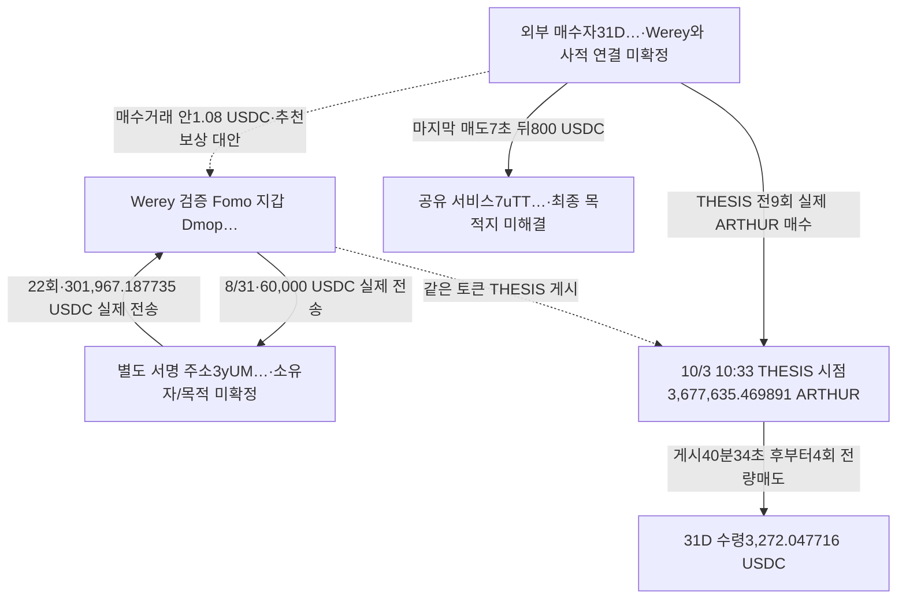

# Werey: ARTHUR 외부 매수자의 게시 후 매도와 반복 송금 지갑

## 현재 결론

**외부 주소31D가 실제로 ARTHUR를 매수하고 Werey의 THESIS 시점까지 보유한 뒤, 게시 이후 같은 주소에서 네 번에 걸쳐 전량 매도한 흐름을 확인했다.** 하지만31D와 Werey의 비서비스 자금 연결·동일 소유는 아직 확인하지 못했다. 따라서 완성된 “연관 뒷지갑 선행 매수→THESIS→그 지갑 매도” 사례 수는0이다. 전체 뒷지갑이 없다는 뜻은 아니다.

별도로 Werey가60,000 USDC를 보낸3yUM에서 Werey로22건·301,967.187735 USDC의 실제 직접 송금을 확인했다. 이 주소는 직접 서명하며 토큰을 거래하지만, 확보한 ARTHUR 외부 매수자와의 접점은 없다. App의 과거 매수와 나중 매도를 연결하려던 가설은 **게시 전 재고0**으로 제외했다.

원래Top10(raw141), 고정60일 **2026-08-08T04:43:41Z ≤ t < 2026-10-07T04:43:41Z**, 실제 기준 매수 당시 유통시총100만 달러 이하 조건을 유지한다. 아래 시각은 모두 UTC다.

## 확인된 구조

정확주소: Werey `DmopudSGaQQenK4cW5NgmHUsexMB3sEJNn6n1EfLKs28`, 외부매수자 `31DQLCzRVc7dFhWS2nEPVrzSm9J1kTShbA7Er9bkv1SF`, 반복송금 주소 `3yUMHknhgFgY1nL3K6BSaJVj34Sm37mzwfYLfwwk5YNC`. ARTHUR exact mint는 `6e8LLHkqCTa4mzGuL1PoUxSfeHmDeceJ3DaJSSUNg937`이다. 풀 `Ftejc2f8dKL9q9RmrtTen6aXPhNdbr8dvNvDbEx56p3H`을 Fomo 지갑으로 표시하지 않는다.

## 31D: 실제 취득, 게시 시점 보유, 같은 주소 처분

9/30 03:07:53 첫 유상 매수부터10/2 06:12:27까지9회 매수로 **4,740,902.564174 ARTHUR**를 취득했다. owner USDC 지출 합계는 **4,699.999999**다.10/2 16:32:44에1,063,267.094283 ARTHUR를 먼저 매도하고1,439.886369 USDC를 받았다. 게시 전 매도도 숨기지 않고 포함했다.

Werey의 보존 THESIS는 **10/3 10:33:00**(raw2156)이다. 당시31D의 정확 토큰 계좌 재고는 **3,677,635.469891 ARTHUR**였다. 이후:

| 실제 매도 UTC | ARTHUR 처분량 | owner 수령 USDC | 거래 | 원문 |
|---|---:|---:|---|---|
| 2026-10-03T11:13:34Z | 919,408.867472 | 920.976431 | [실제 거래](https://solscan.io/tx/H1Eusb3nSDnj6vojpLDVkqtY67Lp6P7mKfitopmr9r9MrsVgXQTPX9MVBT9Js8bk3BfQwNXe9CNHBxHBjWuXyt4) | raw2853 `/response/result/data/10` |
| 2026-10-03T11:14:45Z | 689,556.650604 | 670.871181 | [실제 거래](https://solscan.io/tx/2S5nwcByC63Sb5qidtFzHoMGYRocq43qSYe6a1Z9Mnn7L3gDEpABEvJsSwyn4pW1LjSjxutJn5CNKF6rfHabfFnr) | raw2853 `/response/result/data/11` |
| 2026-10-03T15:28:50Z | 1,034,334.975907 | 859.773318 | [실제 거래](https://solscan.io/tx/3NTSk2JWAY5Xkap1CuEny2xyKhL25P9MwL9iDcNWeHhrovN1FJkD968FWhbjqMC4BhEMtN2UbqMk7gLeMkgpzvCY) | raw2853 `/response/result/data/12` |
| 2026-10-03T15:40:25Z | 1,034,334.975908 | 820.426786 | [실제 거래](https://solscan.io/tx/467hLp3Lh9eUfUSRrJfWpNXrguFyBRpmjJYZ5ZeyraY2cU86uvVWgUQCKitxjEmJrERs58uzY1HFiYhcZNJxc2Ec) | raw2853 `/response/result/data/13` |

네 번의 매도량이 게시 시점 재고와 정확히 일치한다. 마지막10/3 15:40:25에 해당 ARTHUR 계좌 잔고가0이 됐다. 처음 게시 후 매도는40분34초 뒤다. 성공 여부·실제 signer·역사 owner·token/quote delta·swap 로그를 대조했고,14행의 인접 pre/post 잔고가 끊기지 않는다. 직접 조회raw2879도 첫 게시 후 매도를 확인했다. **직접 조회와 이력조회 모두 QuickNode이므로 서로 독립된 제공자라고 부르지 않는다.**

전체 매수·매도의 단순 USDC 차이는 **+11.934086**이다. 이는 게시 후 수익이나 USD 실현손익이 아니다. 여러 차례 다른 자산 거래·수수료·환율·노출 시점·의도·귀속은 별도이며 THESIS가 가격이나 매도를 유발했다는 증거도 없다. 보존 THESIS는 절대 최초 공개를 뜻하지 않고 실제 Fomo BUY의 대외 노출 시각도 미확인이다.

### 당시 저시총 근거

31D의 **10/2 06:03:05** 실제 매수(1,005,857.731900 ARTHUR/600 USDC)는 기존 역사 시총raw2274 `/payload/market_caps/27`의06:00 표본 **678,698.6457851097달러**, 차이185초로 운영상 적격이다. [실제 매수](https://solscan.io/tx/59ZbBkSRAEoWCn8nQWkLtYoNjYxy2TAzkCNsgKubfxQpAQ4ewXreHukTVyS5motz2sQ9bu7XAMARW5zGLXH61Eg8). 정확 mint→CoinGecko `arthur` mapping은raw2268이다. 이는 당시 제공자 유통시총 표본이며 순간값의 온체인 확정이 아니다. 적격raw2893는 **이 외부 매수 한 건**에만 적용한다.

Werey 본지갑의10/2 08:00:37 매수는 기존raw2286 승인(595,241.9577189017달러/37초)을 유지한다. **10/3 THESIS 당시 시총은 pending_cap**이며 새 외부 매수 승인으로 대체하지 않는다. 나머지 외부 매수47건은 기존 시간별 표본의 시각 차이 또는 부재로 보류다.

### 1.08 USDC는 사적 자금 연결로 쓰지 않았다

같은600 USDC 매수 거래에서31D가 Werey의 USDC 계좌로 **1.08 USDC**를 보내고 별도 계좌에0.675 USDC도 보냈다(raw2878).1.08/600=0.18%는 산술관계다. [Fomo 공식 추천 보상 안내](https://fomo.family/affiliates)는 추천 거래의 보상을 Fomo 계정에 실시간 지급하는 일반 구조를 설명한다(raw2881).

따라서 수수료·추천 보상이라는 대안이 있으며, **이1.08 USDC로 private funding·동일인·공모·카피트레이딩을 판정하지 않는다.** 이 거래가 실제 그 추천 프로그램에 속했는지, 당시 정확한 요율은 미확인이다. 지급 자체는 실제 전송으로 보존하되 역할을 분리했다.

### 마지막 매도 뒤800 USDC의 목적지

최종 ARTHUR 매도7초 뒤 **10/3 15:40:32**,31D→서비스 owner `7uTT8Xi5RWXzy7h9XL244GRgEycDYDhLjr3ZyNdXi8pZ`의 ATA `4nvJ5zWdVspxJiNZzB127U6amPH98SFFkBx2JZrAduia`로800 USDC가 실제 전송됐다. [거래](https://solscan.io/tx/2Gsw8PCjLzDgDnvpx2HGFcAxNuLUP9UZMAK7ucSfaFpj9qZoGP6xhsimXyD4iDbYm8SEoaqPkPKZJvsojwdPnKPc), 직접raw2882/기존raw2872. 프로그램 DepositToken 호출과 signer·전송·역사 수령 owner·잔액을 확인했다.

Bridge resolver raw2876은HTTP200이지만 `unresolved`, observation0이다. 주문·목적체인·수령주소·CEX 입금은 아직 연결하지 못했다. 공유 서비스의 pooled 흐름을 확장하거나800 USDC 전부를 직전 ARTHUR 매도대금이라고 귀속하지 않는다. 확보된 USDC 계좌에는 다른 토큰 거래와 자금이 섞여 있다. 기존9/26 18,335.511662 USDC 유입도raw2877에서 미해결이다.

## 다른 외부 후보는 게시 전에 이미 처분

| 주소 | 게시 전 유상 매수 | 게시 전 매도 | 보존 THESIS 재고 | 게시 후 매도 | 정확 계좌 최종 처분 UTC |
|---|---:|---:|---:|---:|---|
| Hqee… |10|8|0|0|10/2 19:27:56|
| EFkr… |29|16|0|0|10/2 17:51:17|

두 후보를 게시 후 처분 사례에 넣지 않는다. 셋 모두 확보한 정확 ATA에서0으로 시작해0으로 끝난다. 다른 자산·다른 주소 전체 잔고가0이라는 뜻은 아니다. 기존613행의 시장 구간은10/2 06:00:37~09:00:37이며, 그 안의 실제 외부 매수자62개 중 이번에는3개를 우선 검토했다.62개 전체의 연결 부재를 선언하지 않는다.

## 3yUM: 실제 반복 자금 연결은 있으나 ARTHUR 연결 없음

Werey→3yUM **8/31 18:13:08·60,000 USDC**를 raw209 `/result/data/89`와 직접raw2883으로 확인했다. [실제 거래](https://solscan.io/tx/5yiNGMwSpUkcb7jhT37Nx5D7KkPtVqNxn8DhuhbdigxjLwLzweMzLyySvb9qXFSKZVkYLp877TW8ZPpXL7XiC2yr). raw209는 top-level `result.data` 구조와 compiled 명령이며, 새 jsonParsed 조회와 대조했다. Wrapper를 잘못 읽고 빈 원문으로 취급한 초안은 정정했다.

3yUM의 고정구간577행 중398행에 직접 signer로 등장한다. 그중3yUM→Werey22건·**301,967.187735 USDC**는 top-level SPL Token 전송·역사 source/destination owner·실제 authority 또는 multisigAuthority·signer·정수수량·양쪽 잔액이 맞고, 해당 거래 안에 swap 로그나 다른3yUM 토큰 delta가 없다. 단순 풀PDA만으로 설명할 주소는 아니다. 그러나 서비스·거래 실행 목적·beneficial owner·개인 관계는 미확인이다.

60,000을 보내기 전5건·137,512.586814, 보낸 뒤17건·164,454.600921이 있다. 따라서301,967.187735를60,000 원금 반환·이익으로 계산하지 않는다.577행에서 **3yUM의 ARTHUR owner delta는0**, 보존62외부 매수자에 대한 직접 SOL/USDC 송금도0이다.31D의 owner737/USDC1783행에도3yUM 접점이 없다. 이 조회 범위의 미관측이며 모든 자산·모든 ATA·다단계 연결 부재는 아니다.

### App: 시간만 보고 연결하면 발생하는 오판

Werey의 App THESIS는8/30 03:21:10, exact mint `49nkLrXi8nCZBVKsShDNasEtPe4Vn1mx9Xbr3kTa8pTL`이다.3yUM이8/13에7회 실제 유상 매수했지만 **같은 날7회 매도로 해당9,423,321,434,886 raw 수량을 모두 소진**했고, 마지막19:07:48의 잔고는0이었다. 다음 유입8/31의 pre잔고도0이다. 따라서 THESIS 때 이 옛 매수 물량의 재고는0이다.

8/31·9/5 새로 들어온12,490,406,532,575 raw 물량과9/15 매도는 **게시 후 새 재고**에 속한다. 단순히 “과거7BUY, 게시후1SELL”을 이어 선행 물량 처분이라고 부르지 않는다. 새 유입은 USDC 지출 동반이지만 기존 route 판독이 부족해 유상 BUY 분류를 보류했다. 이 잘못된 연결의 시총·전체 시장 조회는 실행하지 않았다.

같은 작성자의 확보된 Solana THESIS9개 exact mint를 비교했지만, 이 조회만으로 완성된 별도 지갑 사례는 없다. STONK·ZCAT의 유상 선행 거래는 보존했으나 이 조회의 게시 후 실제 매도는0이다.

## 확보 범위와 저장

| 정확 조회 주소 | 반환 행 | 실제 첫~마지막 UTC | 원문·종료 footer |
|---|---:|---|---|
| `Fof1nahZMhjUZiEFMxiL78D4vVr11HxpZDSkFwmoyxwM` | 14 | 2026-09-30T03:07:53Z~2026-10-03T15:40:25Z | raw2853,raw2854 |
| `HHz7YwcnFBET78RdzZVCARhW4Th6Qs5DwtEXHnfHREpw` | 18 | 2026-09-30T00:46:12Z~2026-10-02T19:27:56Z | raw2855,raw2856 |
| `8csvrd3RpaKHtVfwNBEp5WxGLyPiX8EqRzT9BM6eEEXz` | 45 | 2026-10-01T05:38:56Z~2026-10-02T17:51:17Z | raw2857,raw2858 |
| `24fiSsUdhoPnYPEpN5uiTqMcELhuw9iYWF67gwhJrMGW` | 1,783 | 2026-09-21T21:56:25Z~2026-10-06T16:00:21Z | raw2859,raw2860,raw2861,raw2870,raw2871,raw2872,raw2873,raw2874,raw2875 |
| `31DQLCzRVc7dFhWS2nEPVrzSm9J1kTShbA7Er9bkv1SF` | 737 | 2026-09-21T21:56:25Z~2026-10-06T16:00:21Z | raw2862,raw2863,raw2864,raw2865 |
| `3yUMHknhgFgY1nL3K6BSaJVj34Sm37mzwfYLfwwk5YNC` | 577 | 2026-08-13T01:50:02Z~2026-10-02T23:52:44Z | raw2884,raw2885,raw2886,raw2887 |

각 조회는 finalized/succeeded/full/jsonParsed/asc, `tokenAccounts=none`, 고정60일 경계이며 마지막 빈 페이지/null cursor로 끝났다. **해당 필터 조회의 종료이지 모든 과거 ATA·폐쇄 계좌·모든 자산·평생 완료가 아니다.** 좁은 USDC 중간 조회750행(raw2866–2868)은 전체1783에 전부 중복되므로 합산하지 않았다.

이번 사용량은 직접RPC30, Bridge2, Chrome1, 공식 문서2다. Fomo·시장자료·BigQuery·Nodit indexed0이다. Chrome Arkham raw2869는 Cloudflare challenge여서 라벨 부재를 뜻하지 않는다. 서비스·본지갑 전체 이력을 반복하지 않았고 기존 시장613행을 재사용했다.

기준 SQLite에는 새 유상 swap71건(기존6건 보존), 실제 TRANSFER25건을 추가했다. 누적 trades1,126/edges410, state54다. 기존53state·11wallet resolutions·1055trades·385edges·Fomo1338/원래Top10고정404·match73을 보존했다. 역할 미확정과 수수료 맥락은 edge에도 명시해 사적 자금 연결로 자동 승격되지 않도록 했다.

근거raw2894/검토raw2895/외부매수 적격raw2893, state `initial_top10_arthur_external_exit_and_author_counterparty_review_v1`부터 재개한다. 다음은 아직 검토하지 않은 ARTHUR 실제 외부 매수자의 정확 계좌 매수·재고·게시 후 처분과 비서비스 자금 접점을 좁혀 조사한다.3yUM은 이미 확보한577행과 retained Fomo BUY를 재사용해 동일 작성자·동일 lot의 유효한 새 접점만 검토한다. 연구목표는 계속 진행 중이다.
