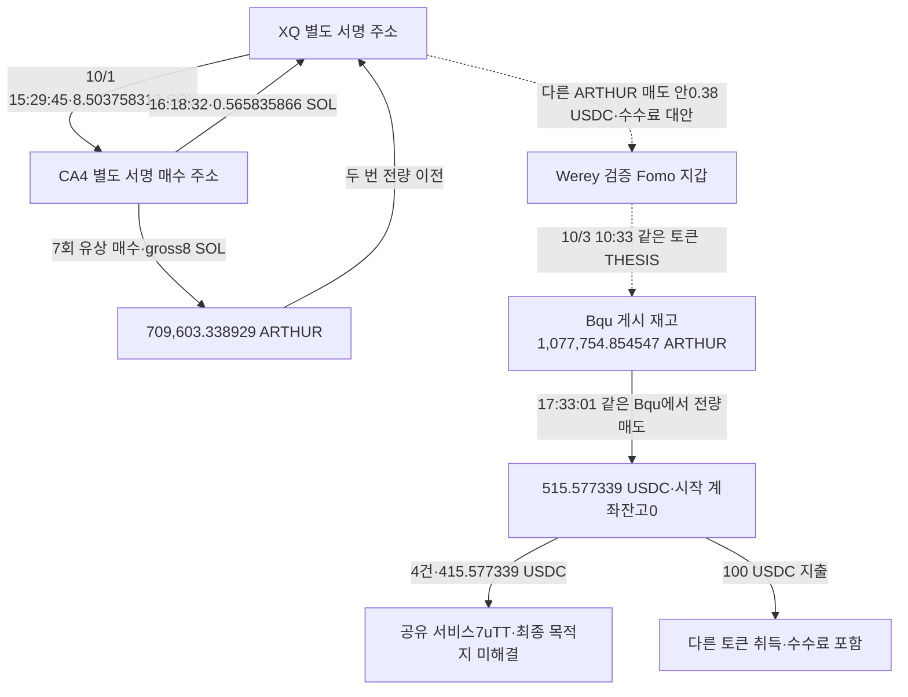

# Werey ARTHUR 별도 지갑의 매수 자금과 매도대금 추적

## 현재 결론

**외부 주소 Bqu가 Werey의 보존 THESIS 시점에 보유하던 ARTHUR 전량을 게시 후 매도하고, 받은 USDC를 서비스 전송과 다른 토큰 매수에 모두 사용한 흐름을 확인했다.** 또 XQ가 별도 CA4 주소에 SOL을 보내 ARTHUR를 매수하게 한 뒤 취득 토큰 전부를 돌려받은 자금·토큰 관계도 확인했다.

두 패턴을 Werey의 뒷지갑으로 확정할 근거는 없다. Werey와의 확보된 접점은 같은 거래 안의 소액 지급으로 수수료·추천 보상이라는 대안이 있다. 개별 브리지 주문 다섯 개도 목적지가 미해결이다. 따라서 **역사 시총100만 달러 이하 조건을 충족하는 연관 별도 지갑 매수→같은 작성자 공개→그 지갑 매도→회수·원가까지 연결된 완성 사례는0건**이며 연구는 계속한다. 이는 전체 뒷지갑 부재를 뜻하지 않는다.

대상은 raw141의 원래 초기10명, 고정60일 **2026-08-08T04:43:41Z ≤ t < 2026-10-07T04:43:41Z**다. 모든 시각은 UTC이며 보존 THESIS는 절대 최초 공개를 뜻하지 않는다.

## 확인된 주소 구조

- Werey: `DmopudSGaQQenK4cW5NgmHUsexMB3sEJNn6n1EfLKs28`
- Bqu: `BquXJFnbcSbFgrL6D88FzQTWNqA5dd8DoJHRRsDLDRmS`
- XQ: `XQvgKqsXmZKiRA6bCrnPnUSQJmzhAowtzvASQSCg32W`
- 실제 source CA4: `CA4r4rn1jBHFuEKFFrnkmfxMpmnCtxZVxGCoepn2gdvC`
- ARTHUR exact mint: `6e8LLHkqCTa4mzGuL1PoUxSfeHmDeceJ3DaJSSUNg937`
- 서비스 수령 owner: `7uTT8Xi5RWXzy7h9XL244GRgEycDYDhLjr3ZyNdXi8pZ`, USDC ATA `4nvJ5zWdVspxJiNZzB127U6amPH98SFFkBx2JZrAduia`

점선은 소유권·사적 자금 연결을 증명하지 않는다. 풀·브리지·수수료 수령자를 개인 뒷지갑으로 분류하지 않았다.

## Bqu의 보존 게시 재고와 매도대금 전액 정산

Bqu exact ARTHUR 이력은 기존raw2909의24행과 빈footer2910을 재사용했다. 게시 전 **16회 실제 매수·3회 매도** 뒤 잔고 **1,077,754.854547 ARTHUR**가 남았다. Werey THESIS는 **10/3 10:33:00**(raw2156)이다.

**17:33:01** 첫 게시 후 거래에서 그 재고를 전량 매도해 target잔고0, USDC 계좌잔고 **0→515.577339**가 됐다. [실제 매도](https://solscan.io/tx/pKD2HTrZid4jAZNEbvzGDFziwF7svhgTpDVFkf56M7pGFhSBuj26cRGBZyCpefyH1D99LjekNcxWvc2pyV1E75z). 같은 서명은 target raw2909 data19와 quote raw2938 data28에 있다. Gross USDC output518.168179에서2.590840이 다른 경로로 지급돼 owner net515.577339가 남는다. 중간 토큰·gross output을 수령액에 더하지 않는다.

그 뒤 **435초 동안 다른 USDC 유입 없이** 아래처럼 계좌가0이 됐다.

|UTC|USDC 계좌 변동|내역|
|---|---:|---|
|17:33:01|+515.577339|ARTHUR 전량 매도|
|17:33:25|−100|DepositToken 서비스 전송|
|17:33:26|−100|같은 서비스 전송|
|17:33:45|−100|같은 서비스 전송|
|17:35:55|−100|다른 토큰 매수99.05 + 별도 수수료·경로 지급0.95|
|17:40:16|−115.577339|같은 서비스 전송, quote잔고0|

다른 토큰의 exact mint는 `74yJPG3gqQByxMpKauwadXXzYGX71FX4P5AG894wFHWt`이며 Bqu 소유 ATA에 **663,466.153893**(d6) 순유입됐다(raw2938 data32). 기존 자금 정산의 맥락으로만 보존했고 새 토큰 전체시장 조사로 확대하지 않았다.

따라서 이 USDC 계좌에서의 수령과 소진은 정산된다. **415.577339 USDC의 외부 목적체인·최종 수령자·CEX·고객은 아직 연결되지 않았다.** 출금 자체를 현금화 또는 수익이라고 부르지 않는다. Bqu의 같은 거래 내 Werey0.079998 USDC 지급은 수수료·추천 보상 대안으로 분리했다. 나중10/5~6 두 ARTHUR 재매수·매도 사이클은 새 물량이며 이 게시 재고와 합치지 않는다.

## XQ가 별도 CA4에 매수 자금을 공급하고 토큰을 돌려받음

[자금 공급](https://solscan.io/tx/5TfbcVHyx5Gs9ZuxccmEA77DLYhAuRjRe36cohsh7avWGHx9Rn4tynekn93CXqkF7EGFHEnFtQ1ww1f17kTcdHXi): **10/1 15:29:45**, XQ가 직접 서명해 CA4에 **8.503758313 SOL**을 보냈다(raw2960/2957 data123/2971 data55). CA4 native balance는0.000959632→8.504717945 SOL이었다.

**4분14초 뒤15:33:59**부터16:07:52까지 CA4가7회 직접 서명한 실제 AMM 매수로 gross **8 SOL**을 투입하고 **709,603.338929 ARTHUR**를 취득했다. Exact source ATA raw2945 10행과 빈2946이 종료됐으며, 실제 route quote와 target delta를 대조했다. 첫 직접 거래raw2959는 같은 제공자 QuickNode의 다른 조회 방식으로 확인한 것이며 독립 제공자 검증으로 부르지 않는다.

첫5매수 물량 **403,860.660803**은15:39:51, 뒤2매수 물량 **305,742.678126**은16:08:45에 XQ 소유 ATA로 이전됐다. 합계가 CA4 취득량과 정확히 일치하고 source target잔고0이다. [첫 토큰 반환](https://solscan.io/tx/XJSCcWgA4YS24ZaTFoyBcchUJPad1xw1a4ksR7GWB8tk1xcjoeVDbaZFzznYuZ5zWz8w7HX2V6M8T4qckNfnpxm), [두 번째 반환](https://solscan.io/tx/3yPN5Zddi9wY2gK7ermGVn6EHibetQRUXmypTtJu2dF3vMBLn4NoGSi2DmnddcCErvBkeG1pgFGGW9C8RP4TA5gu). 원문raw2945 data5/8 및 기존2911 data5/6, 두TRANSFER는 기존canonical을 보존했다.

**16:18:32**에는 CA4→XQ **0.565835866 SOL**도 전송됐다([실제 전송](https://solscan.io/tx/5hkPZsJ77n9NYhEHzsfXZSHFdYixadZqSEXqcxNzhtvtXszfqC1VBURQk9yL5Ci3DcMLdesxxHPdsrwWAjx6efQ3), raw2967/2957 data138/2971 data73). 다만 바로 앞에 ATA 환급·excess lamports 인출·별도 pAMM cashback/wSOL 활동이 있어 **미사용 ARTHUR 매수 원금의 정확한 반환액으로 계산하지 않는다.**8 SOL은 gross 실행 원금이고 네트워크 fee·추가 송금·rent·다른 자산의 환급과 분리했다.

두 주소는 **8/13 03:18:45** CA4→XQ0.536911755 SOL 전송도 있다(raw2961/2957 data122). 이 거래를10/1 반환과 혼동하지 않는다.

이는 이번 토큰 물량에서 단순 무상 에어드롭·풀 출금이 아니라 **자금 공급→별도 주소 유상 매수→취득 물량 전량 반환**이라는 실제 관계다. 수행 대행·서비스·두 주소의 개인 소유 여부는 별도이며, Werey와의 사적 연결은 미확정이다. XQ의 보존 THESIS 재고1,831,819.944915 ARTHUR와 게시 후 추가 매수·부분 처분이 섞여 있고 최종관측4,027,114.195272가 남아, source lot 전량 게시 후 exit를 확정하지 않는다.

### 시총 조건으로 적용할 수 있는 범위

CA4의 **16:02:56 실제 매수**는 기존raw2274 `/payload/market_caps/13`의16:00 유통시총 표본 **1,308,266.6994413398달러**, 차이176초로 **100만 달러 초과 제외**다([해당 매수](https://solscan.io/tx/5d7W8jTNf2tdzViZGb3gGvcoZJ7ZN2bkKT13w8toKjdk1xX61bxTeTFAWWhbRQ94wsZX3Z1YqjFpjguYBAyBQFCT)). 나머지6매수는 기존 시간별 직전 표본과300초 이상 차이가 나므로 보류다. 표본이 기준을 넘거나 오래됐다는 결과를 숨기지 않았다. 따라서 이7건을 일괄 저시총 적격으로 승격하지 않는다. 이미 실제 전달로 연결된 known source의 기초 증명으로 보존했으며 신규 전체시장 수집은0이다.

기존 Werey 실제BUY 적격2286·31D 적격2893·GBh 적격2933은 각 매수 한 건의 승인으로 유지한다. **THESIS cap은 여전히 pending**이다.

## Werey 접점과 수수료 대안

XQ owner3,072행에서 **9/30 04:00:41** ARTHUR 매도 중 Werey 검증 지갑의 USDC ATA로 **0.38 USDC**를 보내고 다른 owner에게0.57도 지급한 거래가 있다(raw2970 data382, topix6). XQ net quote169.251062와 gross170.201062를 분리했다. [실제 거래](https://solscan.io/tx/fPypxVmbEjX2CEBCGSYXFHtp8MdDNDuJ4aj2AkXsuuw59q9En8qfZ1VLT16b93TuWKJwrAppAEVm4RB4xoudxVF).

수수료·추천 보상이라는 대안이 있어 private funding·동일인·공모로 승격하지 않았다. 공식 현재추천안내raw2881은 일반 구조이며 당시 개별 지급의 원인·요율을 증명하지 않는다. 다른 Fomo 지갑으로의 소액 지급도 매수·매도 안에서 발생한 것으로 같은 기준을 적용했다. 확보범위에서는 비서비스 Werey 공급·반환·공통 고객CEX가 확인되지 않았다.

유사 주소 `CA4rPGRhiBJdjR2vzwXmbfzAGSDYBQiwTCyPGQcB2dvC`는 실제 source `CA4r4rn1jBHFuEKFFrnkmfxMpmnCtxZVxGCoepn2gdvC`와 **다른 전체 주소**다. 3쌍의0.0001 USDC/0.000001 SOL 지급과 ATA setup을 source 관계·identity에 추가하지 않았다.

## 6X의 매도 이후 전송은 다른 사이클

기존6X exact ARTHUR34행을 재사용했다. 보존 THESIS 재고4,137,522.678322 뒤 추가매수가 섞인 상태로10/5 10:23:14에 첫잔고0을 확인했다. 전체 quote를 최초 게시 재고의 수익이라고 계산할 수 없다.

10/6의 재매수1,018,628.300954 후 두 매도는 별도 새 사이클이다. 그 마지막매도10:29:57의117.648805 USDC 수령 뒤,8초 후 exact quote계좌 전액 **118.808805**가 shared7uTT ATA로 송금됐다(raw2955/2943 data51). 기존잔액1.16을 포함하며 THESIS 물량의 exit/PnL과 합치지 않는다.

## 개별 서비스 전송과 미해결 주문

|실제 UTC|USDC 전송량|거래|직접 원문과 주문조회|
|---|---:|---|---|
|2026-10-03T17:33:25Z|100.000000|[실제 전송](https://solscan.io/tx/G9BjBNBhPWUvwnGnmWMBxxksZRPLaFFWDQFSmnKfwq3xW6yK53BLjTRDYbPFUngrmyvaY33KXVHM5NtMLXdhE6S)|raw2947 / resolver raw2948|
|2026-10-03T17:33:26Z|100.000000|[실제 전송](https://solscan.io/tx/4dkHZD24wswAUZeTdwrEDvEygyEW7dsFMZbjiKwVS1HiuKLnFwGMz3uzr8AZij7mDYyLd3n6UBtnJLC32ofz4AED)|raw2949 / resolver raw2950|
|2026-10-03T17:33:45Z|100.000000|[실제 전송](https://solscan.io/tx/2wD6tw6YDA5oNLUgGqmbkuNzdctvW4vBt5GEvjdSFM2Vyk3ih5gdzPtDygXRR3UaKrVGw4UXBBk1fF5mJMWBwFV8)|raw2951 / resolver raw2952|
|2026-10-03T17:40:16Z|115.577339|[실제 전송](https://solscan.io/tx/3jrKzk6CdJpW1k3pXohHf3zVaXgSPTFWgoX85pkB7zpGaSx2oYoNzuZcgmpAF4DXjUd9SeiWEJe8RpDSTrtdYvQX)|raw2953 / resolver raw2954|
|2026-10-06T10:30:05Z|118.808805|[실제 전송](https://solscan.io/tx/41L5kN9avqyf99oKoQGRH2ZPyLRzVDYFhsKgprWiEvTP52uDV47MwmbhL2xEkFVcrrggepmRnXNr4PZN5dyXhq1b)|raw2955 / resolver raw2956|

다섯resolver(raw2948/2950/2952/2954/2956)은HTTP200이지만 모두 **unresolved, role unknown, observation0, Relay pending_indexing**이다. Bridge 완료·목적주소·CEX 입금을 증명하지 않는다. 이미조회한 동일 unresolved 주문을 즉시 재요청하지 않고 상태변화나 실제 주문 근거가 생길 때만 이어간다. 공유 서비스의 전체 pooled flow를 개인에게 귀속하지 않는다.

Chrome에서 XQ Arkham주소를 열었으나 보안 확인 화면만 표시됐다(raw2972). 라벨 부재·개인 소유·CEX 부재의 근거가 아니다.

## 확보 범위와 저장

|조회|고유 거래 수|상태|확보 첫·끝 UTC|
|---|---:|---|---|
|BquUSDC|1,027|해당 쿼리 종료|2026-09-02T16:10:01Z~2026-10-06T21:10:51Z|
|6XUSDC|597|해당 쿼리 종료|2026-08-09T05:30:32Z~2026-10-07T04:03:24Z|
|CA4ARTHUR|10|해당 쿼리 종료|2026-10-01T15:33:59Z~2026-10-01T16:18:00Z|
|CA4owner|139|해당 쿼리 종료|2026-08-08T07:01:54Z~2026-10-01T16:18:32Z|
|XQowner|3,072|커서 미완료|2026-08-13T03:18:45Z~2026-10-07T04:32:07Z|

종료는 지정 주소·필터·고정 구간의 쿼리 회수 상태이며 모든 ATA·자산·평생 이력 완료가 아니다. XQ는 **3,072행, cursor `454116346:790`, 빈footer 미확보**라 아직 partial이다. 마지막행10/7 04:32:07은고정끝보다694초 앞선다. 반환 페이지가322행이라고 완료로 올리지 않는다.

5개Luna/max 작업자는DB읽기전용·네트워크0으로 분석했다. 본체 요청은RPC30/Bridge5/Chrome1, Fomo·시장·BigQuery·Nodit indexed·공식문서 신규0이다. 기존역사시총을 재사용했고 오래된 표본을 완화하지 않았다.

SQLite에 실제BUY7·TRANSFER8을 추가해 **trades1,486/edges423/states56**이다. 기존55states·11wallet resolutions·1,479trades·415edges·Fomo1,338/원래Top10구간404·match73을 보존했다. 새source cap review raw2978, 근거raw2979, 검토raw2980, state `initial_top10_arthur_procurement_and_quote_recovery_review_v1`다. Worker 중간 수치·quote자산·거래날짜 표현은 본체의 정확 원문 검산을 우선하며 임의wallet resolution 변경은0이다.

## 이어서 조사할 지점

1. XQ의 저장커서 마지막빈페이지와 실제 source/회수 범위를 새예약에서 닫는다.
2. 기존62외부매수자 중 exact target를 아직 검토하지 않은47개에서 공개 시점 재고·동일 주소 처분·사적 author 자금접점을 확인한다. 이미끝난15개 target와 시장613행은 재수집하지 않는다.
3. Bqu·6X 개별 DepositToken의 주문·목적지에 실제 새근거가 있을 때만 이어간다. 서비스 주소 일치를 공통 고객CEX로 쓰지 않는다.
4. 원래10명의 남은60일 기초자료·BUY-only·역사cap gap은 기존frontier를 유지한다. 단독RZD·Top100 확대는 재개하지 않는다.

완성된 뒷지갑 악용·실현수익 사례로 발표할 단계는 아니다. 지금 확인한 것은 별도 주소의 실제 자금 공급·유상 매수·물량 반환·게시 재고 처분·quote 소진의 거래 구조다.
