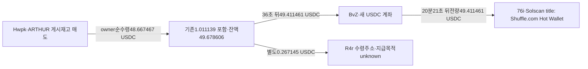

# Werey ARTHUR 세 매수 지갑의 매도대금·공급 주소 추적

## 확인한 내용

이번에 게시 후 전량매도가 확인된3oe·Hwpk·GGbK의 USDC 계좌를 **9/29 00:00UTC~고정 종료** 구간으로 받았다. 합계1,231거래와 각 빈footer가 종료했고, 기존ARTHUR55실제BUY/SELL의 target·quote·서명이 정확히 대응한다.

결과는 서로 다르다.

1. **Hwpk:** ARTHUR 매도36초 후 USDC 잔액을 외부로 모두 보냈다. 주수령주소BvZ가20분21초 뒤49.411461USDC 전량을 또 보냈다. 후속76i 주소에는 Solscan 제목상 **Shuffle.com Hot Wallet** 라벨이 있다. CEX 고객 입금으로 확정하지 않는다.
2. **GGbK:** 네매수109.986905USDC→전량매도19.765839USDC. 매수·매도의 quote순변화는 **−90.221066USDC**이며, 매도17초 뒤19.765839를 다른 토큰 매수에 전부 썼다. 게시 이후 처분은 실제지만 이익 사례라고 볼 근거가 없다.
3. **3oe:** 전량매도 뒤 기존잔액·다른토큰 매수매도·추가입출금이 섞였다. 추후서비스송금을 ARTHUR 매도대금의 직접회수라고 단순 귀속할 수 없다. 별도CYAn 주소와 실제양방향자금·다른토큰 매수·반환 관계를 찾았으나 Werey와의 사적 연결은 미확정이다.

**완성된 저시총 뒷지갑 매수→작성자 게시→같은 지갑 처분→회수·원가 사례는0건**이다. 이는 전체 뒷지갑 부재 판정이 아니다. 실제 경제 관계와 공유서비스·수수료 지급을 구분해 보존했다.

## 고정 범위

원래Top10/cohortraw141, **2026-08-08T04:43:41Z ≤ t < 2026-10-07T04:43:41Z**, 당시유통시총≤100만달러 기준을 유지한다. 모든시각UTC다. 보존Werey THESIS **10/3 10:33:00**, raw2156은 절대최초공개를 증명하지 않는다.

ARTHUR exact mint `6e8LLHkqCTa4mzGuL1PoUxSfeHmDeceJ3DaJSSUNg937`. 기존actualBUY 적격2286/2893/2933은 각실제매수 한건의 승인이다. 신규cap승인0·THESIS cap보류·새토큰전체시장/BQ0이며 실제quote·공급관계 기초검증을 진행했다.

## Hwpk → BvZ → 후속 수령주소

- Hwpk: `Hwpk5iF3FYqV5U8taQUoMWaEHhJmRGpZ48N7nfSJ5tRU`
- USDC ATA: `7ZWNC17LVeuSMVN6qZTJSH9DYQc39jbGp75LyWhb8NKC`
- BvZ: `BvZkf9zJePCBTyNJZgai6ddDMBNE2tbXSfcQUeSNGti6`
- BvZ USDC ATA: `BcRx8d6KDdexxSQAJQZZi8hnscMM1o3nXGxk1s8McJyH`
- 최종 이번관측 owner: `76iXe9yKFDjGv3HicUVVy8AYxHLC71L1wYa12zaZzHHp`
- 해당 USDC ATA: `6uFtNmyQqeKza3Tz5H93K75dKV6vZNN3sUddYDzQzbbn`

매도10/3 16:54:58→16:55:34송금→17:15:55전량후속송금이다. Hwpk quote잔액은49.678606→0, BvZ는신규ATA0→49.411461→0으로 대응한다. 두owner의 실제authority/서명·historical token-account owner·명령·balance를 확인했고 직접raw3032/3041을 같은QuickNode의 다른조회방식으로 대조했다. 독립제공자검증이라고 부르지 않는다.

BvZ exactUSDC 수령이후 **1시간쿼리2행+빈footer3038/3039**가 종료했다. 두전송 사이 다른해당계좌변동은 관측되지 않았다. 전체 지갑·평생 이력이 아니다.

Arkham BvZ 화면raw3040은 보안challenge였다. **BvZ deposit/CEX 라벨을 확보했다는 주장은 하지 않는다.** [Solscan 후속주소 페이지](https://solscan.io/account/76iXe9yKFDjGv3HicUVVy8AYxHLC71L1wYa12zaZzHHp)의 제목에는Shuffle.com Hot Wallet 라벨이 있으나 SSR본문은주소만 나온다(raw3044). 이는탐색기제공자 assertion이며고객·수탁형태·개인소유·CEX귀속을RPC가증명한것이 아니다. 공유핫월렛 전체 흐름을 따라가지 않았다.

## GGbK는 처분·손실 방향·다른토큰 재사용

`GGbKCd4xQ6K1R9ShGTS7xN1vPf3SvPzsQmwUNvd9Mx2D`는 exactARTHUR 계좌에서 이전재고0·4BUY/매도0으로 **96,899.999536**을 취득한 뒤 THESIS까지 보유했다.10/6 02:49:35 같은재고를 전량팔아0이 됐다. 기존raw3003/3004와새quote3026/3027을 대응했다.

4BUY quoteowner순지출 **109.986905USDC**, 전량SELL quoteowner순수령 **19.765839USDC**. 두leg의순변화는 **−90.221066USDC**다. 이는해당USDC출입검산이며 네트워크SOL비·USD환율·소유·의도·수익을 확정하지 않는다. 그매도안Werey0.163717USDC는수수료·추천보상대안이 있어 authorprivatefunding으로 쓰지 않았다.

**17초후02:49:52** raw3026 data272에서USDC **−19.765839**와 다른최종mint `7r1v5rZcGnyzVs1jei7FeMEiZVf4GhQgLYXjZHmMUDGQ` **+114,707,421,349raw**가 대응한다. 중간route mint를최종취득으로 세지 않았다. 기존exit의자금사용맥락만 보존했고 새mint시총·전체시장조사는0이다.

그뒤7uTT로보낸30/32.624312USDC에는 신규입금과 다른거래가 섞인다. 원래ARTHUR 매도대금이그대로브리지·CEX로갔다고 표현하지 않는다.

## 3oe 매도 이후 quote 계좌 정산

`3oe7aYLUw2Pkbm7QMAhAjn5WbzaoG9tigkrX1mAecr1P`의 THESIS재고497,033.836556ARTHUR 전량매도에서346.310900USDC가 늘었다. 기존잔액1,253.975159를 포함하면매도직후1,600.286059USDC였다.

그후시장·자금사용이 많이섞여, 확보구간마지막quote3.876221까지 다음처럼 정산된다.

|owner 축약|ARTHUR 매도직후잔액|추가순유입|추가순유출|최종잔액|후속비영변동|
|---|---:|---:|---:|---:|---:|
|`3oe7a…cr1P`|1,600.286059|7,317.568028|8,913.977866|3.876221|182|
|`Hwpk5…5tRU`|49.678606|0.000000|49.678606|0.000000|1|
|`GGbKC…Mx2D`|19.765839|191.598099|211.363938|0.000000|11|

모든수치는USDC이며 각행 `직후잔액+유입−유출=최종잔액`을정수검산했다. 이 합산이개별ARTHUR lot의 수익이나현금화완료를뜻하지 않는다.

3oe의2LAY 반대편전송은 **BuyExactQuoteIn 다른토큰매수route**다. 첫검토에서단순전송처럼보였던행을수정했고private자금회수·CEX graph로승격하지 않았다. GGbK와같은7uTT ATA 전송도공유서비스관계로만 보존했다.

## CYAn의 실제 자금·다른토큰 매수·반환 관계

- CYAn: `CYAnkArWKrdCnAHKVtazxJqQk853wWJtnEv29hD3ChwD`
- ExactUSDC ATA: `4RzCHJd3fEptviferBU8zGL9orbhjGr2q7LivTiPNwvJ`

새source queryraw3042 **17행+빈3043**은9/29~고정종료의8.197일지정계좌이력이다. 60일전체가 아니다.

1. **9/29 21:52:14**, CYAn→3oe **67.426799USDC**. 그직전CYAn의4다른토큰처분 뒤quote잔액이송금됐다.
2. **10/3 04:05:57**, 3oe→CYAn **250USDC**.
3. **24초뒤04:06:21**, CYAn이직접서명해250USDC를부담하고 `FZhXxRsFdDWqmPmEw2hFzuiUAL1wEJUJ9LZg2xS5t3vN` **21,702,486.744334**(d6)를취득했다.
4. **07:08:56**, 같은정확토큰재고를전량처분하고owner quote **319.572752USDC**를받았다.
5. **07:14:52**, CYAn→3oe **325.710688USDC**, sourcequote0.

마지막반환은그mint매도만의정산이아니다. **기존quote0.877330+매도319.572752+이어진다른mint거래5.260606=325.710688**으로섞였다. 원금상환·수익배분·같은소유자로단정하지 않는다. 세직접송금raw3045–47에서서명·historicalowner·amount를대조했다.

이두주소의실제경제관계는확인했다. 하지만해당mint는저장Fomo events와대조0·당시cap unknown·Werey와의private접점미확인이다. 해당다른토큰의전체시장·새anchor조사로확대하지 않았다. 같은swap안CYAn→3oe소액지급도수수료대안으로분리한다.

유사주소 `3oe7eA4gaL2y3j33XkpxxunzoBAwmnqSLF3VA76Gcr1P`의0.0001/0.001USDC는실제3oe와다른전체주소다. 동일인·공급·반환 graph에서제외했다. 반대편CYASPK 유사주소dust도실제CYAn과병합하지 않는다.

## 공급·공통 주소를 개인 뒷지갑으로 보지 않은 이유

새3quote이력에서F7→세주소 **7,873.032401USDC**,5tz→3oe/Hwpk **2,258.881845USDC**,세주소→7uTT **8,134.822117USDC**의실제전송이있다. 이는범위전체합이며ARTHUR 매도대금으로귀속하지 않는다.

F7는기존실제Base→Solana Relay주문정산의공유source다([이전근거](top10-prepublic-buy-and-crosschain-review.md)).5tz는기존Arkham Binance Hot Wallet assertion이다([이전근거](top10-repeated-exit-endpoint-review.md)). 같은공유source/recipient를같은개인·고객CEX로묶지 않는다.

검증Top10쪽Solstice0.54·pointfarmcap0.777421·Werey0.163717USDC접점도같은swap안의소액지급이다. 확보범위에서추가plain privateauthor 연결은확인하지못했으며 전체부재를뜻하지 않는다. 기존raw≤3020에서BvZ/76i/CYAn문자열교차0은저장자료에서의접점검색결과일뿐60일전체완료근거가 아니다.

## 개별 브리지 주문과 핵심 실제 전송

5개신규resolverraw3029/3031/3033/3035/3037은HTTP200이나모두 **unresolved·observation0·pending_indexing**다. 목적체인·주소·CEX를연결하지못했다. 즉시동일pending주문을반복하지않고실제주문변화·새근거가생길때이어간다.

|UTC|실제owner방향|USDC수량|거래·직접/보존원문|
|---|---|---:|---|
|2026-09-29T21:24:47Z|`F7p3d…gmNe`→`3oe7a…cr1P`|61.318123|[확인](https://solscan.io/tx/37Z9fhVN9ey8JFNuShynFEqTpHNtCsXd5fivRaQW5r4EQRL5wGxMSyGssg9JDCTvNVxAwBF5rJbzrPWHWt3dNzEF) · raw3028|
|2026-09-30T00:17:59Z|`F7p3d…gmNe`→`GGbKC…Mx2D`|0.684402|[확인](https://solscan.io/tx/2EdWKAW95i2AXSLcwzR12Fgazmgi2dZAsbCoXYuJ2J8goCyRWYzrpUj2s9zSjTa9LyKYcwuMXDFYsqcHc3cFTXm4) · raw3030|
|2026-10-03T16:55:34Z|`Hwpk5…5tRU`→`BvZkf…Gti6`|49.411461|[확인](https://solscan.io/tx/2N2uAAoWibgrdeASfatUYbFEFacVXwJ5nVdcDEwZKyCQMPi4aHxGgv9p3mjbUWRYVJ1QmB74a9VUYmiVZsj4LPv8) · raw3032|
|2026-10-03T17:15:55Z|`BvZkf…Gti6`→`76iXe…zHHp`|49.411461|[확인](https://solscan.io/tx/387b5b3sH9XL9TdypTaauwDBwLiWMv8uyZYbCxNWoJyGQBNnpCg7EDb8Yk3oYFP1ijJ2TGH9ptTH5fnJ5wUh5vvK) · raw3041|
|2026-10-04T06:04:14Z|`3oe7a…cr1P`→`7uTT8…i8pZ`|100.000000|[확인](https://solscan.io/tx/3cxq9dppyb7G9tnmhsQY6aq57mPnuuWGNonruBBygiHRjhLVfwghbbrcvvJbaWWXBjBfDgC1KWC6LyUVGdRsqujS) · raw3034|
|2026-10-07T01:28:24Z|`GGbKC…Mx2D`→`7uTT8…i8pZ`|30.000000|[확인](https://solscan.io/tx/2eK143AB547o1dPcBRXTXonzwr9fHRCHwYc2waCSE28adpacij1x1xfia4oSmSnddpBLcF2uoGYJDbse6kSZNanD) · raw3036|
|2026-10-07T03:01:32Z|`GGbKC…Mx2D`→`7uTT8…i8pZ`|32.624312|[확인](https://solscan.io/tx/bLGpX9VeDS9dZ3itrfTmrj8RrkuBkPPTE4TV1PCT5mdkF2UWLNKHLUhz21hNxHL4aXUvg93iPGny6Vkmh1Nv2rz) · raw3026|
|2026-10-05T13:38:50Z|`3oe7a…cr1P`→`7uTT8…i8pZ`|37.000000|[확인](https://solscan.io/tx/5FSLdHAtjgapMz8mDkYcQZeEcV78WzZtfLWraG9sDA36EmdSDe36jRuNmxLyq5YDo1PcjyWgg8t9NWBQLNaZuWZq) · raw3022|
|2026-09-29T21:52:14Z|`CYAnk…ChwD`→`3oe7a…cr1P`|67.426799|[확인](https://solscan.io/tx/5qienzrxvdPTiqTvzmQ3m4NZES5LgpnhzLVp6cDXLDf2BfG4QpF7SjJ7iyLPndy8BoCYzk9hF62SRLA7vRJRzJqy) · raw3045|
|2026-10-03T04:05:57Z|`3oe7a…cr1P`→`CYAnk…ChwD`|250.000000|[확인](https://solscan.io/tx/5GD7pan84U6RiW6DWNRfjmAfdGPg6yJiYPFHr72QbkxPvgNqe1yqNvMsg65wWmQXxwYLdAbPAZ5nnVSz2ZHF8b8y) · raw3046|
|2026-10-03T07:14:52Z|`CYAnk…ChwD`→`3oe7a…cr1P`|325.710688|[확인](https://solscan.io/tx/4LAsY8HQCw7uxy9F9u1NHEEKfxBYgsi5c6T7jMNsxM2yNhb7D8keaDZBFeap6QevtnDv92d8fBVTS1V57seBwjLf) · raw3047|

표의서비스전송은실제leg와roleunknown을보존하며privateauthor/동일고객관계를증명하지 않는다.

## 저장·범위·다음 작업

본체RPC20/Bridge5/Chrome1/공개label1, 작업자5명Luna/max는RO/network0이다. 신규Fomo·시장·BQ·Nodit indexed0. 남은RPC10예약은해제했고실패와무한재시도는없다.

새TRANSFER11만additive적재해 **edges434/trades1852/states58**이다. 기존57states·11wallet resolutions·1852trades·423edges·Fomo1338/원래Top10구간404·match73은보존했다. 근거raw3053/검토raw3054, state `initial_top10_arthur_threebuyer_quote_exit_and_source_review_v1`. 신규 token 거래·wallet resolution변경0, 캡판정도유지한다.

이번quote3개8.197일쿼리종료는60일목표완료가아니다. 3oe의기존USDC1000행prefix는8/29 15:14:52까지cursor442638179:241이고, 이번9/29 시작query와사이gap을남겨둔다. 전체원래10명의공개기록/BUY-only/역사cap/체인coverage도미완료다.

다음우선순위는 **기존62외부매수자의나머지34개에서실제privateauthor경제접점을찾는것**이다. 이미종료한28target·이번quote·BvZ1시간·CYAnquote는재수집하지않는다. 같은서비스에연결되는행을늘리는것보다개별서명·취득재고·실제작성자연결을우선한다. 별도RZD·Top100확대는재개하지않는다.

현재까지두주소의경제관계·게시재고처분·서비스회수경로는보고할수있지만, 작성자의뒷지갑이게시를악용해수익을본완성사례로발표하지않는다.
